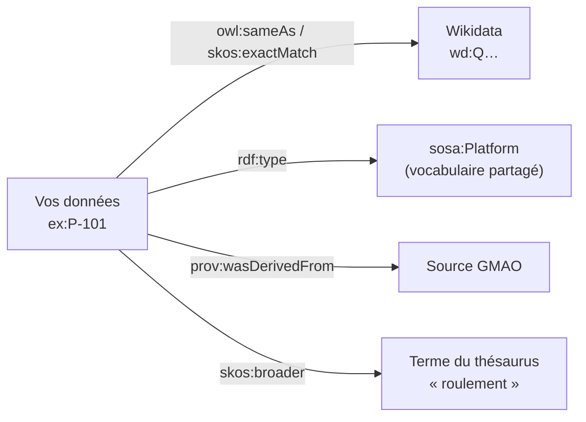

# Données liées et vocabulaires partagés

## Aperçu

- Les **données liées** (Linked Data) sont une façon de publier des données RDF pour qu'elles se **raccordent** à celles des autres : on nomme les choses par des IRI, on les décrit avec des **vocabulaires déjà existants**, et on pointe vers d'autres jeux de données.
- Le principe pratique : **réutiliser plutôt que réinventer**. Un vocabulaire partagé (schema.org, SKOS, PROV-O, SOSA) a déjà un sens fixé, des outils qui le comprennent, et des données qui l'emploient. Inventer son `ex:Capteur` coupe le graphe du reste ; reprendre `sosa:Sensor` le raccorde.
- Cette page dit **quoi réutiliser** et **comment**. Pour le format sous-jacent : [[RDF et triplets]]. Pour la construction d'un schéma sur mesure par-dessus : [[Ontologie]].

## Concepts clés

### Les quatre règles de Berners-Lee

Dans sa note de 2006 sur les données liées, Tim Berners-Lee énonce quatre règles :

1. Utiliser des **URI** comme noms pour les choses.
2. Utiliser des URI **HTTP**, pour qu'on puisse les consulter.
3. Fournir, à la consultation, une information utile dans un **standard** (RDF, SPARQL).
4. Inclure des **liens** vers d'autres URI, pour découvrir d'autres choses.

Il y a ajouté en 2010 un barème en cinq étoiles pour les données ouvertes : de une étoile (données disponibles sur le web sous licence ouverte) à cinq (données **liées** à celles d'autrui pour donner du contexte). Dans un système interne, les deux premières règles se lisent librement : l'important est la troisième et la quatrième — un format standard et des liens.

### Les vocabulaires qui valent d'être connus

| Vocabulaire | Sert à | Ce que la source dit |
|---|---|---|
| **schema.org** | décrire des choses (personnes, organisations, produits, événements…) pour le web | projet communautaire fondé par Google, Microsoft, Yahoo et Yandex, gouverné par un groupe de pilotage et un groupe communautaire du W3C ; marquage en Microdata, RDFa ou JSON-LD ; version 30.1 du 16 septembre 2026 |
| **SKOS** | publier thésaurus, taxonomies, listes de termes : `prefLabel`, `altLabel`, `broader`, `narrower`, `related`, `exactMatch` | Recommandation W3C du 18 août 2009 ; ce n'est pas un langage d'axiomes, c'est un modèle de **concepts à ranger** |
| **PROV-O** | décrire la **provenance** : qui a produit quelle donnée, quand, à partir de quoi | Recommandation W3C du 30 avril 2013, ontologie OWL 2 |
| **SOSA / SSN** | capteurs, observations, actionneurs | Recommandation W3C du 19 octobre 2017 ; détail dans [[Ontologies industrielles]] |
| **Wikidata** | une base de connaissances générale : éléments `Q…`, propriétés `P…` | données sous licence CC0 (domaine public) ; la page de statistiques annonce 123 664 410 éléments |

- **RDFS, OWL** fournissent les mots de base (`rdfs:Class`, `rdfs:label`, `owl:sameAs`) que tous les autres emploient.
- Il existe d'autres vocabulaires par domaine ; chacun est à lire sur sa **page officielle** (statut, licence, version) avant adoption.

### Raccorder ses données



- **`owl:sameAs`** : « ces deux IRI sont la même chose » ; fort (il fusionne tout), à n'employer que si c'est sûr. **`skos:exactMatch`** : « utilisables l'un pour l'autre » dans deux schémas de concepts, plus doux. `skos:closeMatch` et `skos:relatedMatch` existent pour les cas moins nets.
- **Identifier** : pour une organisation, un lieu, un produit connu, l'IRI Wikidata sert de **clef externe**. Trouver la bonne IRI est le travail du [[Liage d'entités]].
- **Typer avec un vocabulaire partagé** plutôt qu'avec un type maison ; si le type maison est plus précis, le déclarer **sous-classe** du type partagé (`rdfs:subClassOf`), après avoir vérifié que « tout A est un B » est vrai.

### Un exemple en SKOS : les modes de défaillance

```turtle
@prefix skos: <http://www.w3.org/2004/02/skos/core#> .
@prefix ex:   <http://example.org/defauts#> .

ex:schéma   a skos:ConceptScheme .
ex:roulement   a skos:Concept ; skos:inScheme ex:schéma ;
               skos:prefLabel "roulement"@fr, "bearing"@en .
ex:jeuRoulement a skos:Concept ; skos:inScheme ex:schéma ;
               skos:prefLabel "jeu de roulement"@fr ;
               skos:broader ex:roulement .
```

Une liste de termes que des techniciens, une GMAO et un modèle de classification de défauts partagent devient un référentiel versionné : un seul mot, plusieurs langues, une hiérarchie. Les vues par `skos:broader` donnent aux tableaux de bord un regroupement qui ne dépend pas du texte libre des ordres de travail.

## Les maths, simplement

- Le raccordement est une **union de graphes** : $G = G_1 \cup G_2$ ; elle fonctionne quand une même IRI désigne la même chose dans les deux. Quand ce n'est pas le cas, on ajoute des triplets de **liaison** `owl:sameAs` $L$ : le graphe utile est $G_1 \cup G_2 \cup L$, et la déduction `sameAs` propage les propriétés d'une IRI à l'autre ([[OWL et raisonnement]]).
- `owl:sameAs` est une relation d'**équivalence** : réflexive, symétrique, transitive. Une erreur dans une seule paire se propage à toute la classe d'équivalence — c'est pourquoi un lien faux contamine tout le graphe.
- Le rapport coût/bénéfice des vocabulaires partagés est un **effet de réseau** : chaque outil qui en comprend un en profite à tous les jeux de données qui l'emploient.

## En pratique

- **Chercher avant de modéliser** : parcourir schema.org, SKOS, PROV-O, SOSA et les vocabulaires de son secteur (voir [[Ontologies industrielles]]) ; si un terme existe avec le bon sens, le reprendre tel quel.
- **Copier les vocabulaires en local** (versionnés dans Git) : en réseau d'usine, on ne résout pas une IRI vers Internet à chaque chargement. Les IRI restent des noms, pas des liens obligatoires.
- **Lire la licence de chaque vocabulaire et de chaque jeu lié** : la CC0 de Wikidata est permissive ; les autres sources sont à vérifier une à une.
- **Garder une trace de la source d'un lien** avec PROV-O ou un graphe nommé : un lien `sameAs` posé par un script de rapprochement est une hypothèse, pas un fait.
- **Pièges** : prendre un terme dont le sens est proche mais pas identique ; employer `owl:sameAs` pour « ressemble à » ; dépendre de la disponibilité d'un service public. À noter : la page de Wikidata sur son service de requêtes indique que le moteur actuel, Blazegraph, est en cours de remplacement par QLever, avec une dégradation possible du service historique à partir de février 2027 — un jeu public n'est pas un service garanti.

## Approches voisines & alternatives

- [[Graphe de connaissances]] — l'entrée du sujet ; [[Ontologie]] — écrire son propre schéma par-dessus.
- [[Ontologies industrielles]] — les vocabulaires de l'usine.
- [[Liage d'entités]] — trouver à quoi relier ; [[SHACL]] — vérifier que les données respectent le vocabulaire retenu.
- [[Catalogue de données et lignage]] ([[DataHub]], [[OpenMetadata]]) — un glossaire métier tenu dans un catalogue : plus simple si aucun raisonnement ni échange en RDF n'est visé.
- **Alternative** : un fichier de codes de référence versionné (CSV) quand les termes ne sortent pas de l'entreprise.

## Pour aller plus loin

- Berners-Lee, T. (2006, révisée 2009) — *Linked Data* (les quatre règles ; le barème en cinq étoiles de 2010) — https://www.w3.org/DesignIssues/LinkedData.html
- W3C — SKOS Simple Knowledge Organization System Reference (Recommandation, 2009-08-18) — https://www.w3.org/TR/skos-reference/
- W3C — PROV-O: The PROV Ontology (Recommandation, 2013-04-30) — https://www.w3.org/TR/prov-o/
- schema.org — présentation et gouvernance — https://schema.org/docs/about.html ; publications — https://schema.org/docs/releases.html ; démarrage — https://schema.org/docs/gs.html
- Wikidata — introduction — https://www.wikidata.org/wiki/Wikidata:Introduction ; statistiques — https://www.wikidata.org/wiki/Wikidata:Statistics ; service de requêtes — https://www.wikidata.org/wiki/Wikidata:SPARQL_query_service/WDQS_backend_update
- W3C — SOSA/SSN, Semantic Sensor Network Ontology (Recommandation, 2017-10-19) — https://www.w3.org/TR/vocab-ssn/
