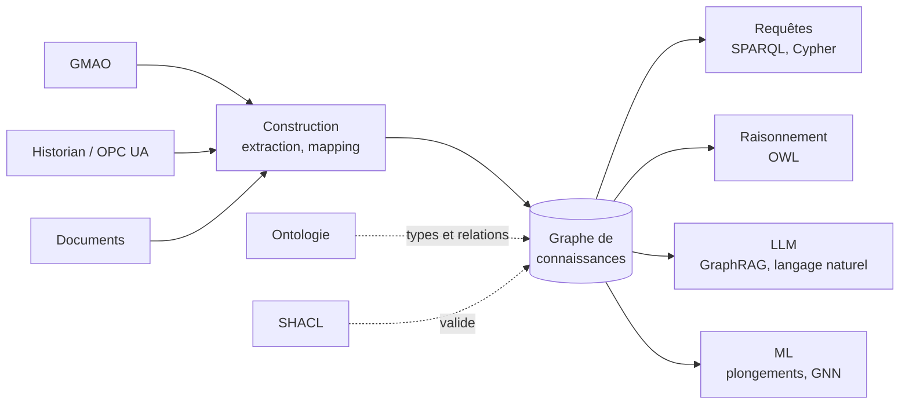

# Graphe de connaissances

## Aperçu

- Un **graphe de connaissances** (knowledge graph) décrit des **choses** (une pompe, un capteur, un ordre de travail, une pièce) et les **relations** qui les relient, sous forme d'un graphe, avec un **sens partagé** : chaque type de chose et chaque type de relation est défini quelque part, pas deviné.
- Il sert à **relier des sources qui s'ignorent** (GMAO, historian, ERP, documents), à les interroger par leurs liens (« quels capteurs sont sur les machines de la ligne 2 ? »), et à vérifier ou déduire des faits. Les données ne sont plus rangées par fichier, mais reliées par ce qu'elles désignent.
- Cette page est l'**entrée** du sujet : elle dit ce que c'est, pose les deux modèles possibles, et renvoie vers chaque page du dossier (carte plus bas). Le mot est aussi un slogan marketing ; ici, il garde son sens étroit : des données en graphe **plus** un schéma explicite.

## Concepts clés

### Ce qu'il y a dans un graphe de connaissances

- **Des entités** : les nœuds (la pompe `P-101`, le capteur `T-17`).
- **Des relations** : les arêtes, qui ont un nom et un sens (`P-101 —équipéDe→ T-17`).
- **Un schéma, souvent une [[Ontologie]]** : la liste des types (`Pompe`, `Capteur`) et des relations permises (`équipéDe` va d'un équipement vers un capteur). C'est ce qui distingue un graphe de connaissances d'un simple graphe de données.
- **Une identité stable** : une chose a un seul identifiant, quelle que soit la source qui en parle (cf. [[Liage d'entités]]).
- **Du contexte** : d'où vient le fait, depuis quand il est vrai. Hogan et al. (2021) rangent ces quatre sujets — modèle de données, schéma, identité, contexte — comme le cœur du domaine.



### Deux modèles de graphe

| | Graphe de propriétés | RDF |
|---|---|---|
| Unité | nœud et arête portent des propriétés | triplet sujet–prédicat–objet |
| Identifiant | interne à la base | IRI, globale, utilisable entre bases |
| Langage | Cypher, GQL, Gremlin | SPARQL |
| Schéma | souvent implicite, contraintes propres au moteur | OWL, RDFS, SHACL, normalisés par le W3C |
| Échange entre systèmes | pas de format normalisé de données | Turtle, N-Triples, JSON-LD |

- Le **graphe de propriétés** (Neo4j, Memgraph…) est plus direct pour parcourir et pour développer ; le détail est dans [[Bases graphe — modèles et langages de requête]].
- **RDF** est plus verbeux, mais il **normalise** l'identité, le schéma, la validation et l'échange. Il convient quand des données doivent se combiner entre équipes ou entreprises, ou quand un raisonnement est voulu. Voir [[RDF et triplets]].
- Les deux se convertissent l'un dans l'autre, avec perte ou ajout d'un nœud intermédiaire (la relation qui porte des propriétés). Angles et al. (2017) décrivent les deux modèles et leurs langages.

### Un exemple d'usine

Trois faits, écrits en Turtle ([[RDF et triplets]]) :

```turtle
@prefix ex: <http://example.org/usine#> .

ex:P-101  a ex:Pompe ;
          ex:installéeSur ex:Ligne2 ;
          ex:équipéeDe    ex:T-17 .
ex:T-17   a ex:CapteurVibration .
```

La requête « tous les capteurs de vibration des équipements de la ligne 2 » devient un parcours de deux arêtes, sans jointure à écrire ([[SPARQL]]). Un autre fait, `ex:T-17 ex:mesure ex:VibrationRMS`, peut venir d'une autre source : l'identifiant `ex:T-17` relie les deux.

### Carte du sujet

| Question | Page |
|---|---|
| Quels types de choses, quelles relations ? | [[Ontologie]] |
| Comment s'écrit un fait ? | [[RDF et triplets]] |
| Comment l'interroge-t-on ? | [[SPARQL]] |
| Comment déduire ce qui n'est pas écrit ? | [[OWL et raisonnement]] |
| Comment vérifier que les données respectent les règles ? | [[SHACL]] |
| Quels vocabulaires réutiliser (schema.org, SKOS, Wikidata) ? | [[Données liées et vocabulaires partagés]] |
| Comment deux noms désignent-ils la même chose ? | [[Liage d'entités]] |
| Comment deviner les liens manquants par apprentissage ? | [[Plongements de graphe et prédiction de liens]] |
| Comment poser une question en français ? | [[Interroger un graphe en langage naturel]] |
| Capteurs, machines, jumeau numérique ? | [[Ontologies industrielles]] |
| Où le stocker, dans quel moteur de graphe de propriétés ? | [[Bases de graphes]], [[Comparatif - Bases graphes]], [[Neo4j]] |
| Où le stocker, dans quel moteur RDF ? | [[Comparatif - Moteurs RDF]] : [[Apache Jena]], [[Oxigraph]], [[RDF4J]], [[QLever]], [[Virtuoso Open Source]], [[Fluree]], [[Ontop]] ; le dossier [[Ontologies et RDF]] |
| Quels outils pour manipuler, valider, concevoir en Python ? | [[Comparatif - Outils RDF et OWL en Python]] : [[rdflib]], [[pySHACL]], [[Owlready2]], [[LinkML]] ; l'éditeur graphique [[Protégé]] ; [[neosemantics]] pour entrer du RDF dans Neo4j |
| Entraîner des plongements de graphe ? | [[PyKEEN]] |
| Comment l'assembler dans une usine ? | [[Pattern - Graphe de connaissances industriel sur site]], [[Pattern - Pipeline de maintenance prédictive on-prem]] |
| Comment le construire depuis du texte avec un LLM ? | [[Construction de graphes de connaissances]] |
| Comment s'en servir pour un RAG ? | [[GraphRAG]], [[Pattern - RAG structuré graphe + human-in-the-loop]] |
| Comment un agent s'en sert comme mémoire ? | [[Mémoire des agents]], [[Agent memory]], [[Graphiti]], [[Cognee]] |
| Apprendre sur un graphe ? | [[Graph Neural Networks]], [[PyTorch Geometric]] |

## Les maths, simplement

- Un graphe de propriétés est un graphe orienté $G = (V, E)$ dont les nœuds et les arêtes portent des étiquettes et des propriétés. Un graphe RDF est plus simple : un **ensemble de triplets** $T \subseteq (I \cup B) \times I \times (I \cup B \cup L)$, où $I$ sont les IRI, $B$ les nœuds anonymes et $L$ les littéraux (RDF 1.1 Concepts). Le sujet est une IRI ou un nœud anonyme, le prédicat une IRI, l'objet n'importe lequel des trois.
- Un **fait déduit** est un triplet que l'ensemble ne contient pas, mais qui découle des autres par une règle ([[OWL et raisonnement]]). Si $T$ contient « P-101 est une Pompe » et que l'ontologie dit « toute Pompe est un Équipement », alors « P-101 est un Équipement » est déduit, sans être écrit.
- Chaque arête a un coût d'écriture : un graphe de $n$ entités avec une moyenne de $d$ relations chacune compte environ $n \cdot d$ triplets. Pour 100 000 équipements à 20 relations, 2 millions de triplets : la taille n'est pas le sujet, la qualité du schéma l'est.

## En pratique

- **Partir des questions.** Écrire dix questions métier (« quel capteur a servi à décider cette intervention ? ») avant de choisir un modèle ; si elles ne portent pas sur des relations, un tableau suffit.
- **Un schéma minimal d'abord.** Une ontologie de vingt types vaut mieux qu'une de deux cents jamais finie ; réutiliser un vocabulaire existant avant d'inventer ([[Données liées et vocabulaires partagés]]).
- **Valider à l'entrée.** Sans contraintes, le graphe se remplit de doublons et de relations incohérentes ([[SHACL]], [[Liage d'entités]]).
- **Quand ne pas en faire un.** Peu de relations, une seule source, aucune question de parcours : [[Postgres]] suffit, et l'étude citée dans [[Bases graphe — modèles et langages de requête]] montre qu'un relationnel bien indexé rivalise sur les parcours courts.
- **Avec un LLM.** Deux usages distincts : le LLM **construit** le graphe depuis du texte ([[Construction de graphes de connaissances]]) ou l'**interroge** ([[GraphRAG]], [[Interroger un graphe en langage naturel]]). Les évaluations divergent selon la tâche ; voir les réserves dans [[Bases graphe — modèles et langages de requête]].

## Approches voisines & alternatives

- [[Bases graphe — modèles et langages de requête]] — le côté stockage et langages, surtout graphe de propriétés ; cette page en est le complément RDF et sémantique.
- [[Construction de graphes de connaissances]] — remplir le graphe depuis du texte, avec un LLM ; la définition y tient en deux lignes, celle-ci la déroule.
- [[GraphRAG]] — le graphe comme index de retrieval.
- [[Modèles graphiques probabilistes]] — un autre « graphe » : il représente des dépendances probabilistes entre variables, pas des faits sur des choses.
- **Alternatives** : une base relationnelle avec clés étrangères ([[Postgres]]), un catalogue de métadonnées ([[Catalogue de données et lignage]]) ou un simple dictionnaire de données, quand le besoin est de décrire les tables et pas de raisonner sur les choses.

## Pour aller plus loin

- Hogan et al. (2021, ACM Computing Surveys 54(4)) — *Knowledge Graphs* — https://arxiv.org/abs/2003.02320
- Angles, Arenas, Barceló, Hogan, Reutter, Vrgoč (2017) — *Foundations of Modern Query Languages for Graph Databases* — https://arxiv.org/abs/1610.06264
- W3C — RDF 1.1 Concepts and Abstract Syntax (Recommendation, 2014-02-25) — https://www.w3.org/TR/rdf11-concepts/
- W3C — RDF 1.1 Primer — https://www.w3.org/TR/rdf11-primer/
- Wikidata — introduction (exemple d'un grand graphe de connaissances ouvert, CC0) — https://www.wikidata.org/wiki/Wikidata:Introduction
