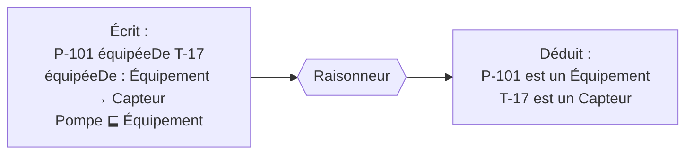

# OWL et raisonnement

## Aperçu

- **OWL 2** (Web Ontology Language) est le langage W3C pour écrire une [[Ontologie]] avec assez de précision pour qu'un programme, un **raisonneur**, en **déduise des faits non écrits** et détecte les contradictions. C'est une Recommandation, 2e édition du 11 décembre 2012.
- Ce que le raisonneur sait faire, d'après la spécification : tester la **cohérence** (l'ontologie se contredit-elle ?), la **subsomption** (une classe est-elle incluse dans une autre ?), la **satisfiabilité** d'une classe et retrouver les **instances** d'une classe.
- OWL travaille en **monde ouvert** : ce qui n'est pas écrit n'est pas faux, c'est inconnu. C'est le piège principal, et ce qui le distingue de [[SHACL]] et d'une base de données.

## Concepts clés

### Ce qu'un raisonneur déduit

- Le primer OWL 2 donne l'exemple type : avec un domaine `Homme` et une portée `Femme` sur la propriété `aPourÉpouse`, un raisonneur infère le sexe des deux individus reliés par elle. Même mécanisme pour `équipéeDe` ci-dessus.
- Axiomes courants : `SubClassOf`, `EquivalentClasses`, `DisjointClasses` (si `Pompe` et `Vanne` sont disjointes, une chose déclarée des deux rend l'ontologie incohérente), propriété **transitive** (`partieDe`), **inverse** (`équipéeDe` / `équipe`), **fonctionnelle** (au plus une valeur).
- Les inférences de base (sous-classe, domaine, portée) existent déjà en **RDFS** ([[RDF et triplets]]) ; OWL y ajoute disjonction, cardinalités, propriétés caractérisées, classes définies par restriction.

### Monde ouvert et absence de nom unique

- **Monde ouvert** : une base de données traite l'absence d'un fait comme sa fausseté. Le primer OWL dit que le fait absent « peut être simplement manquant (mais vrai) ».
- **Pas d'hypothèse de nom unique** : le primer précise qu'OWL ne suppose pas que deux noms différents désignent deux individus différents. Deux IRI peuvent être la même pompe ; pour dire le contraire, il faut `DifferentIndividuals`.
- Conséquence concrète : l'axiome « tout `Équipement` a au moins un `Capteur` » ne **signale pas** l'équipement sans capteur ; il en **déduit** qu'un capteur existe, quelque part, inconnu. Pour vérifier qu'une donnée est présente, c'est [[SHACL]].
- Autre piège : « au plus un capteur » (cardinalité maximale) combiné à l'absence de nom unique ne rend pas incohérent un équipement avec deux IRI de capteur — le raisonneur conclut que ces deux IRI sont le même capteur.

### Deux sémantiques

- **Sémantique directe** : pour les ontologies **OWL 2 DL** (avec des restrictions syntaxiques), fondée sur la logique de description SROIQ. Les raisonneurs l'utilisent.
- **Sémantique fondée sur RDF** : s'applique à tout graphe RDF, sans restriction. Un théorème de correspondance garantit que les conclusions de la première restent valides dans la seconde.

### Trois profils pour un coût maîtrisé

| Profil | Pour quoi | Garantie |
|---|---|---|
| **OWL 2 EL** | très grandes ontologies de classes | raisonnement de base en temps polynomial |
| **OWL 2 QL** | beaucoup d'individus, accès par requêtes de type SQL | réponses aux requêtes en LogSpace sur les données, traduisibles pour un SGBD relationnel |
| **OWL 2 RL** | beaucoup d'individus, règles en chaînage avant sur des triplets | temps polynomial, implémentable dans un moteur à règles |
| **OWL 2 DL** (complet) | expressivité maximale | tâches standard N2EXPTIME-complètes au pire cas |

Le pire cas ne dit pas le cas moyen : beaucoup d'ontologies pratiques se raisonnent vite. Mais il explique pourquoi des projets industriels restent en EL ou RL : la durée devient prévisible.

### Raisonneurs

Les faits ci-dessous viennent des dépôts, à la lecture ; l'activité et les licences changent, à revérifier avant un choix.

- **ELK** (Java) : raisonneur pour OWL 2 EL, calcul multi-cœur, raisonnement incrémental, explications ; Apache-2.0.
- **OWL API** (Java, LGPL et Apache, 5.5.1 du 7 septembre 2024) : bibliothèque de manipulation d'ontologies, qui expose les raisonneurs FaCT++, HermiT, Pellet, Racer, JFact.
- **owlrl** (Python, bibliothèque RDFLib) : raisonnement OWL 2 RL et RDFS élémentaire par chaînage avant, licence « W3C Software Notice and License » ; le dépôt prévient que l'usage d'Oxigraph comme magasin n'accélère pas, l'inférence restant en types RDFLib.
- Certains moteurs RDF intègrent leur propre inférence (RDFS, règles) : voir les fiches de moteurs au brain, quand elles existent.

## Les maths, simplement

- **Implication** : $\mathcal{O} \models \alpha$ veut dire que $\alpha$ est vrai dans **tous** les modèles de l'ontologie $\mathcal{O}$ (tous les « mondes » compatibles avec ses axiomes). En monde ouvert, un fait peut être vrai dans certains modèles et faux dans d'autres : alors $\mathcal{O} \not\models \alpha$ **et** $\mathcal{O} \not\models \neg\alpha$ — c'est l'inconnu.
- **Monde fermé** (base de données) : un seul modèle, celui dont les faits sont exactement ceux écrits ; l'absence se lit comme $\neg\alpha$.
- **Chaînage avant** (OWL RL) : appliquer des règles de la forme « si ces triplets, alors ce triplet » jusqu'à un **point fixe** : plus aucune règle n'ajoute rien. Le nombre de triplets déduits est borné par le nombre de combinaisons possibles, d'où le temps polynomial.

## En pratique

- **Raisonner utile.** Un raisonneur sert à compléter des hiérarchies (« toute `PompeCentrifuge` est une `Pompe`, donc un `Équipement` »), à classer automatiquement et à **trouver des incohérences** dans une ontologie en construction. Il ne remplace pas la validation des données.
- **Matérialiser ou raisonner à la requête.** Deux options : écrire les triplets déduits dans le graphe (rapide à interroger, à recalculer quand les données changent) ou laisser le moteur raisonner au moment de la requête. Le choix dépend du rythme de mise à jour.
- **Rester dans un profil** : annoncer « OWL 2 RL » ou « EL » rend la durée et le comportement prévisibles ; sortir du profil, c'est aller vers DL et son pire cas.
- **Pièges** : croire qu'une cardinalité valide les données ; employer `owl:sameAs` à la légère (il fusionne **toutes** les propriétés des deux IRI, y compris les fausses) ; une ontologie qui contient une contradiction rend tout « déductible » avec un raisonneur DL.

## Approches voisines & alternatives

- [[SHACL]] — valider en monde fermé ; la bonne réponse à « cette donnée est-elle présente ? ». Le travail de Oudshoorn, Ortiz et Simkus (2026) donne une sémantique à l'association des deux.
- [[Ontologie]] — ce que OWL sert à écrire ; [[RDF et triplets]] — dans quoi.
- [[SPARQL]] — les régimes d'implication (RDFS, OWL) changent les réponses d'une requête.
- [[Modèles graphiques probabilistes]] — un tout autre raisonnement : sur l'incertain, pas sur le logique.
- **Alternative sans OWL** : des règles écrites à la main (SQL, SPARQL `CONSTRUCT`) pour les deux ou trois déductions qui comptent. Moins élégant, mais plus simple à tenir qu'une ontologie complète quand les besoins sont limités.
- **Outils** : [[Protégé]] pour éditer et raisonner à la main ; [[Owlready2]] pour raisonner depuis Python ; [[Apache Jena]], [[Fluree]] et [[Ontop]] raisonnent en partie dans le moteur. Voir [[Comparatif - Moteurs RDF]] et [[Comparatif - Outils RDF et OWL en Python]].

## Pour aller plus loin

- W3C — OWL 2 Web Ontology Language Document Overview (2e édition, Recommandation, 2012-12-11) — https://www.w3.org/TR/owl2-overview/
- W3C — OWL 2 Primer (monde ouvert, absence de nom unique, axiomes) — https://www.w3.org/TR/owl2-primer/
- W3C — OWL 2 Profiles (complexité par profil) — https://www.w3.org/TR/owl2-profiles/
- ELK — https://github.com/liveontologies/elk-reasoner
- OWL API — https://github.com/owlcs/owlapi
- OWL-RL — https://github.com/RDFLib/OWL-RL
- Oudshoorn, Ortiz, Simkus (2026, Artificial Intelligence 352) — *SHACL Validation in the Presence of Ontologies: Semantics and Rewriting Techniques* — https://arxiv.org/abs/2507.12286
