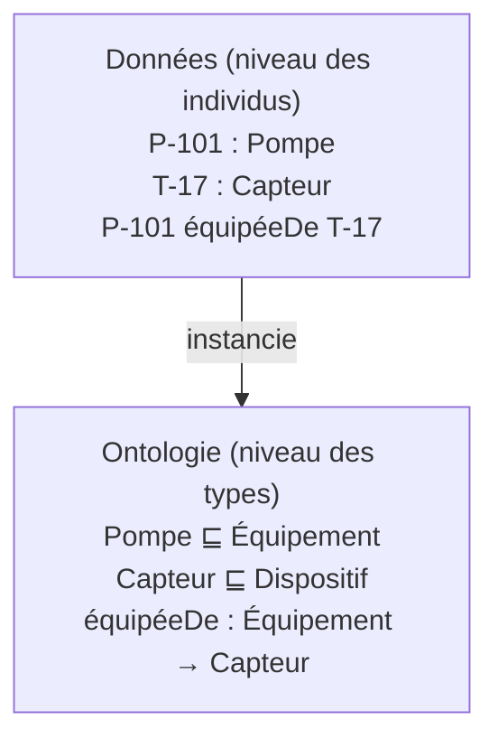

# Ontologie

## Aperçu

- Une **ontologie** est la description explicite et partagée des **types de choses** d'un domaine, des **relations** qui les lient et des **règles** qui s'y appliquent, écrite de façon qu'une machine puisse la lire. La définition qu'on cite partout vient de Gruber (1993) : une « spécification explicite d'une conceptualisation ».
- Elle répond à la question « de quoi parle-t-on exactement ? » avant « quelles données a-t-on ? ». Dans un [[Graphe de connaissances]], elle fixe ce que veulent dire les nœuds et les arêtes ; les données, elles, sont les faits individuels.
- Exemple d'usine : l'ontologie dit qu'une `Pompe` est un `Équipement`, qu'un `Équipement` peut porter des `Capteur`, et qu'un capteur ne mesure qu'une grandeur à la fois. La pompe `P-101` n'y figure pas : elle est dans les données.

## Concepts clés

### Les briques d'une ontologie

- **Classes** : les types (`Pompe`, `Capteur`). Une classe est un ensemble d'individus possibles.
- **Propriétés** : les relations entre individus (`équipéeDe`), ou entre un individu et une valeur (`diamètreEnMm`).
- **Individus** : les choses précises (`P-101`).
- **Axiomes** : ce qui est vrai pour toutes les instances. D'après le primer OWL 2 : `SubClassOf` (« tout A est un B »), `EquivalentClasses` (mêmes individus), `DisjointClasses` (aucun individu commun), et des caractéristiques de propriété (transitive, inverse, fonctionnelle).
- La littérature de logique distingue souvent la **TBox** (le niveau des classes et axiomes : l'ontologie) de l'**ABox** (le niveau des individus : les données). Le mot sert surtout à dire que le schéma et les faits sont deux couches.



### Ontologie, taxonomie, vocabulaire, schéma de base

| Objet | Ce qu'il fait | Ce qui lui manque pour être une ontologie |
|---|---|---|
| **Vocabulaire / glossaire** | liste des termes et leur définition en texte | aucune relation formelle, aucun axiome |
| **Taxonomie** | hiérarchie de types (« est un ») | une seule sorte de relation, pas de propriétés ni de règles |
| **Thésaurus** ([[Données liées et vocabulaires partagés]], SKOS) | termes, synonymes, plus large/plus étroit, associé | décrit des **concepts à ranger**, pas des axiomes sur le monde : SKOS le dit lui-même, ce n'est pas un langage de représentation formelle |
| **Schéma de base de données** | structure et contraintes d'un stockage donné | lié à un moteur ; contraintes de validité plutôt que sens partagé |
| **Ontologie** | classes, propriétés, axiomes, lisibles par machine et **indépendantes du stockage** | — |

Les limites sont floues. Un thésaurus bien fait côtoie une ontologie légère ; un schéma SQL très contraint approche un modèle de domaine. Ce qui compte : le sens est-il **écrit**, **partagé** et **exploitable** par un outil ?

### Trois niveaux d'ontologie

- **De haut niveau** (upper ontology) : des catégories très générales (objet, processus, rôle). Exemple : BFO, sur lequel s'appuie IOF Core pour l'industrie ([[Ontologies industrielles]]).
- **De domaine** : le vocabulaire d'un métier (capteurs et observations avec SOSA/SSN, la hiérarchie d'équipement de l'ISA-95).
- **D'application** : ce dont un projet précis a besoin, souvent un petit sous-ensemble des précédentes plus quelques classes locales.

Réutiliser les deux premiers niveaux, ne construire que le troisième : c'est l'économie du sujet ([[Données liées et vocabulaires partagés]]).

### Exemple en OWL (Turtle)

```turtle
@prefix ex:   <http://example.org/usine#> .
@prefix owl:  <http://www.w3.org/2002/07/owl#> .
@prefix rdfs: <http://www.w3.org/2000/01/rdf-schema#> .

ex:Équipement  a owl:Class .
ex:Pompe       a owl:Class ; rdfs:subClassOf ex:Équipement .
ex:Capteur     a owl:Class .
ex:équipéeDe   a owl:ObjectProperty ;
               rdfs:domain ex:Équipement ;
               rdfs:range  ex:Capteur .
```

Un raisonneur qui lit ce fragment et le fait `ex:P-101 ex:équipéeDe ex:T-17` en **déduit** que `P-101` est un `Équipement` et que `T-17` est un `Capteur`, même si personne ne l'a écrit : c'est l'objet de [[OWL et raisonnement]].

## Les maths, simplement

- En logique de description, l'ontologie est un **ensemble d'axiomes** $\mathcal{O}$ ; `Pompe SubClassOf Équipement` s'écrit $\text{Pompe} \sqsubseteq \text{Équipement}$ et veut dire : pour tout individu $x$, $\text{Pompe}(x) \Rightarrow \text{Équipement}(x)$.
- Une ontologie **entraîne** (entails) une conclusion $\alpha$, notée $\mathcal{O} \models \alpha$, quand $\alpha$ est vrai dans tous les mondes où les axiomes le sont. Le raisonnement ne devine pas : il tire ce qui est forcé par les axiomes.
- Le coût de cette expressivité est mesuré : pour OWL 2 DL, la complexité au pire cas des tâches standard est N2EXPTIME-complète ; les profils EL, QL et RL de la spécification limitent la forme des axiomes pour obtenir un temps polynomial (EL, RL) ou des requêtes traduisibles en SQL (QL).

## En pratique

- **Petite d'abord.** Une vingtaine de classes qui répondent à des questions réelles valent mieux qu'un modèle universel jamais terminé ; chaque axiome ajouté est à maintenir.
- **Classe ou instance ?** La question piège : `Pompe` est une classe, `P-101` un individu. « Modèle de pompe » (un catalogue) est une troisième chose ; la confondre avec l'un des deux casse les requêtes.
- **Écrire peu d'axiomes, valider le reste.** Pour dire « un capteur doit avoir une unité », une contrainte [[SHACL]] vérifie ; un axiome OWL de cardinalité ne signale rien quand la donnée manque (monde ouvert, cf. [[OWL et raisonnement]]).
- **Outils.** Un éditeur graphique comme Protégé permet de construire et de tester ; le code source reste un fichier Turtle ou OWL versionné dans Git, comme du code.
- **Pièges** : ontologie trop fine pour les données disponibles ; classes créées pour un seul individu ; hiérarchie « est un » utilisée pour exprimer « fait partie de » (une pompe n'est pas un atelier, elle est *dans* un atelier).

## Approches voisines & alternatives

- [[Graphe de connaissances]] — la page d'entrée : l'ontologie en est le schéma, les données en sont le contenu.
- [[RDF et triplets]] — le format dans lequel s'écrit une ontologie OWL ([[OWL et raisonnement]]).
- [[Données liées et vocabulaires partagés]] — réutiliser schema.org, SKOS, des vocabulaires existants.
- [[Ontologies industrielles]] — SOSA/SSN, ISA-95, coque d'administration d'actif : ce qui existe déjà pour l'usine.
- [[Construction de graphes de connaissances]] — le choix « schéma ouvert contre ontologie cadrée » y est décrit côté extraction par LLM.
- [[Catalogue de données et lignage]] — décrit les jeux de données (glossaire, propriétaire), pas les choses du monde.
- **Alternative légère** : un simple schéma de validation ([[SHACL]]) ou une table de référence, quand aucun raisonnement n'est attendu.
- **Outils** : [[Protégé]] pour construire et tester une ontologie ; [[LinkML]] pour partir d'un schéma YAML ; [[Owlready2]] pour la manipuler en Python. Voir [[Comparatif - Outils RDF et OWL en Python]].

## Pour aller plus loin

- Gruber, T. R. (1993) — *A Translation Approach to Portable Ontology Specifications*, Knowledge Acquisition 5(2), 199–220 — https://tomgruber.org/writing/ontolingua-kaj-1993/
- W3C — OWL 2 Web Ontology Language Primer (Recommendation, 2012) — https://www.w3.org/TR/owl2-primer/
- W3C — OWL 2 Profiles (complexité des tâches de raisonnement) — https://www.w3.org/TR/owl2-profiles/
- W3C — SKOS Reference (Recommendation, 2009-08-18) — https://www.w3.org/TR/skos-reference/
- Hogan et al. (2021) — *Knowledge Graphs* (schéma, identité, contexte) — https://arxiv.org/abs/2003.02320
- Industrial Ontologies Foundry — IOF Core (mid-level, au-dessus de BFO 2020) — https://spec.industrialontologies.org/
