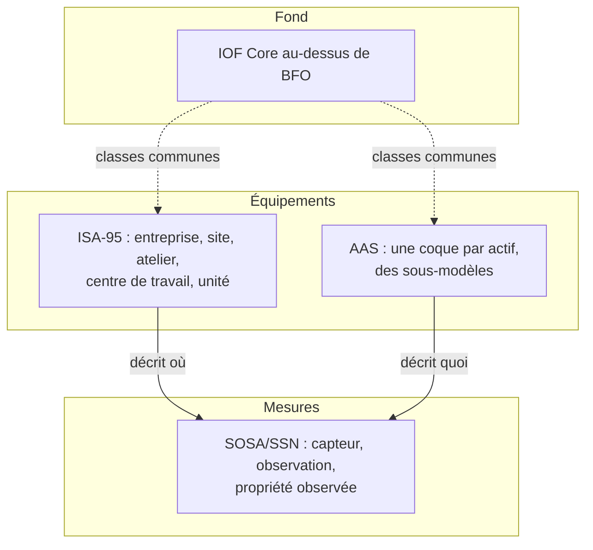

# Ontologies industrielles

## Aperçu

- Ce sont les **modèles déjà écrits** pour décrire une usine : capteurs et mesures (**SOSA/SSN**, W3C), hiérarchie d'équipements et d'ordres de fabrication (**ISA-95 / IEC 62264**), fiche numérique standardisée d'un actif (**coque d'administration d'actif**, *Asset Administration Shell*, AAS), ontologie de fabrication de haut niveau (**IOF Core**). On les réutilise avant d'écrire une [[Ontologie]] maison.
- Ils ne sont **pas du même genre** : SOSA/SSN et IOF sont des ontologies OWL ; ISA-95 est un **modèle d'objets** défini par une norme, que d'autres techniques (OPC UA) reprennent ; l'AAS est un **métamodèle** avec ses formats d'échange et son interface HTTP. Les ranger sous un seul mot trompe : ils se raccordent, ils ne se remplacent pas.
- Pour la maintenance prédictive du brain ([[Maintenance prédictive et RUL]], [[Jumeau numérique et modèles hybrides]]), c'est ce qui donne un sens commun aux **mesures**, aux **équipements** et aux **prédictions** qui les relient. Les standards évoluent : chaque fait ci-dessous est daté ; à relire avant d'engager un projet.

## Concepts clés



### SOSA/SSN : capteurs et observations

- **Statut** : Recommandation W3C du 19 octobre 2017 (corrections de liens du 8 décembre 2017), produite par le groupe de travail conjoint W3C et OGC sur les données spatiales.
- **SOSA** (Sensor, Observation, Sample, Actuator) est un **noyau léger** ; **SSN** l'importe et ajoute plus d'expressivité (stimulus, système, déploiement, capacités, plages de fonctionnement). On peut n'employer que SOSA.
- **Classes de SOSA** : `Sensor` (un appareil, un agent **ou un logiciel** qui applique une procédure et produit des résultats), `Observation` (estimer une propriété d'une chose), `ObservableProperty` (la grandeur mesurable), `FeatureOfInterest` (la chose observée), `Platform` (ce qui porte capteurs et actionneurs), `Actuator`, `Actuation`, `Sample`, `Sampler`, `Procedure`, `Result`.

```turtle
@prefix sosa: <http://www.w3.org/ns/sosa/> .
@prefix ex:   <http://example.org/usine#> .
@prefix xsd:  <http://www.w3.org/2001/XMLSchema#> .

ex:obs-8842 a sosa:Observation ;
    sosa:madeBySensor        ex:T-17 ;
    sosa:observedProperty    ex:VibrationRMS ;
    sosa:hasFeatureOfInterest ex:P-101 ;
    sosa:hasSimpleResult     4.7 ;
    sosa:resultTime          "2026-10-19T08:15:00Z"^^xsd:dateTimeStamp .
```

Une **prédiction** d'un modèle de détection d'anomalie s'écrit dans le même cadre : le modèle est un `Sensor` (c'est un logiciel qui applique une procédure), la propriété observée est « score d'anomalie », la chose observée est la pompe. Le même graphe porte alors la mesure et ce qu'on en a conclu ([[Time series anomaly detection]]).

### ISA-95 / IEC 62264 : la hiérarchie de l'usine

- ISA-95 (ANSI/ISA-95) est publiée à l'international sous le nom **IEC 62264**. Elle définit une **hiérarchie d'équipements** : entreprise, site, atelier (*area*), centre de travail (*work center*), unité de travail (*work unit*), ainsi que des modèles d'objets pour le personnel, les équipements, les actifs physiques et les matériaux.
- Les définitions que reprend le modèle d'information OPC UA (OPC 10030) : une **entreprise** regroupe des sites et des ateliers, un **site** est un regroupement physique, géographique ou logique, un **atelier** peut contenir des centres de travail, une **unité de travail** est l'élément le plus bas, planifié par les fonctions de niveau 3.
- **Aucune ontologie OWL normative** d'ISA-95 n'est apparue dans les sources lues : le modèle de référence lisible par machine qu'on trouve est l'ISA-95 Base Information Model d'OPC UA (OPC 10030). Passer par ce dernier ou écrire un petit schéma maison qui reprend les niveaux est le chemin réaliste. Cf. [[Protocoles de l'atelier - MQTT, OPC UA et Modbus]] et [[asyncua]] pour la lecture des nœuds.

### Coque d'administration d'actif (AAS)

- Définition (IEC 63278-1:2023, publiée en décembre 2023) : la **représentation numérique standardisée** d'un actif. Une coque est associée à un actif, expose des **interfaces**, et liste un ou plusieurs **sous-modèles** (*submodels*), chacun représentant **un aspect** de l'actif (fiche technique, nameplate, documentation, données de maintenance…). Un sous-modèle contient des **éléments** (propriétés, fichiers, relations…).
- Les spécifications de l'IDTA (Industrial Digital Twin Association) forment une série : partie 1 le **métamodèle** (IDTA-01001, version 3.1.1 vue en PDF ; des documents plus récents citent une 3.2), partie 2 l'**API** HTTP, partie 3 les spécifications de données, partie 5 le format d'échange de fichiers AASX. Les règles de **mapping** vers XML, JSON et **RDF** sont tenues dans des dépôts GitHub à côté des schémas.
- **Le lien avec les ontologies** : chaque élément doit porter une **définition sémantique** (`semanticId`) qui renvoie à une définition externe (ECLASS, IEC CDD) ou à une description de concept. Bader et Maleshkova (2019) ont proposé une version RDF du modèle, la *Semantic Asset Administration Shell* : ontologie, mapping, validation, raisonnement de base. La proposition est académique ; vérifier la correspondance avec la version courante des spécifications avant de s'en servir.
- Ce que l'AAS **n'est pas** : une base de graphe, ni une ontologie de domaine. C'est un contrat d'échange entre fournisseurs, intégrateurs et exploitants ; le graphe interne peut l'importer.

### IOF Core : le fond commun

- Le *Industrial Ontologies Foundry* est une unité d'OAGi (organisme à but non lucratif). **IOF Core** est une ontologie **de niveau intermédiaire** pour la fabrication, bâtie sur **BFO 2020** (Basic Formal Ontology, ontologie de haut niveau) ; les ontologies de domaine IOF en dérivent. La dernière publication vue date de mars 2026 (release 202603) ; l'ancien dépôt `iofoundry/Core` est archivé depuis le 20 octobre 2022 au profit de `iofoundry/ontology`.
- La licence n'a **pas** pu être vérifiée à la source dans cette lecture : à lire dans le dépôt avant de l'intégrer.

### Comment les assembler

| Besoin | Brique |
|---|---|
| « Cette mesure vient de quel capteur, sur quelle machine ? » | SOSA (observation) + hiérarchie ISA-95 (où est la machine) |
| Échanger la fiche d'un équipement avec un fournisseur | AAS (partie 1 et sous-modèles) ; la correspondance AAS vers graphe est à construire |
| Se doter d'un vocabulaire commun de fabrication | IOF Core, si le projet a besoin d'une ontologie de haut niveau |
| Des types simples et un petit projet | un schéma maison, avec 10 à 20 classes, aligné sur SOSA et sur les niveaux ISA-95 |

## Les maths, simplement

- Une observation SOSA est un **tuple** $(s, p, f, r, t)$ : un capteur $s$, une propriété observée $p$, une chose observée $f$, un résultat $r$ et un instant $t$. Une mesure d'un historian est déjà ce tuple ; la modéliser en SOSA ajoute **sa signification** et lui permet de se joindre aux autres.
- La hiérarchie d'équipements est un **arbre** (ou un DAG si un équipement dépend de plusieurs) : la relation « est dans » est transitive. Un chemin SPARQL `ex:dans+` retrouve tout ce qui est sous un atelier ([[SPARQL]]) ; la transitivité peut aussi être déclarée dans l'ontologie et déduite ([[OWL et raisonnement]]).
- Volume : une usine de 5 000 capteurs échantillonnés à 1 Hz produit $5\,000 \times 86\,400 \approx 4{,}3 \times 10^{8}$ observations par jour. **Aucun** graphe RDF ne doit les contenir : les séries restent dans une base de séries temporelles, le graphe décrit les **capteurs** et les **conclusions**, et renvoie vers la série par un identifiant.

## En pratique

- **Ne pas mettre les séries brutes dans le graphe.** Le graphe porte la structure (qui est où, qui mesure quoi, quelle alerte a été levée) ; [[InfluxDB]] ou [[TimescaleDB]] portent les points.
- **Réutiliser avant d'écrire** : partir de SOSA pour l'observation, des niveaux ISA-95 pour le lieu, et ne créer des classes locales que pour ce qui manque (le type de pompe, le mode de défaillance).
- **Aligner, ne pas fusionner.** Si deux modèles ne coïncident pas (un sous-modèle AAS et une classe maison), écrire des triplets d'alignement (`skos:exactMatch`, `rdfs:subClassOf`) plutôt que forcer l'un dans l'autre ([[Données liées et vocabulaires partagés]]).
- **Valider à l'import** : formes [[SHACL]] sur chaque observation (propriété, unité, instant) avant d'entrer dans le graphe.
- **Pièges** : prendre une norme de **messagerie ou de transport** (MQTT, OPC UA) pour un modèle sémantique : le protocole transporte, il ne dit pas ce que la valeur signifie ; croire qu'une ontologie remplace la **qualité** de la donnée ; ignorer que les versions des spécifications AAS se succèdent à un rythme soutenu.

## Approches voisines & alternatives

- [[Graphe de connaissances]] — l'entrée du sujet ; [[Ontologie]] — écrire la sienne ; [[Données liées et vocabulaires partagés]] — les autres vocabulaires.
- [[Maintenance prédictive et RUL]], [[Jumeau numérique et modèles hybrides]] — ce que le graphe industriel nourrit : les entrées (mesures) et les sorties (diagnostics, durées de vie) d'un modèle, reliées à l'équipement.
- [[Protocoles de l'atelier - MQTT, OPC UA et Modbus]] — le transport des mesures ; [[asyncua]] — client OPC UA pour lire le modèle d'information de la machine.
- [[Catalogue de données et lignage]] — si le besoin est de connaître d'où vient un jeu de données, pas de modéliser l'équipement.
- **Alternative** : un modèle relationnel de la hiérarchie d'équipement ([[Postgres]]) : suffisant tant qu'aucun raisonnement ni échange avec des tiers n'est visé.

## Pour aller plus loin

- W3C — Semantic Sensor Network Ontology (SOSA/SSN), Recommandation du 2017-10-19 — https://www.w3.org/TR/vocab-ssn/
- OPC Foundation — OPC 10030, ISA-95 Base Information Model — https://reference.opcfoundation.org/specs/OPC-10030/7
- IEC 63278-1:2023, *Asset Administration Shell structure* (publication décembre 2023) — https://webstore.iec.ch/en/publication/65628
- IDTA — Specification of the Asset Administration Shell, Part 1 : Metamodel, IDTA-01001 v3.1.1 — https://industrialdigitaltwin.org/wp-content/uploads/2025/08/IDTA-01001-3-1-1_AAS-Specification_Part1_Metamodel.pdf ; page des spécifications — https://industrialdigitaltwin.org/en/content-hub/aasspecifications
- Bader, Maleshkova (2019, Semantics 2019) — *The Semantic Asset Administration Shell* — https://arxiv.org/abs/1909.00690
- Industrial Ontologies Foundry — https://spec.industrialontologies.org/ ; dépôt actuel — https://github.com/iofoundry/ontology

> Non vérifié : le texte normatif d'ISA-95 / IEC 62264 (payant ; seules des reprises par OPC UA et des résumés ont été lus), la licence d'IOF Core, la version courante exacte de la partie 1 de l'AAS (3.1.1 lue, 3.2 citée par d'autres documents).
