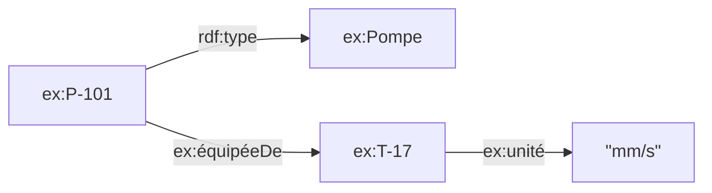

# RDF et triplets

## Aperçu

- **RDF** (Resource Description Framework) est le modèle de données du web sémantique : toute information s'écrit comme un **triplet** `sujet – prédicat – objet`, et un ensemble de triplets forme un **graphe**. C'est une recommandation du W3C, RDF 1.1 datant du 25 février 2014.
- Sa force : l'**identité globale**. Le sujet et le prédicat sont des **IRI** (des identifiants du type d'une adresse web), donc deux bases écrites par deux équipes qui utilisent la même IRI parlent de la même chose, sans table de correspondance.
- Il n'est pas un format de fichier. C'est un modèle abstrait, qui s'écrit dans plusieurs **syntaxes** (Turtle, N-Triples, JSON-LD, TriG…), toutes équivalentes.

## Concepts clés

### Le triplet

- **Sujet** : une IRI ou un nœud anonyme. **Prédicat** : une IRI. **Objet** : une IRI, un nœud anonyme ou un **littéral** (une valeur : texte, nombre, date).
- Dans le dessin, sujets et objets sont des nœuds, le prédicat est l'arc orienté de l'un vers l'autre.
- Un **littéral** porte un type de donnée (`"42"^^xsd:integer`) ou une langue (`"pompe"@fr`) ; sans type, c'est une chaîne.
- Un **nœud anonyme** (blank node) désigne une chose qu'on ne nomme pas globalement ; son identifiant n'a de portée que dans le fichier.



### IRI : l'identifiant global

- Une IRI est une chaîne absolue, éventuellement avec un fragment, comparée **caractère par caractère** (RDF 1.1 Concepts). Deux IRI qui se ressemblent mais diffèrent d'une lettre sont deux choses.
- RDF ne dit pas ce qu'une IRI signifie ; le sens vient du vocabulaire qui l'emploie ([[Ontologie]], [[Données liées et vocabulaires partagés]]). Le primer du W3C le dit : **réutiliser** l'IRI de quelqu'un d'autre plutôt qu'en inventer une.
- Les préfixes (`ex:`, `rdfs:`) raccourcissent l'écriture ; `ex:Pompe` se déplie en une IRI complète.

### Graphes nommés et jeux de données

- Un **jeu de données RDF** (dataset) contient **un** graphe par défaut et zéro ou plusieurs **graphes nommés**, chacun identifié par une IRI.
- Usage typique : un graphe par source (`<graph:gmao>`, `<graph:historian>`), pour garder la **provenance** et pouvoir remplacer une source sans toucher les autres. Les formats TriG et N-Quads portent les graphes nommés.

### Quatre façons d'écrire le même graphe

| Syntaxe | Forme | Quand |
|---|---|---|
| **Turtle** | lisible, avec préfixes, `;` (même sujet), `,` (même sujet et prédicat), `a` = `rdf:type` | écrire et relire à la main |
| **N-Triples** | un triplet complet par ligne, `.` final, UTF-8, sous-ensemble de Turtle | échange en masse, découpage ligne à ligne, outils de flux |
| **JSON-LD** | JSON avec `@context` (noms courts → IRI), `@id`, `@type` ; Recommandation du 16 juillet 2020 | API web, données déjà en JSON |
| **RDF/XML** | l'ancienne syntaxe, d'origine | lecture de données historiques |

```turtle
@prefix ex: <http://example.org/usine#> .

ex:P-101  a ex:Pompe ;
          ex:équipéeDe ex:T-17 .
ex:T-17   ex:unité "mm/s" .
```

La même chose en N-Triples : trois lignes, chaque triplet avec ses IRI complètes entre `<…>`. En JSON-LD :

```json
{
  "@context": { "ex": "http://example.org/usine#" },
  "@id": "ex:P-101",
  "@type": "ex:Pompe",
  "ex:équipéeDe": { "@id": "ex:T-17" }
}
```

### RDF 1.2 : parler d'un fait

- RDF 1.1 ne peut pas attacher une propriété à un **triplet** (« ce fait date de 2026, source : GMAO »). Il faut une **réification** : transformer le fait en nœud.
- **RDF 1.2** ajoute les **triple terms** : un triplet peut être l'objet d'un autre, avec `rdf:reifies`. Il ajoute aussi les chaînes avec direction de texte et un moyen d'annoncer la version.
- Statut vérifié : RDF 1.2 Concepts est un *Candidate Recommendation Snapshot* du 7 avril 2026, non encore Recommandation d'après les sources lues ; SPARQL 1.2 est en *Working Draft*. À rechercher avant de bâtir sur ces ajouts.

## Les maths, simplement

- Un graphe RDF est un **ensemble** de triplets : $G \subseteq (I \cup B) \times I \times (I \cup B \cup L)$. Comme c'est un ensemble, ajouter deux fois le même triplet ne change rien, et l'ordre ne compte pas.
- Fusionner deux graphes, c'est faire l'**union** des deux ensembles : $G_1 \cup G_2$. Si deux sources emploient la même IRI pour la même pompe, les faits se rejoignent d'eux-mêmes ; si elles emploient deux IRI, il faut déclarer qu'elles désignent la même chose ([[Liage d'entités]], `owl:sameAs`).
- L'**implication** (RDFS) ajoute des triplets déduits : si `ex:Pompe rdfs:subClassOf ex:Équipement` et `ex:P-101 a ex:Pompe`, alors `ex:P-101 a ex:Équipement`. RDF 1.1 Semantics liste ces règles (domaine, portée, sous-classe, sous-propriété).

## En pratique

- **Écrire en Turtle, échanger en N-Triples ou JSON-LD** selon le destinataire. Versionner les fichiers Turtle dans Git : un diff de graphe devient lisible.
- **Choisir ses IRI tôt.** Une IRI instable (un numéro de ligne de table, une adresse de serveur qui change) se paie à chaque fusion ; préférer des identifiants métier stables (numéro d'équipement).
- **Éviter les nœuds anonymes pour ce qu'on veut retrouver** ou fusionner entre sources : leur identifiant est local au fichier.
- **Pièges** : mélanger littéral et IRI pour la même valeur (`"T-17"` n'est pas `ex:T-17`) ; confondre l'IRI d'une chose et celle de sa page de description ; oublier que `"1"` et `"1"^^xsd:integer` sont deux littéraux distincts.
- **Vs graphe de propriétés** : pour une propriété sur une relation, RDF 1.1 demande la réification ; un graphe de propriétés l'a de base ([[Bases graphe — modèles et langages de requête]]).

## Approches voisines & alternatives

- [[SPARQL]] — interroger ces triplets ; [[SHACL]] — valider la forme du graphe ; [[OWL et raisonnement]] — en déduire plus.
- [[Graphe de connaissances]] — l'entrée du sujet.
- [[Bases graphe — modèles et langages de requête]] — le graphe de propriétés, l'autre modèle, et la comparaison des langages.
- [[Données liées et vocabulaires partagés]] — les IRI à réutiliser.
- [[Neo4j]] — un moteur de graphe de propriétés, pour comparer avec le modèle RDF.

## Pour aller plus loin

- W3C — RDF 1.1 Concepts and Abstract Syntax (Recommendation, 2014-02-25) — https://www.w3.org/TR/rdf11-concepts/
- W3C — RDF 1.1 Primer — https://www.w3.org/TR/rdf11-primer/
- W3C — RDF 1.1 Turtle (Recommendation, 2014-02-25) — https://www.w3.org/TR/turtle/
- W3C — RDF 1.1 N-Triples (Recommendation, 2014-02-25) — https://www.w3.org/TR/n-triples/
- W3C — JSON-LD 1.1 (Recommendation, 2020-07-16) — https://www.w3.org/TR/json-ld11/
- W3C — RDF 1.1 Semantics (Recommendation, 2014-02-25) — https://www.w3.org/TR/rdf11-mt/
- W3C — RDF 1.2 Concepts (Candidate Recommendation Snapshot, 2026-04-07) — https://www.w3.org/TR/rdf12-concepts/
