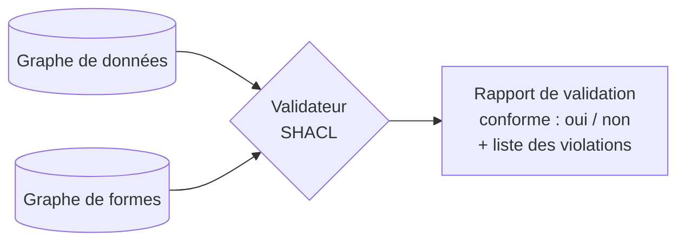

# SHACL

## Aperçu

- **SHACL** (Shapes Constraint Language) est le langage W3C pour **valider un graphe RDF** : on écrit des **formes** (shapes) qui disent à quoi doivent ressembler les données, et un validateur rend un **rapport** de conformité listant chaque violation. C'est une Recommandation du 20 juillet 2017.
- Les formes sont elles-mêmes écrites en RDF, dans un **graphe de formes** (shapes graph), distinct du **graphe de données** vérifié (data graph).
- C'est pour RDF ce que JSON Schema est pour JSON ou les contraintes `NOT NULL` et `CHECK` pour SQL : le garde-fou de qualité à l'entrée. Là où [[OWL et raisonnement]] déduit, SHACL **contrôle**.

## Concepts clés

### Une forme

```turtle
@prefix ex: <http://example.org/usine#> .
@prefix sh: <http://www.w3.org/ns/shacl#> .
@prefix xsd: <http://www.w3.org/2001/XMLSchema#> .

ex:CapteurShape
    a sh:NodeShape ;
    sh:targetClass ex:Capteur ;
    sh:property [
        sh:path ex:unité ;
        sh:minCount 1 ;
        sh:datatype xsd:string ;
    ] .
```

Lecture : « tout `ex:Capteur` doit avoir au moins une `ex:unité`, et c'est une chaîne ». Un capteur sans unité produit une violation dans le rapport.

- **Node shape** : contraintes sur le nœud cible lui-même (c'est une IRI, il a tel type).
- **Property shape** : contraintes sur les valeurs atteintes depuis le nœud par un chemin (`sh:path`) : nombre minimum et maximum, type de donnée, valeur dans une liste, motif de texte.
- **Cibles** : qui est validé ? `sh:targetNode` (un nœud), `sh:targetClass` (les instances d'une classe, sous-classes comprises), `sh:targetSubjectsOf` et `sh:targetObjectsOf` (les nœuds qui portent, ou reçoivent, un prédicat donné).



### SHACL contre OWL

| | OWL | SHACL |
|---|---|---|
| Tâche | **déduire** (implication) | **valider** (conformité) |
| Hypothèse | monde ouvert, pas de nom unique | on traite le graphe de données comme complet |
| Absence d'une valeur | inconnue : rien n'est signalé | `sh:minCount 1` **signale** la violation |
| Résultat | des triplets déduits, des incohérences | un rapport de violations |

- Les deux se complètent : OWL pour enrichir et classer, SHACL pour garantir la qualité de ce qu'on charge. Bogaerts, Jakubowski et Van den Bussche (2022) montrent que SHACL est formellement une logique de description, avec une sémantique de validation propre ; Oudshoorn, Ortiz et Simkus (2026) donnent une sémantique à SHACL **en présence d'ontologies**.
- La spécification dit que SHACL utilise les vocabulaires RDF et RDFS mais **n'exige pas** l'inférence RDFS complète : si les données comptent sur des sous-classes déduites, il faut soit les écrire dans le graphe, soit utiliser un validateur qui sait raisonner (`sh:entailment`).

### Ce qu'on peut vérifier

- **Cardinalités** (`sh:minCount`, `sh:maxCount`), **types** (`sh:datatype`, `sh:class`, `sh:nodeKind`), **valeurs** (liste, intervalle, longueur, expression régulière), **forme des chemins** et formes **imbriquées**, combinaisons logiques (`sh:and`, `sh:or`, `sh:not`).
- **Contraintes en SPARQL** (extension SHACL-SPARQL) pour les règles que les constructions de base n'expriment pas — à utiliser avec parcimonie, car elles dépendent du moteur.
- Un message par violation, avec le nœud fautif, le chemin, la valeur et la forme enfreinte : lisible par une personne **et** exploitable par un script.

### SHACL 1.2

Une version 1.2 est en cours de rédaction par le groupe de travail du W3C : plusieurs brouillons (*Working Draft*) de SHACL 1.2 Core datent de 2026, le plus récent vu étant du 28 août 2026, avec une liste de documents compagnons qui change d'une version à l'autre. La Recommandation de référence reste celle de 2017.

## Les maths, simplement

- Une forme est un **prédicat** sur les nœuds. Un graphe $G$ est **conforme** à un graphe de formes $S$ quand, pour toute forme $s \in S$ et pour tout nœud cible $n$ de $s$, la condition de $s$ est vraie de $n$ dans $G$. Un nœud qui n'est ciblé par aucune forme n'est **jamais** vérifié : valider ne dit rien de ce qu'aucune forme ne vise.
- `sh:minCount 1` sur `ex:unité` s'écrit : pour tout $c$ de type `Capteur`, $|\{v : (c, \text{unité}, v) \in G\}| \geq 1$. Il compte les triplets **présents** : c'est du monde fermé. Le même énoncé comme axiome OWL ne compterait rien (monde ouvert), il postulerait l'existence d'une valeur inconnue.
- La validation est un **test de modèle** (le graphe vérifie-t-il la condition ?), alors que le raisonnement OWL est une **déduction** (la conclusion suit-elle des axiomes ?). Ce sont deux problèmes de complexité différente.

## En pratique

- **Valider à chaque chargement** : un pipeline qui charge dans le graphe commence par valider le lot, et rejette ou met en quarantaine ce qui viole une forme — l'équivalent d'un test de schéma avant l'écriture en base.
- **Écrire les formes avec les questions métier** : « un équipement sans identifiant » ou « une mesure sans unité » sont des formes évidentes ; elles attrapent les erreurs de mapping depuis la GMAO.
- **Versionner le graphe de formes** avec l'[[Ontologie]] : une forme est du contrat, un changement s'annonce comme une migration.
- **Outils** : une bibliothèque Python de validation SHACL et les moteurs RDF qui l'intègrent existent ; ils seront décrits dans les fiches d'outils, une fois leur licence et leur activité vérifiées à la source.
- **Pièges** : une forme qui cible une classe jamais déclarée ne valide rien et ne dit rien ; oublier que `sh:minCount` ne dit pas « qui est responsable » ; confondre « valide » et « vrai » (une valeur peut respecter la forme et être fausse) ; compter sur SHACL pour **corriger** les données (il signale, il ne répare pas).

## Approches voisines & alternatives

- [[OWL et raisonnement]] — le pendant : déduire en monde ouvert ; [[Ontologie]] — ce que les formes protègent.
- [[RDF et triplets]] — les formes sont du RDF ; [[SPARQL]] — l'extension SHACL-SPARQL.
- [[Graphe de connaissances]] — l'entrée du sujet ; [[Liage d'entités]] — traite les doublons, que SHACL ne voit pas.
- **Hors RDF** : [[Postgres]] et ses contraintes déclaratives pour les données tabulaires ; [[pandera]] ou [[Great Expectations]] pour des DataFrames, si le graphe n'est pas en jeu.

## Pour aller plus loin

- W3C — Shapes Constraint Language (SHACL), Recommandation du 2017-07-20 — https://www.w3.org/TR/shacl/
- W3C — SHACL 1.2 Core (Working Draft) — https://www.w3.org/TR/shacl12-core/
- Bogaerts, Jakubowski, Van den Bussche (2021, LPNMR 2022) — *SHACL: A Description Logic in Disguise* — https://arxiv.org/abs/2108.06096
- Oudshoorn, Ortiz, Simkus (2026, Artificial Intelligence 352) — *SHACL Validation in the Presence of Ontologies: Semantics and Rewriting Techniques* — https://arxiv.org/abs/2507.12286
