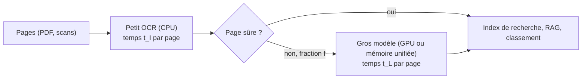

# Cascade OCR et contrôle arithmétique des factures

## Aperçu

- Deux idées qui se complètent. **La cascade** : un petit OCR rapide lit toutes les pages, et seules les pages douteuses montent vers un gros modèle lent. **Le contrôle arithmétique** : sur une facture, un total qui ne se recalcule pas à partir des lignes révèle un chiffre mal lu, sans relecture humaine.
- Exemple chiffré : sur un portable, un petit OCR sur CPU lit une page en 0,09 s et un modèle vision-langage de 0,8 milliard de paramètres en 10,07 s. Si 5 % des pages seulement montent, la page coûte 0,59 s en moyenne, soit environ 17 fois moins que le gros modèle seul ; à 26 % de pages renvoyées, le gain tombe à 3,7.

## Concepts clés

### La cascade

- Le gros modèle n'est payé que sur la fraction $f$ des pages renvoyées. Le petit OCR est payé sur **toutes** les pages : c'est son temps $t_I$ qui fixe le plancher.
- C'est une instance du schéma général de [[Routing and cascading]] : escalader du moins cher au plus cher, selon un signal.
- La thèse défendue par l'éditeur d'un petit OCR : pour alimenter un index de recherche ou un RAG, un texte « assez bon » suffit s'il arrive vite.

### Le critère de tri : le maillon faible

- « N'envoyer que les pages qu'il ne sait pas lire » suppose de les **reconnaître sans les lire**. Un petit OCR expose une confiance par ligne, mais ni la vidéo ni l'éditeur ne montrent qu'elle est **calibrée** (cf. [[Calibration]]).
- Piège : certains moteurs **suppriment le texte** d'une ligne dont la confiance moyenne est sous 0,5 (la boîte reste, le texte disparaît). Une ligne illisible disparaît au lieu d'être fausse : le tri doit compter les lignes **vides**, pas seulement les lignes fausses.
- Signaux candidats, à mesurer sur ses propres pages : fraction de lignes à faible confiance ou vides, nombre de caractères par page comparé à ce qu'on attend, écriture non prise en charge, page manuscrite, tableau à cellules fusionnées, échec du contrôle arithmétique.
- Un tri fiable n'est donc **pas** fourni : il se construit et se mesure.

### Le contrôle arithmétique d'une facture

Les chiffres d'une facture sont liés entre eux : somme des lignes, taxe, total. Une facture synthétique du banc :

| Ligne | Quantité × prix | Montant |
|---|---|---|
| Étiquettes thermiques | 40 × 185,00 | 7 400,00 |
| Lecteur de codes-barres | 3 × 4 250,00 | 12 750,00 |
| Ruban adhésif | 120 × 36,50 | 4 380,00 |
| Carton ondulé | 250 × 22,80 | 5 700,00 |
| Pochette de coursier | 500 × 6,40 | 3 200,00 |
| **Sous-total** | | **33 430,00** |
| TVA 18 % | $33\,430\times0{,}18$ | 6 017,40 |
| **Total** | $33\,430+6\,017{,}40$ | **39 447,40** |

- Trois recalculs : chaque ligne ($q\times p$), le sous-total (somme des lignes), la taxe puis le total. Un seul chiffre mal lu casse au moins une égalité.
- Le contrôle est **indépendant du modèle** : il vaut pour un OCR de 1 million de paramètres comme pour un modèle de 4 milliards.
- Il décide de **qui relit** : égalités vérifiées, la facture passe ; sinon, elle monte vers le gros modèle ou vers un humain. C'est un critère de tri de la cascade, et le seul de cette page qui ne dépende pas d'une confiance.

## Les maths, simplement

- **Temps moyen par page** : $t = t_I + f\,t_L$, avec $t_I=0{,}09$ s, $t_L=10{,}07$ s. La cascade bat le gros modèle seul tant que $t_I+f\,t_L<t_L$, soit $f<1-t_I/t_L\approx0{,}99$ : elle gagne presque toujours en temps ; la question est de **combien**.

| Fraction renvoyée $f$ | $t$ (s par page) | Gain face au gros modèle seul |
|---|---|---|
| 5 % | 0,59 | environ 17× |
| 10 % | 1,10 | environ 9× |
| 20 % | 2,10 | environ 4,8× |
| 26 % | 2,71 | environ 3,7× |

- Le 26 % est la proportion des pages **mises en échec** par un banc volontairement difficile (6 pages sur 23 : rapport de terrain manuscrit, ticket, kannada en image, page de maths, télécopie, tableau à en-têtes fusionnés). Il ne vaut pas pour un corpus d'entreprise.
- **Contrôle d'une facture** : $\sum_i q_ip_i=S$, $\;S\times\tau=T_{\text{taxe}}$, $\;S+T_{\text{taxe}}=T_{\text{total}}$, à l'arrondi près.

## En pratique

- **Mesurer $f$ sur ses documents** avant de promettre un gain : le gain s'effondre quand $f$ monte.
- **Même matériel ou non** : l'exemple compare un OCR sur CPU et un modèle sur le GPU du même portable. Ce n'est pas un rapport à matériel égal, et il ne se transporte pas sur un serveur (cf. [[Mesurer une latence]]).
- **Ce que le contrôle ne voit pas** : un libellé faux, un chiffre faux **qui laisse les égalités vraies** (deux erreurs qui se compensent, un total lu de travers avec les mêmes lignes), l'appariement entre libellé et montant. Un ticket lu en deux blocs, libellés puis montants, passe un contrôle de somme et reste inutilisable pour extraire les lignes.
- **Ce qu'il ne dit pas non plus** : zéro erreur sur **une** facture synthétique propre n'établit pas un taux d'erreur sur des factures réelles (tampons, plis, reflets, lignes multiples).
- **Quel gros modèle** : un modèle vision-langage sur mémoire unifiée ou GPU (LightOnOCR-3, [[olmOCR]]) ; **quel petit OCR** : [[Indra OCR]] ou [[Tesseract]] sur CPU.
- **Avant la cascade, une question plus simple** : le PDF porte-t-il déjà son texte ? (cf. [[Couche de texte d'un PDF contre OCR]]). Un classeur de pages ([[pdf-inspector]]) décide page par page.

## Repères datés

- Temps mesurés par l'auteur d'un banc (MacBook Air M5 24 Go) : Indra OCR 0.3.2, 64 ms par page isolée sur 4 fils, 0,09 s par page dans son tableau comparatif, 25,2 pages/s sur 10 cœurs (2026-10-15) ; LightOnOCR-3 0,8B, 10,07 s par page (2026-10-10). Aucune mesure indépendante. Le paquet a changé depuis : la 1.1.0 (2026-10-19) annonce environ 16 % de temps en plus par page que la 0.3.2, et de nouveaux modèles de précision différente (journal des modifications du dépôt, relevé le 2026-10-20) ; les temps ci-dessus sont ceux de la 0.3.2.
- Le « ~108× plus rapide » de la vidéo retombe à environ 112× avec les valeurs arrondies du tableau ; l'ordre de grandeur « cent fois » tient, la valeur exacte non.

## Approches voisines & alternatives

- [[Routing and cascading]] — le cas général : cascade de modèles de langage, routeur.
- [[OCR classique vs modèles vision-langage pour documents]] — les deux familles qu'une cascade relie ; un billet cité propose Tesseract d'abord et un repli sous 70 % de confiance, coûts calculés par son auteur.
- [[Couche de texte d'un PDF contre OCR]] — éviter l'OCR quand le texte est déjà là.
- [[OCR vision-langage en une passe avec grounding]] — le gros modèle de la cascade.
- [[Évaluer un OCR]] — mesurer l'ensemble sur ses pages.
- [[Calibration]] — condition pour qu'une confiance serve de critère de tri.
- [[Parsing]] et [[Comparatif - Parsing de documents]] — les outils.

## Pour aller plus loin

- Cours de floSa : *Indra OCR : un OCR pour processeur* — vidéo AI WITH Rithesh, 7 min 31, [youtube.com/watch?v=wXvJeofdAFQ](https://www.youtube.com/watch?v=wXvJeofdAFQ), 2026-10-15 (schéma de l'architecture à 01 min 02 s ; comparaison de vitesse à 06 min 52 s ; verdict « utiliser pour / envoyer ailleurs » à 07 min 05 s). Le calcul $t=t_I+f\,t_L$ est celui de la rédaction du cours, non de la vidéo.
- Cours de floSa : *LightOnOCR-3* — vidéo AI WITH Rithesh, [youtube.com/watch?v=sPPmHJZCl_s](https://www.youtube.com/watch?v=sPPmHJZCl_s), 2026-10-10 (facture inclinée à 03 min 33 s et tableau reconstruit à 03 min 59 s).
- Datalab, [Indra OCR : a 1M-parameter OCR model that reads 49 pages per second on CPU](https://www.datalab.to/blog/indra-ocr) (2026-10-13) — éditeur, auto-rapporté.
