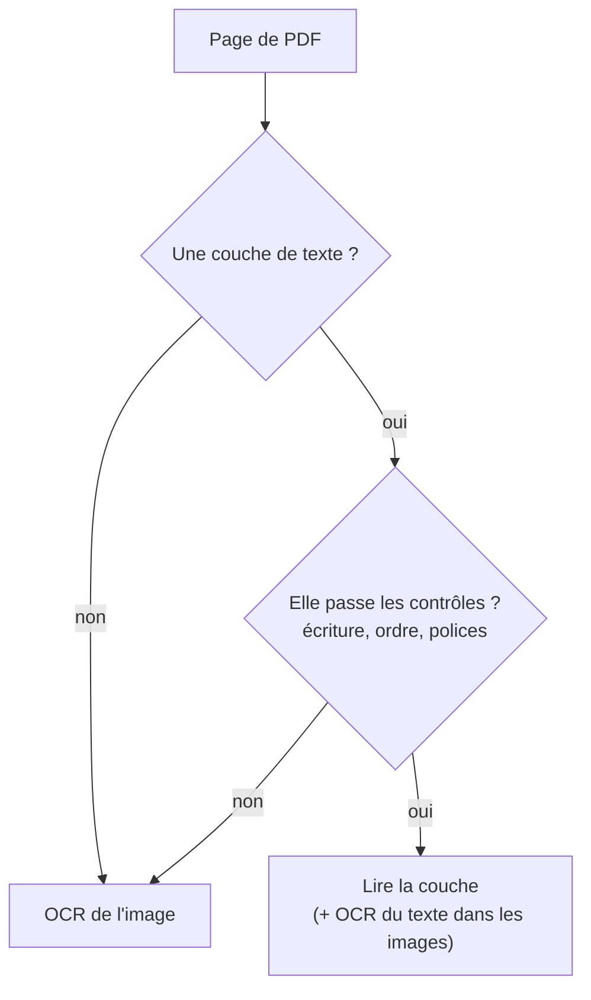

# Couche de texte d'un PDF contre OCR

## Aperçu

- Un PDF « numérique » porte déjà son texte : une **couche de texte** (les caractères, avec leurs positions, dessinés par le producteur du fichier). Un PDF scanné n'est qu'une image. **Lire la couche coûte une extraction ; reconnaître l'image coûte un OCR**, plus lent et probabiliste.
- Exemple chiffré : sur une même page en kannada, un OCR lit l'image avec 88,1 % d'erreur de caractères (l'écriture est hors de ses écritures prises en charge) ; lu depuis la couche du PDF numérique, le même texte sort à 4,8 %. Ce n'est pas de la reconnaissance : c'est de l'extraction.

## Concepts clés

### Le premier choix : la couche, ou l'image

- **Page numérique propre** : lire la couche. Un moteur qui lit la couche quand elle est exploitable annonce 130 ms par page contre 304 ms pour une page qui passe par l'OCR (médianes de l'éditeur, un processus par cœur, versions 0.3.x).
- **Page scannée** : OCR. Rien à lire dans la couche.
- **Page mixte** (texte natif plus une image qui contient du texte) : lire la couche et ne faire l'OCR que sur les images.
- Trier **avant** d'extraire : un classeur de PDF (texte natif, scanné, mixte) rend un routage page par page en quelques dizaines de millisecondes ([[pdf-inspector]]).

### Quand la couche ment

Une couche existe, mais elle est inexploitable. Deux cas documentés par l'éditeur d'un OCR, dans son journal des modifications (versions 1.1.1 et 1.1.2, octobre 2026) :

- **Polices anciennes** : beaucoup de PDF en hindi utilisent des polices héritées dont la couche stocke des codes **latins** à la place des caractères devanagari. Lue telle quelle, la page sort en bouillie latine (précision de mots de 0,01 à 0,20). L'éditeur compare désormais l'écriture de quelques lignes de la couche avec celle des images de ces lignes ; si la couche est latine alors que la page montre une autre écriture, l'OCR lit la page, et la précision de mots monte à 0,85-0,89.
- **Texte de droite à gauche en ordre visuel** : certains producteurs (le navigateur Chrome en tête) rangent les lettres arabes en partie dans l'ordre d'affichage : la couche se lit lettre à lettre à l'envers, avec des espaces dans les mots. Une telle couche n'est plus crue, et l'OCR lit la page.

Un test de validité de la couche (écriture, ordre, polices) précède donc sa lecture ; ce test est un élément de l'outil, pas un acquis du format PDF.

### Un score global n'est pas un taux d'erreur de caractères

- Un taux de tests réussis sur un benchmark (41,3 ; 62,1) mesure des tests oui/non sur des pages difficiles : manuscrit, scans anciens, formules, rotations. Il ne se compare pas à un CER (cf. [[Évaluer un OCR]]).
- **Un CER de 0,0 % sur un PDF numérique ne dit rien de l'OCR** : si l'outil lit la couche, il n'a rien reconnu. Un banc doit dire quels fichiers étaient des **images** et lesquels des PDF à couche, et forcer le mode OCR (`--mode ocr`) pour mesurer la reconnaissance.

## Les maths, simplement

- **Coût d'un corpus** : $t = n_{\text{couche}}\,t_{\text{couche}} + n_{\text{OCR}}\,t_{\text{OCR}}$. Avec 130 ms contre 304 ms (médianes de l'éditeur), 1 000 pages à couche valent 130 s, 1 000 pages scannées 304 s ; un VLM sur GPU ou portable monte à 10 s par page ([[Mesurer une latence]]). Le gain d'une bonne détection de couche est donc proportionnel à la part de pages numériques du corpus.
- **Taux de caractères conservés** : l'éditeur annonce, sur 1 125 pages de 75 familles de langues, « au moins 98 % » des caractères de la couche conservés dans chaque famille, **sur les pages dont la couche passe les contrôles**. La condition fait la valeur du chiffre.

## En pratique

- **Première question à se poser** : ce PDF porte-t-il du texte ? Si oui, [[PyMuPDF]], [[pdfplumber]], [[pypdfium2]] ou [[pdfminer.six]] extraient sans OCR, avec les positions.
- **Vérifier la couche** : comparer quelques lignes de la couche avec ce que l'image montre. Une page « numérique » dont le texte sort en caractères latins sur un document devanagari est à passer à l'OCR.
- **Les OCR de bout en bout** qui ne lisent que l'image (un modèle vision-langage comme [[LightOnOCR-3]]) ignorent la couche : le client rend chaque page en image. Le texte natif n'est pas exploité, et le temps par page ne dépend pas de la couche.
- **Un OCR qui lit la couche** ([[Indra OCR]], mode `auto`) change ce que mesure un test : cf. plus haut.
- **PDF cherchable** : produire un PDF qui porte la couche d'un OCR est une sortie de [[Tesseract]], utile pour retrouver une page par mot-clé sans changer l'image.
- **Écritures hors liste** : si l'OCR ne gère pas l'écriture (kannada, tamoul, arabe en image), la couche d'un PDF numérique est parfois le seul chemin ; pour une image, c'est un autre moteur ou un VLM.

## Repères datés

- Indra OCR 0.3.2 (2026-10-15, banc d'un testeur) : kannada, image 88,1 % contre PDF numérique 4,8 %. Version 1.1.x (2026-10-19 et 2026-10-20) : l'éditeur ajoute des contrôles de couche (écriture des lignes, polices héritées, ordre visuel) ; l'état courant est dans le journal des modifications du dépôt, relevé le 2026-10-20.
- Les médianes de 130 et 304 ms datent des versions 0.3.x : à remesurer avec les modèles 1.1.

## Approches voisines & alternatives

- [[Parsing]] — le hub : PDF natif contre scanné est le clivage qui décide de tout.
- [[Comparatif - Parsing de documents]] — les outils, avec ce qui les départage.
- [[OCR]] — la notion de base.
- [[OCR classique vs modèles vision-langage pour documents]] — le choix pour les pages sans couche.
- [[OCR vision-langage en une passe avec grounding]] — le cas d'un modèle qui lit toujours l'image.
- [[RAG visuel - retrouver des documents sans OCR]] — éviter à la fois la couche et l'OCR : retrouver la page par son image.
- [[Chunking strategies]] — que faire du texte une fois lu.
- [[Évaluer un OCR]] — ne pas mesurer une extraction comme une reconnaissance.

## Pour aller plus loin

- Cours de floSa : *Indra OCR : un OCR pour processeur* — vidéo AI WITH Rithesh, 7 min 31, [youtube.com/watch?v=wXvJeofdAFQ](https://www.youtube.com/watch?v=wXvJeofdAFQ), 2026-10-15 (écritures : hindi à 05 min 20 s, kannada à 05 min 36 s et 05 min 40 s).
- Datalab, dépôt [datalab-to/indra](https://github.com/datalab-to/indra), `README.md` (modes `auto`, `ocr`, `text` ; section « Text layer ») et `CHANGELOG.md` (versions 1.1.1 et 1.1.2) — éditeur, auto-rapporté.
- Datalab, [Indra OCR : a 1M-parameter OCR model that reads 49 pages per second on CPU](https://www.datalab.to/blog/indra-ocr) (2026-10-13).
