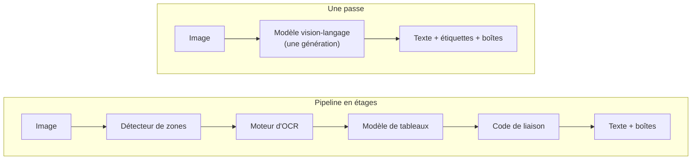

# OCR vision-langage en une passe avec grounding

## Aperçu

- Un **modèle vision-langage** lit l'image d'une page et, **dans une seule génération**, écrit le texte de chaque bloc, son étiquette (titre, texte, tableau, graphique…) et sa **boîte englobante**. Le *grounding* (ancrage) est ce mode qui attache chaque bloc à sa position sur la page.
- Exemple : en mode grounding, chaque bloc est précédé d'un marqueur du genre `` suivi du contenu du bloc ; un graphique en barres sort comme un **tableau de données** (six barres, six valeurs). Un pipeline classique aurait enchaîné un détecteur de zones, un OCR, un modèle de tableaux et du code de liaison.

## Concepts clés

### Pipeline en étages contre une passe

Schéma refait d'après une diapositive de la vidéo *LightOnOCR-3 Is HERE* (AI WITH Rithesh, 01 min 46 s), qui oppose les quatre blocs de la pile classique à un modèle unique.

### Le format de sortie

- Un **marqueur court** `` avant chaque bloc, puis le contenu. Les coordonnées sont **des jetons de texte** normalisés sur une grille de **0 à 1000**, pas des pixels : elles valent quelle que soit la taille de l'image.
- Un ensemble fermé d'étiquettes (une quinzaine : texte, titre, liste, en-tête, pied de page, numéro de page, note de bas de page, légende, formule, code, tableau, image, graphique…), plus un suffixe `+` pour un bloc qui continue le précédent (une colonne qui se prolonge).
- Une image sort avec une courte **description**, un graphique avec son **tableau de données**. Sans l'invite `grounding`, le même modèle rend la page en Markdown seul.
- Le choix d'un format en marqueurs courts plutôt qu'en HTML ou en JSON est un **choix de coût** : l'éditeur annonce 9 à 14 % de jetons de sortie en moins que deux concurrents sur 512 pages, pour des sorties de contenu différent. Le mode grounding ajoute tout de même environ **un quart** de jetons : 1 433 contre 1 158 jetons par page en moyenne pour le plus gros modèle (+23,8 %).

### Ce que « une passe » veut dire, et ne veut pas dire

- Un **appel de génération** par page, pas une lecture instantanée : le temps reste proportionnel au nombre de jetons produits (cf. [[Mesurer une latence]]).
- Les boîtes sont **apprises**, non mesurées. Elles viennent d'un pipeline d'annotation (détecteurs de texte et de mise en page alignés sur des transcriptions d'un modèle précédent) : le modèle est **distillé** d'une chaîne multi-modèles. Sa qualité de boîtes est bornée par celle de ces annotations, puis affinée par renforcement.
- Le renforcement à récompense vérifiable (RLVR) note chaque paire de boîtes appariées par $\min\!\left(\dfrac{\mathrm{IoU}}{0{,}75},1\right)$, divisée par le plus grand des deux nombres de boîtes : une boîte manquante, en trop ou mal étiquetée coûte.
- Une étiquette rare peut ne **jamais sortir** : sur un banc local de quatre pages, aucun des trois modèles n'a produit l'étiquette `aside_text` (texte tourné en marge) alors qu'elle existe dans la liste ; le texte vertical était trouvé et lu juste, étiqueté `text`.

## Les maths, simplement

- **Jetons d'entrée** : une page à 1540 px sur le grand côté coûte environ 1,6 à 1,7 k jetons visuels, contre environ 4,8 k pour un rendu à 400 ppp plafonné à 5 mégapixels (chiffres de l'éditeur). Moins de jetons d'image, c'est ce qui rend le préremplissage supportable sur un portable.
- **Jetons de sortie** : $t\approx t_{\text{prefill}}+\dfrac{n_{\text{sortie}}}{v}$, avec $v$ le débit de decode (cf. [[Plafond de débit d'un GPU (roofline)]]). Un modèle de 0,8 milliard de paramètres en bfloat16 pèse 1,71 Go ; sur une machine à 153 Go/s, le plafond est à 89,7 jetons/s, et l'auteur d'un banc en mesure 69,8 (78 % du plafond).
- **Coût d'une page** : `jetons produits ÷ débit`. Les mêmes trois modèles, sur le même portable, produisent environ 700 jetons par page sur un banc de pages courtes (10 à 52 s) et 1 433 sur des pages denses (environ le double du temps).

## En pratique

- **Quand** : une seule chaîne à héberger, des boîtes pour **citer la source** d'une réponse ou surligner une zone, des graphiques à convertir en données, des tableaux et des formules dans le même appel.
- **Ce que ça change** : moins de code de liaison, un seul modèle à servir, mais un temps par page qui suit la densité du texte, et un modèle à **héberger sur GPU** ou sur une machine à mémoire unifiée (un 0,8B tient dans 2,8 Go de mémoire de pointe, un 4B dans 10,5 Go, d'après un banc sur MacBook Air M5).
- **Ce que ça ne règle pas** : un VLM peut **réécrire** ce qu'il lit, avec une sortie fluide (cf. [[OCR classique vs modèles vision-langage pour documents]]) ; télécopies et manuscrits restent des limites ; les étiquettes de zones rares sont peu fiables.
- **Critères d'évaluation** : un F1 de boîtes à IoU 0,5 avec étiquette obligatoire, pas un score d'ordre de lecture (cf. [[Évaluer un OCR]]).
- **Contrôler les chiffres** à part : un contrôle arithmétique rattrape un total mal lu (cf. [[Cascade OCR et contrôle arithmétique des factures]]).
- **Deux écoles de sortie** : un VLM de bout en bout ([[LightOnOCR-3]], [[Surya]] dans sa version 2, qui fait mise en page, OCR et tableaux par un seul modèle) contre un pipeline de petits réseaux qui sort lui aussi des boîtes, sur CPU ([[Indra OCR]]).

## Repères datés

- LightOnOCR-3 (0,8B, 1B, 4B), sorti les 6 et 7 octobre 2026 ; blog du 8 octobre ; relevé le 2026-10-10 : trois bancs publics auto-rapportés (olmOCR-Bench 84,5 à 86,3 ; ParseBench 71,4 à 75,1 ; fr-bench-pdf2md 69,6 à 74,1), aucune mesure indépendante trouvée.
- Surya 0.22.1 (2026-07-20) : modèle de 650 millions de paramètres, d'après le README relevé le 2026-10-20.

## Approches voisines & alternatives

- [[OCR]] — la notion de base : deux étages, CTC contre attention.
- [[OCR classique vs modèles vision-langage pour documents]] — quand un pipeline en étages, quand un modèle vision-langage, et comment chacun échoue.
- [[Vision Language Models]] — la famille de modèles, sans le cadre documentaire.
- [[RAG visuel - retrouver des documents sans OCR]] — l'approche qui évite l'OCR : retrouver une page par son image.
- [[Évaluer un OCR]] — comment mesurer texte, boîtes, graphiques et tableaux.
- [[Couche de texte d'un PDF contre OCR]] — la première question : faut-il lire l'image ?
- [[Constrained decoding]] — contraindre la sortie d'un modèle à un format.
- [[Parsing]] et [[Comparatif - Parsing de documents]] — les outils.

## Pour aller plus loin

- Cours de floSa : *LightOnOCR-3 : trois tailles d'OCR à passe unique* — vidéo AI WITH Rithesh, 6 min 34, [youtube.com/watch?v=sPPmHJZCl_s](https://www.youtube.com/watch?v=sPPmHJZCl_s), 2026-10-10 (pile classique contre modèle unique à 01 min 46 s, sortie de grounding à 01 min 09 s, format en marqueurs à 01 min 31 s, entraînement à 01 min 51 s et 01 min 57 s).
- LightOn, [LightOnOCR-3 : High-Performance OCR and Layout Extraction in One Model](https://huggingface.co/blog/lightonai/lightonocr-3) (2026-10-08) et dépôt [lightonai/LightOnOCR](https://github.com/lightonai/LightOnOCR) (client, format de sortie, étiquettes) — éditeur, auto-rapporté.
- LightOn, [LightOnOCR : a 1B End-to-End Multilingual Vision-Language Model for State-of-the-Art OCR](https://arxiv.org/abs/2601.14251) (arXiv 2601.14251, janvier 2026) — la lignée précédente.
