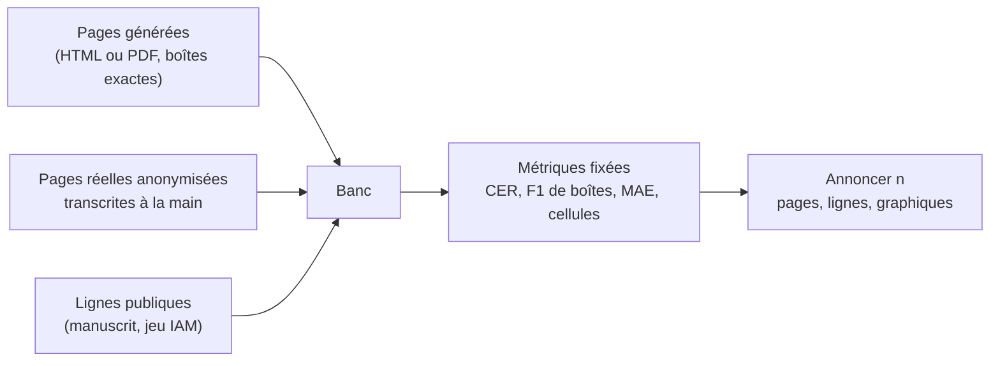

# Évaluer un OCR

## Aperçu

- Évaluer un OCR, c'est **comparer sa sortie à une vérité terrain connue, avec une métrique qui dit ce qu'elle compte, et annoncer combien de pages ont été testées**. Un score sans métrique, sans normalisation ni nombre de pages ne se compare à rien.
- Exemple chiffré : un banc de quatre pages fabriquées donne 0,25 à 0,30 % d'erreur de caractères pour trois modèles, et un F1 de boîtes de 0,926 à 0,947. Écart entre le premier et le dernier : une à deux boîtes sur 47. Le banc est utile pour voir **où** les modèles échouent (une page de télécopie, un mot manuscrit), pas pour les classer.

## Concepts clés

### Quatre mesures, quatre questions

| Mesure | Question posée | Piège |
|---|---|---|
| **CER** (taux d'erreur de caractères) | le texte est-il juste, caractère par caractère ? | sensible à l'**ordre** : un texte juste mais dans le mauvais ordre est lourdement pénalisé ; la normalisation (casse, ponctuation, trait d'union) change le chiffre |
| **F1 de boîtes à IoU 0,5** | les zones sont-elles trouvées, avec la bonne étiquette ? | ce n'est ni un score d'ordre de lecture ni de structure ; un F1 **cumulé** diffère de la moyenne des pages |
| **Erreur absolue sur un graphique** (MAE) | les valeurs extraites d'un graphique sont-elles justes ? | un seul graphique prouve peu ; des valeurs rondes masquent un arrondi |
| **Précision de cellule de tableau** | chaque cellule est-elle dans la bonne ligne et la bonne colonne ? | des nombres justes à 100 % avec une forme fausse (9 lignes lues pour 5) |

- Le **CER** ne distingue pas une erreur de lecture d'une erreur d'ordre : un ticket de caisse lu avec tous ses libellés et tous ses montants, mais en deux blocs (libellés, puis montants), donne 40,7 % d'erreur alors que la reconnaissance est bonne. Pour du plein texte, la page est lisible ; pour extraire des lignes de facture, elle est inutilisable.
- Le **score d'un benchmark publié** est un autre objet : un taux de tests oui/non réussis (« la bonne cellule, le bon bloc, le bon ordre »), sur des pages difficiles. Un 41,3 de ce type n'est **pas** un taux de caractères justes, et ne se compare pas à un CER.

### Le banc à vérité terrain

- **Pages générées par script** : la vérité terrain est exacte (le texte et la position de chaque bloc sont connus), on ajoute une perspective et une ombre pour la « photo », un seuillage et du bruit pour la télécopie. Contrepartie : un rendu numérique parfait est **plus facile** qu'un document réel.
- **Pages réelles de la mission**, anonymisées et transcrites à la main : quelques dizaines valent mieux qu'un score parfait sur quatre pages fabriquées.
- **Lignes manuscrites publiques** : utiles, mais un jeu répandu comme IAM peut avoir servi à l'entraînement ; une contamination ne s'exclut pas, et un 0,0 % de CER sur cinq lignes n'est pas une garantie.
- **Graphiques à valeurs non rondes** : si les valeurs sont des demi-entiers, un modèle qui arrondit à l'entier est pris en défaut.

## Les maths, simplement

- **CER** : $\mathrm{CER}=\dfrac{S+D+I}{N}$, substitutions, suppressions, insertions (distance de Levenshtein sur les caractères) rapportées au nombre $N$ de caractères de la référence. Il peut dépasser 100 %.
- **IoU** : intersection sur union de deux boîtes, de 0 à 1. Une boîte prédite est juste si elle porte **la même étiquette** qu'une boîte vraie et si l'IoU atteint 0,5.
- **F1 de boîtes** : $F_1=\dfrac{2\,\mathrm{TP}}{P+T}$ ($\mathrm{TP}$ boîtes justes, $P$ prédites, $T$ vraies). Sur 47 régions : $\dfrac{2\times45}{48+47}=0{,}947$ ; avec 49 boîtes prédites au lieu de 48 : $\dfrac{2\times45}{49+47}=0{,}938$. Le « 0,95 contre 0,94 » est **une boîte en trop**. Le score global est un F1 **cumulé** (micro) : la moyenne simple des quatre pages donnerait 0,928.
- **MAE** : $\dfrac{1}{n}\sum|\hat y_i-y_i|$. Six barres dont quatre en $x{,}5$, toutes lues à $\pm0{,}5$ : $\dfrac{4\times0{,}5}{6}=0{,}33$ millier d'inscriptions, soit 1,9 % de la moyenne (17,5). Un « tiers » veut ici dire un tiers d'**unité**.
- **Reconstruire un score affiché** : retrouver les nombres de boîtes, refaire le calcul à la main. Un score qu'on ne sait pas refaire est un score dont on ne sait pas ce qu'il compte.

## En pratique

- **Annoncer n** : nombre de pages, de lignes, de graphiques. Quatre pages et un graphique disent « zéro erreur sur trois pages propres », pas « zéro erreur sur vos documents ».
- **Fixer et publier** : normalisation du CER, IoU, règle d'appariement des boîtes, nombre de régions, décodage (glouton pour être déterministe), versions logicielles, résolution d'entrée, format des poids.
- **Répéter les temps**, noter si le chargement du modèle et le préremplissage sont compris, et le matériel (cf. [[Mesurer une latence]]). Pour un lot long sur un portable sans ventilateur, mesurer la montée en température.
- **Dire qui a mesuré** : une mesure de l'éditeur sur son propre banc, une mesure de première main sur un banc personnel, une mesure indépendante. Les trois ne se mélangent pas (cf. [[Lire un score publié]]).
- **Un écart d'un point est une égalité** sur un banc public, d'après l'éditeur d'un des modèles : la même note de bas de page écrite en HTML, en LaTeX ou en Unicode déplace les scores. La règle ne vaut pas pour un écart de 3,6 points.
- **Tester la structure à part** : tableaux, ordre de lecture, étiquettes. Le CER seul ne les voit pas.
- **Tester ce que le PDF contient déjà** : un 0,0 % d'erreur sur un PDF numérique dont l'outil lit la couche de texte ne mesure pas l'OCR (cf. [[Couche de texte d'un PDF contre OCR]]).

## Repères datés

Mesures de première main de l'auteur d'une vidéo (AI WITH Rithesh), sur un MacBook Air M5 24 Go, pages fabriquées avec vérité terrain exacte ; aucune mesure indépendante trouvée à la date de rédaction des documents.

| Modèle | Pages | CER texte | F1 boîtes (47 régions) | Graphique | Relevé |
|---|---|---|---|---|---|
| LightOnOCR-3 0,8B, 1B, 4B | 4 pages, 5 lignes manuscrites, 1 graphique | 0,30 / 0,25 / 0,30 % | 0,938 / 0,926 / 0,947 | MAE 0,33 / 0,33 / 0,0 | 2026-10-10 |
| Indra OCR 0.3.2 | 23 pages, 20 lignes manuscrites | 0 à 3,3 % sur imprimé propre et pages tournées ; 40,7 % ticket ; 49,6 % manuscrit ; 12,1 % télécopie | non mesuré | tableaux : cellules 72,0 à 98,0 %, nombres 100 % | 2026-10-15 |

Les scores publiés par les éditeurs (olmOCR-Bench, ParseBench, OmniParseBench) sont **auto-rapportés** : cf. les fiches LightOnOCR-3 et [[Indra OCR]].

## Approches voisines & alternatives

- [[OCR]] — la notion de base : deux étages, CTC contre attention, CER et WER.
- [[OCR classique vs modèles vision-langage pour documents]] — TEDS pour les tableaux, tests unitaires binaires, Character Error Vector, et les désaccords entre sources.
- [[OCR vision-langage en une passe avec grounding]] — ce que mesure un F1 de boîtes à IoU 0,5.
- [[Cascade OCR et contrôle arithmétique des factures]] — un contrôle qui attrape un chiffre mal lu sans relecture.
- [[Lire un score publié]] — lire un score d'éditeur : version, qui l'a exécuté, banc saturé.
- [[Mesurer une latence]] — matériel, protocole, statistique.
- [[Calibration]] — une confiance par ligne ne sert de critère de tri que si elle est calibrée.
- [[LLM benchmarks]] — le cas général des bancs de modèles.

## Pour aller plus loin

- Cours de floSa : *LightOnOCR-3 : trois tailles d'OCR à passe unique* (vidéo AI WITH Rithesh, 6 min 34, [youtube.com/watch?v=sPPmHJZCl_s](https://www.youtube.com/watch?v=sPPmHJZCl_s), 2026-10-10 ; quatre pages de test à 00 min 26 s, paramètres d'exécution à 03 min 15 s, métriques affichées à 05 min 58 s) et *Indra OCR* (même chaîne, 7 min 31, [youtube.com/watch?v=wXvJeofdAFQ](https://www.youtube.com/watch?v=wXvJeofdAFQ), 2026-10-15 ; banc à 03 min 12 s, tableaux à 04 min 07 s).
- LightOn, dossier `benchmarks/` du dépôt [lightonai/LightOnOCR](https://github.com/lightonai/LightOnOCR) : scripts de reproduction de ParseBench, olmOCR-bench et fr-bench-pdf2md, versions épinglées.
- Datalab, [omni_parse_bench](https://github.com/datalab-to/omni_parse_bench) : benchmark de l'éditeur de [[Indra OCR]], créé le 2026-10-09 ; moteur et juge du même éditeur.
- Jeu de lignes manuscrites [Teklia/IAM-line](https://huggingface.co/datasets/Teklia/IAM-line) (lignes de l'IAM Handwriting Database).
