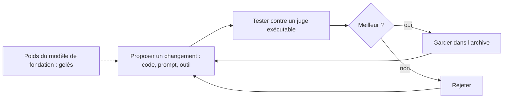

# Boucle d'amélioration d'un agent

## Aperçu

- Une **boucle d'amélioration d'un agent** est un dispositif où un agent propose des changements à son propre **échafaudage** (code, prompts, outils, algorithmes), les teste contre un juge, garde les meilleurs et recommence.
- L'**auto-amélioration récursive** (*recursive self-improvement*, RSI) est l'idée plus forte où l'outil et celui qui l'améliore fusionnent, de sorte que chaque gain facilite le suivant. Les systèmes publiés ne la réalisent pas : **aucun ne modifie les poids du modèle**.
- Trois questions suffisent à classer n'importe quelle annonce : **qu'est-ce qui change, qui juge que c'est mieux, où la boucle s'arrête ?**

## Concepts clés

### Les systèmes publiés, par les trois questions

*Schéma refait d'après le document de formation de floSa sur l'auto-amélioration récursive (section 3), tiré de la vidéo « AI That Builds the NEXT AI?! Recursive Self-Improvement Explained » (AI WITH Rithesh, 8 min 18, 2026-09-15).*

| Système | Ce qui s'améliore | Qui juge | Où la boucle s'arrête |
|---|---|---|---|
| AlphaGo Zero (2017) | les poids du joueur, par auto-jeu | l'issue de la partie, règles fixes | l'algorithme d'apprentissage, écrit par des humains, n'a pas changé |
| Machine de Gödel (Schmidhuber, 2003) | n'importe quelle partie du code | une preuve formelle | la recherche de preuve ; le document de formation dit qu'aucune n'a été réellement construite, l'abstract ne le dit pas |
| STOP (2023) | le programme d'échafaudage | une fonction d'utilité exécutable | « les modèles de langage eux-mêmes n'étant pas modifiés, il ne s'agit pas d'auto-amélioration récursive complète » (résumé des auteurs) |
| AlphaEvolve (2025) | programmes et algorithmes engendrés par Gemini | métriques d'évaluation automatisées | Gemini n'est pas réentraîné ; le système trouve des algorithmes *pour* son infrastructure |
| Darwin Gödel Machine (2025) | le code Python de l'agent | bancs conçus par des humains (SWE-bench, Polyglot) | le modèle de fondation reste gelé selon le document de formation ; confinement et supervision humaine |

- Le joueur progresse, l'améliorateur non : c'est la distinction qui structure le sujet.
- Le pas entre *modifier l'échafaudage* et *lancer et valider un entraînement complet pour un successeur* n'a **aucune instance publiée** selon le document de formation.
- Ce que le juge peut être, et ce qui arrive quand l'agent atteint le juge : voir [[Vérificateur externe et loi de Goodhart]].

### Trois ordres d'affirmations

Une annonce se range avant d'être citée :

1. **Mesuré** : système construit, résultat publié, protocole connu (les cinq lignes ci-dessus ; l'évaluation par ombre de Princeton).
2. **Déclaré** : un éditeur parle de sa propre pratique interne, sans audit externe.
3. **Prévu ou soutenu** : un pronostic ou une thèse (l'« explosion d'intelligence » de I. J. Good en 1965, les pronostics de dirigeants).

Un argument de 1965 et le pronostic d'un dirigeant ne sont pas des résultats et ne concluent jamais un raisonnement bâti sur des résultats. L'argument de Good repose en outre sur une prémisse non démontrée : des rendements non décroissants. Si chaque amélioration devient beaucoup plus difficile que le gain obtenu, la suite converge au lieu d'exploser.

### Ce qui manque

- **Un signal de vérité pour le choix du problème.** La mesure publique : une « évaluation par ombre » (équipe de Princeton, rapportée par MIT Technology Review le 18 août 2026) fait répondre un agent à la question d'un article non publié. Deux articles produits, aucun accepté. L'ingénierie est acquise (revue de littérature, centaines d'expériences) ; le jugement de recherche non. Deux articles seulement : limite que l'étude énonce elle-même.
- **Pourquoi ça manque** : les modèles progressent sur ce qu'on peut entraîner par renforcement, ce qui suppose un succès vérifiable automatiquement. Le choix d'un problème n'a pas de vérificateur : c'est la même raison que pour les briques qui existent. Reste ouverte la question de savoir si la recherche ouverte est indispensable à la RSI.
- **Un juge hors de portée, une surveillance qui tient à l'échelle, du calcul, une infrastructure sûre, une évaluation par des tiers.** Aucun chiffre interne d'éditeur n'a été audité.

## Les maths, simplement

- **Intérêts composés, ou pas.** Un gain relatif constant $g$ par tour donne $(1+g)^n$ : croissance exponentielle. Si le gain tombe à $g/2^{k-1}$ au tour $k$, le produit converge. Toute la dispute sur la vitesse (Yudkowsky contre Hanson, 2008) porte sur ce taux, pas sur l'existence de la boucle.
- Exemple chiffré avec $g=0{,}10$ : constant, 20 tours donnent $1{,}1^{20}\approx 6{,}7$ ; avec un premier gain de 10 % divisé par deux à chaque tour suivant, le total reste borné : $\prod_{k\ge1}(1+0{,}1/2^{k-1})\approx 1{,}21$, quel que soit le nombre de tours.
- **Une mesure d'entrée n'est pas une productivité.** « 3,1 journées-agent par journée humaine » (OpenAI) mesure du temps d'exécution d'agents normalisé en journées de 8 heures, pas le travail produit.

## En pratique

- **Lire une annonce avec les trois questions et les trois ordres.** « Plus de 80 % du code est écrit par le modèle » est une part de **lignes** fusionnées en production, attribuées par une chaîne interne, sous direction et revue humaines : pas « l'IA développe seule ».
- **Construire une boucle chez soi** : un juge exécutable (tests, compilateur, banc), une archive des variantes, un bac à sable (voir [[Sandboxing de code généré]]), un juge inaccessible en écriture à l'agent. C'est le motif de [[Boucle de Ralph]] et de [[agent-loops]], avec en plus l'échafaudage comme objet à améliorer.
- **Garder l'humain sur le choix du problème** : c'est la partie sans vérificateur ([[Human-in-the-loop]]).

### Repères datés

| Repère | Valeur | Ordre, date et source |
|---|---|---|
| Part du code fusionné écrit par Claude chez Anthropic | plus de 80 % des lignes fusionnées en production (le « 90 % » avancé oralement couvre un autre périmètre) | déclaré ; chiffre de mai 2026, page publiée le 4 juin 2026 ; l'éditeur écrit aussi « We are not there yet » |
| « Stagiaire de recherche automatisé » | tâches de recherche bien définies, sous direction humaine, de l'ordre de quelques jours de travail | déclaré ; OpenAI, 6 septembre 2026 |
| Pronostic de Jack Clark | plus de 60 % de chances qu'un modèle entraîne intégralement son successeur d'ici fin 2028 ; sans critère de résolution ; plus large dans la vidéo que dans la source (Axios, 7 mai 2026) | prévu |
| AlphaEvolve | noyau de Gemini accéléré de 23 % (1 % de temps d'entraînement en moins), jusqu'à 32,5 % sur un noyau FlashAttention, multiplication de matrices complexes 4×4 en 48 multiplications | mesuré, déclaré par DeepMind, 14 mai 2025 |
| Évaluation par ombre | deux articles produits par Claude Opus 4.8 sous OpenClaw en six jours et 3 000 dollars de crédits, deux rejetés | mesuré, rapporté par MIT Technology Review le 18 août 2026 |

Tous ces repères sont relevés dans le document de formation de floSa (lu aux sources primaires le 2026-09-15) et **n'ont pas été rouverts** à la rédaction de cette page, sauf les trois papiers de la page voisine. Ils datent de quelques semaines : ils vieillissent.

## Approches voisines & alternatives

- [[Vérificateur externe et loi de Goodhart]] — la ligne de partage entre boucle qui converge et boucle qui triche.
- [[Boucle de Ralph]] — itérer un agent de code jusqu'à ce que les tests passent.
- [[agent-loops]] — les boucles d'un agent au sens de l'orchestration.
- [[Harnais d'agent]] — l'échafaudage que ces systèmes améliorent.
- [[Garde-fous hors modèle]] — contenir une boucle qui atteint son propre environnement.
- [[Excessive agency et lethal trifecta]] — ce qu'un agent peut faire hors du périmètre prévu.
- [[AlphaZero and self-play]] — le cas où seul le joueur progresse.
- [[Agent evaluation]] — mesurer un agent, y compris sur la durée d'une boucle.
- [[Preuve formelle et assistant de preuve]] — un vérificateur de boucle, au domaine des mathématiques.

## Pour aller plus loin

- Zelikman et al., *Self-Taught Optimizer (STOP)*, arXiv 2310.02304 : https://arxiv.org/abs/2310.02304 — abstract relu le 2026-10-20.
- Zhang et al., *Darwin Gödel Machine*, arXiv 2505.22954 : https://arxiv.org/abs/2505.22954 — abstract relu le 2026-10-20.
- Schmidhuber, *Gödel Machines*, arXiv cs/0309048 (2003) ; I. J. Good, *Speculations Concerning the First Ultraintelligent Machine*, 1965 ; *The AI-Foom Debate*, Hanson et Yudkowsky, https://intelligence.org/ai-foom-debate/.
- Anthropic, *When AI builds itself* (2026) et OpenAI, *Research acceleration: The view inside OpenAI* (6 septembre 2026) : déclarations d'éditeurs, citées d'après le document de formation.
- Source de cette page : document de formation de floSa « Auto-amélioration récursive de l'IA » d'après la vidéo d'AI WITH Rithesh (https://www.youtube.com/watch?v=iXKbjDBnJgE). Le document signale que Turing 1950, Good 1965, Vinge 1993 et Bostrom 2014 n'ont pas été rouverts à la source.
