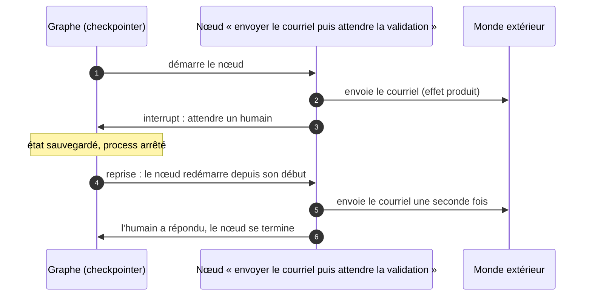

# Checkpointing et reprise

## Aperçu

- Un **checkpoint** est un instantané de l'état d'un agent, pris à un point précis de l'exécution, qui permet de **reprendre** là où l'on s'est arrêté après une panne, une pause ou une validation humaine, au lieu de repartir de zéro.
- Règle à retenir : **un checkpoint rejoue, il n'annule pas.** La reprise relance le dernier nœud interrompu ; les effets qu'il avait déjà produits dans le monde (un courriel, un paiement, une écriture) restent produits. Reprendre n'est pas défaire.
- D'où l'obligation qui en découle : les actions d'un agent doivent être **idempotentes**, ou placées là où un rejeu ne les répète pas.

## Concepts clés

### Ce que sauvegarde un checkpoint

- Dans un graphe d'agent comme [[LangGraph]], un *checkpointer* enregistre l'état à la fin de chaque étape (« super-étape »), pour chaque fil d'exécution (*thread*) : les données, les résultats des nœuds, le nœud suivant. Après un crash, l'exécution reprend à ce point.
- Si un nœud échoue, une politique de reprises (`retry_policy`) relance **la tentative du nœud**, avec un délai croissant (trois tentatives par défaut dans la documentation de LangGraph relevée le 2026-10-20) : un retry rejoue donc le nœud, lui aussi.
- Le même mécanisme porte la **pause humaine** : un `interrupt` suspend le graphe, l'état est persisté, la décision arrive plus tard, l'exécution reprend (voir [[Human-in-the-loop]]).

### Le rejeu : ce qui arrive au nœud interrompu

- La documentation de LangGraph le dit sans détour : une reprise **redémarre le nœud depuis son début**, donc le code placé avant l'`interrupt` s'exécute de nouveau. Les effets de bord déclenchés avant l'`interrupt` doivent être idempotents, être placés **après** l'`interrupt`, ou vivre dans un **nœud séparé**.
- Piège connexe de la même page : une boucle `while True` qui appelle `interrupt()` plusieurs fois dans un seul nœud rejoue toutes les itérations précédentes à chaque reprise (1, puis 2, puis 3…). Une question de relance se range dans l'état et s'interroge une seule fois par nœud.

### Idempotence : rendre le rejeu inoffensif

- Une opération est **idempotente** quand l'appliquer plusieurs fois donne le même résultat que l'appliquer une fois. Un `upsert` l'est, un `INSERT` simple non.
- Pour une action qui ne l'est pas naturellement, on ajoute une **clé d'idempotence** : un identifiant stable, dérivé de la tâche (fil, nœud, étape), que le service destinataire utilise pour ignorer un doublon. Même idée que dans [[ELT vs ETL & idempotence]] côté données.
- Garantie visée : l'effet est appliqué **au moins une fois** par le runtime ; la clé d'idempotence le transforme en effet **« effectivement une fois »**. C'est la même combinaison que celle d'un moteur de flux comme [[Flink]], dont l'*exactly-once* repose sur le checkpointing **et** sur des puits idempotents ou transactionnels.

### Trois objets qui portent le même nom

| Où | Ce que « checkpoint » désigne | Sert à | Ne couvre pas |
|---|---|---|---|
| **LangGraph** | un instantané de l'**état du graphe** | reprendre après une panne, une pause ou une validation | les effets déjà produits dans le monde |
| **Claude Code** | un instantané des **fichiers édités** par l'agent | restaurer le code ou la conversation (`/rewind`) | les changements faits par des commandes shell, la plupart des éditions de sous-agents, les modifications extérieures, les systèmes distants ; ne remplace pas le contrôle de version |
| **Hermes Agent** | un instantané git « fantôme » du projet, pris avant les opérations destructrices | restaurer le projet (`/rollback`) | désactivé par défaut depuis la version 2 ; le dépôt réel n'est pas touché |

Les deux derniers sont des **filets pour les fichiers**. Le premier est un **état d'exécution**. Mélanger les sens fait croire qu'un agent « reprend » alors qu'il a seulement restauré des fichiers.

### Reprise ou annulation : deux questions distinctes

- **Reprendre** : continuer l'exécution depuis un état connu. Problème : le rejeu.
- **Annuler** : défaire des effets déjà produits. Un courriel parti ne revient pas. On passe alors par une **action de compensation** (un rappel, un remboursement, une suppression) écrite à l'avance, selon le principe des sagas des systèmes distribués. Aucun checkpoint ne l'écrit à la place du développeur.

## Les maths, simplement

- Soit un nœud dont l'effet extérieur se produit au pas $e$ et qui peut s'interrompre à un pas $c > e$ avec une probabilité $q$ par exécution. À chaque reprise après un arrêt en $c$, l'effet est rejoué : le nombre attendu d'exécutions de l'effet vaut $1 + q$ par tâche dans le cas simple d'une seule interruption possible.
- Exemple : 1 000 tâches par jour, un courriel envoyé avant une validation humaine, 3 % de reprises. Sans idempotence : environ 30 courriels en double par jour. Avec une clé d'idempotence acceptée par le service d'envoi : 0.
- Le coût d'un checkpoint est le **volume d'état** sauvegardé : sauvegarder à chaque super-étape rend la reprise fine, mais fait croître le stockage (la documentation de LangGraph signale d'ailleurs les points de contrôle qui s'accumulent sans limite) ; il faut purger.

## En pratique

- **Écrire les outils comme s'ils allaient être rejoués** : upsert plutôt qu'insertion, clé d'idempotence pour un paiement ou un envoi, vérification d'existence avant création.
- **Séparer lecture, décision et effet** : un nœud qui prépare, un nœud qui exécute, de sorte qu'une reprise ne répète que le travail sûr.
- **Placer l'effet après l'attente humaine**, pas avant : c'est le placement le plus simple et le plus sûr pour un `interrupt`.
- **Persister dans un stockage durable** (une base) dès que la pause peut durer ou que le processus peut mourir ; un stockage en mémoire disparaît avec le processus.
- **Distinguer le filet de fichiers du filet d'exécution** : activer un `/rewind` ne dispense pas d'idempotence.
- **Journaliser la reprise** : quel point, quel nœud rejoué, quel effet dédoublonné. Voir [[LLM observability]].

## Approches voisines & alternatives

- [[Human-in-the-loop]] — la pause humaine suppose un état persisté : c'est le checkpoint qui la rend possible, et la raison de l'idempotence des outils sensibles.
- [[Reliability patterns]] — retries, timeouts, idempotence : le checkpointing en est la brique de reprise, et un retry rejoue aussi.
- [[agent-loops]] — la boucle d'exécution que le checkpoint découpe en étapes reprenables.
- [[LangGraph]] — l'implémentation de référence décrite ici (checkpointer, `interrupt`, reprise).
- [[Harnais d'agent]] — la persistance et la reprise font partie de ce que le harnais apporte.
- [[Garde-fous hors modèle]] — l'approbation humaine, qui s'appuie sur ce mécanisme.
- [[ELT vs ETL & idempotence]] — le même principe pour les pipelines de données.
- [[Flink]] — le checkpointing d'un moteur de flux : état, barrières, *exactly-once*.
- Alternative : **ne pas reprendre**, recommencer la tâche depuis le début. Simple et sans rejeu partiel, acceptable pour une tâche courte et sans effet ; coûteux (jetons, temps) pour une tâche longue.

## Pour aller plus loin

- Documentation de LangGraph, *Interrupts* : https://docs.langchain.com/oss/python/langgraph/interrupts — lue le 2026-10-20 ; section « Side effects called before interrupt must be idempotent » et règles d'usage.
- Documentation de LangGraph, *Persistence* et *Fault tolerance* : https://docs.langchain.com/oss/python/langgraph/persistence et https://docs.langchain.com/oss/python/langgraph/fault-tolerance — checkpointers, retries, délais, gestionnaires d'erreur. L'ancienne page « Durable execution » est fusionnée dans la page de persistance.
- Documentation de Claude Code, *Checkpointing* : https://code.claude.com/docs/en/checkpointing — lue le 2026-10-20 ; les limites listées dans le tableau ci-dessus.
- Documentation de Hermes Agent, *Checkpoints and /rollback* : https://github.com/NousResearch/hermes-agent (dossier `website/docs/user-guide/`) — lue le 2026-10-20.
- Source de cette page : document de formation de floSa d'après le court « C'est quoi un Harness ? Les 6 mécanismes à comprendre » de Benoit Ferrere (2 min 11, 2026-10-18, https://www.youtube.com/watch?v=MXcJGOf2S9M). Schéma de la reprise refait en Mermaid d'après la carte « Le Harness, 4 sur 6 — Checkpointing » à 1 min 06 (« Reprise à l'étape 12 », « Les effets externes restent exécutés »).
