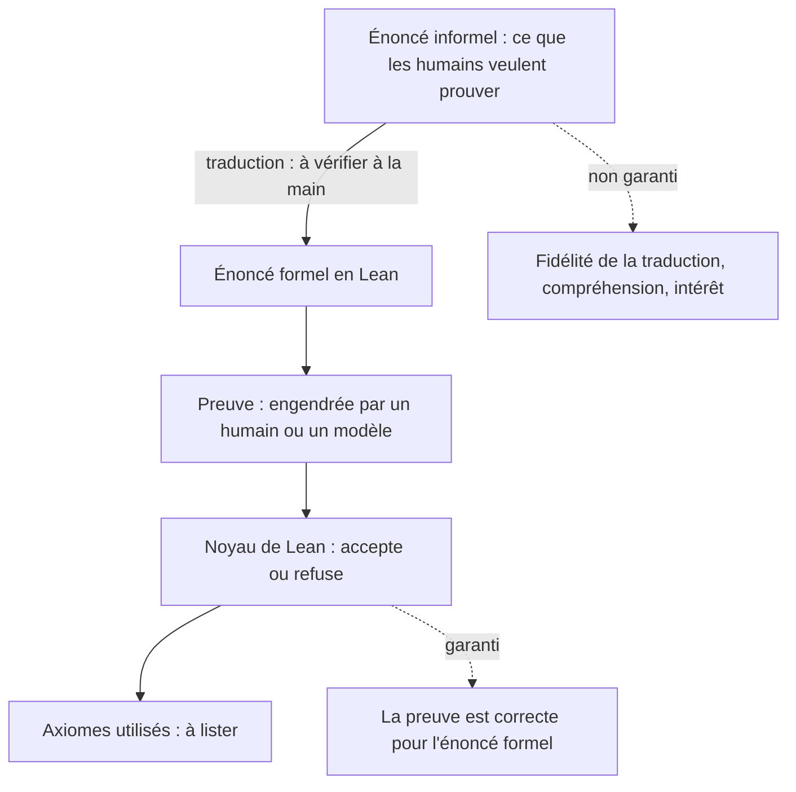

# Preuve formelle et assistant de preuve

## Aperçu

- Un **assistant de preuve** (Lean, Coq, Isabelle) est un programme qui vérifie mécaniquement qu'une preuve est correcte. Lean 4 est décrit par son dépôt comme « programming language and theorem prover », sous licence Apache-2.0 (relevé le 2026-10-20) ; sa bibliothèque de mathématiques, Mathlib, est aussi sous Apache-2.0.
- Ce que Lean **garantit** : la preuve est correcte **pour l'énoncé formalisé**, aux axiomes déclarés près. Plus de lacune cachée, plus d'erreur enfouie page 94.
- Ce qu'il **ne garantit pas** : que l'énoncé formalisé dise ce que les mathématiciens voulaient dire. L'erreur de **traduction** entre l'énoncé informel et l'énoncé formel reste à vérifier à la main.
- Pour un agent, c'est le **vérificateur le plus fort** d'une boucle générer-tester-corriger : le modèle propose, Lean accepte ou refuse, et le signal est immédiat et sans appel.

## Concepts clés

### Ce qui est vérifié, ce qui ne l'est pas

*Schéma refait d'après le document de formation de floSa « Navier-Stokes : ce qu'OpenAI a démontré, exactement » (section 4.2), d'après la vidéo de Nerdy Kings (9 min 29, 2026-09-14).*

- **Un exemple de traduction qui trompe** : « pour tout entier $n$, $n-1<n$ ». En Lean, sur les entiers naturels, $0-1=0$ : l'énoncé est faux pour $n=0$. Un énoncé écrit de façon naïve se prouve ou se réfute pour une autre raison que celle qu'on voulait. La vérification machine ne voit pas cette différence : elle vérifie ce qu'on lui a donné.
- **Les axiomes** : une preuve acceptable ne dépend que des trois axiomes standard (`propext`, `Quot.sound`, `Classical.choice`). `sorry`, le trou volontaire, introduit un quatrième axiome (`sorryAx`) qui doit être absent d'une soumission. La commande `#print axioms` liste les axiomes d'un théorème (documentation de Lean, relue le 2026-10-20).
- **Quelle part est de confiance** : le noyau, petit, qui vérifie chaque terme de preuve. Un calcul natif ajoute un axiome par calcul et fait dépendre la preuve du compilateur et plus seulement du noyau (documentation de Lean, relue).
- **Une contre-vérification indépendante** est possible : un autre vérificateur relit la preuve exportée. Le dépôt de la preuve de Navier-Stokes en prévoit un (`Comparator`, `lean4export`, un noyau tiers `nanoda_bin`, selon le document de formation).

### Quand c'est un agent qui produit la preuve

- **Qui écrit l'énoncé compte.** Dans la formalisation de la preuve de Navier-Stokes d'OpenAI, l'énoncé formel vient du projet *Formal Conjectures* de Google DeepMind, pas d'OpenAI : un tiers a fixé ce qu'il fallait prouver. Cela répond en partie à l'objection « celui qui encode choisit ce qu'il prouve ». Il reste à vérifier à la main que la traduction dit bien ce que dit l'énoncé officiel.
- **La vérification finale filtre le bruit.** Avec des milliers de pistes fausses produites par des milliers d'agents, la vérification Lean est ce qui empêche une démonstration hallucinée de survivre. Sans elle, c'est une loterie à grande échelle.
- **Un domaine vérifiable n'est pas un domaine compris.** Terence Tao parle d'un « découplage très étrange et sans précédent entre obtenir des réponses et obtenir de la compréhension » (cité par le document de formation). Une preuve vérifiée et non lue est un fait dont on ne sait pas encore que faire.
- **Un résultat n'est pas une validation.** Un texte public et une formalisation auditable ne remplacent ni la relecture des pairs, ni la réplication indépendante du build, ni la décision d'une institution.

### Repères datés

État au 2026-09-15 (document de formation) : OpenAI revendique, le 8 septembre 2026, une preuve d'explosion en temps fini pour Navier-Stokes 3D **avec forçage régulier**, ce qui répond à une des quatre formulations du prix du millénaire et laisse ouverte la question **sans force** ; formalisation Lean publique ; **rien de validé par l'Institut Clay** (note du 11 septembre : « apparemment réglé », évaluation « délibérément sans hâte »). Une recherche web du 2026-10-20 confirme la portée (version forcée), la publicité du texte et du dépôt, et une querelle de priorité ; elle ne trouve aucune décision du Clay. Cet état bouge vite : ne pas le figer.

## Les maths, simplement

- **Une preuve est un terme dont le type est l'énoncé** (correspondance de Curry-Howard) : le noyau vérifie que le terme a le bon type. Exemple minimal : `theorem add_zero_example (n : Nat) : n + 0 = n := rfl`. L'énoncé est `n + 0 = n`, la preuve est `rfl` (réflexivité : les deux membres se calculent au même résultat).
- **Trois modes d'échec d'une preuve vérifiée**, du plus au moins probable quand le noyau est sain : (1) écart entre l'énoncé formalisé et l'énoncé voulu ; (2) problème dans la formalisation elle-même (axiome caché, `sorry` résiduel) ; (3) erreur logique dans la démonstration, que Lean exclut par construction.

## En pratique

- **Quand utiliser un assistant de preuve dans une boucle d'agent** : quand le critère de succès est mécanique et que l'énoncé est stable. C'est le même raisonnement que pour les tests ou un compilateur ([[Vérificateur externe et loi de Goodhart]]), avec la garantie la plus forte.
- **Garder un humain sur la traduction** : relire l'énoncé formel contre l'énoncé informel, lister les axiomes, interdire `sorry`.
- **Ne pas confondre vérifié et compris** : une preuve vérifiée et non lue est un fait dont on ne sait pas encore que faire.
- **Hors des maths**, l'idée se transpose en vérification de logiciel et en tests à propriétés : plus l'énoncé est précis, plus la vérification a de valeur, et plus la traduction de l'intention en énoncé devient le point fragile.

## Approches voisines & alternatives

- [[Vérificateur externe et loi de Goodhart]] — pourquoi un juge extérieur et non contournable fait converger une boucle.
- [[Boucle d'amélioration d'un agent]] — où la preuve formelle joue le rôle du juge (machine de Gödel).
- [[Récompense vérifiable (RLVR)]] — la récompense à règles, version légère de la même idée.
- [[Human-in-the-loop]] — l'humain qui garde la traduction de l'énoncé.
- [[Garde-fous hors modèle]] — une règle du runtime tient même si le modèle se trompe : un noyau de preuve en est l'exemple extrême.
- [[Reasoning models]] — les modèles que ces boucles entraînent et évaluent.
- Alternatives non formelles : tests, compilateur, banc d'essai exécutable ; relecture humaine d'une preuve en langage naturel.

## Pour aller plus loin

- Lean 4 : https://github.com/leanprover/lean4 (Apache-2.0, relevé le 2026-10-20) ; Mathlib : https://github.com/leanprover-community/mathlib4 (Apache-2.0) ; documentation, *Axioms* : https://lean-lang.org/doc/reference/latest/Axioms/ — relue le 2026-10-20.
- Énoncé officiel du problème, Charles Fefferman, Institut Clay : https://www.claymath.org/wp-content/uploads/2022/06/navierstokes.pdf ; dépôt de la formalisation : https://github.com/openai/NavierStokesAndEuler ; reportage de *Quanta Magazine*, 8 septembre 2026 — d'après le document de formation, non rouverts sauf recherche web du 2026-10-20.
- Source de cette page : document de formation de floSa « Navier-Stokes : ce qu'OpenAI a démontré, exactement » (vidéo de Nerdy Kings, https://www.youtube.com/watch?v=9_7piNRO-0Y, 2026-09-14). Le document signale que la vidéo n'est source d'aucun fait mathématique : il repose à 80 % sur des sources primaires.
- À ne pas figer : l'état de validation (relecture, réplication du build Lean, position du Clay, attribution du crédit).
