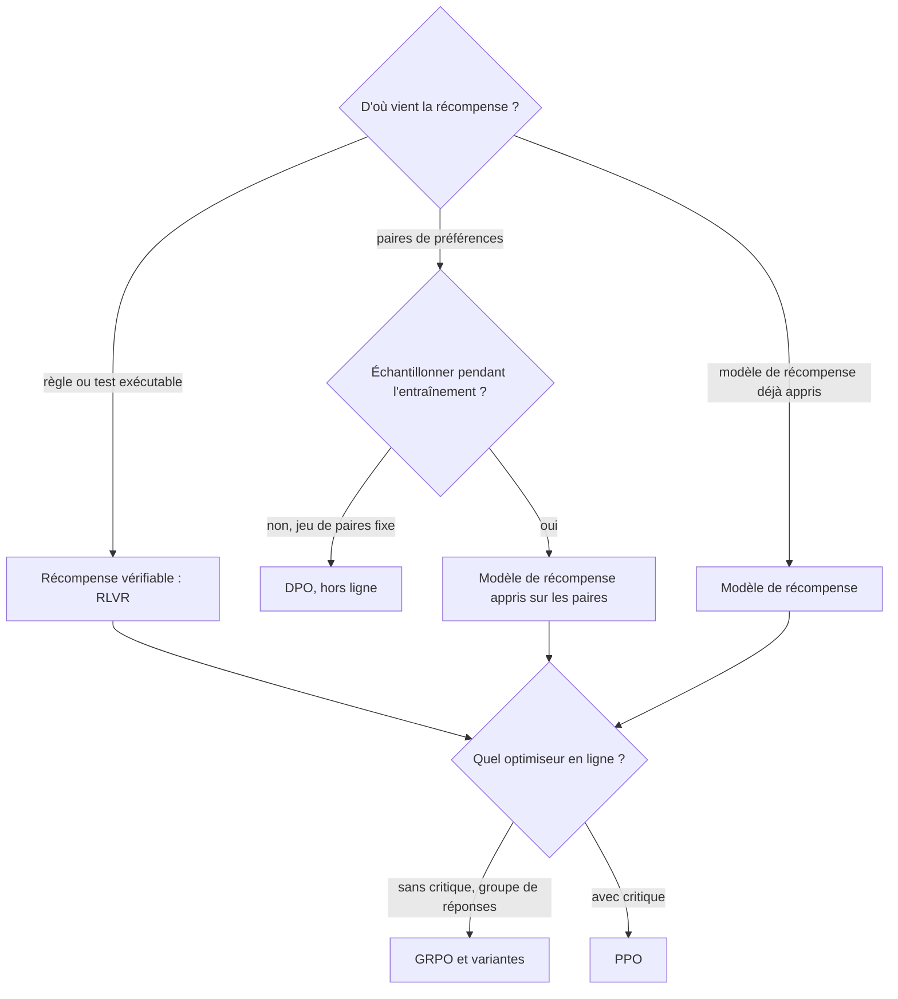

# Récompense vérifiable (RLVR)

## Aperçu

- Le **RLVR** (*Reinforcement Learning with Verifiable Rewards*) est un apprentissage par renforcement où la récompense est calculée par une **fonction de vérification déterministe** (réponse comparée à la solution, tests exécutés, contrainte de format contrôlée par un programme) au lieu d'un modèle de récompense appris.
- Ce n'est **pas un optimiseur**. C'est une **source de récompense**. Il se combine avec PPO ou GRPO, il ne les remplace pas : opposer « RLVR » et « GRPO » mélange deux décisions.
- Deux décisions distinctes, donc : **d'où vient la récompense** (règle, paires de préférences, modèle de récompense appris), puis **quel optimiseur** la consomme (DPO hors ligne, PPO avec critique, GRPO sans critique).

## Concepts clés

### Deux questions, pas une

*Schéma refait d'après le guide de décision du document de formation de floSa, lui-même tiré de la vidéo « RLHF vs DPO vs GRPO: Which Method, and When » (AI WITH Rithesh, 4 min 25, 2026-07-19). La vidéo enchaîne les deux questions en une seule cascade (vérifiable, sinon paires, sinon RL sans critique, sinon PPO) ; cette version les sépare.*

La cascade en quatre règles de la vidéo tient aux deux extrêmes (tâche vérifiable, tâche de goût) et reste une règle empirique : aucun papier ne la propose.

### D'où vient le terme

- Première occurrence retrouvée du nom : *Tülu 3* (Lambert et al., AI2), arXiv 2411.15124, première version du **22 novembre 2024**, « a novel method we call Reinforcement Learning with Verifiable Rewards (RLVR) ». L'abstract a été relu à la source.
- **DeepSeek-R1** (janvier 2025) n'emploie pas le terme (zéro occurrence selon le document de formation, v1 et v2). Il a apporté la démonstration à grande échelle, avec GRPO et des récompenses à règles (précision et format), sans démonstrations de raisonnement. L'attribution courante « RLVR, DeepSeek 2025 » est inexacte : à citer « Lambert et al., 2024 ; popularisé par R1, 2025 ».
- L'idée précède le nom : STaR (Zelikman et al., 2022), apprentissage par retour d'exécution, et un juge « règle » en ablation dans DeepSeekMath.
- **R1-Zero** est le cas pur (GRPO, récompense de précision et de format, pas de reward model neuronal). **R1**, le modèle publié, ajoute un SFT de démarrage, de l'échantillonnage par rejet et des reward models : sa recette n'est pas du RLVR pur.

### Ce que RLVR coûte vraiment

- Tülu 3 optimise RLVR avec **PPO**, critique conservé, initialisé depuis un reward model ; ses auteurs notent que la fonction de valeur joue un rôle important.
- **GRPO supprime un réseau (le critique), pas la génération** : 16 à 64 réponses par question. « GRPO est pas cher » vaut pour la mémoire, pas pour le temps de calcul, que dominent les générations.
- **DPO coûte environ deux fois moins de mémoire que PPO, pas cinq** (calcul ci-dessous). Son vrai avantage : pas d'étape de génération, pas de modèle de récompense à entraîner.
- **La qualité du signal pèse plus que l'algorithme** : dans la comparaison d'Ivison et al. (2024), de meilleures paires de préférences gagnent jusqu'à 8 % en suivi d'instructions et véracité, contre jusqu'à 2,5 % (maths) et 1,2 % (général) pour PPO sur DPO.

## Les maths, simplement

- **Objectif RLVR** (Tülu 3) : $\max_{\pi_\theta}\ \mathbb{E}_{y\sim\pi_\theta(x)}\big[v(x,y)-\beta\,\mathrm{KL}(\pi_\theta\|\pi_{ref})\big]$, avec $v(x,y)=\alpha$ si la réponse est vérifiée correcte, $0$ sinon ($\alpha=10$ chez Tülu 3). C'est l'objectif RLHF où le reward model est remplacé par la fonction $v$.
- **Avantage de groupe de GRPO** : $\hat A_i=\dfrac{r_i-\mathrm{mean}(\mathbf r)}{\mathrm{std}(\mathbf r)}$. Exemple : $G=8$ réponses, 2 justes (récompense 1), 6 fausses (0). Moyenne $0{,}25$, écart type $0{,}433$ ; avantage d'une juste $+1{,}73$, d'une fausse $-0{,}58$. Si les huit récompenses sont égales, l'écart type est nul : la question n'apporte aucun signal.
- **DPO** : perte $-\log\sigma\big(\beta\log\tfrac{\pi_\theta(y_w)}{\pi_{ref}(y_w)}-\beta\log\tfrac{\pi_\theta(y_l)}{\pi_{ref}(y_l)}\big)$. Au départ, marge nulle et perte $\ln 2=0{,}693$ pour toute paire ; avec des log-rapports $+1{,}0$ et $-0{,}5$ et $\beta=0{,}1$, marge $0{,}15$ et perte $0{,}621$.
- **Mémoire des états de modèle** (calcul du document de formation, entraînement en précision mixte avec Adam : $16\Psi$ octets pour un modèle entraîné, $2\Psi$ pour un modèle gelé) :

| Configuration | Octets par paramètre | 7 Md de paramètres | Rapport à PPO |
|---|---|---|---|
| RLHF : PPO + reward model (politique et critique entraînés ; référence et reward model gelés) | 36 | 252 Go | 1,00 |
| RLVR avec PPO (Tülu 3) | 34 | 238 Go | 0,94 |
| GRPO + reward model | 20 | 140 Go | 0,56 |
| GRPO + vérificateur, $\beta>0$ ; DPO | 18 | 126 Go | 0,50 |
| GRPO + vérificateur, $\beta=0$ | 16 | 112 Go | 0,44 |

Hors calcul : activations, cache KV de génération, moteur d'inférence. Ce sont des ordres de grandeur, pas des mesures de temps.

## En pratique

- **Dès qu'un vérificateur fiable existe**, la récompense vérifiable est la source à privilégier. Sinon : paires de préférences (DPO) ou reward model.
- **Vérifier demande de l'ingénierie** : une balise imposée pour la réponse finale, un extracteur robuste, un module d'exécution des tests (lent pour le code).
- **Un vérificateur incomplet reste contournable** (format mal extrait, tests insuffisants) : voir [[Vérificateur externe et loi de Goodhart]] et [[Reward shaping and hacking]].
- **Évaluer en pass@k, pas seulement en pass@1.** Yue et al. (2025) trouvent que le modèle de base dépasse le modèle entraîné par RLVR quand $k$ est grand ; une prépublication de septembre 2026 conteste ce croisement. Débat ouvert : ne pas lire « RLVR étend les capacités ».
- **Une recette sérieuse empile des méthodes** : Tülu 3 enchaîne SFT, DPO puis RLVR ; R1 enchaîne SFT, RL à règles, échantillonnage par rejet, RL mixte.
- Trou du guide : ni vérificateur ni paires. Retour d'une IA, rubriques, auto-jeu : pas de branche dans la cascade.

### Repères datés

| Repère | Valeur | Date et source |
|---|---|---|
| Défauts de `GRPOConfig` dans TRL | `beta=0.0` (donc pas de modèle de référence chargé), `loss_type="dapo"`, `scale_rewards="group"`, `importance_sampling_level="token"` | documentation TRL, branche `main`, relevée le 2026-10-20 |
| Variantes de GRPO | DAPO (arXiv 2503.14476), Dr. GRPO (2503.20783), GSPO (2507.18071) ; la formule d'origine de DeepSeekMath, avec division par la longueur et KL, n'est plus le défaut de TRL | document de formation, 2026-10-10 |
| AIME 2024 de R1-Zero, pass@1 | 71,0 % (v1 du papier) ou 77,9 % (v2, janvier 2026) : citer la version | document de formation |
| Prépublications sur RLVR (diversité, dérive du langage, auto-vérifiable) | signaux, pas résultats : une étude chacune, non évaluées par des pairs | arXiv, juillet à octobre 2026, lues en résumé seulement |

Le défaut `beta=0.0` a changé d'une version de bibliothèque à l'autre : relire la documentation de la version utilisée avant de comparer à un papier.

## Approches voisines & alternatives

- [[RL for LLMs]] — le cadre général de l'apprentissage par renforcement des modèles de langage.
- [[GRPO]] — l'optimiseur sans critique avec lequel RLVR se combine le plus souvent.
- [[RLHF and DPO]] — la source « préférences humaines » et ses deux voies, par reward model ou directe.
- [[Reward modeling]] — la source « modèle appris » que RLVR remplace par une règle.
- [[Reward shaping and hacking]] — ce qui arrive quand la récompense est contournable.
- [[Vérificateur externe et loi de Goodhart]] — pourquoi le vérificateur doit être hors de portée du modèle.
- [[Reasoning models]] — les modèles que cette méthode a rendus courants.
- [[TRL]] — la bibliothèque dont les défauts sont datés ci-dessus.
- [[Sycophancy]] — l'effet inverse : une récompense apprise des préférences plaît, une règle ne plaît pas.

## Pour aller plus loin

- Lambert et al., *Tülu 3: Pushing Frontiers in Open Language Model Post-Training*, arXiv 2411.15124 (22 novembre 2024) : https://arxiv.org/abs/2411.15124 — abstract relu le 2026-10-20 ; le reste d'après le document de formation.
- DeepSeek-AI, *DeepSeek-R1*, arXiv 2501.12948 (22 janvier 2025) ; *Nature* 645 (2025) : https://arxiv.org/abs/2501.12948
- Shao et al., *DeepSeekMath*, arXiv 2402.03300 (GRPO) ; Rafailov et al., arXiv 2305.18290 (DPO) ; Schulman et al., arXiv 1707.06347 (PPO) ; Ouyang et al., arXiv 2203.02155 (InstructGPT).
- Ivison et al., arXiv 2406.09279 (DPO contre PPO) ; Yue et al., arXiv 2504.13837 (limites du RLVR).
- Documentation TRL, *GRPO Trainer* : https://huggingface.co/docs/trl/main/en/grpo_trainer (relevée le 2026-10-20).
- Source de cette page : document de formation de floSa « RLHF, DPO, GRPO, RLVR : choisir une méthode d'apprentissage par renforcement pour LLM », d'après la vidéo d'AI WITH Rithesh (https://www.youtube.com/watch?v=8ryUBPvzAlw, 2026-07-19). Les papiers cités ont été relus par ce document, pas rouverts ici, sauf Tülu 3 (abstract) et la documentation TRL.
