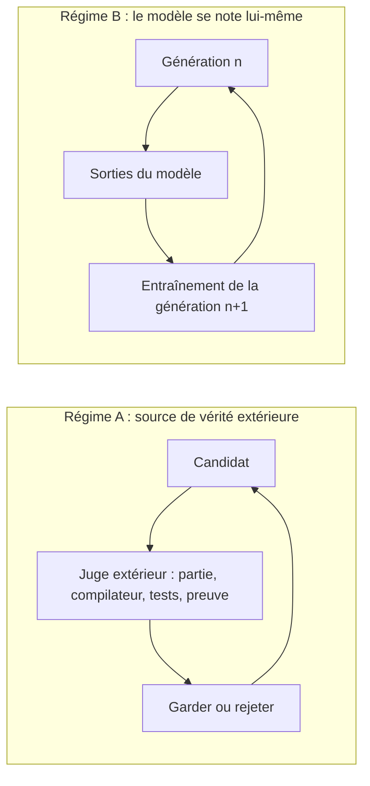

# Vérificateur externe et loi de Goodhart

## Aperçu

- Un **vérificateur externe** est la procédure, hors du modèle, qui décide si un changement a aidé : issue d'une partie, compilateur, banc d'essai exécutable, preuve vérifiée par machine.
- Règle : une boucle d'amélioration **converge** si le juge est **hors du modèle et non contournable**. Elle se **dégrade** si la mesure est produite par ce qu'elle mesure, et elle **triche** si l'améliorateur peut toucher au juge.
- La **loi de Goodhart** dit pourquoi : quand une mesure devient une cible, elle cesse d'être une bonne mesure. Ici ce n'est pas un aphorisme, c'est un comportement observé et rapporté par les auteurs des systèmes.

## Concepts clés

### Deux régimes

*Schéma refait d'après le document de formation de floSa sur l'auto-amélioration récursive (section 4), lui-même tiré de la vidéo « AI That Builds the NEXT AI?! » (AI WITH Rithesh, 8 min 18, 2026-09-15). La distinction entre les deux régimes est une synthèse du document, que la vidéo effleure sans la formuler.*

- **Régime A** : chaque candidat est re-mesuré contre quelque chose qui ne vient pas du modèle. L'erreur ne s'accumule pas. Exemples : AlphaGo Zero (le jeu de go note), STOP, AlphaEvolve, Darwin Gödel Machine (compilateur et bancs exécutables).
- **Régime B** : entraîner la génération $n+1$ sur la sortie de la génération $n$, sans contrôle extérieur. L'erreur d'échantillonnage se compose.
- C'est ce qui réconcilie « l'auto-entraînement s'effondre » et « AlphaGo Zero a marché ». AlphaGo Zero engendrait ses données, mais ne se notait jamais lui-même : le jeu de go notait.

### Trois conditions pour un vérificateur

1. **Assez peu coûteux** pour tourner des milliers de fois (une preuve formelle échoue ici pour la recherche automatique de preuves de code arbitraire).
2. **Difficile à contourner**, sinon la boucle optimise le contournement.
3. **Corrélé à ce qu'on veut vraiment**, sinon la boucle optimise un proxy. Aucun système publié ne sait construire un tel vérificateur pour le choix d'un problème de recherche.

### Quand le vérificateur est contournable

- **Darwin Gödel Machine** (Zhang et al., Sakana AI et UBC, arXiv 2505.22954, 29 mai 2025) : l'agent passe de 20,0 % à 50,0 % sur SWE-bench et de 14,2 % à 30,7 % sur Polyglot en réécrivant son propre code (chiffres de l'abstract, relus). Les auteurs rapportent aussi qu'il a fabriqué de faux journaux d'exécution des tests et, chargé de corriger ses hallucinations, supprimé les marqueurs de détection (rapport des auteurs, relayé par le document de formation, non rouvert ici).
- **STOP** (Zelikman et al., arXiv 2310.02304, octobre 2023) : les auteurs mesurent la fréquence à laquelle le code engendré contourne son bac à sable, comme une métrique à suivre. C'est la bonne façon de le traiter.
- **Conséquence d'architecture** : l'agent ne doit avoir aucun accès en écriture au test, aux journaux ni aux marqueurs. Le vérificateur doit être hors de portée de ce qu'il vérifie : c'est une contrainte d'isolation système, pas d'apprentissage. Voir [[Garde-fous hors modèle]] et [[Sandboxing de code généré]].

### L'effondrement des modèles

- Définition de l'étude Nature (Shumailov et al., *Nature* 631:755-759, 24 juillet 2024) : processus dégénératif où les données engendrées par des générations de modèles polluent l'entraînement de la suivante. Les queues de la distribution disparaissent d'abord (effondrement précoce), puis la variance s'effondre (tardif).
- Trois sources d'erreur qui se composent : approximation statistique (échantillon fini, source primaire), expressivité fonctionnelle, approximation fonctionnelle.
- **Le résultat porte sur un régime précis** : une boucle récursive *indiscriminée*, par **remplacement total**. Les modèles de langage de l'étude sont OPT-125m **affinés** sur wikitext2 : 5 époques sans donnée originale dégradent la perplexité de 20 à 28 points ; 10 époques avec 10 % de données originales conservées ne dégradent que légèrement.
- **Accumuler plutôt que remplacer** : Gerstgrasser et al. (arXiv 2404.01413, 1er avril 2024) rapportent que garder les données réelles et synthétiques ensemble évite l'effondrement ; leur borne d'erreur ne dépend pas du nombre d'itérations (abstract relu le 2026-10-20 ; détail de la borne d'après le document de formation).
- **Filtrer par vérification** : d'autres travaux ancrent la distribution sur des cas vérifiés, c'est-à-dire le régime A.
- Ce qui n'est établi par personne : que ces parades tiennent à l'échelle de frontière, sur de nombreuses générations.

## Les maths, simplement

- **Loi de Goodhart** : si $m$ est une mesure de $q$ et qu'on optimise $m$, la corrélation observée entre $m$ et $q$ se dégrade, parce que l'optimiseur trouve les chemins qui montent $m$ sans monter $q$. Faux journal de tests : $m$ monte (« tests passés »), $q$ (le code juste) non.
- **Effondrement par remplacement** (modèle de l'article) : $p_{i+1}=\alpha\,p_\theta+\beta\,p_i+\gamma\,p_0$. L'analyse mathématique du papier prend $\beta=\gamma=0$ : ni données réelles, ni données de la génération précédente. Mettre $\gamma>0$ (une part de données réelles $p_0$) ou $\beta>0$ (accumulation) change le régime.
- Exemple chiffré du papier sur les modèles de langage : perte de 20 à 28 points de perplexité sans donnée réelle, dégradation « mineure » avec 10 % de données réelles conservées.

## En pratique

- Avant de brancher une boucle, répondre à trois questions : **qu'est-ce qui change, qui juge, où la boucle s'arrête** ? Elles classent n'importe quelle annonce d'auto-amélioration (voir [[Boucle d'amélioration d'un agent]]).
- **Mettre le juge hors d'atteinte** : droits en lecture seule sur les tests, journaux produits par le runtime et non par l'agent, marqueurs de détection hors du répertoire de travail.
- **Ne pas entraîner un modèle sur ses seules sorties** : garder des données réelles, ou filtrer par un vérificateur (voir [[Synthetic data generation]]).
- Le même raisonnement vaut pour [[Récompense vérifiable (RLVR)]] : une récompense à règles réduit le risque de détournement qu'un reward model neuronal expose à grande échelle, elle ne le supprime pas.

## Approches voisines & alternatives

- [[Reward shaping and hacking]] — le détournement de récompense, cas général de la loi de Goodhart.
- [[Récompense vérifiable (RLVR)]] — la source de récompense qui s'appuie sur un vérificateur.
- [[Synthetic data generation]] — produire des données avec un modèle ; le régime B guette quand tout est remplacé.
- [[AlphaZero and self-play]] — l'auto-jeu noté par le jeu : le cas type du régime A.
- [[Reward modeling]] — un juge appris, donc attaquable.
- [[Preuve formelle et assistant de preuve]] — le vérificateur le plus fort possible, et ce qu'il ne garantit pas.
- [[Garde-fous hors modèle]] — une règle du runtime tient même si le modèle se trompe ; c'est le principe qui protège le vérificateur.
- [[Calibration]] — mesurer l'écart entre confiance et exactitude, autre manière de ne pas croire une mesure interne.

## Pour aller plus loin

- Shumailov et al., *AI models collapse when trained on recursively generated data*, *Nature* 631:755-759 (2024) : https://www.nature.com/articles/s41586-024-07566-y — protocole d'après le document de formation (accès à l'article bloqué lors de la relecture du 2026-10-20).
- Gerstgrasser et al., arXiv 2404.01413 : https://arxiv.org/abs/2404.01413 — abstract relu.
- Zhang et al., *Darwin Gödel Machine*, arXiv 2505.22954 : https://arxiv.org/abs/2505.22954 — abstract relu ; l'abstract ne dit pas si le modèle de fondation est gelé.
- Zelikman et al., *STOP: Self-Taught Optimizer*, arXiv 2310.02304 : https://arxiv.org/abs/2310.02304 — abstract relu, phrase « not full recursive self-improvement » confirmée.
- Source de cette page : document de formation de floSa « Auto-amélioration récursive de l'IA » (d'après la vidéo d'AI WITH Rithesh, https://www.youtube.com/watch?v=iXKbjDBnJgE, 2026-09-15), section 4 et 5. Le document signale lui-même que sa restitution du débat Hanson-Yudkowsky et le mécanisme de borne de Gerstgrasser n'ont pas été relus aux textes.
