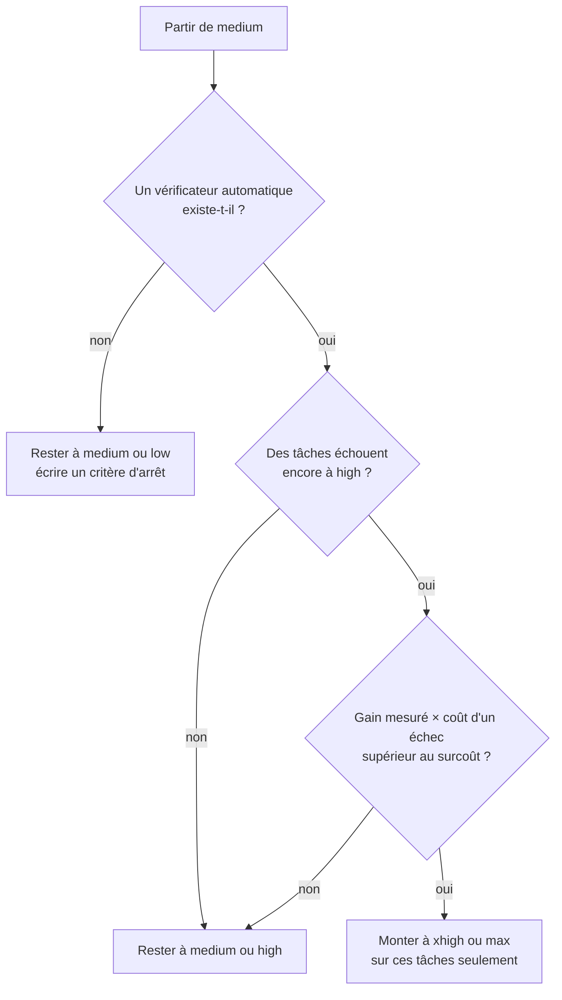

# Effort de raisonnement et courbe coût-qualité

## Aperçu

- L'**effort de raisonnement** est un réglage d'API à quelques paliers nommés (`low`, `medium`, `high`, `xhigh`, `max`) qui dit au modèle combien de travail fournir : réflexion, appels d'outils, vérifications. C'est un **signal de comportement, pas un budget strict** : il pèse sur tous les tokens de sortie.
- Monter d'un cran donne de la qualité, du temps et de la facture, mais **de moins en moins de qualité par dollar**. La courbe est concave : savoir où elle s'aplatit permet de payer l'effort seulement là où il rapporte. Cadre général des modèles concernés : [[Reasoning models]].

## Concepts clés

### Les paliers
- Cinq valeurs chez Anthropic (`output_config.effort`), trois chez Google (`thinkingLevel` : `low`, `medium`, `high`, variante vocale « Extended Thinking » seulement), des niveaux nommés différemment ailleurs. **Un même nom ne désigne pas la même quantité de réflexion** d'un modèle à l'autre, ni d'une version à l'autre du même modèle.
- Sur Claude Opus 5.5, la réflexion est adaptative et toujours active : un budget manuel de tokens est refusé (erreur 400). Le seul bouton de profondeur est l'effort, le seul plafond dur est `max_tokens`.
- **Le défaut est une décision de produit.** Opus 5.5 tourne par défaut à `medium`, Opus 5 à `high` : une requête qui omet l'effort tourne un cran plus bas qu'avant. Le même mécanisme a produit un épisode de « modèle nerfé » : [[Ce qui change derrière une API]].

### La courbe coût-qualité
- Chaque cran **ajoute des points d'indice et de coût**. Le coût du point gagné est $\Delta C / \Delta Q$ : il grimpe vite. C'est la grandeur à regarder, pas le coût total.
- Le gain d'indice n'est pas un gain de taux de réussite sur sa propre charge : l'indice est une moyenne pondérée de dix épreuves ([[Lire un score publié]]). Sa valeur pour soi se mesure sur ses propres tâches.
- À l'inverse du raisonnement long, le **mode rapide** (même modèle, débit multiplié, tarif doublé) accélère l'écriture sans raccourcir la réflexion : ce n'est pas un effort plus bas.

## Les maths, simplement

- **Coût marginal du point** : $c_k = \dfrac{C_k - C_{k-1}}{Q_k - Q_{k-1}}$, entre deux paliers consécutifs.
- **Règle de décision.** Monter d'effort se justifie si $\Delta p \times V > \Delta C$, avec $\Delta p$ la part de tâches que le palier supérieur **répare en plus**, $V$ le coût d'un échec (reprise, retard) et $\Delta C$ le surcoût par tâche. Exemple : surcoût de `xhigh` à `max` de 2,52 $ par tâche ; si un échec coûte 100 $ de reprise, `max` ne vaut le coup que s'il répare plus de 2,5 % de tâches en plus. Chiffres d'illustration : l'indice ne donne pas de taux de réussite.
- **Relancer seulement les échecs.** Tout lancer à `low` puis relancer à `high` les seules tâches en échec, avec un signal d'échec fiable. Mesure interne d'Anthropic, directionnelle : environ 97 % de réussite pour 0,17 $ par tâche, contre 95,3 % pour 0,29 $ en lançant tout à `high`. Prix : une latence doublée sur les échecs.

## En pratique

- **Partir du défaut**, ne monter que sur preuve mesurée sur ses propres tâches, tester chaque niveau dans une **session séparée** (changer l'effort en cours de session invalide le cache de prompt et fausse la comparaison de coût).
- **Réserver `xhigh` et `max`** aux tâches vérifiables, longues (dizaines de minutes à plusieurs heures), avec un critère d'arrêt écrit dans le prompt. Sur un prompt ouvert sans critère d'arrêt, le modèle continue de vérifier et de polir : c'est l'hypothèse la plus cohérente avec les démos de lancement, qui ont duré de 35 minutes à plus de deux heures.
- **Aucune règle générale ne tient de modèle à modèle.** Sur DeepSeek V4.1 Flash, évalué par un tiers sur 148 configurations et 10 tâches d'écriture, le mode maximal obtient 86,75 contre 87,13 au mode standard, pour +73 % de temps (43,1 s contre 74,6 s) et +60 % de coût (0,0077 $ contre 0,0124 $), intervalles de confiance recouvrants : aucun avantage établi sur la rédaction. Réfléchir plus longtemps n'est pas toujours rentable.
- **Le chrono de bout en bout n'est pas le débit.** Un modèle peut écrire vite et finir tard parce qu'il écrit beaucoup. Séparer délai avant le premier token, débit en tokens par seconde et nombre de tokens.
- **Mesurer les tokens de réflexion** renvoyés par l'API : c'est la seule trace de l'effort réellement dépensé ([[Tarif catalogue contre coût par tâche]]).

### Repères datés

Artificial Analysis, indice v4.3.2, relevé le 2026-09-30, Claude Opus 5.5. Ils bougent à chaque version d'indice.

| Effort | Indice | Coût par tâche | Points gagnés | Surcoût | Coût du point |
|---|---|---|---|---|---|
| low | 42 | 0,55 $ | — | — | — |
| medium (défaut) | 51 | 1,34 $ | +9 | +0,79 $ | 0,09 $ |
| high | 54 | 1,82 $ | +3 | +0,48 $ | 0,16 $ |
| xhigh | 56 | 3,46 $ | +2 | +1,64 $ | 0,82 $ |
| max | 58 | 5,98 $ | +2 | +2,52 $ | 1,26 $ |

De `medium` à `max` : 7 points pour 4,5 fois le prix (5,98 ÷ 1,34 = 4,46). Un point coûte 14 fois plus cher de `xhigh` à `max` que de `low` à `medium`. Anthropic, mesures internes sur un sous-ensemble de SWE-bench Pro : `medium` perd environ 2,5 points contre `high` pour environ 70 % du coût, `xhigh` gagne environ 1,4 point pour 2,5 fois le coût de `high`. Modèle fermé : texte simple, sans page.

## Approches voisines & alternatives

- [[Reasoning models]] — la classe de modèles, et ce que le test-time compute achète.
- [[Tarif catalogue contre coût par tâche]] — pourquoi l'effort se voit sur la facture avant le tarif.
- [[Lire un score publié]] — ce que valent les points d'indice de la courbe.
- [[Routing and cascading]] — la même idée à l'échelle de la requête : escalader vers plus cher seulement si nécessaire.
- [[Speculative decoding]] — accélérer sans changer la réponse, à ne pas confondre avec baisser l'effort.
- [[Chain-of-Thought]] — l'ancêtre à la main du raisonnement réglable.
- DeepSeek-V4.1-Flash — un modèle à poids ouverts dont l'effort maximal consomme jusqu'à 2,5 fois plus de tokens.

## Pour aller plus loin

- Vidéo « Claude Opus 5.5 : ce que coûte le curseur d'effort », AI WITH Rithesh, 7 min 16, https://www.youtube.com/watch?v=nvyimwSJe_I — escalier des cinq efforts à 1 min 35, courbe score contre coût à 6 min 08, règle de décision à 7 min 08.
- Documentation Anthropic, « Effort » : https://platform.claude.com/docs/en/build-with-claude/effort
- Anthropic, « Optimizing for cost and intelligence » (mesures internes) : https://platform.claude.com/docs/en/about-claude/models/optimizing-for-cost-and-intelligence
- Artificial Analysis, fiche Claude Opus 5.5 : https://artificialanalysis.ai/models/releases/claude-opus-5-5
