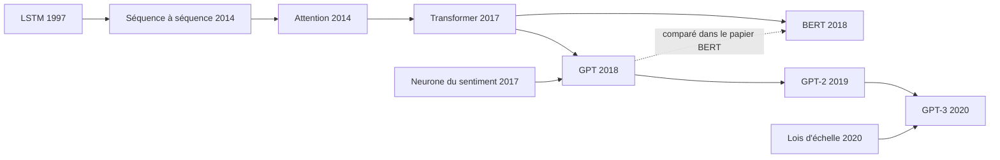
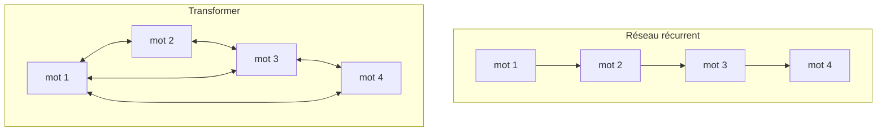
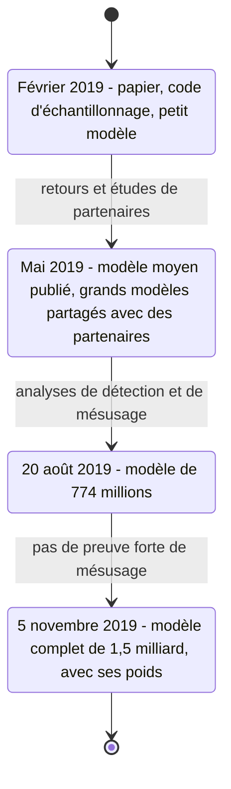

# Généalogie des modèles de langage (2011-GPT-3)

## Aperçu

- La **généalogie** des modèles de langage de 2011 à GPT-3 (mai 2020) : un prédicteur de caractères, des LSTM de plus en plus gros, le séquence à séquence, l'attention, le Transformer, BERT, puis GPT, GPT-2 et GPT-3.
- Le **principe est ancien** : prédire l'unité suivante d'un texte en minimisant l'entropie croisée. La boucle de génération (tirer, ajouter, recommencer) est déjà dans un papier de 2011. Ce qui change : d'abord l'**architecture**, ensuite les **données**, enfin l'**échelle**.
- Avant 2019, aucun papier lu ne vise à faire écrire un texte long. Les modèles servent à compresser, mesurer une perplexité, traduire ou préparer une classification. GPT-2 (février 2019) fait de la génération un résultat, à la surprise de ses auteurs.
- Le « **monopole du langage** » perdu est une **thèse du narrateur** de la vidéo source, pas un résultat : aucun papier lu ne l'emploie.

## Concepts clés

### Le fil, jalon par jalon

*Schéma refait d'après le document de formation de floSa « Généalogie des grands modèles de langage, de 2011 à GPT-3 » (vidéo de Monsieur Phi, 1 h 21 min 11 s, 2026-10-10, conclusion du document). Chaque flèche pleine correspond à une relation écrite dans les papiers lus ; la flèche pointillée est une comparaison.*

| Date | Jalon | Ce que le papier montre |
|---|---|---|
| 2011 | Sutskever, Martens, Hinton, ICML : prédire le **caractère** suivant (RNN multiplicatif) | 4,9 millions de paramètres, 8 GPU, environ 5 jours ; 1,60 bit par caractère sur Wikipédia. Exemple « the meaning of life is » : échantillon choisi parmi moins de dix lancements |
| 2014 | Séquence à séquence (Sutskever, Vinyals, Le) ; attention (Bahdanau, Cho, Bengio) | ensemble de cinq LSTM de 384 millions de paramètres : 34,81 BLEU contre 33,30 pour la traduction statistique |
| 2015 | *A Neural Conversational Model* (Vinyals, Le) ; billet `char-rnn` de Karpathy | un chatbot appris sur des sous-titres et des conversations d'assistance ; des LSTM sur Shakespeare, LaTeX, le noyau Linux |
| 2016 | Jozefowicz et al., *Exploring the Limits of Language Modeling* | LSTM de 1,04 milliard de paramètres, 32 GPU K40, trois semaines ; perplexité 30,0 contre 51,3 ; corpus « 1B Word » d'environ 0,8 milliard de mots, phrases mélangées |
| 2017 | Shazeer et al., couche de mélange d'experts | jusqu'à 137 milliards de paramètres **dans la couche d'experts d'un modèle entraîné sur un autre corpus** ; perplexité 28,0 sur 1B Word à calcul comparable ; aucune génération de texte |
| 2017 | Radford, Jozefowicz, Sutskever, neurone du sentiment | mLSTM de 4096 unités, 82 millions d'avis Amazon (38 Go) ; une unité suit le sentiment ; 91,8 % sur SST binaire |
| 2017 | Transformer | 213 millions de paramètres (version « grande »), 3,5 jours sur 8 GPU ; 28,4 BLEU en anglais-allemand ; testé sur la traduction |
| 2018 | GPT (juin), BERT (octobre) | GPT : 12 couches, GLUE 72,8 contre 68,9 ; BERT : 110 et 340 millions de paramètres, plus de 80 sur GLUE |
| 2019 | GPT-2 | jusqu'à 1,5 milliard de paramètres, WebText 40 Go ; sans entraînement spécifique, meilleur résultat sur 7 des 8 jeux de modélisation |
| 2020 | Lois d'échelle (janvier), GPT-3 (mai) | 175 milliards de paramètres, 300 milliards de tokens, 31 auteurs |

Les tailles croissent de **quatre ordres de grandeur** en cinq ans, et l'objectif reste la modélisation du langage, pas l'écriture.

### De la récurrence à l'attention

*Schéma refait d'après le chapitre « Attention is all you need » de la vidéo (33:58 à 38:21) et le papier de 2017 ; il ne montre pas le masque qui interdit de regarder vers l'avant pendant la génération.*

- Un réseau récurrent traite les mots un à un dans un état de taille fixe : il saisit mal les dépendances lointaines. Le Transformer laisse chaque position regarder directement toutes les autres, et se **parallélise** sur des cartes graphiques.
- **L'attention n'est pas née en 2017** : Bahdanau et al. l'introduisent en 2014 pour corriger le goulot d'étranglement de l'encodeur-décodeur ; Vaswani et al. gardent l'attention et jettent la récurrence. Le coût par couche est **quadratique** en la longueur, la contrepartie du parallélisme.
- Le papier de 2017 teste la traduction et l'analyse syntaxique, pas la génération. Ni l'allusion aux Beatles dans le titre, ni la raison du nom « Transformer », ne figurent dans le papier.

### Deux pertes, deux familles

- **GPT** : modèle **autorégressif**, ne regarde que ce qui précède, génère de gauche à droite.
- **BERT** : **bidirectionnel**, remplit des mots masqués (15 % des tokens), excellent en classification (GLUE), sans procédure naturelle d'écriture. Wang et Cho (2019, *BERT has a Mouth*) montrent qu'on peut en tirer des phrases, plus variées et de qualité légèrement moindre qu'un modèle de gauche à droite.
- À taille égale (BERT base a été dimensionné comme GPT), BERT dépasse GPT de 4,5 points sur GLUE (79,6 contre 75,1, hors WNLI).

### GPT-2 : le choc, puis la publication par étapes

*Schéma refait d'après le chapitre « Pourquoi OpenAI refuse d'abord de publier son modèle » de la vidéo (1:07:39 à 1:10:44) et les billets d'OpenAI de 2019 lus par le document de formation.*

- GPT-2 est présenté par ses auteurs comme un **changement d'échelle** de GPT (plus de 10 fois les paramètres et les données ; facteur réel d'environ 13 sur les paramètres) : même objectif, contexte doublé (1024), vocabulaire élargi.
- **Les tâches sont dans les données** : en prédisant le mot suivant sur un large échantillon d'Internet, GPT-2 apprend un peu à résumer (suffixe « TL;DR: »), traduire, répondre. Voir [[Pré-entraînement, affinage et apprentissage en contexte]].
- **La publication par étapes** (février à novembre 2019) est une expérience de politique de publication, appuyée sur la clause de la Charte d'OpenAI (9 avril 2018) qui prévoit de réduire la publication pour des raisons de sûreté. En novembre, OpenAI ne rapporte pas de preuve forte de mésusage. Que la prudence fût raisonnable ou excessive est un débat que les sources n'achèvent pas.
- **GPT-3** : même architecture à plus grande échelle, avec des couches d'attention alternativement denses et éparses ; 175 milliards de paramètres sont 1,3 fois les 137 milliards de la couche d'experts de 2017 en paramètres bruts, mais dix fois plus que tout modèle « non épars » antérieur selon le papier.

## Les maths, simplement

- **Bits par caractère** (2011) : $\mathcal L=-\frac1T\sum_t\log_2 p_\theta(x_t\mid x_{<t})$. Un codeur arithmétique appuyé sur ces probabilités compresse le texte à environ $\mathcal L$ bits par caractère : c'est le lien prédiction-compression.
- **Perplexité** : $\mathrm{PPL}=\exp\big(-\frac1N\sum_i\ln p_\theta(w_i\mid w_{<i})\big)$ ; 30 équivaut à choisir entre 30 mots équiprobables. Voir [[Perplexity]].
- **Les deux pertes** : $\mathcal L_{AR}=-\sum_t\log p_\theta(x_t\mid x_{<t})$ ; $\mathcal L_{MLM}=-\sum_{i\in M}\log p_\theta(x_i\mid\tilde x)$ où $M$ est l'ensemble des positions masquées et $\tilde x$ le texte entier, trous compris.
- **Lois d'échelle** : $L(N)=(N_c/N)^{\alpha_N}$ avec $\alpha_N\approx0{,}076$ ; doubler $N$ réduit la perte d'environ 5 %. Voir [[Scaling laws]].
- **Le rapport d'échelle** : $175/1{,}5\approx117$ entre GPT-2 et GPT-3 ; Chalmers et la vidéo arrondissent à cent.

## En pratique

- **Pour lire une généalogie**, vérifier que les chiffres comparés sont de la même expérience. Trois confusions de la vidéo, corrigées par les sources : les **137 milliards** sont ceux de la couche d'experts d'un modèle entraîné sur un corpus d'environ 100 milliards de mots, pas ceux du test sur 1B Word (environ 4,3 milliards de paramètres) ; le corpus « 1B Word » compte **0,8** milliard de mots ; l'ordre de ses phrases était **déjà aléatoire** à la source, ce qui n'a pas de lien établi avec des droits d'auteur.
- **Les six corrections nettes** parmi 25 points vérifiés par le document (6 corrigés, 13 précisés, 6 non retrouvés) : mélange des phrases de 1B Word, perplexité de 28 attribuée aux 137 milliards, « toujours dix essais » pour les échantillons du billet GPT-2 (1, 2, 5, 10 ou 25 selon l'échantillon), version complète publiée en novembre **2019** et non 2018, titre de Jack Clark (*head of policy*), *La leçon amère* (13 mars 2019) parue 27 jours après GPT-2, pas deux mois.
- **GPT-2 traduit peu et mal** : 5 BLEU de l'anglais vers le français (sous une substitution mot à mot) et 11,5 BLEU du français vers l'anglais ; le corpus filtré pour l'anglais contenait 10 Mo de français dans 40 Go. « Dans la moyenne basse » est donc exact dans un sens et trop généreux dans l'autre.

### Repères datés

| Repère | Valeur | Source |
|---|---|---|
| Coût du pré-entraînement de GPT-2 | « 43 000 dollars » : estimation de tiers (Hacker News 2019, reprise par Karpathy en 2026), non confirmée par OpenAI | document de formation, 2026-10-10 |
| Attention de 2017 : le papier date du | 12 juin 2017 (v1, arXiv) | relu le 2026-10-20 |
| GPT-3 | arXiv 2005.14165, 28 mai 2020, 31 auteurs | relu le 2026-10-20 |
| Événements de 2026 évoqués par la vidéo (découvertes mathématiques, arrivée de Karpathy chez Anthropic) | non vérifiés par le document, ne fondent rien ici | document de formation |

## Approches voisines & alternatives

- [[Histoire de l'IA (1943-2026)]] — la chronologie générale ; cette page entre dans le détail du langage.
- [[Pré-entraînement, affinage et apprentissage en contexte]] — les trois étapes qui se mettent en place de GPT à GPT-3.
- [[Transformer architectures]] et [[Self-attention]] — le mécanisme de 2017 en détail.
- [[Mixture of Experts]] — la couche d'experts de Shazeer et al. (2017).
- [[LSTM et réseaux récurrents]] — les modèles de 2011 à 2016.
- [[Scaling laws]] — Kaplan et al. (2020).
- [[Perplexity]] et [[Cross-entropy]] — les deux mesures de cette période.
- [[Tokenization]] — du caractère à l'octet, au mot, au token.
- [[Reasoning models]] — ce qui vient après GPT-3.

## Pour aller plus loin

- Sutskever, Martens, Hinton, *Generating Text with Recurrent Neural Networks*, ICML 2011 : https://www.cs.toronto.edu/~ilya/pubs/2011/LANG-RNN.pdf
- Bahdanau, Cho, Bengio, arXiv 1409.0473 ; Sutskever, Vinyals, Le, arXiv 1409.3215 ; Vinyals, Le, arXiv 1506.05869 ; Jozefowicz et al., arXiv 1602.02410 ; Shazeer et al., arXiv 1701.06538 ; Radford et al., arXiv 1704.01444 ; Devlin et al., arXiv 1810.04805.
- Vaswani et al., arXiv 1706.03762 (auteurs et date relus le 2026-10-20) ; Brown et al., arXiv 2005.14165 (relu) ; Kaplan et al., arXiv 2001.08361 (relu).
- Pages d'OpenAI de 2018 et 2019 (billets GPT, GPT-2, suivi de six mois, 1,5B Release) : lues par le document de formation dans une copie d'archive, non rouvertes ici.
- Source de cette page : document de formation de floSa « Généalogie des grands modèles de langage, de 2011 à GPT-3 » (https://www.youtube.com/watch?v=PUxgpy81Cnc, vidéo de Monsieur Phi). Non vérifiés par le document : tableau de Wooldridge, conférence de Sutskever de novembre 2018, lettre de GPT-3 aux philosophes, texte exact du test du *Guardian* sur le Brexit.
