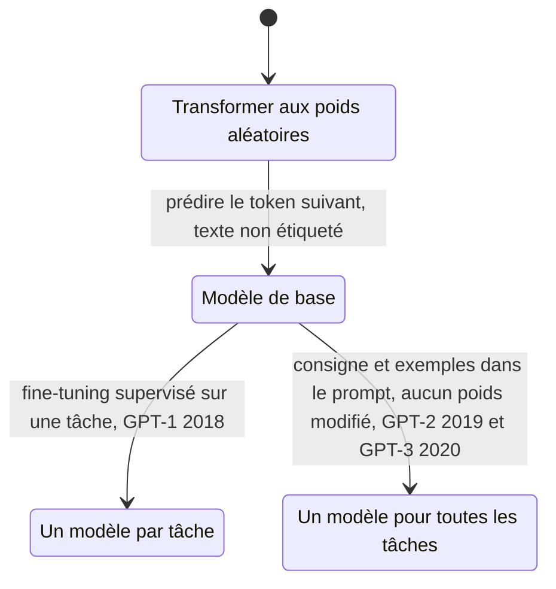

# Pré-entraînement, affinage et apprentissage en contexte

## Aperçu

- Trois étapes de la vie d'un modèle de langage, apparues dans cet ordre de GPT-1 (2018) à GPT-3 (2020) : **pré-entraîner** (prédire le token suivant sur un très grand texte non étiqueté), **affiner** (un petit entraînement supervisé sur une tâche), puis **apprendre en contexte** (donner la tâche et quelques exemples dans le prompt, sans mettre à jour aucun poids).
- Le **pré-entraînement** est auto-supervisé : le signal d'apprentissage est le texte lui-même, pas une étiquette ajoutée à la main.
- L'**apprentissage en contexte** n'apprend rien au sens du gradient : les poids ne bougent pas. Le prompt change la suite la plus probable.

## Concepts clés

*Schéma refait d'après le document de formation de floSa « Généalogie des grands modèles de langage » (vidéo de Monsieur Phi, 1 h 21, 2026-10-10), sections 9 à 13, d'après les papiers GPT, GPT-2 et GPT-3.*

### De GPT-1 à GPT-3 : ce que chaque étape a changé

| Modèle | Ce qui change | Mise en œuvre de la tâche |
|---|---|---|
| GPT-1 (juin 2018) | Transformer « décodeur seul » de 12 couches, pré-entraîné sur BooksCorpus (plus de 7 000 livres) ; meilleur résultat sur 9 des 12 tâches étudiées, GLUE à 72,8 contre 68,9 | **fine-tuning** requis pour chaque tâche |
| BERT (octobre 2018) | Encodeur Transformer, pré-entraîné à remplir des mots masqués (15 % des tokens) ; plus de 80 sur GLUE | fine-tuning ; non conçu pour générer |
| GPT-2 (février 2019) | Même architecture, plus de 10 fois les paramètres et les données ; corpus WebText (40 Go) ; contexte de 1024 tokens | **zéro exemple** : la tâche se formule comme le début d'un texte, par exemple « TL;DR: » après un article pour obtenir un résumé |
| GPT-3 (mai 2020) | 175 milliards de paramètres, contexte de 2048 tokens, 300 milliards de tokens vus | **zéro, un ou quelques exemples** dans le prompt, sans mise à jour des poids |

- Le schéma « pré-entraîner puis affiner » **n'est pas né** avec GPT-1 : Dai et Le (2015), ULMFiT (janvier 2018) et ELMo (février 2018) l'avaient proposé.
- Le papier GPT-2 donne l'argument théorique : un système général doit modéliser la probabilité de la sortie sachant l'entrée *et la tâche* ; le langage permet d'écrire les trois comme une suite de symboles ; l'objectif non supervisé a donc le même minimum global que l'objectif supervisé. Reste à savoir l'optimiser jusqu'au bout, et les expériences préliminaires montrent un apprentissage beaucoup plus lent que par supervision explicite.
- Les « tâches sont dans les données » : GPT-2 a trouvé dans son corpus des démonstrations naturelles (citations en français suivies de leur traduction). Un détecteur de langue a trouvé 10 Mo de français dans 40 Go (un quatre-millième), assez pour traduire un peu. Résultat chiffré, très inégal : 11,5 BLEU du français vers l'anglais, 5 BLEU de l'anglais vers le français, moins qu'une substitution mot à mot.

### Zéro, un, quelques exemples

- **Zero-shot** : une consigne, aucun exemple. **One-shot** : un exemple. **Few-shot** : quelques exemples. Tous dans le prompt.
- **Piège de vocabulaire.** Le papier GPT-2 emploie « zero-shot » au sens « sans modifier ni paramètre ni architecture ». Le papier GPT-3 précise que « zero-shot transfer » peut prêter à confusion : il vise l'absence de **mise à jour de gradient**, pas l'absence d'exemples dans le prompt.
- Ne pas confondre avec [[Méta-apprentissage et few-shot learning]] : là on entraîne un modèle à s'adapter vite à partir de peu d'exemples ; ici le modèle est un modèle de langage ordinaire, et l'adaptation se fait par le contexte.

## Les maths, simplement

- **Perte de pré-entraînement** (GPT-1) : $L_1(\mathcal U)=\sum_i \log P(u_i\mid u_{i-k},\dots,u_{i-1};\Theta)$, la log-vraisemblance du token $u_i$ sachant les $k$ précédents. C'est la même entropie croisée que pour la compression de texte ([[Cross-entropy]]).
- **Perte d'affinage** : $L_3(\mathcal C)=L_2(\mathcal C)+\lambda L_1(\mathcal C)$. $L_2$ est la perte supervisée de la tâche ; garder un peu de $L_1$ pendant l'affinage améliore la généralisation et accélère la convergence, selon les auteurs.
- **Perplexité** : $\mathrm{PPL}=\exp(-\tfrac1N\sum_i\ln p(w_i\mid w_{<i}))$. Une perplexité de 30 équivaut à choisir, à chaque mot, entre 30 mots équiprobables ([[Perplexity]]). Exemple historique : 30,0 pour un LSTM à 1,04 milliard de paramètres sur le corpus « 1B Word » (2016), contre 51,3 pour l'état de l'art précédent.
- **Lois d'échelle** (Kaplan et al., arXiv 2001.08361, 23 janvier 2020) : la perte suit une loi de puissance en taille $N$, données $D$ et calcul $C$, sur plus de sept ordres de grandeur. Avec $\alpha_N\approx0{,}076$, doubler $N$ multiplie la perte par $2^{-0{,}076}\approx0{,}95$ : environ **−5 % de perte par doublement** des paramètres, un rendement décroissant mais prévisible. L'abstract a été relu à la source ; la valeur de l'exposant vient du document de formation.

## En pratique

- **Pour une application**, on part presque toujours d'un modèle déjà pré-entraîné. Le choix se fait ensuite entre le prompt (zéro ou quelques exemples : [[Prompt engineering]], [[Chain-of-Thought]]), l'affinage ([[SFT]], [[PEFT]]) et l'alignement ([[RLHF and DPO]]).
- **Quelques exemples dans le prompt avant d'affiner** : c'est le moins cher, et GPT-3 a fait de ce mode un usage courant. L'affinage garde l'avantage quand les exemples ne tiennent plus dans la fenêtre ou quand la tâche doit être stable.
- **Pré-entraîner soi-même** : hors de portée d'un projet courant, mais le même mécanisme explique les modèles pré-entraînés qu'on reprend ([[Small Language Models]], [[Licences de modèles open weights]]).
- **Un modèle de base n'est pas un assistant** : GPT-1 « de base » est quasi inutilisable seul. Le comportement de dialogue vient de l'affinage et de l'alignement (ChatGPT, 30 novembre 2022, est affiné d'un modèle de la série GPT-3.5 par RLHF).

### Repères datés

| Repère | Valeur | Source |
|---|---|---|
| Taille de GPT-1 | non imprimée dans le papier ; « 117 millions » est repris du papier GPT-2, corrigé ensuite par OpenAI en 124 millions | document de formation, 2026-10-10 |
| GPT-3 | 175 milliards de paramètres, 31 auteurs, arXiv 2005.14165 du 28 mai 2020 | abstract relu le 2026-10-20 |
| Coût de GPT-2 | « 43 000 dollars pour 7 jours sur 32 TPU v3 » : estimation de tiers (Hacker News 2019, reprise par Karpathy), jamais confirmée par OpenAI | document de formation |

## Approches voisines & alternatives

- [[Prompt engineering]] — l'art de rédiger la consigne et les exemples : l'usage courant de l'apprentissage en contexte.
- [[Chain-of-Thought]] — des exemples qui montrent le raisonnement, pas seulement la réponse.
- [[SFT]] — l'affinage supervisé après pré-entraînement.
- [[PEFT]] — l'affinage qui ne touche qu'une petite partie des poids.
- [[RLHF and DPO]] — l'alignement qui transforme un modèle de base en assistant.
- [[Scaling laws]] — la relation entre taille, données et performance.
- [[Perplexity]] et [[Cross-entropy]] — la mesure du pré-entraînement.
- [[Transformer architectures]] — l'architecture sur laquelle repose tout ce qui précède.
- [[Méta-apprentissage et few-shot learning]] — l'autre sens, entraîné, de « peu d'exemples ».
- [[Généalogie des modèles de langage (2011-GPT-3)]] — l'histoire détaillée de ces trois étapes.

## Pour aller plus loin

- Radford, Narasimhan, Salimans, Sutskever, *Improving Language Understanding by Generative Pre-Training* (OpenAI, 11 juin 2018) ; Radford et al., *Language Models are Unsupervised Multitask Learners* (2019) ; documents lus par la source de cette page, pas rouverts ici.
- Brown et al., *Language Models are Few-Shot Learners*, arXiv 2005.14165 : https://arxiv.org/abs/2005.14165 — abstract relu le 2026-10-20.
- Kaplan et al., *Scaling Laws for Neural Language Models*, arXiv 2001.08361 : https://arxiv.org/abs/2001.08361 — abstract relu le 2026-10-20.
- Devlin et al., *BERT*, arXiv 1810.04805.
- Source de cette page : document de formation de floSa « Généalogie des grands modèles de langage, de 2011 à GPT-3 », d'après la vidéo de Monsieur Phi (https://www.youtube.com/watch?v=PUxgpy81Cnc, 2026-10-10), et « Histoire de l'IA de 1943 à 2026 ». Le document signale ses passages non retrouvés (extrait de prose de GPT-1, texte exact du test du *Guardian*).
