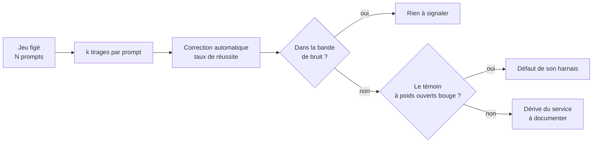

# Canari de dérive d'un LLM en API

## Aperçu

- Un **canari** est un petit jeu de prompts **figés**, rejoué périodiquement contre une API de modèle, dont on suit la distribution des résultats dans le temps. Il répond à une question : « ce que je paie donne-t-il aujourd'hui les mêmes résultats qu'hier sur **mes** tâches ? ».
- Il ne remplace pas un benchmark. Il sépare une **dérive de service** (ce qui tourne derrière l'API a changé, voir [[Ce qui change derrière une API]]) du bruit normal et d'un changement de ses propres appels.

## Concepts clés

### Les cinq règles
1. **Figer le jeu avant le doute.** Un jeu constitué le jour où l'on soupçonne une dégradation ne dit rien de la période antérieure.
2. **Tâches à correction automatique et non ambiguë** : un test unitaire qui passe ou non, une extraction dont la réponse est connue. Pas de jugement de style.
3. **Plusieurs tirages par prompt.** 1 000 appels identiques à température 0 ont produit 80 sorties distinctes sur un serveur partagé : un tirage unique ne mesure rien, c'est l'erreur des « avant/après » publiés sur les réseaux.
4. **Établir la bande de bruit d'abord.** Rejouer le canari plusieurs fois, à des heures différentes. Une variation dans la bande n'est pas un signal ; la bande est plus large aux heures de pointe qu'à quatre heures du matin.
5. **Un témoin.** Le même canari contre un modèle à **poids ouverts auto-hébergé**, dont la configuration ne bouge pas, sépare une dérive du fournisseur d'une dérive de son propre harnais ([[vLLM]], [[Ollama]]).

### Quoi consigner à chaque appel
Identifiant du modèle envoyé **et** renvoyé, fournisseur servi, horodatage UTC, paramètres d'échantillonnage explicites (température, top-p, graine si acceptée), effort ou budget de réflexion demandé, prompt système intégral, comptes de tokens (entrée, sortie, réflexion), succès de cache, en-têtes de limite de débit. Sans eux, une comparaison à trois mois ne distingue pas une dérive de modèle d'un changement de ses appels.

## Les maths, simplement

- Taux de réussite d'une exécution : $\hat p = \dfrac{\text{réussites}}{N \times k}$. Les $k$ tirages d'un même prompt ne sont pas indépendants : l'incertitude se calcule sur les **prompts**, par un [[Bootstrap]] sur les $N$ prompts, ou par un intervalle de Wilson ([[Intervalles de confiance]]).
- **Bande de bruit.** Sur $m$ exécutions de référence, bande $\bar p \pm 2s$. Exemple de cours, chiffres illustratifs : cinq exécutions donnent 0,84 ; 0,86 ; 0,83 ; 0,85 ; 0,82, soit $\bar p = 0{,}84$ et $s = 0{,}016$, bande $[0{,}81\,;\,0{,}87]$. Une exécution à 0,78 sort de la bande ; une à 0,83 n'est pas un signal.
- Une seule exécution hors bande ne prouve rien (une exécution sur vingt sort d'une bande à $2s$) : exiger deux exécutions consécutives hors bande, ou un [[Data drift|test de dérive]] sur la série.

## En pratique

- **Épingler le point d'accès** et, pour un modèle multi-fournisseurs, le fournisseur ; désactiver le repli automatique ; resserrer la fenêtre de temps d'une campagne.
- **Fréquence** : quotidienne suffit pour la dérive de service ; plus serrée pour établir la bande.
- **Taille** : quelques dizaines de prompts ; plus de prompts réduit l'incertitude plus qu'un plus grand $k$.
- **Outils** : [[promptfoo]] ou [[Inspect AI]] pour rejouer et noter, [[Langfuse]] pour consigner et tracer ([[LLM observability]]).
- **Limites** : un canari ne distingue pas une régression d'une **correction** (un garde-fou resserré à raison fait baisser le score) ; il ne dit pas la précision servie, le pool de serveurs ni le prompt d'un produit fermé ; il ne vaut que pour les tâches qu'il contient.
- **Variation de mesure** : un canari joué localement est immunisé contre un changement de version d'un indice public ([[Lire un score publié]]) ; c'est le test qui tranche entre mesure et service.

## Approches voisines & alternatives

- [[Ce qui change derrière une API]] — les molettes qu'un canari cherche à détecter.
- [[LLM observability]] — la trace de chaque appel, matière première du canari.
- [[Data drift]] — la dérive d'entrée d'un modèle ML, autre sens du mot.
- [[Lire un score publié]] — comparer à un indice public, avec ses limites.
- [[LLM eval metrics]] — les métriques de correction automatique.
- [[LLM-as-judge]] — à éviter dans un canari : le juge dérive aussi.

**Candidat pattern** : la procédure (jeu figé, tirages multiples, bande de bruit, témoin, journal d'appel) est assez structurée pour un pattern ; proposé à floSa, non créé.

## Pour aller plus loin

- Vidéo « Are AI Models Being NERFED? », AI WITH Rithesh, 9 min 15, https://www.youtube.com/watch?v=ixw4xBYGvKY — « pin your versions » à 9 min 13.
- Thinking Machines Lab, « Defeating Nondeterminism in LLM Inference » : https://thinkingmachines.ai/blog/defeating-nondeterminism-in-llm-inference/
- Khoriaty, LessWrong, 2026-07-23, recommandations d'épinglage du fournisseur : https://www.lesswrong.com/posts/KsyoSAyBRXtwzSugg
