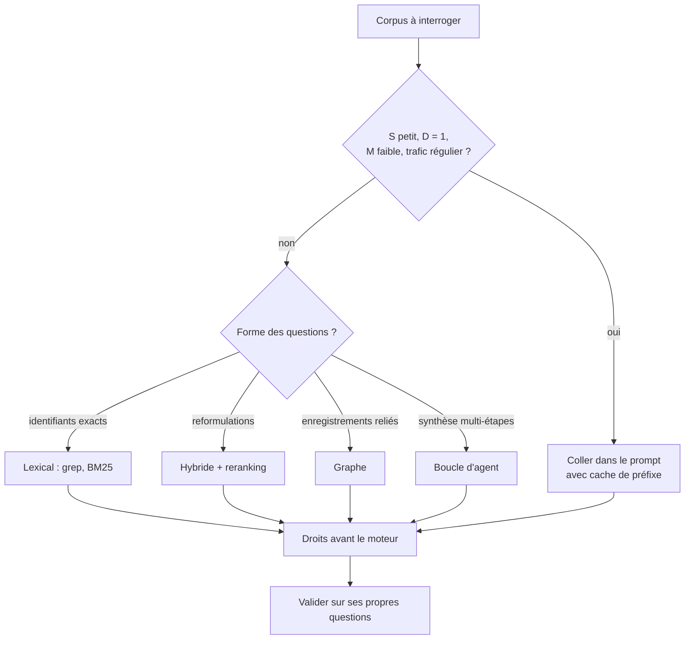

# Coller le corpus ou récupérer

## Aperçu

- Deux façons de donner un corpus à un modèle : **tout coller** dans le prompt (avec un cache de préfixe), ou **récupérer** les quelques passages utiles à chaque question. « Le RAG est-il mort ? » est mal posé : ce qui recule, c'est le montage unique de 2023 (une base vectorielle, une recherche par question), pas l'idée de chercher avant de répondre.
- Le choix dépend de la taille du corpus, de sa fréquence de mise à jour, de ses droits d'accès, de la forme des questions et du coût par question. Cette page donne la **règle de décision en cinq étapes** et les formules qui la fondent. Les chiffres de produits (tarifs, scores) vieillissent : ils sont dans « Repères datés ».
- Les mécanismes de la fenêtre de contexte (coût du cache KV, longueur utile) sont dans [[Contexte long]] ; le cache de préfixe dans [[prompt-caching]]. Cette page tranche entre les deux usages.

## Concepts clés

### La règle de décision

1. **Mesurer cinq choses** : la taille du corpus $S$ en tokens du modèle cible ; le nombre de jeux de droits distincts $D$ ; la part du corpus modifiée par jour $M$ ; le nombre de questions par jour $Q$ et leur régularité ; la forme des questions (identifiants exacts, reformulations, synthèse).
2. **Coller avec cache si les quatre conditions tiennent** : $S$ petit (de l'ordre de 200 000 tokens, sous le seuil de surprime du modèle) ; $D = 1$ ; $M$ faible, car une modification invalide le cache à partir du point modifié ; une question au moins toutes les 5 minutes (environ 288 par jour, réparties) ou, avec l'option de cache à une heure, environ 24 par jour réparties. Sinon, étape 3.
3. **Récupérer, selon la forme des questions** : identifiants exacts (codes, SKU, noms de fonctions) → recherche lexicale (grep, BM25) ; utilisateurs qui reformulent → ajouter des embeddings, donc recherche hybride avec reranking ([[Hybrid retrieval]], [[Reranking]]) ; enregistrements reliés entre eux → graphe ([[GraphRAG]]) ; synthèse en plusieurs étapes → boucle d'agent ([[RAG agentique]]), pour ces questions seulement.
4. **Traiter les droits avant le moteur** : filtrer avec l'identité de l'utilisateur avant que le texte entre dans le prompt ; nettoyer le sur-partage à la source. Voir [[Droits d'accès dans un RAG]].
5. **Valider sur ses propres questions** : une cinquantaine de questions réelles à réponse connue (ordre de grandeur proposé par l'auteur de la source, non mesuré) ; mesurer le rappel et le coût par question, cache compris. Aucun benchmark d'éditeur ne se transpose à un corpus client.

### Le rapport « 200 pour 1 » est un rapport de tokens

- **Formule.** Soit $S$ les tokens collés, $R$ les tokens récupérés, $p$ le prix d'entrée par million de tokens : $C_{\text{coller}} = S\,p/10^6$, $C_{\text{récupérer}} = R\,p/10^6$, et le rapport vaut $S/R$. Pour $S = 10^6$ et $R = 5\,000$ : **200**, quel que soit le modèle.
- **Il tient à trois conditions** : même tarif des deux côtés, aucun cache, tokens d'entrée seuls. Il tombe dès que l'une saute.
  - **Cache chaud** : la lecture de cache coûte une fraction du tarif d'entrée (0,05 fois chez Anthropic pour Opus 5.5 et Sonnet 5.5, 0,025 fois pour Fable 5.1 ; 0,1 fois sinon). Le rapport tombe à 5 à 10 avec ces modèles (exemple ci-dessous).
  - **Tokens de sortie** : pour 500 tokens de sortie par réponse, le rapport d'Opus 5.5 passe de 200 à environ 134 (sans cache) et à 7 (avec cache chaud).
  - **Corpus plus petit** : le rapport vaut $S/R$, soit 40 pour 200 000 tokens.
- **Il est sous-estimé** quand le seuil de surprime d'un modèle est franchi (le tarif est alors appliqué à toute la requête) ou quand la récupération est une boucle d'agent (4 à 15 fois les tokens d'un chat, mais l'écart reste en faveur de la récupération).
- **Le coût d'indexation** d'une récupération est négligeable à cette échelle (quelques centimes d'embeddings pour un million de tokens) ; ce qui coûte, c'est la construction, le retard de fraîcheur entre une modification et son indexation, et la copie des droits dans un second système.

### Quand le cache tient

Trois conditions, toutes à lire sur la page du fournisseur :

- **Préfixe identique, à l'octet.** Une modification avant le point de cache invalide ce qui suit (chez Anthropic : `tools`, puis `system`, puis `messages`, chaque niveau invalidant les suivants).
- **Trafic régulier.** Le cache vit 5 minutes par défaut, prolongé à chaque lecture ; une écriture à 5 minutes coûte 1,25 fois l'entrée normale, une écriture à une heure 2 fois. Sous une question toutes les 5 minutes (288 par jour), chaque question repaie une écriture, plus chère que l'entrée normale.
- **Un seul contexte pour tout le monde.** Des droits différents donnent des sous-corpus différents, donc un préfixe et un cache par jeu de droits.

### Un test d'aiguille mesure retrouver, pas synthétiser

- Un test d'aiguille (une information cachée dans un long texte, éventuellement parmi des passages voisins) demande de **localiser** un passage. Répondre à une question qui combine des informations réparties est une autre tâche. Les mesures de synthèse sont plus sévères : voir RULER, NoLiMa et HELMET dans [[Contexte long]].
- Une fenêtre annoncée est une capacité, pas une garantie de rappel. Deux scores de longueur de contexte publiés par deux éditeurs ne se comparent pas sans la même tranche de longueur, le même jeu de données (version), le même tokenizer et le même réglage ; voir [[Lire un score publié]].

### Pourquoi grep reste compétitif sur le code

C'est un mécanisme, pas une anecdote :

1. **Les identifiants sont exacts** : un nom de fonction ou un chemin figure tel quel dans le code.
2. **Il n'y a pas de paraphrase** entre la requête et le texte : un agent de code écrit le nom qu'il cherche.
3. **Pas d'index à tenir à jour** : le code change en continu, grep lit l'état courant.
4. **Pas de second système** qui copie le dépôt (moins de surface de données).

Le prix : latence et tokens (boucle de recherche), et sur de très gros dépôts grep lui-même ralentit. Cursor, qui a choisi de garder grep **et** une recherche sémantique, mesure un gain d'exactitude moyen de 12,5 % (de 6,5 à 23,5 % selon le modèle) sur son propre jeu interne, et un effet en ligne de +0,3 % de code d'agent conservé sur tous les dépôts, +2,6 % sur ceux d'au moins 1 000 fichiers : un effet faible sur un petit dépôt, plus net sur un grand. Ce sont des mesures d'éditeur, sur un jeu interne. Claude Code, lui, récupère « juste à temps » par glob et grep (billet d'Anthropic sur l'ingénierie de contexte, 29 septembre 2025, qui évoque aussi une stratégie hybride pour les domaines peu dynamiques comme le juridique ou la finance). Les deux choix sont des choix de produit, sans mesure directe de l'un contre l'autre.

### Les limites des embeddings à un seul vecteur

- Weller et al. (Google DeepMind, ICLR 2026) montrent que le nombre de sous-ensembles de $k$ documents qu'un embedding à **un seul vecteur** de dimension $d$ peut ramener en tête est borné par $d$. Le jeu LIMIT (environ 50 000 documents, 1 000 requêtes de la forme « qui aime X ? », deux documents pertinents par requête) le met à l'épreuve : rappel@100 de 18,9 pour le meilleur embedding à vecteur unique testé (Promptriever, dimension 4096), de 54,8 pour un modèle multi-vecteur, de **93,6 pour BM25**.
- **Portée.** Jeu synthétique, construit pour que toutes les combinaisons soient demandées ; il montre une limite de principe, pas la probabilité d'y buter sur un corpus client. BM25 s'effondre sur la variante à synonymes : son avantage tient au recouvrement lexical. Un modèle multi-vecteur ou un reranker fait nettement mieux ([[Late-interaction retrieval]]).

## Les maths, simplement

- **Coût d'entrée par question** : $C = n_{\text{frais}}\,p + n_{\text{cache}}\,r\,p$ ($r$ = ratio de lecture de cache, entre 0,025 et 0,1 selon le modèle), pour $n$ tokens en tout. Coller avec cache chaud : $S\,r\,p/10^6$ ; récupérer : $R\,p/10^6$. Rapport avec cache : $S\,r / R$.
- **Exemple, Opus 5.5** (4 $ le million en entrée, 0,20 $ en lecture de cache, relevé le 2026-10-20), $R = 5\,000$ :

  | Corpus collé | Sans cache | Cache chaud | Récupéré |
  |---|---|---|---|
  | 100 000 tokens | 0,40 $ | 0,02 $ | 0,02 $ |
  | 200 000 tokens | 0,80 $ | 0,04 $ | 0,02 $ |
  | 1 000 000 tokens | 4,00 $ | 0,20 $ | 0,02 $ |

  À 100 000 tokens, coller avec cache chaud coûte autant que récupérer : sous ce seuil, le calcul ne justifie pas un index. Anthropic donnait déjà ce conseil en 2024 : sous 200 000 tokens, mettre le corpus dans le prompt.
- **Même corpus, Fable 5.1** (10 $ en entrée, 0,25 $ en lecture) : 10 $ collé, 0,25 $ avec cache, 0,05 $ récupéré, soit 200 puis 5.
- **Cache et trafic** : questions par jour nécessaires pour garder le cache chaud : $24 \times 60 / 5 = 288$ (durée de 5 minutes), $24$ (durée d'une heure).

## En pratique

- **Commencer par $D$ et $M$**, pas par $S$ : un corpus de 100 000 tokens à droits multiples ou modifié chaque heure ne se colle pas.
- **Mesurer avec ses questions** : si les échecs sont des passages mal classés, c'est le travail de la recherche hybride, du reranker et du découpage ([[Chunking strategies]]), plus économique qu'un graphe ou qu'un modèle plus gros.
- **Séparer la récupération de la génération** dans les comptes de coût : une boucle d'agent multiplie les tokens, le filtre de droits doit couvrir chaque appel.
- **Écrire la date** à côté de chaque tarif ou score copié.

### Repères datés

Relevés le 2026-10-20 sur les pages officielles d'Anthropic (tarifs, cache) ; à relire avant de citer.

| Fait | Valeur | Source |
|---|---|---|
| Opus 5.5 : entrée / écriture de cache 5 min / lecture / sortie | 4 $ / 5 $ / 0,20 $ / 20 $ le million | platform.claude.com, tarifs |
| Fable 5.1 : mêmes postes | 10 $ / 12,50 $ / 0,25 $ / 50 $ | idem |
| Haiku 5.5 | 0,10 $ jusqu'à 100 000 tokens de prompt, 0,50 $ au-delà (toute la requête) | idem |
| Cache de prompt : durée par défaut et option | 5 minutes ; une heure en option (écriture à 2 fois l'entrée) | platform.claude.com, prompt caching |
| Récupération contextuelle : échec du top-20 | 5,7 % (embeddings seuls) → 1,9 % (contexte généré + BM25 + reranking), soit −67 % relatif ; 1,02 $ par million de tokens de documents pour générer le contexte | Anthropic, 19 septembre 2024 |
| Système multi-agents | environ 4 fois les tokens d'un chat pour un agent, 15 fois pour un multi-agents ; +90,2 % sur l'évaluation interne | Anthropic, 13 juin 2025 |

Les −67 % de la récupération contextuelle empilent trois ajouts (contexte généré, BM25, reranking) sur un jeu de bases de connaissances statiques ; c'est une mesure de récupération, pas de qualité de réponse.

## Approches voisines & alternatives

- [[Contexte long]] — le coût de la longueur, la longueur utile, et l'état des mesures « contexte long contre RAG ».
- [[prompt-caching]] — le mécanisme du cache de préfixe, ses conditions de trafic.
- [[Droits d'accès dans un RAG]] — l'étape 4 de la règle.
- [[Hybrid retrieval]] · [[Reranking]] · [[Late-interaction retrieval]] — les étapes de la récupération.
- [[RAG agentique]] — la boucle d'agent, pour les questions de synthèse.
- [[Tarif catalogue contre coût par tâche]] · [[Coût d'un token et taux d'utilisation]] — un prix par token ne dit pas ce que coûte une tâche.
- [[Lire un score publié]] — pourquoi deux scores de contexte long d'éditeurs différents ne se comparent pas.
- [[RAG eval]] — mesurer le rappel et la fidélité sur ses propres questions.

## Pour aller plus loin

- Anthropic, *Introducing Contextual Retrieval*, 19 septembre 2024 — https://www.anthropic.com/news/contextual-retrieval
- Anthropic, documentation *Prompt caching* et page des tarifs — https://platform.claude.com/docs/en/build-with-claude/prompt-caching
- Weller, Boratko, Naim, Lee, *On the Theoretical Limitations of Embedding-Based Retrieval*, arXiv 2508.21038 (ICLR 2026) — https://arxiv.org/abs/2508.21038
- Cursor, *Improving agent with semantic search*, 6 novembre 2025 — https://cursor.com/blog/semsearch
- Anthropic, *How we built our multi-agent research system*, 13 juin 2025 — https://www.anthropic.com/engineering/multi-agent-research-system
- Anthropic, *Effective context engineering for AI agents*, 29 septembre 2025 — https://www.anthropic.com/engineering/effective-context-engineering-for-ai-agents
- Hsieh et al., *RULER*, arXiv 2404.06654 ; Modarressi et al., *NoLiMa*, arXiv 2502.05167.
- Vidéo « Is RAG Dead in 2026? The Truth About AI Retrieval », AI WITH Rithesh, 9 min 09, https://www.youtube.com/watch?v=VNuC00pm2_M — grille de choix à 8 min 34, calcul de coût à 2 min 49, cache à 3 min 05, grep contre vectoriel à 3 min 41.
