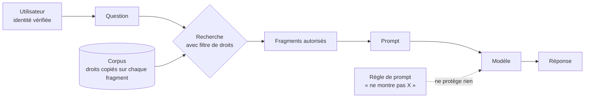

# Droits d'accès dans un RAG

## Aperçu

- Un RAG sert à chaque utilisateur des extraits de documents. Si un extrait qu'il ne peut pas ouvrir à la source atteint le prompt, le modèle le restitue : **le filtre des droits se pose avant le prompt, jamais dans le prompt**. Une consigne « ne montre pas les documents confidentiels » est une règle de prompt, que le modèle peut oublier ou qu'une injection peut annuler ([[Prompt injection]]).
- Le sujet pèse lourd en contexte ESN ou industriel : un assistant branché sur un partage de fichiers révèle d'abord les droits trop larges qui y dorment. Le moteur de recherche n'est pas le travail difficile ; **les droits et la qualité des données le sont**.
- Quatre idées à retenir : filtrer à chaque appel de recherche ; choisir entre index centralisé et requête fédérée selon la fraîcheur des droits dont on a besoin ; nettoyer le sur-partage **à la source**, car aucun des deux montages ne le corrige ; tester avec deux comptes.

## Concepts clés

### Où le filtre s'applique

- **Côté serveur, à la récupération, avec l'identité de l'utilisateur.** C'est la ligne de l'OWASP, risque LLM08:2025 (*Vector and Embedding Weaknesses*) : contrôles d'accès insuffisants ou mal alignés sur les embeddings, avec fuite entre utilisateurs ou entre locataires quand des groupes partagent une même base vectorielle. Remèdes cités : stores vectoriels « permission-aware », partition logique et d'accès, classification des données, journaux de récupération.
- **À chaque appel de recherche, boucle d'agent comprise.** Un agent qui relance dix recherches ([[RAG agentique]]) passe dix fois par le filtre. Un filtre posé une seule fois, au premier appel, laisse les suivants ouverts.
- **Sur chaque fragment, pas seulement sur le document.** Quand un document est découpé ([[Chunking strategies]]), les métadonnées de droits doivent être recopiées sur **chaque fragment** : la documentation d'Azure AI Search le dit pour les étiquettes de sensibilité (sans projection au niveau du fragment, les références au fragment ne sont pas filtrées) et pour les ACL SharePoint (les champs passent du mappage de l'indexeur aux projections d'index).

### Index centralisé ou requête fédérée

Deux architectures, qui ne portent pas les droits au même endroit.

| | Index centralisé | Requête fédérée (à la volée) |
|---|---|---|
| Où sont vérifiés les droits | Dans l'index, sur une **copie** des ACL écrite à l'indexation ; filtre à la requête avec l'identité de l'utilisateur | Dans l'application source, à l'appel, avec l'identité de l'utilisateur |
| Fraîcheur des droits | Celle de la dernière synchronisation | Celle de la source, au moment de l'appel |
| Révocation d'un droit | Visible après la synchronisation suivante ; un changement hérité d'un dossier parent exige un rafraîchissement explicite | Visible à l'appel suivant |
| Classement | Un seul modèle de pertinence sur tout le corpus | Pas de classement entre sources |
| Latence | Une recherche locale | Au mieux celle de la source la plus lente |
| Surface de données | Copie des contenus et des droits dans un second système | Aucune copie |
| Risque propre | Décalage de droits ; filtre de locataire oublié sur une requête | Quotas d'API des sources ; qualité de la recherche native de chaque source |

- **Ce qui est lu à la source** : la documentation d'Azure AI Search écrit que le filtre à la requête évalue les droits **déjà synchronisés** dans l'index ; un changement dans la source n'apparaît qu'après la synchronisation (exécution d'indexeur, mise à jour par l'API de dépôt, rafraîchissement), et un changement hérité d'un niveau parent (site, bibliothèque, dossier) exige un rafraîchissement explicite. Le reste du tableau est un raisonnement d'architecture, cohérent avec les billets des éditeurs d'index (Glean, Elastic) — qui vendent des index et n'ont pas intérêt à dire l'inverse.
- **Quand choisir quoi** : index centralisé quand les sources sont nombreuses, que le classement global compte et que les droits changent peu ; requête fédérée quand les sources sont peu nombreuses, vivantes, ou à droits sensibles et changeants. Les deux peuvent coexister (c'est ce que propose la documentation Microsoft : connecteurs fédérés pour les sources sensibles ou dynamiques).
- **Jeton en fédéré** : la spécification MCP interdit à un serveur MCP d'accepter un jeton qui ne lui a pas été émis et de le retransmettre tel quel à l'API en aval (*token passthrough*, « MUST NOT accept any tokens that were not explicitly issued for the MCP server »). Un montage fédéré utilise donc un jeton émis pour le serveur, au nom de l'utilisateur.

### Aucun des deux ne corrige un sur-partage

- Les deux montages **héritent des droits de la source**. Un document partagé « avec tout le monde » à la source sort de l'index comme de l'appel fédéré. Indexer ne change pas les permissions.
- La seule parade est un **nettoyage des droits à la source** avant de brancher l'assistant : inventaire des partages larges, retrait des droits hérités inutiles, classification. C'est pourquoi la règle de décision place les droits **avant** le choix du moteur ([[Coller le corpus ou récupérer]]).

### Le filtre dans la base vectorielle

Poser le filtre ne suffit pas, encore faut-il que la base le tienne sans perdre de résultats.

- **Filtre après l'index approximatif** : avec pgvector, le filtre s'applique aux candidats que l'index renvoie. Si le filtre ne garde que 10 % des lignes, 40 candidats donnent en moyenne **4 résultats** (calcul du README, cf. [[pgvector]]). Parades : scans itératifs, index partiels, partitionnement.
- **Filtre intégré au parcours** : [[Qdrant]] (filtre sur le payload, index construit pour ne pas casser le graphe), [[Weaviate]] (pré-filtrage par index inversé). Le coût d'isolation par locataire varie avec le découpage : chez [[Pinecone]], 100 locataires de 1 Go interrogés dans un seul espace de noms filtré coûtent 100 fois plus d'unités de lecture que dans un espace de noms par locataire (exemple de la documentation).
- **Granularité du droit** : une clé d'API par collection (Qdrant) n'est pas un droit par document ; l'isolation fine passe par les filtres de métadonnées. Voir [[Comparatif - Bases vectorielles]].

### Le cache change la donne

- Un cache de préfixe ([[prompt-caching]]) est propre à un contexte identique. Si chaque groupe d'utilisateurs voit un sous-ensemble différent du corpus, il y a un préfixe, donc un cache, par groupe : coller le corpus avec cache ne vaut que pour **un seul jeu de droits**.

## Les maths, simplement

- **Résultats perdus par un filtre après l'index** : $k_{\text{final}} \approx n_{\text{cand}} \times s$, avec $n_{\text{cand}}$ le nombre de candidats que l'index renvoie (`hnsw.ef_search` = 40 par défaut dans pgvector) et $s$ la sélectivité du filtre (part des lignes autorisées). $40 \times 0{,}10 = 4$ : on demande 10, on en reçoit 4.
- **Fenêtre d'exposition d'une révocation** dans un index centralisé : au plus la période de synchronisation $T_{\text{sync}}$ (plus le délai de traitement). Un droit retiré à $t_0$ reste lisible dans les réponses jusqu'à la synchronisation suivante, au pire $t_0 + T_{\text{sync}}$. En fédéré, la fenêtre est de l'ordre de la durée d'un appel.

## En pratique

- **Avant tout moteur** : lister les jeux de droits distincts $D$. Si $D = 1$ (tout le monde lit tout), le sujet disparaît ; sinon il structure l'architecture.
- **Tester avec deux comptes** : une question dont la réponse ne se trouve que dans un document réservé au compte A ; la poser avec le compte B, puis retirer le droit de A et recommencer après la synchronisation. Lire le **journal de récupération**, pas seulement la réponse : un fragment interdit dans le contexte est déjà une fuite, même si le modèle ne le cite pas.
- **Journaliser** chaque récupération (utilisateur, requête, fragments renvoyés) : c'est ce qui permet de détecter un accès suspect, et ce que l'OWASP recommande.
- **Synchroniser avec l'annuaire** : [[Keycloak]] ou [[Authentik]] authentifient ; ils ne propagent pas les droits sur les documents. La synchronisation des groupes vers les métadonnées de l'index est un composant à écrire ou à acheter (voir [[RAG documentaire on-prem - clé en main ou assemblé]]).
- **ESN** : le sur-partage est le vrai sujet de chez le client. Un inventaire des droits ouvre le projet, avant le choix du modèle ou de la base.

### Repères datés

Relevés le 2026-10-20 ; les documentations changent.

| Fait | Source | Date |
|---|---|---|
| Azure AI Search : filtre à la requête sur des droits synchronisés ; changements hérités de SharePoint = rafraîchissement explicite ; fonctions de permissions encore en préversion | Microsoft Learn, *Document-Level Access Control* | page mise à jour le 2026-09-17 |
| OWASP LLM08:2025 : permission-aware vector stores, partition d'accès, journaux | OWASP GenAI Security Project | consulté le 2026-10-20 |
| MCP : un serveur ne doit pas accepter un jeton non émis pour lui | modelcontextprotocol.io, *Security Best Practices* (version draft) | consulté le 2026-10-20 |

## Approches voisines & alternatives

- [[RAG documentaire on-prem - clé en main ou assemblé]] — la section « Droits d'accès aux documents » y donne la règle et la granularité par moteur ; cette page en est le développement.
- [[Coller le corpus ou récupérer]] — le choix de l'architecture vient après le traitement des droits.
- [[RAG agentique]] — un filtre par appel dans la boucle.
- [[Hybrid retrieval]] — la recherche lexicale et la recherche vectorielle appliquent toutes deux le même filtre.
- [[Comparatif - Bases vectorielles]] — le filtrage et l'isolation de chaque base.
- [[AI security]] · [[Guardrails]] · [[Prompt injection]] — la défense en profondeur autour du RAG ; un garde-fou de prompt ne remplace pas le filtre.
- [[Ontologie]] — certaines plateformes appellent « ontologie » une couche qui porte aussi des permissions par objet ; ce n'est pas le sens d'OWL.

## Pour aller plus loin

- OWASP GenAI Security Project, *LLM08:2025 Vector and Embedding Weaknesses* — https://genai.owasp.org/llmrisk/llm082025-vector-and-embedding-weaknesses/
- Microsoft Learn, *Document-level access control in Azure AI Search* — https://learn.microsoft.com/en-us/azure/search/search-document-level-access-overview
- Model Context Protocol, *Security Best Practices* (token passthrough) — https://modelcontextprotocol.io/specification/draft/basic/security_best_practices
- pgvector, README, section de filtrage — https://github.com/pgvector/pgvector
- Vidéo « Is RAG Dead in 2026? The Truth About AI Retrieval », AI WITH Rithesh, 9 min 09, https://www.youtube.com/watch?v=VNuC00pm2_M — index contre requêtes à la volée à 7 min 26, chiffres de blocage à 8 min 07.
- Short « 4 Bases de Données RAG à connaître (et comment les choisir) », Benoit Ferrere, 2 min 55, https://www.youtube.com/watch?v=4CMGyHzYFJg — filtre qui arrive après l'index à 0 min 55.
