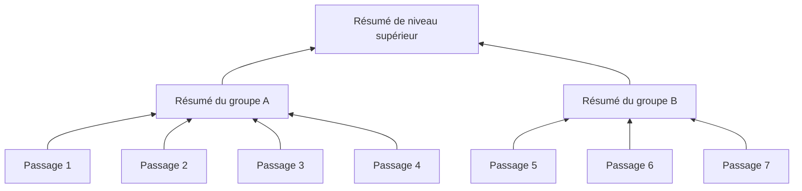
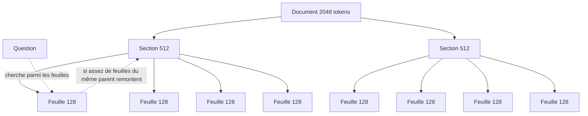
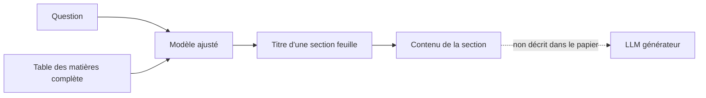

# RAG hiérarchique

## Aperçu

- Un RAG hiérarchique organise le corpus **du général au détail** : un résumé global, des sections, des passages. La recherche choisit le bon niveau, au lieu de comparer la question à des passages tous de même taille.
- « Hiérarchique » est un mot piégeux. Il recouvre au moins trois choses qui ne se ressemblent pas : un **arbre de résumés** généré par un modèle (RAPTOR), une **hiérarchie native** du document (rapport, section, passage : récupération parent-enfant) et une méthode qui **pointe vers la bonne section** à partir de la table des matières (STAIR). Un quatrième sens, le « RAG agentique hiérarchique », désigne des **agents** hiérarchisés, pas des documents.
- Aucune de ces méthodes ne **supprime les hallucinations**. Chacune améliore la récupération sous une condition (qualité des résumés, structure du document, présence d'une table des matières) et n'évalue pas la justesse de la réponse finale.

## Concepts clés

### Pourquoi une hiérarchie

- Un passage de 100 à 500 tokens perd son contexte : une règle dans un passage et son exception dans le suivant donnent une réponse sourcée mais fausse. Le découpage n'a pas d'optimum universel ([[Chunking strategies]]) : des passages longs portent du bruit, des passages courts perdent le contexte.
- Une question de synthèse (« de quoi parle ce livre ? ») n'est répondue par aucun passage isolé. Une question de détail se passe de la vue d'ensemble. Une hiérarchie permet de servir les deux.

### RAPTOR : un arbre de résumés

- **Construction.** Sarthi et al. (arXiv 2401.18059, ICLR 2024 selon la source de formation ; la page arXiv ne nomme pas de conférence) découpent le corpus en passages d'environ 100 tokens, les encodent, les regroupent par **classification floue** (mélange de gaussiennes, réduction UMAP, nombre de groupes choisi par BIC ; un nœud peut appartenir à plusieurs groupes), font résumer chaque groupe par un modèle (gpt-3.5-turbo dans le papier), puis recommencent sur les résumés jusqu'au sommet.
- **Interrogation.** Deux stratégies : parcourir l'arbre de la racine vers les feuilles, ou **aplatir** tous les niveaux en une seule réserve classée par cosinus, jusqu'à une limite de tokens (2 000 dans les expériences principales). La seconde a donné de meilleurs résultats sur un échantillon de 20 histoires du jeu QASPER, et c'est elle qui sert aux résultats principaux.
- **Mesure.** Avec GPT-4, RAPTOR atteint **82,6 %** d'exactitude sur QuALITY (76,2 % sur le sous-ensemble difficile), contre 62,3 % pour le meilleur résultat précédent. Une relecture manuelle de 150 nœuds a trouvé 6 nœuds (4 %) avec une forme d'hallucination mineure, sans effet visible sur la qualité des réponses d'après les auteurs.
- **Ce qu'il faut en garder.** Les niveaux supérieurs sont **générés**, pas la structure du document : leur qualité est celle du résumé, et elle se paie en appels de modèle à l'indexation (un arbre à refaire quand le corpus change).

### Parent-enfant : la hiérarchie native

- **Principe.** On indexe de petites **feuilles**, précises pour la recherche, et on remonte au **parent** (plus grand, riche en contexte) pour la génération. Le `HierarchicalNodeParser` de LlamaIndex découpe par défaut à 2048, 512 et 128 tokens ; seules les feuilles vont dans l'index vectoriel, tous les nœuds dans un docstore ; l'`AutoMergingRetriever` remplace les feuilles retrouvées d'un même parent par ce parent (dans l'exemple de la documentation : 4 feuilles remplacées par leur parent, 6 nœuds renvoyés devenant 3). La documentation ne donne pas le seuil de fusion ni sa valeur par défaut.
- **Ce qu'il faut en garder.** La structure est celle du **document** (sections, titres), pas un résumé généré : pas d'appel de modèle à l'indexation, mais une qualité qui dépend du parseur ([[OCR classique vs modèles vision-langage pour documents]]).

### STAIR : pointer vers la section par la table des matières

- **Méthode.** STAIR (*STructure Aware Information Retriever*, IBM ; Kumar et al., arXiv 2609.03874, préprint, v1 du 2026-09-03, v2 du 2026-10-13) ajuste un modèle (Mistral-7B-Instruct-v0.2, adaptateur LoRA de rang 16, entrée jusqu'à 14 000 tokens) pour que, devant une question et la **table des matières complète** d'un livre, il **génère le titre de la section feuille** qui répond. Les questions d'entraînement sont générées par un autre modèle (Mixtral 8x7B), plusieurs par paragraphe. Le savoir du livre est dans les paramètres du modèle : un livre ou une table modifiés demandent un nouvel ajustement (déduction : le papier annonce comme travail futur les tables artificielles et le passage à l'échelle).
- **Mesure.** Sur SearchTome (18 livres, 6 domaines, jeu construit par les auteurs), Recall@1 de **82,6 %** pour STAIR, contre 76,9 % pour un DSI ajusté, 68,7 % pour un embedding utilisé tel quel, 59,5 % pour BM25. L'avantage se concentre au rang 1 ; à Recall@3 l'écart se resserre.
- **Ce que « hallucination » veut dire ici.** Le papier la définit comme la génération d'un **nœud qui n'est pas une feuille** de la table des matières (un identifiant de section invalide) : 0,05 % pour STAIR. Ce n'est pas une réponse fausse d'un LLM : **aucune réponse n'est générée ni évaluée**. Il reste environ 17 % de sections erronées (100 − 82,6).
- **Condition posée par les auteurs** : l'évaluation se limite aux corpus qui ont une **structure globale**, c'est-à-dire une table des matières propre. Le protocole favorise aussi la mémorisation (questions d'entraînement, de développement et de test tirées des mêmes paragraphes par le même modèle).

### Comparaison

| | Arbre de résumés (RAPTOR) | Parent-enfant | Pointer par la table des matières (STAIR) |
|---|---|---|---|
| Source de la structure | Générée (regroupement et résumés) | Native (sections, titres) | Native (table des matières) |
| Coût à l'indexation | Appels de modèle sur tous les niveaux | Découpage | Ajustement d'un modèle |
| Corpus qui change | Arbre à reconstruire | Découpage à refaire pour les pages modifiées | Nouvel ajustement |
| Condition | Qualité des résumés | Qualité du parseur | Une table des matières propre |
| Mesure publiée | Exactitude QuALITY, jeu des auteurs | — | Recall@1 sur un jeu des auteurs |
| Questions servies | Synthèse et détail | Détail avec contexte | Trouver la section |

## Les maths, simplement

- **Recall@1** : $\mathrm{Recall@}1 = \frac{1}{|Q|}\sum_{q\in Q}\mathbb{1}[\hat s(q) = s^\star(q)]$, avec $\hat s(q)$ la feuille prédite et $s^\star(q)$ la feuille de référence. Une feuille valide mais fausse compte comme une erreur de rappel, pas comme une hallucination.
- **Nombre de nœuds d'un arbre** : avec un taux de regroupement moyen $b$ (passages par résumé), le niveau $\ell$ compte environ $n / b^{\ell}$ nœuds pour $n$ passages ; l'arbre ajoute donc de l'ordre de $n/(b-1)$ résumés. Pour $n = 10\,000$ et $b = 5$, environ 2 500 résumés à générer. Estimation d'ordre de grandeur, pas une mesure de RAPTOR.

## En pratique

- **Documents longs et structurés** (manuels, normes, procédures, contrats) : commencer par **parent-enfant**, qui ne demande ni modèle ni ajustement, et mesurer.
- **Questions de synthèse sur un corpus** : un arbre de résumés ou un graphe ([[GraphRAG]]) ; comparer sur ses propres questions avant de payer l'indexation.
- **STAIR et ses semblables** : un préprint, évalué sur un jeu des auteurs, hors du cadre d'un corpus sans table des matières. Une piste à suivre, pas une brique.
- **Une hiérarchie n'efface pas les erreurs en aval** : mesurer la fidélité de la réponse comme pour tout RAG ([[RAG eval]]).
- **Un reranker ne rattrape pas ce que la recherche n'a pas remonté** : si la bonne section n'est pas dans les candidats, la hiérarchie aval ne la retrouvera pas ([[Reranking]]).

## Approches voisines & alternatives

- [[RAG]] · [[Advanced RAG]] — la famille ; le RAG hiérarchique y est l'un des motifs, comme le correctif ou le graphe.
- [[Chunking strategies]] — le découpage, point critique que la hiérarchie contourne ou complète.
- [[GraphRAG]] — l'autre approche pour la synthèse sur tout le corpus : un graphe d'entités plutôt qu'un arbre de résumés.
- [[Late-interaction retrieval]] — une autre réponse à la perte de contexte : garder un vecteur par token.
- [[RAG agentique]] — une boucle de contrôle ; à ne pas confondre avec des agents hiérarchisés.
- [[Hybrid retrieval]] · [[Reranking]] — les étages de recherche qui s'appliquent à chaque niveau.
- [[Coller le corpus ou récupérer]] — pour un livre qui tient dans le contexte, la hiérarchie est superflue.

## Pour aller plus loin

- Sarthi et al., *RAPTOR: Recursive Abstractive Processing for Tree-Organized Retrieval*, arXiv 2401.18059 — https://arxiv.org/abs/2401.18059
- Kumar et al. (IBM), *STAIR: A novel dataset and LLM based retriever for document structure augmentation*, arXiv 2609.03874 — https://arxiv.org/abs/2609.03874
- Tay et al., *Differentiable Search Index*, arXiv 2202.06991 — le point de comparaison de STAIR.
- LlamaIndex, *Auto-merging retriever* — https://developers.llamaindex.ai/python/examples/retrievers/auto_merging_retriever/
- Short « Les 7 patterns de RAG à connaître pour un Ingénieur IA », Benoit Ferrere, 17 s, https://www.youtube.com/watch?v=Ak-wMJiqp6w — carte « Hierarchical / Tree RAG » à 0 min 08.
- Short « Cette nouvelle méthode d'IBM supprime les hallucinations ? », Benoit Ferrere, 2 min 27, https://www.youtube.com/watch?v=qOqZmqGNb2w — fine-tuning à 1 min 17, résultats à 1 min 50, condition à 2 min 07.
