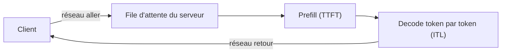

# Mesurer une latence

## Aperçu

- Une latence (délai entre la requête et la réponse) **ne se lit pas sans son matériel, son protocole et ce qu'elle inclut**. Quatre questions la rendent comparable : quoi est mesuré (calcul seul ou aller-retour réseau), sur quelle machine, avec quelle charge, et quelle statistique (médiane p50, ou queue p95).
- Exemple chiffré : un même modèle de décision de 3 milliards de paramètres répond en **8 ms** sur une RTX 4090, en **30 ms** sur un Apple M5 Pro et en **78 ms** sur un MacBook Air M5 : trois machines, trois valeurs, un seul modèle. Une API hébergée pour un autre modèle du même genre affiche **524 ms** de médiane depuis un client distant : une ligne qui ne se compare à aucune des trois.

## Concepts clés

### Calcul seul contre aller-retour

- Une mesure « **calcul seul** » commence à l'entrée du modèle sur la carte et finit à sa sortie : elle dit ce que vaut le matériel et le logiciel d'inférence.
- Une mesure « **aller-retour** » (*end to end*) ajoute le réseau, l'authentification, la file d'attente, la sérialisation : c'est ce que voit un client. Elle dépend du point de départ : pour une même API hébergée, 191 à 205 ms depuis l'Italie contre 342 à 495 ms depuis Bengaluru (relevés d'un auteur, octobre 2026).
- Une latence éditeur « de 70 à 500 ms », une médiane de testeur et la médiane d'un classement indépendant, pour une même API, sont trois protocoles différents.

### Médiane, queue, et nombre de mesures

- **p50** (médiane) : la moitié des requêtes va plus vite. **p95** : 95 % vont plus vite, les 5 % les plus lentes sont au-delà. La queue décrit l'expérience des pires cas et dépend beaucoup de la charge et de la file.
- Deux modèles peuvent avoir une médiane très proche et une queue très différente : 5,8 ms de médiane mais 222,5 ms de p95 pour un encodeur dans un classement, contre 16,1 ms de médiane et 55,9 ms de p95 pour un autre. Le p95 compte quand chaque appel est bloquant (un garde-fou avant chaque commande d'agent).
- Une médiane sur 10 clips ou 20 passes dit peu de la queue : avec dix mesures, le p95 est presque le maximum. Annoncer le nombre de mesures, ou ne pas annoncer de p95.

### Ce qu'une mesure doit nommer

| Question | Exemple de réponse qui rend la mesure lisible |
|---|---|
| Matériel | « RTX 4090 », « MacBook Air M5 24 Go (sans ventilateur) », pas « un GPU » |
| Logiciel et précision | bf16, FP16, PyTorch sur le GPU Apple (MPS), MLX, CUDA graphs activés ou non |
| Entrée | une question de 50 tokens, un état de 4 897 tokens, une page à 700 jetons de sortie |
| Charge | une requête à la fois, ou N en parallèle ; client séquentiel ; lot de combien |
| Statistique | médiane de 20 passes, p95 sur 750 lignes ; moyenne ou médiane |
| Périmètre | chargement du modèle compris ou à part ; préremplissage compris ; réseau compris |

### Normaliser avant de comparer

Une ligne intitulée « log de 3,4 K tokens » comparée à une autre de 4 897 tokens surestime l'écart : 640 ms contre 2 649 ms donne un rapport de 4,1, mais rapporté au token, 0,19 ms contre 0,54 ms donne 2,9, cohérent avec les 2,6 à 3,2 fois des autres lignes. Comparer des temps à **entrée égale**, ou par token.

### Le temps d'une génération

Pour une génération, la latence totale est `préremplissage + nombre de tokens produits ÷ débit de decode` : le temps suit le **nombre de tokens produits**, pas seulement la taille du modèle. Sur un MacBook Air M5, trois modèles d'OCR de 0,8, 1 et 4 milliards de paramètres produisent environ 700 tokens par page ; les pages denses d'un banc public en produisent 1 433, d'où 10 s mesurées contre environ 21 s inférées pour le plus petit.

## Les maths, simplement

- Débit de decode : `v = tokens produits ÷ durée du decode`. Latence d'une page : `t ≈ préremplissage + tokens ÷ v`. Exemple : 4 B, `v = 13,5` jetons/s, préremplissage d'environ 3 s : pour 1 433 jetons, `1 433 ÷ 13,5 + 3 ≈ 109 s` (inféré) ; mesuré sur des pages de 700 jetons : 52 s.
- Comparaison à un plafond : un plafond de formule (cf. [[Plafond de débit d'un GPU (roofline)]]) se confronte à une mesure. Les trois modèles cités atteignent 78 à 80 % du plafond de bande passante de leur machine (153 Go/s annoncés par le constructeur) : c'est le signe que le decode est limité par la mémoire, et un contrôle de cohérence de la mesure.
- p95 d'un échantillon trié de `n` mesures : la valeur au rang `⌈0,95 n⌉`. Pour `n = 10`, c'est la dixième : le maximum.

## En pratique

- Une latence annoncée sans matériel ni protocole : ne rien en conclure ; demander le matériel, la charge et la statistique.
- Mesurer soi-même, sur **sa** machine et **sa** charge, deux séries distinctes : calcul seul (en local ou sur le serveur) et aller-retour (depuis le vrai client). La différence est le coût de l'infrastructure.
- Pour un serveur LLM : mesurer TTFT et ITL séparément, en p50 et p95, sous la charge réelle (cf. [[Prefill par morceaux et désagrégation prefill-decode]]). Une latence sans charge ne dit pas la latence sous concurrence : les bancs lus n'en publient souvent pas.
- Distinguer **variation de mesure** (même service, même question, valeurs différentes d'une exécution à l'autre) et **variation de service** : le chiffre d'un jour n'est pas celui d'un autre.
- Ne pas comparer une API et une carte locale : les lignes sont de nature différente.
- Mentionner le matériel dans toute fiche ou tout comparatif de modèles : « 8 ms » seul n'informe pas.

## Repères datés

Valeurs relevées dans les cours de floSa en octobre 2026 ; ce sont des mesures d'éditeurs, d'un classement et d'un testeur, non rouvertes à leur source.

- Modèle de décision d1-3B : 8 ms sur RTX 4090 (bf16, CUDA graphs, médiane de 20 passes, éditeur), 9 ms AMD MI325X, 16 ms Jetson AGX Thor, 26 ms Jetson AGX Orin, 30 ms Apple M5 Pro, 50 ms Jetson Orin Nano ; 78 ms sur MacBook Air M5 (testeur, une mesure).
- Modèles d'OCR LightOnOCR-3 sur MacBook Air M5 (MLX, bfloat16, 1540 px) : 10,07 / 11,09 / 52,15 s par page pour 0,8 / 1 / 4 milliards de paramètres ; 69,8 / 59,8 / 13,5 jetons/s ; mesure d'un testeur, quatre pages.
- API hébergée d'un modèle de décision : p50 de 150 ms et p95 de 350 ms (testeur, 2026-09-16) ; 524,1 ms de médiane et 536,0 ms au classement indépendant (client séquentiel, 2026-10-10).

## Approches voisines & alternatives

- [[Plafond de débit d'un GPU (roofline)]] — le plafond contre lequel contrôler une mesure.
- [[Prefill par morceaux et désagrégation prefill-decode]] — TTFT, ITL et goodput.
- [[Inference optimization]] — ce qui fait varier la latence.
- [[Server-Sent Events & streaming LLM]] — le premier token perçu compte plus que le débit total pour l'utilisateur.
- [[LLM benchmarks]] — lire un banc : version, protocole, qui l'exécute.
- [[Coût d'un token et taux d'utilisation]] — le débit saturé et le débit sous charge réelle ne sont pas le même nombre.
- [[Quantization]] — change la latence autant que la précision.
- [[Comparatif - Modèles de décision]] — un modèle, trois matériels : 8, 30 et 78 ms pour d1-3B, rangés une ligne par matériel.

## Pour aller plus loin

- Cours de floSa : *Modèles de décision — synthèse Jev, Laya, Clef, d1* (latences rangées une ligne par matériel), *LightOnOCR-3* (AI WITH Rithesh, 2026-10-10, [youtube.com/watch?v=sPPmHJZCl_s](https://www.youtube.com/watch?v=sPPmHJZCl_s)) et *Servir un LLM à plusieurs utilisateurs* (Benoit Ferrere ; un benchmark éditeur affiche un P99 de 80 ms contre 673 ms sans dire s'il s'agit d'un TTFT ou d'un ITL : un exemple de chiffre à ne pas citer sans son périmètre).
- Rapports de bancs publics de classement : lire d'abord la section « protocole » (matériel décrit, nombre de lignes, client séquentiel ou concurrent).
