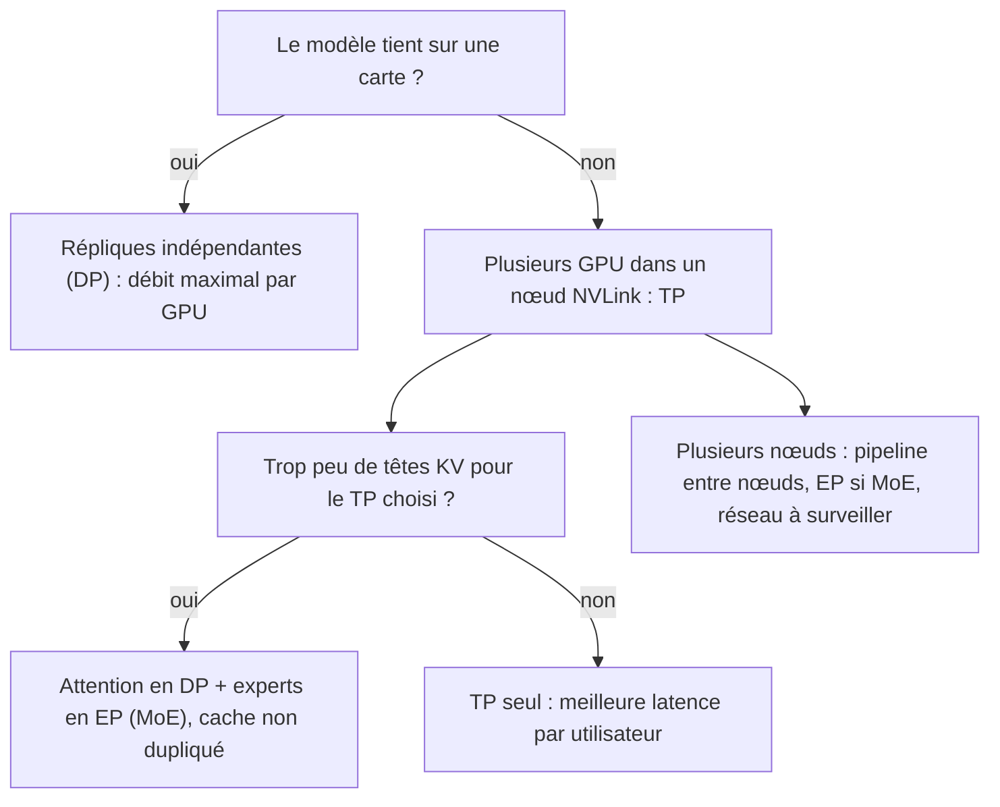

# Parallélisme en inférence

## Aperçu

- Quand un modèle ne tient pas sur une carte, ou qu'une carte ne sert pas assez d'utilisateurs, on répartit le travail sur plusieurs GPU. Trois modes se retrouvent dans tous les moteurs : **tenseurs** (couper chaque matrice), **données** (répliquer le modèle, servir des requêtes différentes) et **experts** (répartir les experts d'un MoE).
- Le choix ne se règle pas après coup : il fixe la latence par utilisateur, le nombre d'utilisateurs qui tiennent en mémoire et le coût de communication. Exemple chiffré : un MoE à 2 têtes KV sur 8 GPU tient environ **43 utilisateurs** de 32 768 tokens en parallélisme de tenseurs, environ **150** quand l'attention passe en parallélisme de données.

## Concepts clés

### Parallélisme de tenseurs (TP)

Chaque matrice de poids est **coupée entre les GPU** : chacun stocke et lit sa tranche. On coupe la première matrice d'un bloc par colonnes (chaque GPU calcule une part des sorties sans rien demander) et la seconde par lignes (chaque GPU produit une somme partielle). Un seul *all-reduce* (une somme sur toutes les cartes) par bloc suffit : c'est le schéma de Megatron-LM. Avec deux blocs par couche et 64 couches : **128 échanges par pas de decode**.

- Gain : chaque carte lit `1/n` des octets, donc le terme mémoire du pas passe de `W ÷ BW` à `W ÷ (n·BW)`, et de la place est libérée pour le cache sur chaque carte.
- Coût : à un utilisateur, chaque échange porte un vecteur de 10 Kio (5 120 valeurs × 2 octets) ; sur NVLink à 900 Go/s le transfert dure environ 11 ns, mais la **latence de synchronisation** domine. Pour garder 90 % d'efficacité sur 128 échanges, il faut environ 6 µs par échange (budget de calcul, non mesure). Sans interconnexion rapide (PCIe seulement), les 128 synchronisations par token peuvent annuler le gain.
- Le TP augmente le débit **par utilisateur** et la capacité, pas l'efficacité par GPU : si une carte suffit, deux cartes en TP servent moins de requêtes par carte que deux répliques indépendantes.
- Il se règle d'ordinaire **dans un nœud** (`tensor_parallel_size` = nombre de GPU du nœud) ; entre nœuds, c'est le parallélisme de pipeline (couper par couches) qui prend le relais.

### Réplication des têtes KV

Le nombre de têtes de clés-valeurs borne le découpage propre de l'attention. Si le TP atteint ou dépasse ce nombre, [[vLLM]] duplique les têtes (`num_kv_head_replicas = tp_size // total_num_kv_heads`, code relu le 2026-10-20). Avec 2 têtes KV et TP = 8, le cache effectif du nœud est **multiplié par 4** : 122 880 octets par token au lieu de 30 720, autant qu'un modèle tout-attention (cf. [[Taille du cache KV par token]]).

### Parallélisme de données (DP)

Le modèle (ou, pour un MoE, la partie attention) est **répliqué** sur plusieurs groupes de GPU, qui traitent des requêtes différentes. Aucune communication par couche entre répliques ; chaque réplique garde le cache de ses propres requêtes, donc pas de duplication de têtes KV. Plus de débit total, pas de latence gagnée par utilisateur, et il faut que le modèle tienne dans chaque groupe.

### Parallélisme d'experts (EP)

Dans un MoE, les experts sont répartis sur les GPU. Pour chaque token, un routeur choisit `K` experts ; les activations sont envoyées aux GPU qui les portent puis rapatriées (*all-to-all*) : la communication est le coût de ce mode. Dans vLLM, `--enable-expert-parallel` calcule une taille d'EP égale à TP × DP ; l'attention se met en DP et les couches d'experts se partagent entre tous les rangs. Les bibliothèques d'*all-to-all* se choisissent selon la charge (`--all2all-backend` : DeepEP pour un prefill multi-nœuds ou un decode à faible latence, d'autres backends pour NVLink multi-nœuds).

- **Équilibre** : un routage déséquilibré laisse des GPU inactifs. La perte auxiliaire d'équilibrage est un remède **à l'entraînement** ; à l'inférence, vLLM propose un rééquilibrage dynamique (EPLB, `--enable-eplb`) avec des experts redondants, au prix de mémoire supplémentaire.
- **Réseau** : sur un seul nœud NVLink, le cas est le plus favorable ; sur plusieurs nœuds, la bande passante du réseau devient le facteur limitant probable.
- Pour un MoE, **tous les experts restent en mémoire** et, dès un lot de quelques dizaines de requêtes, presque tous sont lus à chaque pas (cf. [[Mixture of Experts]]).

### Choisir

## Les maths, simplement

- Temps d'un pas avec `n` cartes en TP : `t ≈ (W + κT + S) ÷ (n·BW) + 128 × t_all-reduce` (cf. [[Plafond de débit d'un GPU (roofline)]]). Avec `n = 2`, le terme mémoire d'un modèle de 27 Md passe de 16,1 ms à environ 8 ms dans le cas idéal.
- Cache effectif d'un nœud en TP : `κ × max(1, tp_size ÷ n_kv)`. Pour `n_kv = 2` et `tp_size = 8` : facteur 4.
- Capacité d'un nœud de 8 × H100 en FP8 pour le MoE de 396 Md (reste : 170 Gio, contextes de 32 768 tokens, cache bfloat16) : `170 ÷ (0,94 × 4 + 0,18) ≈ 43` en TP 8, `170 ÷ (0,94 + 0,18) ≈ 150` en attention DP (cf. [[Dimensionner la mémoire d'un serveur LLM]]).

## En pratique

- Une recette officielle de vLLM pour le MoE cité propose `-dp 8 --enable-expert-parallel` pour le **débit** et `--tensor-parallel-size 8` pour la **latence** : le calcul de réplication ci-dessus est une explication plausible, que la recette ne donne pas.
- Commencer par le plus simple : une carte si le modèle (quantifié) tient, puis TP dans un nœud, puis seulement des modes plus coûteux en communication.
- Vérifier l'interconnexion avant d'acheter : le TP sur des cartes grand public reliées par PCIe est un mauvais pari.
- Ne pas déduire un débit du nombre de GPU : aucune mesure de débit n'a été retrouvée pour le MoE de 396 Md sur un moteur ; les chiffres ici sont des plafonds de formule.
- Chaque pool d'un serveur désagrégé peut avoir son propre parallélisme (cf. [[Prefill par morceaux et désagrégation prefill-decode]]).

## Repères datés

- vLLM v0.32.0 et documentation stable relues les 2026-10-19 et 2026-10-20 : TP via l'algorithme de Megatron-LM, pipeline entre nœuds, DP pour l'attention des MoE, EP par `--enable-expert-parallel`, EPLB documenté.
- Une recette vLLM de Qwen3.5-397B-A17B est vérifiée sur 8 × H200 (FP8) et sur 4 GPU d'un nœud GB200 (NVFP4) ; la configuration sur 8 × H100 en FP8 est une estimation du cours de floSa, non une recette officielle.

## Approches voisines & alternatives

- [[Entraînement distribué]] — les mêmes familles de parallélisme, côté entraînement.
- [[Mixture of Experts]] — pourquoi un MoE appelle le parallélisme d'experts.
- [[Taille du cache KV par token]] — la duplication des têtes KV.
- [[Dimensionner la mémoire d'un serveur LLM]] — ce que chaque mode fait au nombre d'utilisateurs.
- [[Plafond de débit d'un GPU (roofline)]] — ce que le TP achète : des octets lus par GPU.
- Moteurs : [[vLLM]], [[SGLang]], [[TensorRT-LLM]] (multi-GPU et multi-nœuds).

## Pour aller plus loin

- Shoeybi et al. (2019) — *Megatron-LM: Training Multi-Billion Parameter Language Models Using Model Parallelism*, arXiv 1909.08053 (parallélisme intra-couche, 76 % d'efficacité de passage à l'échelle sur 512 GPU).
- Documentation vLLM — [Parallelism and scaling](https://docs.vllm.ai/en/stable/serving/parallelism_scaling/) et [Expert Parallel Deployment](https://docs.vllm.ai/en/stable/serving/expert_parallel_deployment/).
- Cours de floSa : *Inférence d'un LLM sur GPU* (AI WITH Rithesh, 2026-09-28, [youtube.com/watch?v=lasG5MsR-gE](https://www.youtube.com/watch?v=lasG5MsR-gE), le parallélisme de tenseurs de 15:14 à 15:27) et *Servir un LLM à plusieurs utilisateurs* (Benoit Ferrere, le MoE, 2026-10-18, [youtube.com/watch?v=oUyqmYglYBM](https://www.youtube.com/watch?v=oUyqmYglYBM)).
