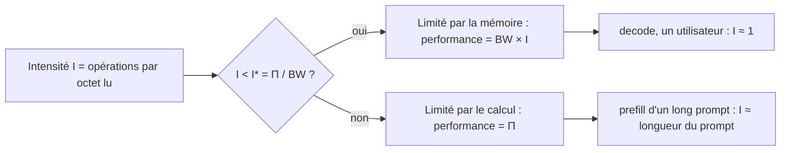

# Plafond de débit d'un GPU (roofline)

## Aperçu

- Pour générer du texte, un GPU attend sa mémoire bien plus qu'il ne calcule : le débit maximal d'un utilisateur vaut **la bande passante mémoire divisée par le nombre d'octets lus à chaque token** (`tok/s ≈ BW ÷ octets lus par token`). C'est un plafond qui se calcule avant de lancer le serveur, avec deux nombres : la fiche du GPU et la taille du modèle.
- Exemple chiffré : un modèle dense de 27 milliards de paramètres en bfloat16 pèse environ 54 Go. Sur un H100 SXM (3,35 To/s), relire ces 54 Go prend **16 ms** ; faire les calculs d'un token n'en prend que **0,055 ms**. Le plafond à un utilisateur est donc de **62 tokens/s**, et le GPU n'utilise que 0,34 % de son pic de calcul.

## Concepts clés

### Les deux nombres d'une machine

- **Bande passante mémoire** `BW` : octets que la mémoire (HBM) livre par seconde.
- **Pic de calcul** `Π` : opérations en virgule flottante par seconde, pour un format donné (bfloat16, FP8…), en version *dense* (les chiffres « avec sparsity » des fiches constructeur valent le double et ne servent pas à des poids denses).
- Leur rapport est le **point d'inflexion** `I* = Π ÷ BW` : le nombre d'opérations que la puce peut faire pendant qu'elle va chercher un octet. Sur un H100 SXM en bfloat16 : 989 ÷ 3,35 ≈ **295 FLOP/octet**. Ce nombre appartient à la machine, pas au modèle.

### L'intensité arithmétique et le toit

- L'**intensité arithmétique** `I` d'un calcul est le nombre d'opérations faites par octet lu en mémoire. Un token traverse chaque poids avec 2 opérations (une multiplication, une addition) et chaque poids bfloat16 pèse 2 octets : sur un lot de `n` tokens traités ensemble, `I ≈ n`.
- Le modèle *roofline* (Williams, Waterman, Patterson, 2009) dessine la performance atteignable comme un toit : une oblique à gauche (limitée par la mémoire), un plateau à droite (limitée par le calcul), un coude en `I*`.

### Prefill et decode : deux régimes

- Le **prefill** traite tout le prompt d'un coup : chaque poids lu sert pour tous les tokens du prompt. Dès que le prompt dépasse environ 295 tokens, le calcul est le facteur limitant. Le temps avant le premier token (TTFT) croît avec la longueur du prompt.
- Le **decode** produit un token par pas et relit presque tous les poids pour un seul vecteur : `I ≈ 1`, très loin du coude. Ajouter des cœurs de calcul ne l'accélère pas ; ajouter de la bande passante, si.
- Le plafond de decode est celui qui est cité dans les cours d'inférence ; il s'écrit en toute généralité `v_max = BW ÷ (W + κT + S)` : `W` les poids, `κT` le cache KV du contexte (cf. [[Taille du cache KV par token]]), `S` un éventuel état de taille fixe.

### Ce que chaque optimisation attaque

Chaque technique de [[Inference optimization]] s'attaque à une grandeur différente du même déséquilibre. Dire qu'un moteur « optimise mieux » n'a de sens qu'en nommant la grandeur.

| Levier | Grandeur attaquée | Contrepartie |
|---|---|---|
| Quantization des poids (FP8, 4 bits) | octets de poids lus par pas | perte de qualité ; fichiers plus gros que la formule |
| Batching continu | lectures de poids pour un même travail (partagées entre utilisateurs) | latence par utilisateur ; mémoire des caches |
| Cache KV plus petit (GQA, latent, hybride, FP8) | octets de cache lus et stockés | rappel moins parfait, précision |
| Décodage spéculatif | nombre de passes par token | calcul gaspillé à grand lot |
| Parallélisme de tenseurs | octets lus *par GPU* | synchronisations à chaque couche |
| Fusion de noyaux, FlashAttention | trafic mémoire des résultats intermédiaires | noyaux à maintenir par matériel |
| CUDA graphs, overlap scheduling | temps GPU inactif (lancement, CPU) | formes figées, mémoire de capture |

### Optimisations de noyaux : fusion, FlashAttention, CUDA graphs, overlap

Ces quatre techniques ne changent ni le modèle ni les octets de poids : elles retirent des attentes autour du calcul.

- **Fusion de noyaux** : enchaîner normalisation, produit et activation sans repasser par la HBM entre deux. À un utilisateur, les résultats intermédiaires pèsent 10 Kio contre 54 Go de poids : l'économie en octets est négligeable. Elle compte au prefill et à grand lot, et réduit le nombre de lancements.
- **FlashAttention** : calculer l'attention par tuiles, avec un softmax « courant », sans jamais écrire en HBM la matrice des scores `T × T`. Le résultat est **exact**. Le gain est surtout au prefill (la matrice croît comme `T²`) ; au decode, une requête contre `T` clés ne produit qu'une ligne de scores, et c'est la lecture du cache qui domine.
- **CUDA graphs** : enregistrer la séquence de noyaux d'un pas de decode et la rejouer en un seul lancement, au lieu de plusieurs centaines. Contreparties documentées : formes de lot figées (remplissage jusqu'à une taille connue) et mémoire de capture hors budget (des échecs mémoire au démarrage ont été relevés, contournés en désactivant les graphes).
- **Overlap scheduling** : préparer sur le CPU le lot `n+1` pendant que le GPU exécute le lot `n`. Même idée que les CUDA graphs à une autre échelle ; le gain est plus net quand le pas GPU est court (petit modèle, poids quantifiés, parallélisme élevé).

## Les maths, simplement

- Performance atteignable : `P(I) = min(Π, BW × I)`.
- Temps de calcul d'un token : `2P ÷ Π` avec `P` le nombre de paramètres actifs. Temps de lecture : `W ÷ BW`. Pour `P = 27·10⁹`, `W = 54 Go` : 0,055 ms contre 16,1 ms, rapport 295, qui vaut exactement `Π ÷ BW` quand on lit un octet par opération.
- Plafond de decode d'un utilisateur selon la précision des poids (même modèle, H100 SXM, sans cache) :

| Poids | Taille | Plafond |
|---|---|---|
| bfloat16 | 53,8 Go | 62 tok/s |
| FP8 | 26,9 Go | 125 tok/s |
| INT4 par groupes de 128 | 13,9 Go | 242 tok/s |
| NVFP4 | 15,1 Go | 221 tok/s |

- **Lot de `B` utilisateurs** : `t_pas(B) = max(2PB ÷ Π, (W + B·(κT_u + S)) ÷ BW)`. Les poids sont lus une fois pour tout le lot ; le cache de chaque utilisateur, lui, est relu en entier. Exemple (modèle ci-dessus, contextes de 8 192 tokens) : 1 utilisateur, 61 tok/s ; 28 utilisateurs, 1 284 tok/s au total et 46 tok/s chacun. Le débit total est multiplié par 21 pour 34 % de latence en plus par utilisateur. Le calcul reste très sous le temps mémoire (1,5 ms contre 21,8 ms) : c'est la capacité mémoire qui borne le lot avant le coude de 295 (cf. [[Dimensionner la mémoire d'un serveur LLM]]).
- Ces valeurs sont des **majorants de formule**, pas des mesures. Une mesure indépendante les situe : un testeur a relevé sur un MacBook Air M5 (153 Go/s annoncés par Apple) 78 à 80 % du plafond calculé, pour trois modèles de 0,8, 1 et 4 milliards de paramètres en bfloat16, avec un débit inversement proportionnel à la taille des poids (cf. Pour aller plus loin).

## En pratique

- Avant de louer ou d'acheter du matériel : diviser la bande passante par la taille du modèle quantifié. Si le résultat est trop bas pour l'usage, aucun moteur ne le relèvera de plus de quelques dizaines de pour cent.
- Choisir une carte pour sa **bande passante** autant que pour ses téraflops : le decode d'un utilisateur ne voit pas les téraflops.
- Pour un modèle à experts, les paramètres *actifs* décident du calcul, jamais de la mémoire ni, à lot moyen, de la lecture : voir [[Parallélisme en inférence]] et [[Mixture of Experts]].
- Ne pas comparer un « tok/s » sans son matériel, son lot et la longueur de contexte (cf. [[Mesurer une latence]]).
- Ne pas attendre d'une optimisation de noyau un gain de decode à un utilisateur : le gros du temps est la lecture des poids et du cache.

## Repères datés

Relevé le 2026-09-30 / 2026-10 dans les cours de floSa ; les caractéristiques de matériel ne changent pas l'argument, mais se relisent à la fiche constructeur.

- H100 SXM : 80 Go HBM3, 3,35 To/s, NVLink 900 Go/s ; les téraflops de la page produit sont annoncés « avec sparsity » (bfloat16 dense : environ 989). Vérifié à la page NVIDIA le 2026-10-20 pour la mémoire, la bande passante et NVLink.
- RTX 4090 : 24 Go GDDR6X, 1 008 Go/s (21 Gbit/s × 384 bits ÷ 8). Cette valeur vient du livre blanc *Ada GPU Architecture*, pas de la page produit.

## Approches voisines & alternatives

- [[Inference optimization]] — le panorama des techniques ; cette notion en donne la grille de lecture.
- [[Quantization]] et [[Quantification des LLM - GGUF, AWQ, GPTQ]] — le levier le plus direct : moins d'octets de poids à lire.
- [[Taille du cache KV par token]] — le second poste d'octets lus, qui grandit avec le contexte.
- [[Flash Attention and efficient attention]] — l'attention exacte par tuiles.
- [[Speculative decoding]] et [[Multi-Token Prediction]] — mettre la marge de calcul du decode au travail.
- [[Coût d'un token et taux d'utilisation]] — traduire le débit par GPU en dollars.
- [[llmfit]] — savoir quel modèle tient sur une machine avant de le télécharger.
- Les moteurs qui appliquent ces leviers : [[vLLM]], [[SGLang]], [[llama.cpp]].
- LightOnOCR-3 — trois tailles d'un même modèle dont les débits mesurés suivent le plafond de bande passante.

## Pour aller plus loin

- Williams, Waterman, Patterson (2009) — *Roofline: An Insightful Visual Performance Model for Multicore Architectures*, Communications of the ACM 52(4), pp. 65-77.
- Dao et al. (2022) — *FlashAttention: Fast and Memory-Efficient Exact Attention with IO-Awareness*, arXiv 2205.14135.
- NVIDIA — [page produit H100](https://www.nvidia.com/en-us/data-center/h100/).
- Cours de floSa, *Inférence d'un LLM sur GPU* (vidéo d'AI WITH Rithesh, « How LLMs Actually Run on a GPU », 2026-09-28, [youtube.com/watch?v=lasG5MsR-gE](https://www.youtube.com/watch?v=lasG5MsR-gE), notamment de 7:23 à 7:57 pour le calcul de 0,055 ms contre 16 ms) : calculs refaits et exécutés (script `recalcul-chiffres.py`).
- Même auteur, test local de LightOnOCR-3 (2026-10-10, [youtube.com/watch?v=sPPmHJZCl_s](https://www.youtube.com/watch?v=sPPmHJZCl_s)) : 78 à 80 % du plafond mesuré sur MacBook Air M5.
