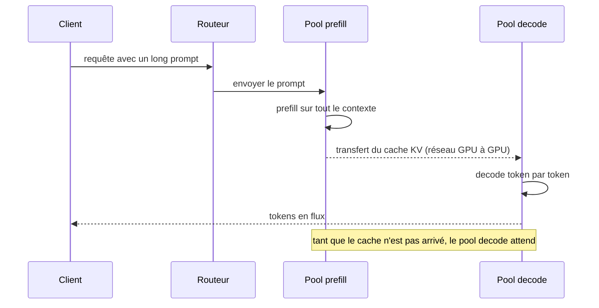

# Prefill par morceaux et désagrégation prefill-decode

## Aperçu

- Dans un serveur LLM, un très long prompt arrive au milieu de réponses en cours : son prefill demande beaucoup de calcul d'un coup et **retarde le prochain token de tout le monde**. Deux remèdes : découper ce prefill en morceaux mêlés aux decodes (*chunked prefill*), ou séparer physiquement les deux phases sur deux pools de GPU (*désagrégation*).
- La désagrégation **ne fait pas gagner de débit brut** : elle règle séparément le temps avant le premier token (TTFT) et l'intervalle entre tokens (ITL), et permet de tenir un objectif de latence sous charge.
- Ordre de grandeur : sur 8 H200, un prompt de 32 768 tokens pour un modèle à 16 Md de paramètres actifs demande au moins **68 ms** de calcul (plancher à 100 % du pic) alors qu'un pas de decode tient en environ 5 ms : un seul long prefill non découpé retarde les decodes d'une dizaine de pas.

## Concepts clés

### Les mesures : TTFT, ITL, goodput

- **TTFT** (*time to first token*) : délai avant le premier token ; c'est le prefill, limité par le calcul, croissant avec la longueur du prompt.
- **ITL** ou **TPOT** (*inter-token latency*, *time per output token*) : intervalle entre deux tokens de la réponse ; c'est le decode, limité par la mémoire (cf. [[Plafond de débit d'un GPU (roofline)]]).
- **Débit** (*throughput*) : tokens par seconde, toutes requêtes confondues. **Goodput** : débit des seules requêtes qui respectent à la fois un objectif de TTFT et un objectif de TPOT (SLO). C'est le goodput, pas le débit brut, que la désagrégation améliore.

### Le continuous batching, rappel

Le lot est réévalué **à chaque itération** : une requête terminée sort, une requête en attente entre au pas suivant si ses blocs de cache tiennent (*iteration-level scheduling*, Orca, OSDI 2022). Il remplit le GPU, mais il coûte de la latence par utilisateur et de la mémoire. Ce n'est pas propre à [[vLLM]] : le serveur de [[llama.cpp]] l'active par défaut. Il est la condition du prefill par morceaux.

### Remède 1 : le prefill par morceaux

Un long prompt est découpé en tranches mélangées aux decodes dans le même pas. Un pas de decode est limité par la mémoire, un morceau de prefill par le calcul : **ils se complètent**, les decodes « voyagent » dans le lot du morceau (Sarathi). Dans vLLM, le planificateur sert les decodes d'abord, puis remplit un budget de tokens par pas (`max_num_batched_tokens`) avec des morceaux de prefill.

- Gain : ITL de queue plus stable, meilleure utilisation du GPU.
- Coût : le TTFT du long prompt augmente (servi en plusieurs passes), et **la bonne taille de morceau est difficile à trouver** : petite, elle donne un meilleur ITL ; grande, un meilleur TTFT.

### Remède 2 : la désagrégation prefill/decode

Un pool de GPU fait le prefill, un autre le decode ; à la fin du prefill, le **cache KV du prompt** passe d'un pool à l'autre.

**Ce que la désagrégation règle** : l'interférence entre phases ; le dimensionnement et le parallélisme propres à chaque pool (tenseurs ou pipeline différents pour le TTFT et pour l'ITL) ; l'ITL de queue, de façon plus fiable que le prefill par morceaux, selon la documentation vLLM.

**Ce qu'elle ne règle pas** : le débit brut d'un parc homogène (la documentation vLLM le dit en toutes lettres) ; le coût du transfert ; le fait d'avoir deux parcs à dimensionner, avec un routeur ; la complexité d'un connecteur de transfert (NIXL, Mooncake, LMCache dans vLLM) et d'une pile réseau (UCX, RDMA). Avec un seul GPU, l'isolation disparaît.

> Les gains publiés (DistServe : 7,4 fois plus de requêtes ou un objectif 12,6 fois plus serré ; Splitwise : 1,4 fois le débit à 20 % de coût en moins ; Mooncake : 75 % de requêtes en plus sur la charge de Kimi) sont **auto-rapportés** et mesurent le goodput ou du matériel différent par phase. Ils ne contredisent pas « pas de gain de débit ».

### Le coût du transfert

La taille à envoyer est `κ·T + S` (cf. [[Taille du cache KV par token]]). Pour un MoE hybride de 396 Md (`κ = 30 720` octets par token, `S = 180 Mio`) :

| Prompt | Cache + état | NVLink 900 Go/s | Lien à 50 Go/s | Lien à 25 Gbit/s |
|---:|---:|---:|---:|---:|
| 8 192 tokens | 0,41 Gio | 0,5 ms | 8,8 ms | 141 ms |
| 32 768 tokens | 1,11 Gio | 1,3 ms | 24 ms | 383 ms |
| 131 072 tokens | 3,93 Gio | 4,7 ms | 84 ms | 1,35 s |
| 262 144 tokens | 7,68 Gio | 9,2 ms | 165 ms | 2,6 s |

Un modèle dense de 70 Md à 8 têtes KV (327 680 octets par token) enverrait 10 Gio pour 32 768 tokens, neuf fois plus. Un lien rapide isole les gros prefills et garde un decode régulier ; un lien lent stabilise l'ITL au prix du TTFT. DistServe place donc les phases d'un même étage dans le même nœud (NVLink) quand le réseau entre nœuds est lent. Ces temps sont des calculs avec des débits supposés, non des mesures.

## Les maths, simplement

- Prefill, plancher de calcul : `T × 2·P_actifs ÷ Π`. Pour 32 768 tokens, 16,3 Md de paramètres actifs, 8 GPU à 1 979 TFLOPS FP8 : `1,07·10¹⁵ ÷ 1,58·10¹⁶ ≈ 68 ms`.
- Transfert : `(κ·T + S) ÷ débit du lien`. Il se compare à un pas de decode (quelques ms à quelques dizaines de ms).
- Goodput : nombre maximal de requêtes par seconde (et par GPU) dont le TTFT **et** le TPOT respectent leurs objectifs. Deux systèmes de même débit brut peuvent avoir des goodputs très différents.

## En pratique

- Commencer par le prefill par morceaux (activé par défaut en V1 de vLLM) ; ne passer à la désagrégation que si l'ITL de queue reste mal tenu et que le trafic justifie deux parcs.
- Mesurer TTFT et ITL en p50 **et** p95 sous la charge réelle, pas à vide (cf. [[Mesurer une latence]]).
- Les charges d'agents aggravent le cas : plus l'agent travaille, plus son contexte (donc son prefill) est long. Le cache de préfixe ([[prompt-caching]], RadixAttention dans [[SGLang]]) retire une partie du prefill répété avant même d'envisager la désagrégation.
- Vérifier le statut de la fonction avant de s'engager : dans vLLM v0.32.0 (documentation relue le 2026-10-20), la désagrégation est « experimental » et « subject to change » ; celle de [[SGLang]] n'est pas qualifiée ainsi. Les deux instances doivent par défaut porter la même version de vLLM.

## Repères datés

- vLLM v0.32.0 (2026-10-18) : prefill par morceaux « Functional », activé par défaut ; désagrégation « experimental » ; connecteurs : NIXL, Mooncake, LMCache, offloading… (relevé dans le cours de floSa du 2026-10-19 et dans la documentation du 2026-10-20).
- Un banc public (InferenceX) a mesuré le 2026-09-01 une configuration désagrégée de 64 GPU B200 (48 de prefill, 16 de decode, SGLang sous Dynamo) : 9 734 tokens/s par GPU, 22,7 tokens/s par utilisateur. Ordre de grandeur sur un grand parc, pas une preuve de gain sur un nœud ; relevé du document de floSa, non rouvert.

## Approches voisines & alternatives

- [[Inference optimization]] — le panorama ; la désagrégation y est l'aboutissement du constat prefill compute-bound, decode memory-bound.
- [[Plafond de débit d'un GPU (roofline)]] — pourquoi les deux phases se complètent.
- [[Taille du cache KV par token]] — ce qui se transfère.
- [[Parallélisme en inférence]] — chaque pool peut avoir son propre parallélisme.
- [[Speculative decoding]] — autre manière de réduire le temps entre tokens.
- [[prompt-caching]] — éviter de refaire le prefill d'un préfixe commun.
- Moteurs : [[vLLM]], [[SGLang]], [[TensorRT-LLM]].

## Pour aller plus loin

- Yu et al. (2022) — *Orca: A Distributed Serving System for Transformer-Based Generative Models*, OSDI 2022.
- Agrawal et al. (2024) — *Taming Throughput-Latency Tradeoff in LLM Inference with Sarathi-Serve*, arXiv 2403.02310 (jusqu'à 2,6 fois la capacité de service pour Mistral-7B sur une A100 face à vLLM, auto-rapporté).
- Zhong et al. (2024) — *DistServe: Disaggregating Prefill and Decoding for Goodput-optimized Large Language Model Serving*, arXiv 2401.09670 (OSDI 2024).
- Patel et al. (2023) — *Splitwise: Efficient generative LLM inference using phase splitting*, arXiv 2311.18677.
- Qin et al. (2024) — *Mooncake: A KVCache-centric Disaggregated Architecture for LLM Serving*, arXiv 2407.00079.
- Documentation vLLM — [Disaggregated Prefilling (experimental)](https://docs.vllm.ai/en/stable/features/disagg_prefill/).
- Cours de floSa : *Servir un LLM à plusieurs utilisateurs* (Benoit Ferrere, cinq shorts : continuous batching 2026-10-12, [youtube.com/watch?v=cK41M9kGqK0](https://www.youtube.com/watch?v=cK41M9kGqK0) ; désagrégation 2026-10-03, [youtube.com/watch?v=s6N4zGJ7YKY](https://www.youtube.com/watch?v=s6N4zGJ7YKY)).
