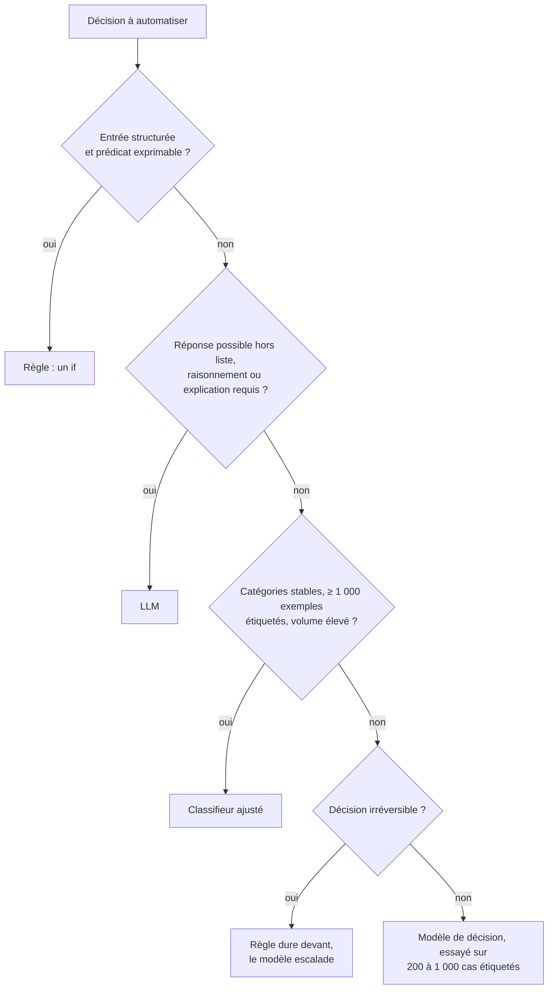

# Choisir entre règle, classifieur, modèle de décision et LLM

## Aperçu

- Quatre outils répondent à « que faire de cette entrée ? » : une **règle** (`if`), un **classifieur ajusté**, un [[Modèle de décision|modèle de décision]] et un **LLM**. Le moins cher qui tient la barre de qualité gagne.
- **Le vrai concurrent d'un modèle de décision, c'est le `if`** : gratuit, instantané, déterministe, auditable, testable, sans réseau. Comparer un modèle de décision à un LLM ne mène nulle part (ils ne font pas le même travail) ; le comparer à une règle écrite à la main mène à une question tranchable.
- Cette page donne la règle de décision. Les modèles eux-mêmes sont dans Clef, d1-3B, d1-omni-600M et Laya.

## Concepts clés

### Les cinq conditions pour prendre un modèle de décision
1. **L'entrée n'est pas énumérable.** Texte libre, intention, ton, contexte ouvert : on ne peut écrire qu'une heuristique, pas la règle. Condition première, elle écarte la plupart des cas où l'on serait tenté.
2. **La règle a déjà une liste d'exceptions qui s'allonge.** Réécrite trois fois pour des cas particuliers, son vrai coût est sa maintenance, pas son exécution.
3. **Le taux d'erreur du modèle est mesuré sur ses données, et il est meilleur que le taux de ratés de l'heuristique.** Personne ne peut remplir cette condition à la place de l'utilisateur : ni l'éditeur, ni une vidéo. Un jeu étiqueté de quelques centaines de cas, une après-midi.
4. **Une erreur est rattrapable et son coût est borné.** Un routage raté se rattrape au tour suivant ; un refus d'accès raté, non.
5. **Volume × coût unitaire reste négligeable devant ce que la décision protège.** À 84 $ le million de décisions de 2 000 tokens, rien à dire ; si la décision garde une opération à 0,01 $, l'arbitrage change.

Sources : document de l'auteur AI WITH Rithesh (vidéo du 2026-09-16, § « Le vrai concurrent : le `if` de votre code »), recoupé avec la synthèse du 2026-10-10.

### Garder le `if`, sans hésiter
- L'entrée est déjà **structurée** et le prédicat exprimable.
- La décision doit être **reproductible et auditable** (conformité, facturation, contrôle d'accès) : une probabilité de 0,84 n'est pas une justification.
- Une **panne réseau** ne doit pas bloquer le chemin.
- Une **mise à jour silencieuse** du modèle ne doit pas changer le comportement du système (voir [[Ce qui change derrière une API]]).

### La règle de décision en cinq lignes
1. Si une règle écrite à la main suffit, garder la règle.
2. Si la réponse est un choix dans une liste connue et que l'entrée est libre, essayer d'abord le moins cher des candidats ouverts **sur 200 à 1 000 cas étiquetés de ses données**.
3. Ne jamais poser un seuil de confiance repris d'un autre modèle ni d'une vidéo : **recalibrer par type de question**, sur ses données.
4. Pour une décision **irréversible**, laisser une règle dure devant le modèle ; le modèle sert à escalader, pas à autoriser seul.
5. Si la bonne réponse peut être « aucune des options », si le raisonnement compte ou s'il faut expliquer, rester sur un **LLM ordinaire**.

### Où chaque outil gagne et perd
| Si… | Alors plutôt… | Raison |
|---|---|---|
| l'entrée est structurée et le prédicat exprimable | **une règle** | gratuite, déterministe, auditable |
| un petit LLM est déjà auto-hébergé, avec un seul jeu de questions fixes | **ce LLM, lu sur les log-probabilités de jetons d'options** | c'est le mécanisme même de d1-3B ; on perd la calibration entraînée et le partage de tronc, pas le principe |
| les catégories sont stables, ≥ 1 000 exemples étiquetés, volume élevé | **un classifieur ajusté** (encodeur de la famille BERT) ou Laya ajusté | coût nul par appel, aucune dépendance réseau, souvent 90 % et plus sur un domaine fermé |
| la bonne réponse peut n'être dans aucune option | **un LLM** | un modèle de décision renvoie toujours une option de la liste |
| il faut expliquer la décision à un auditeur | **un LLM** (ou une règle) | un modèle de décision ne produit aucun texte |
| la décision est irréversible (suppression, paiement, accès) | **une règle d'abord** | le modèle complète, il n'autorise pas seul |

## Les maths, simplement

- **Une règle contre un modèle, sur le même jeu.** Il faut comparer des taux sur les mêmes cas, avec leur intervalle : un écart plus petit que l'[[Intervalles de confiance|intervalle de confiance]] n'est pas un classement. Un test apparié (McNemar) compare deux méthodes passées sur les mêmes e-mails.
- **Coût d'une décision** : $t \times p / 10^6$ ($t$ tokens, $p$ le prix par million). À 2 000 tokens : 84 $ le million de décisions chez Jev (0,042 $), 76 $ chez Clef-flash (0,038 $), 480 $ chez Clef (0,24 $).
- **« Gratuit » veut dire coût fixe.** Un modèle local saturé coûte, sur les hypothèses de rédaction du document source (machine amortie à 0,05–0,14 $ par heure, non sourcées), environ 3,7 $ le million de décisions sur un MacBook Air M5 à 7,5 décisions par seconde. À 1 % d'utilisation, le même matériel monte à environ 370 $ : 100 fois plus. Le local gagne avec du volume, ou pour la confidentialité, la latence ou le hors-ligne.
- **Un 14 sur 14 ne dit rien d'un taux.** Un modèle à 90 % de réussite fait 14 sur 14 dans $0{,}9^{14} \approx 23\ \%$ des cas ; un modèle à 85 % fait 8 sur 8 dans $0{,}85^8 \approx 27\ \%$ des cas. Un banc de quelques essais fabriqués par un seul testeur sert à **sentir** un modèle, pas à le classer.

## En pratique

- **Exemple de la règle contre le modèle.** Sur 2 000 e-mails synthétiques d'un banc public de détection d'hameçonnage, une règle de deux lignes (domaines d'hébergement gratuit et de raccourcisseurs, domaine de l'expéditeur différent de celui du lien) atteint 91,8 % sur la moitié de test, **sans apprentissage**. Le meilleur signal isolé de Jev ne la bat pas (89,4 %). La régression sur ses cinq signaux la bat (95,0 %, p = 0,002). Voir [[Décomposer une question en signaux étroits]]. La leçon : sur un jeu qu'une règle sépare déjà, le modèle ne rapporte que ce que coûte la règle à maintenir.
- **Escalade à trois étages.** Automatiser au-dessus d'un seuil, passer à un LLM entre deux seuils, à un humain en dessous : la forme est bonne ([[Routing and cascading]]), mais les seuils se posent **après recalibrage sur ses données**, par type de question. Une étude indépendante conclut « ne pas seuiller sur le champ `confidence` » pour Jev ([[Entraîner pour la calibration]]).
- **Le testeur de la latence.** À 4 s, un classifieur LLM exige une heuristique qui décide quand l'appeler (un `if`) ; à 150 ms, l'appel est systématique et l'heuristique disparaît. C'est la vraie bascule, plus que le prix.
- **Décision irréversible** : l'auteur de la vidéo d1 garde « une règle dure » devant les écrans de paiement et de connexion, parce que ses deux seuls échecs sur dix captures sont précisément ceux-là (arrêt demandé à 0,27 et 0,22). Dix cas fabriqués par un seul testeur : un comportement, pas un taux.
- **Avant d'adopter, essayer** : 200 à 1 000 cas étiquetés, deux candidats ouverts au moins (par exemple Clef, d1 ou Laya), la règle comme base, l'intervalle des écarts.

### Repères datés

Relevés le 2026-09-16 et le 2026-10-10 dans les documents de l'auteur, puis recoupés à la source le 2026-10-20 (banc d'hameçonnage). À relire avant de citer.

| Repère | Valeur | Source |
|---|---|---|
| Hameçonnage, Jev, une question large | 62,6 % (Claude Haiku 4.5 : 81,3 %) | banc public, 2026-09-17, 2 000 e-mails synthétiques |
| Même tâche, régression sur cinq signaux, moitié de test | 95,0 % (Haiku : 93,2 %, écart non significatif, p = 0,063) | même banc, contrôles ajoutés le 2026-09-17 |
| Règle de deux lignes, moitié de test | 91,8 % | même banc |

## Approches voisines & alternatives

- [[Modèle de décision]] — l'objet dont cette page dit quand le prendre.
- [[Décomposer une question en signaux étroits]] — comment lui poser la question, quand il est retenu.
- [[Entraîner pour la calibration]] — pourquoi un seuil ne se reprend pas d'un autre modèle.
- [[Routing and cascading]] — l'usage le plus fréquent : aiguiller, escalader.
- [[Structured outputs]] et [[Constrained decoding]] — la garantie de format d'un LLM, qui efface l'argument « sortie typée » du modèle de décision (restent le prix et la latence).
- [[Classification]] et [[Régression logistique]] — le classifieur ajusté et la recomposition de signaux.
- [[Guardrails]] — filtrer les entrées et les sorties d'un LLM, un usage où une règle d'abord reste le bon réflexe.
- [[Tarif catalogue contre coût par tâche]] et [[Coût d'un token et taux d'utilisation]] — lire un prix, et ce qu'un taux d'utilisation fait au coût.

## Pour aller plus loin

- Vidéo « Jev AI Is INSANE… 193× Faster Than LLMs?! », AI WITH Rithesh, 8 min 07, 2026-09-16, https://www.youtube.com/watch?v=JZknBu3u8C0 — la thèse « le vrai rival est le `if` » à 7 min 49, le comparatif de latence à 6 min 09.
- Banc public « Jev vs LLM: a phishing decision benchmark with a calibration audit » (anisselbd), 2026-09-17 : https://github.com/anisselbd/jev-phishing-bench — protocole, intervalles de Wilson, test de McNemar, règle de référence.
- Vidéo « Liquid AI's d1-3B Decision Model Is WILD… I Tested It Locally! », AI WITH Rithesh, 10 min 05, 2026-10-08, https://www.youtube.com/watch?v=rFs62hHdf5E — l'essai du garde-fou d'agent à 6 min 04, l'échec sur paiement et connexion à 6 min 56 et 7 min 00.
