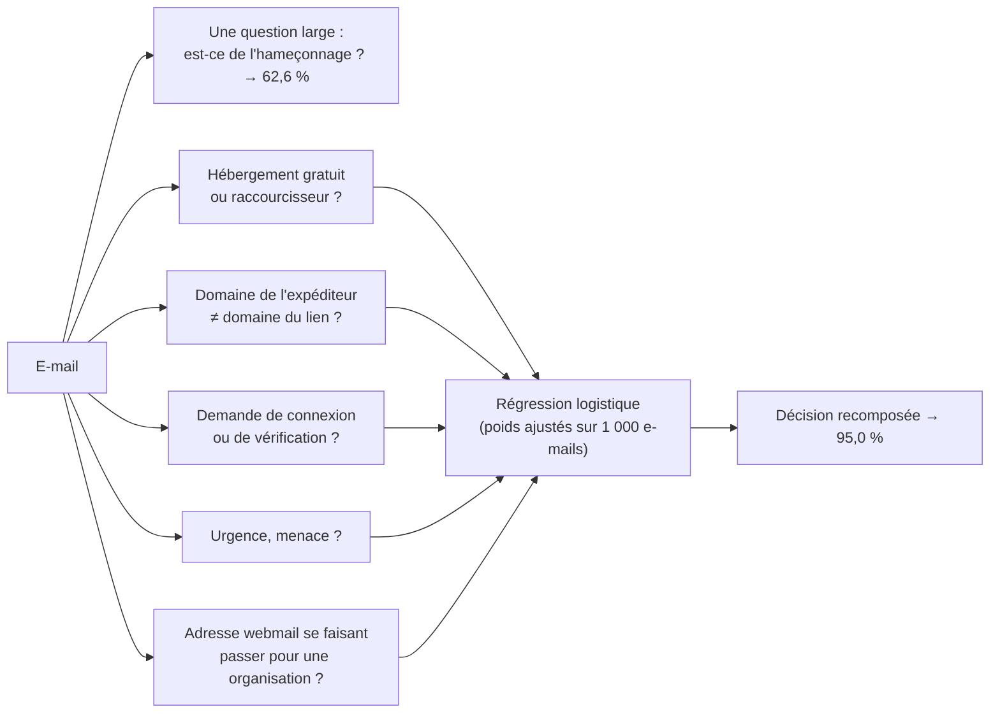

# Décomposer une question en signaux étroits

## Aperçu

- Un [[Modèle de décision|modèle de décision]] ne se pilote pas comme un LLM. On ne lui pose pas la question métier (« est-ce de l'hameçonnage ? ») ; on lui pose les **composantes observables** de la question, une par une, puis on **recompose** la réponse avec des poids ajustés sur des exemples étiquetés.
- Mesuré sur un banc public : la question large donne **62,6 %** d'exactitude, cinq questions étroites recomposées donnent **95,0 %**, soit 32,4 points de plus. Les mêmes questions étroites, posées à un petit LLM, le font passer de 81,3 % (2 000 e-mails) à 93,2 % (moitié de test) : le gain tient à la décomposition, pas à Jev.
- Cela a un prix : la recomposition demande **environ un millier d'exemples étiquetés**, l'investissement que l'on évitait en ne prenant pas un classifieur ajusté. Et sur ce banc, une règle de deux lignes fait déjà 91,8 % ([[Choisir entre règle, classifieur, modèle de décision et LLM]]).

## Concepts clés

### Une question étroite se lit dans l'entrée
- « Le lien pointe-t-il vers un raccourcisseur ou un hébergement gratuit ? » est **observable** : la réponse est dans l'adresse. « Est-ce de l'hameçonnage ? » demande un **jugement** qui mêle plusieurs indices, dont certains ne sont pas dans le texte.
- Un modèle de décision répond vite et sans bloc-notes : il lit une probabilité sur des options, il ne raisonne pas. Une question qui exige de raisonner lui convient mal ; une question qui se lit lui convient.
- Le même motif apparaît dans l'essai d'un testeur de d1-3B : sur une page de paiement, le modèle **reconnaît** l'écran (98 %) mais ne demande l'arrêt qu'à 0,27 ; « faut-il s'arrêter ? » demande une politique que l'image ne contient pas. Raison plausible, non testée.

### Les questions sont indépendantes
- Chez un LLM, empiler les questions dans un même appel dégrade les réponses : elles partagent un même bloc-notes de raisonnement (observation d'un testeur de Jev, un témoignage et non une mesure).
- Chez un modèle de décision, l'état est lu **une fois** (le tronc), chaque question en est une **branche** : en ajouter ne dégrade pas les autres, et coûte peu (30 ms pour une question, 41 ms pour trois, sur Apple M5 Pro, mesure de Liquid pour [[d1-3B]]).

### Poser, recomposer, calibrer
1. **Écrire les signaux avant de regarder le jeu de test.** Des signaux rédigés après lecture de la taxonomie du jeu de données « savent » comment il a été fabriqué : l'auteur du banc l'écrit lui-même.
2. **Les poser tous dans le même appel** : cinq questions de type `noul` sur le même e-mail.
3. **Ajuster les poids** d'une régression logistique sur les probabilités, sur une moitié étiquetée, **mesurer sur l'autre**.
4. **Lire la calibration à la sortie** : la recomposition, ajustée sur des étiquettes, recalibre au passage (ECE de 0,154 à 0,027 sur ce banc), ce que la confiance brute d'une question large ne fait pas ([[Entraîner pour la calibration]]).

*Schéma refait d'après le banc public cité en fin de page (2 000 e-mails, cinq signaux de type `noul`) ; les valeurs sont celles de ce banc.*

## Les maths, simplement

- **Recomposition** : $P(\text{hameçonnage}) = \sigma\!\left(w_0 + \sum_{k=1}^{5} w_k\, p_k\right)$, où $p_k$ est la probabilité du signal $k$ rendue par le modèle et $\sigma$ la fonction logistique. Les $w$ sont ajustés sur la moitié A (1 000 e-mails), mesurés sur la moitié B. Voir [[Régression logistique]].
- **Pourquoi un seul signal ne suffit pas** : le meilleur signal de Jev (hébergement gratuit, seuil à 0,70) fait 89,4 % sur la moitié B ; la règle de deux lignes fait 91,8 % (p = 0,003, test de McNemar apparié) ; la régression sur les cinq signaux fait 95,0 % (intervalle de Wilson à 95 % : 93,5 à 96,2).
- **Le gain n'est pas propre au modèle** : le même protocole appliqué à Claude Haiku 4.5 donne 94,2 % pour son meilleur signal et 93,2 % pour la régression (intervalle : 91,5 à 94,6). L'écart avec Jev (95,0 % contre 93,2 %) n'est pas significatif (p = 0,063).
- **Coût de la décomposition** : 0,04 $ les 1 000 e-mails chez Jev pour neuf questions, contre 1,02 $ chez Haiku pour les cinq signaux ; environ 27 fois moins cher et 5 fois plus rapide (médiane de Haiku : 1 199 ms par appel). Ce que Jev garde, c'est le prix de la décomposition, pas la qualité.

## En pratique

- **Quand l'appliquer** : la décision a plusieurs indices indépendants et lisibles dans l'entrée (un lien, un expéditeur, un ton, une pièce jointe), et un jeu étiqueté de quelques centaines à un millier de cas existe ou se fabrique.
- **Ce que ça donne en plus** : chaque signal est **réutilisable** et **auditable** (« rejeté parce que le lien est un raccourcisseur et l'expéditeur un webmail »), ce qu'une probabilité unique n'offre pas.
- **Variations de formulation, peu d'effet** : sur le même banc, quatre formulations de la question large donnent 58,4 % à 63,2 %. Reformuler ne remplace pas décomposer.
- **Pièges** : un banc synthétique que des règles séparent déjà (91,6 % pour la règle de listes seule sur les 2 000 e-mails) surestime ce qu'un modèle apporte ; une vérité terrain issue de listes de réputation d'URL n'est pas un humain qui relit chaque e-mail ; ces chiffres viennent d'**un auteur, un jeu, une tâche**.
- **Si la décomposition ne tient pas** (la décision n'est que de la politique, rien d'observable) : retour au `if`, ou au LLM ([[Choisir entre règle, classifieur, modèle de décision et LLM]]).

### Repères datés

Relevés le 2026-09-17 (banc) et lus à la source le 2026-10-20. À relire avant de citer.

| Repère | Valeur |
|---|---|
| Jev 1.13.0, question large, 2 000 e-mails | 62,6 % d'exactitude, ECE 0,154, AUROC 0,689 |
| Haiku 4.5, même question, mêmes e-mails | 81,3 % |
| Jev, cinq signaux recomposés, moitié B | 95,0 % ; AUROC 0,982 |
| Haiku 4.5, cinq signaux recomposés, moitié B | 93,2 % ; AUROC 0,991 |

## Approches voisines & alternatives

- [[Modèle de décision]] — l'objet, et pourquoi ses questions sont indépendantes.
- [[Choisir entre règle, classifieur, modèle de décision et LLM]] — sur ce banc, la règle de deux lignes fait 91,8 % : à lire avant de payer un modèle.
- [[Entraîner pour la calibration]] — pourquoi la confiance d'une question large ne se seuille pas.
- [[Calibration]] — ECE, diagramme de fiabilité, recalibrage sur un jeu réservé.
- [[Classification metrics]] et [[Intervalles de confiance]] — lire un écart de quelques points.
- [[Chain-of-Thought]] — l'inverse : donner un bloc-notes à un LLM pour une question qui exige de raisonner.

## Pour aller plus loin

- Banc public « Jev vs LLM: a phishing decision benchmark with a calibration audit » (anisselbd), 2026-09-17 : https://github.com/anisselbd/jev-phishing-bench — protocole, neuf questions par appel, contrôles ajoutés après revue (règle de référence, séparation en deux moitiés, mêmes questions au LLM).
- Jeu de données PhishNChips v5.2 (avril 2026), https://huggingface.co/datasets/AreLit/PhishNChips — 1 000 e-mails frauduleux et 1 000 légitimes, corps générés par LLM.
- Vidéo « Jev AI Is INSANE… 193× Faster Than LLMs?! », AI WITH Rithesh, 8 min 07, 2026-09-16, https://www.youtube.com/watch?v=JZknBu3u8C0 — questions indépendantes contre bloc-notes partagé à 6 min 20.
- Vidéo « Liquid AI's d1-3B Decision Model Is WILD… I Tested It Locally! », AI WITH Rithesh, 10 min 05, 2026-10-08, https://www.youtube.com/watch?v=rFs62hHdf5E — page de paiement reconnue à 98 % mais arrêt demandé à 0,27, à 6 min 56.
