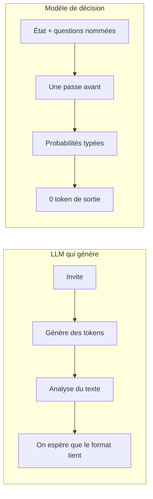
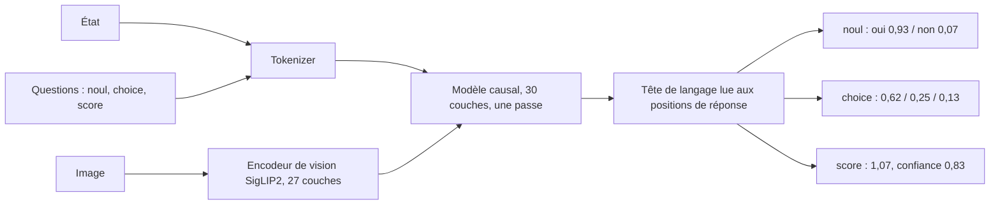

# Modèle de décision

## Aperçu

- Un modèle de décision répond à une question par une **valeur typée accompagnée de sa probabilité** (un oui ou non, un choix dans une liste, un niveau sur une échelle), en **une seule passe avant** et **sans écrire un token**.
- Ce n'est pas un LLM : il ne converse pas, ne résume pas, n'explique rien. Il sert à **décider** (router, noter, filtrer, approuver) là où un LLM était employé faute de mieux.
- Le nom « System One » est commercial (TypeSafe, avec son modèle Jev, d'après Kahneman). L'objet est plus ancien que le nom : classifieur, routeur, décodage contraint. Ce qui est neuf, c'est l'**interface commune** et la **calibration visée à l'entraînement**.

## Concepts clés

### Un état, des questions typées, une réponse par question
- **L'état** : un texte, un JSON, une image, parfois un clip audio. **Les questions** : nommées, **déclarées à l'appel**, donc l'ensemble des réponses possibles n'est pas figé à l'entraînement.
- Trois types, identiques chez tous les éditeurs : `noul` (oui ou non ; le nom est celui de TypeSafe, il remplace *bool*), `choice` (une option parmi des options nommées) et `score` (un niveau sur une échelle ordonnée de 2 à 10 niveaux).
- La réponse porte une probabilité par option. Un `noul` rend la probabilité de « oui » (`0,93`), un `choice` l'option choisie et une `confidence`, un `score` une **espérance** (un score peut tomber entre deux niveaux). La facturation et la mesure parlent de `output_tokens = 0`.
- Le point d'accès local ou hébergé est le même : `/v1/systemone`. Jev (fermé), [[Clef]], [[d1-3B]] et [[Laya]] parlent ce schéma ; passer de l'un à l'autre change l'URL, la clé et le champ `model`, pas la qualité ni les seuils.

*Schéma refait d'après la diapositive « One question, two ways » de la vidéo citée en fin de page, à 1 min 04.*

### Comment la réponse est lue (d1-3B, d'après le code livré)
- Une invite de conversation est construite ; chaque option reçoit un **code d'un seul token** (A, B, C…) ; la consigne est « répondre par le code seul ». Le modèle s'arrête **à l'emplacement où il commencerait à répondre**.
- À cet endroit, la tête de langage donne des logits sur tout le vocabulaire. Seuls les **jetons d'options** sont gardés ; un softmax restreint à eux donne les probabilités. Rien n'est tiré, rien n'est analysé : une réponse invalide est **impossible**, pas improbable.
- **Plusieurs questions** : l'état (et les images) forme un **tronc** lu une fois ; chaque question est une **branche**. Trois questions sur le même état coûtent peu de plus qu'une seule (30 ms contre 41 ms sur Apple M5 Pro, mesure de Liquid).
- Les variantes à **encodeur** ([[d1-omni-600M]], [[Laya]]) mettent un marqueur `<mask>` par option et lisent une tête de décision à chacun. [[Clef]] branche une tête de schéma conjointe sur un modèle Qwen gelé et note toutes les options de toutes les questions ensemble.

*Schéma refait d'après la figure 2 du blog de Liquid, telle que la vidéo la montre à 2 min 56.*

### Ce que ce n'est pas
- **Pas un LLM** : aucun texte, aucune explication, aucun raisonnement. Si la bonne réponse n'est dans aucune option, le modèle renvoie **quand même** une option de la liste.
- **Pas du décodage contraint** : la garantie de type est la même, mais elle vient de la lecture sur un ensemble fermé de jetons, pas d'un masque appliqué pendant une génération ([[Constrained decoding]]).
- **Pas un modèle de garde** : [[Llama Guard]] *génère* un court verdict ; un modèle de décision lit des probabilités.
- **Pas un classifieur ordinaire** : les étiquettes entrent dans l'entrée, à l'appel.
- **« 0 % d'erreur de type » n'est pas « 0 % d'erreur »** : le type est garanti, la réponse ne l'est pas.

## Les maths, simplement

- Probabilités d'une question : $p_i = \dfrac{e^{z_i}}{\sum_{j \in \text{options}} e^{z_j}}$, où $z_i$ est le logit de l'option $i$ (un softmax **restreint** aux options).
- Un `score` rend l'espérance $\sum_i i \cdot p_i$. Exemple lu sur le schéma de Liquid : probabilités 0,05 / 0,83 / 0,12 pour les niveaux 0, 1, 2, soit $0{,}83 + 2 \times 0{,}12 = 1{,}07$. Même calcul chez Cloudflare : 0,0636 / 0,766 / 0,1704 donnent 1,1068.
- **`confidence` n'a pas une définition unique.** Dans le code de d1-3B, c'est la probabilité maximale. Chez Cloudflare, elle est « dérivée des probabilités » sans formule publiée (ni la probabilité maximale ni un moins l'entropie normalisée, d'après les chiffres publiés). Chez TypeSafe, non publiée. Un seuil réglé sur un modèle ne se transpose pas.

## En pratique

- **Ce que ça change dans une architecture, c'est la latence.** Un testeur de Jev décrit un classifieur LLM à environ 4 s par appel, donc des chaînes d'heuristiques qui décident *quand* l'appeler (des `if` qui ratent des cas). À 150 ms (p50 de ce testeur, témoignage et non mesure), l'appel devient systématique et l'heuristique disparaît. Le prix de l'entrée compte moins que ce déplacement.
- **Ordre de grandeur d'un coût** : $\text{coût} = t \times p / 10^6$ pour $t$ tokens d'entrée au prix $p$ par million ; la sortie n'est pas facturée. À 2 000 tokens par décision et 0,042 $ le million, un million de décisions coûte 84 $.
- **Une latence n'a de sens qu'avec son matériel.** Le même d1-3B répond en 8 ms sur une RTX 4090 (Liquid), 30 ms sur un Apple M5 Pro (Liquid) et 78 ms sur un MacBook Air M5 (banc d'un tiers) : trois machines, trois valeurs. Ne jamais comparer deux lignes de matériel différent. Voir [[Mesurer une latence]].
- **Aucune option « je ne sais pas ».** Sur une tâche dont la règle est absente de l'entrée, Jev répond juste 44,7 % du temps en annonçant en moyenne 0,74 de probabilité (étude indépendante, tickets synthétiques) ; 0 message sur 30 hors périmètre a été signalé, à 0,99. Poser un seuil sur la confiance brute est déconseillé : le recalibrer par type de question, sur ses données ([[Entraîner pour la calibration]], [[Calibration]]).
- **Le choix du modèle** : règle, classifieur ajusté, modèle de décision ou LLM, dans [[Choisir entre règle, classifieur, modèle de décision et LLM]]. Plusieurs questions étroites plutôt qu'une large : [[Décomposer une question en signaux étroits]].
- **Licence** : les poids ouverts n'ont pas tous la même. Clef et Laya sont en Apache-2.0 ; d1 est sous la LFM Open License (gratuite sous 10 M$ de chiffre d'affaires annuel). Jev est une API fermée, citée ici en texte simple. [[Licences de modèles open weights]].

### Repères datés

Relevés le 2026-10-10 dans un document de synthèse, puis recoupés à la source le 2026-10-20. À relire avant de citer.

| Repère | Valeur | Date et source |
|---|---|---|
| Entrées « decisions » listées sur OpenRouter | 19 (variantes gratuites et alias compris) | 2026-10-10, API OpenRouter |
| Prix de Jev, d1 hébergé, Clef-flash, Clef | 0,042 $ ; 0,04 $ ; 0,038 $ (0,09 $ au 2026-10-03) ; 0,24 $ par million de tokens d'entrée | 2026-10-10 ; Clef-flash et Clef relus le 2026-10-20 sur la documentation Cloudflare |
| « System One » employé par une seule organisation | vrai au 2026-09-20, faux au 2026-10-10 : Liquid, Cloudflare, Convai, OpenRouter et Vercel reprennent le vocabulaire | 2026-10-10 |

## Approches voisines & alternatives

- [[Constrained decoding]] — même garantie de type, par masque pendant une génération.
- [[Structured outputs]] — le cadre des trois mécanismes (JSON mode, validation avec reprise, décodage contraint) ; un modèle de décision en est un quatrième, qui ne génère pas.
- [[Calibration]] — la propriété que ces modèles disent viser : ECE, diagramme de fiabilité, recalibrage.
- [[Routing and cascading]] — l'usage le plus courant : aiguiller une requête, et escalader sous un seuil de confiance.
- [[Guardrails]] et [[Llama Guard]] — filtrer les entrées et les sorties d'un LLM ; un modèle de décision peut tenir ce rôle sans générer.
- [[Choisir entre règle, classifieur, modèle de décision et LLM]] · [[Décomposer une question en signaux étroits]] · [[Entraîner pour la calibration]] — les trois notions qui complètent celle-ci.
- [[Clef]] · [[d1-3B]] · [[d1-omni-600M]] · [[Laya]] — les quatre fiches à poids ouverts, départagées dans [[Comparatif - Modèles de décision]].

## Pour aller plus loin

- Vidéo « Liquid AI's d1-3B Decision Model Is WILD… I Tested It Locally! », AI WITH Rithesh, 10 min 05, 2026-10-08, https://www.youtube.com/watch?v=rFs62hHdf5E — contraste LLM et modèle de décision à 1 min 04, les trois types de questions à 1 min 26, schéma d'architecture à 2 min 56.
- Blog de Liquid AI, « Open d1 », 2026-10-07 : https://www.liquid.ai/blog/d1-open
- Schick et Schütze, *Exploiting Cloze Questions for Few Shot Text Classification and Natural Language Inference*, 2020 : https://arxiv.org/abs/2001.07676 — lire un modèle de langage sur des mots d'étiquettes.
- Yin, Hay et Roth, *Benchmarking Zero-shot Text Classification*, 2019 : https://arxiv.org/abs/1909.00161 — étiquettes données en langage naturel.
- Willard et Louf, *Efficient Guided Generation for Large Language Models*, 2023 : https://arxiv.org/abs/2307.09702 — le décodage contraint.
- Zhang et al., *Generative Verifiers: Reward Modeling as Next-Token Prediction*, 2024 : https://arxiv.org/abs/2408.15240 — la récompense lue sur le jeton suivant.
