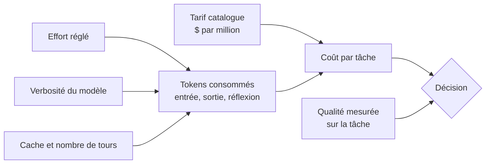

# Tarif catalogue contre coût par tâche

## Aperçu

- Le **tarif catalogue** est le prix affiché par million de tokens (entrée, sortie, cache). Le **coût par tâche** est ce qu'une tâche coûte vraiment : le tarif multiplié par les tokens **effectivement consommés**, réflexion comprise. Deux modèles au même tarif peuvent coûter quatre fois plus ou moins cher par tâche.
- À retenir avant de choisir un modèle sur une grille de prix : le tarif est une propriété du fournisseur, le nombre de tokens est une propriété du modèle, de l'effort réglé et de la tâche. Seul leur produit se paie.

## Concepts clés

### Ce que la facture additionne
- **Entrée** (le prompt), **sortie** (la réponse) et **cache** (entrée déjà vue, relue à prix réduit). La **réflexion** des modèles de raisonnement est facturée comme de la sortie : monter l'[[Effort de raisonnement et courbe coût-qualité|effort]] gonfle la ligne la plus chère.
- Rapport des lignes chez un fournisseur, relevé au 2026-09-30 : sortie 20 $, entrée 4 $, lecture de cache 0,20 $ le million. La sortie coûte **5 fois** l'entrée et **100 fois** une lecture de cache.
- Dans une boucle d'agent, chaque tour relit tout le contexte accumulé : le coût d'une tâche croît à peu près comme le **carré du nombre de tours**, et les lectures de cache sont souvent le premier poste. Un plafond de tours agit plus directement qu'une baisse de `max_tokens`.

### Trois façons de se tromper
- **Lire le tarif comme un coût.** Un modèle verbeux paie son tarif sur beaucoup plus de tokens (exemple chiffré plus bas).
- **Lire une remise comme une remise sur la tâche.** « 50 % moins cher » porte sur le tarif, pas sur la facture : la baisse de coût par tâche peut être plus petite ou plus grande.
- **Comparer deux défauts comme deux modèles.** « 40 % moins cher » compare souvent le réglage par défaut d'une version au réglage par défaut de la précédente, donc deux efforts différents.

## Les maths, simplement

- Coût d'une tâche : $C = \dfrac{t_{in}\,p_{in} + t_{out}\,p_{out} + t_{cache}\,p_{cache}}{10^{6}}$, avec $t$ les tokens et $p$ le prix par million. Les tokens de réflexion comptent dans $t_{out}$.
- **Exemple chiffré, sortie seule.** Relevé au 2026-09-23 sur l'indice d'Artificial Analysis : GPT-6 Luna produit 150 M de tokens à 0,50 $ le million, soit 75 $ ; DeepSeek V4.1 Flash en produit 250 M à 1,20 $ (tarif de pointe), soit 300 $. Rapport 4,0, pour des tarifs « du même ordre » ; le coût par tâche publié (0,07 $ contre 0,27 $) donne 3,9. La sortie suffit à retrouver l'ordre de grandeur.
- **Baisse de tarif contre baisse de coût par tâche.** $\dfrac{1{,}99 - 1{,}06}{1{,}99} = 46{,}7\,\%$ pour GPT-6 Sol alors que le tarif est divisé par deux (−50 %) ; $\dfrac{0{,}18 - 0{,}07}{0{,}18} = 61{,}1\,\%$ pour Luna, dont la sortie passe de 1,20 $ à 0,50 $ (−58,3 %, pas −50 %). La verbosité fait la différence dans les deux sens.

## En pratique

- **Mesurer sur sa propre tâche.** Rejouer 20 à 50 tâches réelles, relever les tokens d'entrée, de sortie et de réflexion renvoyés par l'API, puis calculer le coût moyen **et** la qualité obtenue : le coût seul ne décide rien ([[Lire un score publié]]).
- **Compter le cache** : une lecture de cache à 1 % du tarif de sortie change le classement des modèles sur les tâches à long contexte répété ([[prompt-caching]], [[LLM caching]]).
- **Se méfier d'un coût « par heure » ou « par tâche » publié.** Artificial Analysis donne 0,84 $ par heure d'audio pour un modèle vocal : c'est un coût **mesuré** sur 40 questions de logique, pas un tarif. Les tarifs catalogue des deux variantes du modèle sont identiques ; l'écart (0,84 $ contre 3,50 $) vient du volume de tokens de réflexion. Un agent qui parle autant qu'il écoute paie au moins 1,38 $ par heure au tarif catalogue, au-dessus du chiffre mis en avant.
- **Lire la référence d'une baisse.** Un tarif comparé à un tarif « promotionnel » de la version précédente n'est pas une baisse depuis le prix de lancement.
- **Choisir par tâche, pas par modèle.** Router les tâches simples vers un petit modèle et réserver le grand aux cas difficiles : [[Routing and cascading]], via une passerelle comme [[LiteLLM]] ou [[OpenRouter]]. Suivre le coût réel en production : [[LLM observability]].

### Repères datés

Relevés les 2026-09-22, 2026-09-23 et 2026-09-30, indice Artificial Analysis v4.3.2. Ils vieillissent vite : relire la source avant de décider.

| Cas | Tarif catalogue | Coût par tâche | Lecture |
|---|---|---|---|
| MiMo-V2.5-Pro → MiMo-V2.6-Pro | inchangé (0,435 $ entrée, 0,87 $ sortie) | 0,05 $ → 0,13 $ (×2,6) | le modèle raisonne plus longtemps : 140 M de tokens de sortie |
| GPT-6 Sol contre GPT-5.6 Sol | −50 % | −46,7 % (1,99 $ → 1,06 $) | 90 M puis 77 M de tokens de sortie |
| GPT-6 Luna contre GPT-5.6 Luna | −50 % entrée, −58,3 % sortie | −61,1 % (0,18 $ → 0,07 $) | 150 M de tokens des deux côtés |
| Claude Opus 5.5 contre Opus 5 | −20 % entrée et sortie | de −29 % à −63 % selon l'effort ; +2 % à `max` | le « −40 % » compare `medium` à `high` |
| MiMo-V2.6-Pro contre Grok 4.7 (xhigh), même indice de 46 | — | 0,13 $ contre 3,74 $ (rapport 29) | l'écart se voit au coût par tâche, pas au tarif |

Modèles fermés (Claude, GPT-6, Gemini, Grok) : cités en texte simple, sans page, car payants ou sans version sur site.

## Approches voisines & alternatives

- [[Effort de raisonnement et courbe coût-qualité]] — la molette qui fait varier le nombre de tokens, donc le coût par tâche.
- [[Lire un score publié]] — l'autre moitié du choix : ce que vaut la qualité qu'on paie.
- [[Ce qui change derrière une API]] — pourquoi un coût ou un score mesuré aujourd'hui n'est pas garanti demain.
- [[Routing and cascading]] — payer le grand modèle seulement quand il le faut.
- [[Reasoning models]] — la classe de modèles dont la facture suit la réflexion.
- [[LLM benchmarks]] — d'où viennent les indices qui accompagnent les coûts publiés.
- [[Inference optimization]] — le côté fournisseur : ce qui fait baisser le coût d'un token.
- DeepSeek-V4.1-Flash · MiMo-V2.6 — deux modèles à poids ouverts dont le tarif et le coût par tâche divergent.

## Pour aller plus loin

- Vidéo « Claude Opus 5.5 : ce que coûte le curseur d'effort », AI WITH Rithesh, 7 min 16, https://www.youtube.com/watch?v=nvyimwSJe_I — tableau coût par tâche à 6 min 08, tarifs à 1 min 46.
- Vidéo « GPT-6 Sol et Luna », AI WITH Rithesh, 5 min 53, https://www.youtube.com/watch?v=b36oyJJQDKg — tarif à 1 min 30, coût par tâche à 4 min 53.
- Vidéo « Xiaomi MiMo-V2.6, Pro et Flash », AI WITH Rithesh, 10 min 03, https://www.youtube.com/watch?v=WWYH-Lw-i2g — grille tarifaire à 7 min 35.
- Artificial Analysis, fiches modèles et coût par tâche : https://artificialanalysis.ai/models
- Tarifs de l'API DeepSeek : https://api-docs.deepseek.com/quick_start/pricing
