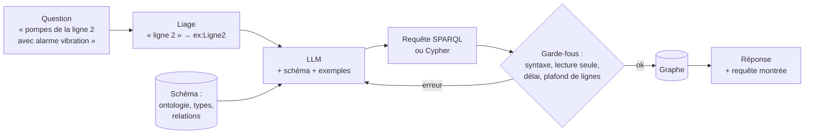

# Interroger un graphe en langage naturel

## Aperçu

- Faire écrire par un **LLM** la requête (**Cypher** pour un graphe de propriétés, **SPARQL** pour un graphe RDF) qui répond à une question en langage naturel, l'exécuter sur le graphe, puis rendre le résultat. C'est le cousin de [[Text-to-SQL]], avec une cible différente : des **motifs de graphe** et des **identifiants** d'entités au lieu de tables et de jointures.
- Deux promesses : laisser un technicien demander « quelles pompes de la ligne 2 ont eu une alarme de vibration ce mois-ci ? » sans connaître le langage, et garder la réponse **vérifiable** (la requête générée se relit et se rejoue), ce que ne fait pas un résumé libre du LLM.
- Deux avertissements, mesurés (voir plus bas) : les résultats chutent dès que les questions se compliquent, et les scores publiés peuvent être gonflés par la **mémorisation** des benchmarks.

## Concepts clés

### La chaîne

1. **Lier les entités** de la question à leurs identifiants ([[Liage d'entités]]) : « ligne 2 » doit devenir l'IRI ou la clé exacte. C'est le point faible habituel : un LLM sans liste d'identifiants **invente** un identifiant plausible.
2. **Donner le schéma** : l'[[Ontologie]] (classes, propriétés, domaine et portée) ou, pour un graphe de propriétés, les labels et types de relations. Sans lui, le modèle fabrique des relations qui n'existent pas.
3. **Montrer des exemples** : quelques paires question / requête du **même** graphe valent plus que des explications.
4. **Générer, exécuter, corriger** : en cas d'erreur de syntaxe ou de résultat vide, renvoyer le message au modèle pour une seconde tentative (même boucle que dans [[Vanna]] ou [[LangChain SQL agent]]).
5. **Afficher la requête** à côté de la réponse : c'est ce qui rend le système auditable.

### Ce qui diffère du text-to-SQL

- **Schéma en graphe** : les relations sont des citoyens de première classe, et leur **sens** compte (`(pompe)-[:EQUIPEE_DE]->(capteur)` n'est pas l'inverse). Un schéma SQL se lit par colonnes et clés étrangères.
- **Identifiants** : en RDF, tout est une IRI ; il faut les connaître ou les retrouver. En SQL, on filtre souvent sur des libellés.
- **Données d'entraînement plus rares côté Cypher** : les jeux sont jeunes. Ozsoy et al. (2024) regroupent 44 387 exemples pour affiner et évaluer des modèles, et notent que les LLM généralistes produisent souvent du Cypher incomplet ou faux.
- **Deux dialectes principaux** : le Cypher de [[Neo4j]] et de [[Memgraph]] ; SPARQL sur un moteur RDF ([[SPARQL]]). Les écarts de dialecte comptent : un Cypher écrit pour l'un ne passe pas toujours sur l'autre ([[Bases graphe — modèles et langages de requête]]).

### Ce que disent les mesures

| Source | Résultat |
|---|---|
| Spider4SPARQL (Kosten et al., IEEE Big Data 2023) : 9 693 questions écrites à la main, 4 721 requêtes SPARQL complexes, 166 graphes et ontologies | les meilleurs systèmes testés (KGQA et LLM) n'atteignent qu'environ **45 %** d'exactitude d'exécution |
| Gashkov et al. (ICWE 2025, meilleur article) | les LLM ont pu **voir** les benchmarks et les graphes à l'entraînement : ils proposent un protocole en trois conditions (sans aide, avec connaissances injectées, avec connaissances **anonymisées**) pour séparer capacité réelle et mémorisation |
| SPARQL-LLM (Smeros et al., 2025, ACM TWEB 2026) : système ouvert, fonctionne avec tout moteur RDF via des métadonnées légères | jusqu'à 59 % de F1 de plus que le second système d'un défi multilingue, jusqu'à 27 fois plus rapide, au plus 0,01 dollar par question |
| Text2Cypher (Ozsoy et al., 2024) | les LLM généralistes produisent souvent du Cypher incomplet ou faux ; l'affinage sur données spécialisées fait mieux (Google-BLEU et correspondance exacte) |

Les chiffres ne se comparent pas entre eux : tâches, graphes et mesures diffèrent. La seule lecture sûre est locale : **tester sur ses propres questions**.

## Les maths, simplement

- **Exactitude d'exécution** : une requête générée $\hat q$ est comptée juste si son **résultat** égale celui de la requête de référence $q^{*}$ : $EX = \frac{1}{N}\sum_i \mathbb{1}\bigl[\text{res}(\hat q_i) = \text{res}(q^{*}_i)\bigr]$. Deux requêtes différentes peuvent donner la même réponse, d'où la mesure sur le résultat, pas sur le texte.
- **F1 sur les réponses** : pour une question qui a un **ensemble** de réponses $A$ et un système qui rend $\hat A$, $P = |A \cap \hat A| / |\hat A|$, $R = |A \cap \hat A| / |A|$, $F_1 = 2PR/(P+R)$.
- **Coût de la boucle de correction** : avec $k$ tentatives maximum et une probabilité $p$ que chaque tentative réussisse (supposées indépendantes, ce qui est optimiste), la probabilité de réussir est $1-(1-p)^k$ ; avec $p = 0{,}5$ et $k = 3$, $87{,}5\,\%$. Les tentatives ne sont pas indépendantes : une erreur de schéma se répète. Le chiffre est un plafond théorique, à ne pas annoncer.

## En pratique

- **Lecture seule d'abord.** Compte de base de données **sans droit d'écriture**, requêtes limitées en durée et en nombre de lignes, liste de clauses autorisées ; une instruction `DELETE` ou `SET` générée par erreur ne doit pas pouvoir s'exécuter.
- **Modèle local** quand les données sont sensibles (usine, brevets) : un modèle servi par [[Ollama]] ou équivalent ; accepter un score moindre en échange de la maîtrise.
- **Questions guidées avant questions libres** : proposer des gabarits (« pannes de X depuis la date D ») dont seules les valeurs varient, et réserver la génération libre à ce qu'aucun gabarit ne couvre.
- **Couche sémantique** : décrire en amont, dans un schéma métier, des concepts et des mesures calculées ; c'est l'idée de [[WrenAI]] côté SQL, et le rôle d'une [[Ontologie]] côté graphe.
- **Journaliser** question, requête, résultat, retour utilisateur : c'est le jeu d'exemples de demain.
- **Piège central** : une requête valide qui répond à **une autre question** ; elle s'exécute, rend un tableau net, et l'erreur ne se voit pas. Montrer la requête et un exemple de lignes.
- Autres pièges : relation inversée ; propriété inexistante ; limite implicite qui tronque les résultats ; un graphe sans schéma lisible (propriétés nommées `p1`, `p2`).

## Approches voisines & alternatives

- [[Text-to-SQL]] — le même problème sur des tables ; [[Comparatif - Frameworks text-to-SQL]] — les outils existants côté SQL.
- [[GraphRAG]] — l'alternative : le LLM **lit des extraits du graphe** (voisinage, résumés de communautés) plutôt que d'écrire une requête. Le choix dépend de la question : lister précisément (requête) ou synthétiser (retrieval). Voir [[Pattern - RAG structuré graphe + human-in-the-loop]].
- [[Liage d'entités]] — l'étape qui évite les identifiants inventés.
- [[Graphe de connaissances]] — l'entrée du sujet ; [[SHACL]] — des formes bien posées aident aussi à décrire le schéma que le modèle lit.
- [[Structured outputs]] — contraindre la sortie du LLM à une grammaire (une requête bien formée).
- **Alternative** : un **tableau de bord** ou des requêtes paramétrées sur un graphe : moins souple, mais plus sûr.

## Pour aller plus loin

- Kosten, Cudré-Mauroux, Stockinger (2023, IEEE Big Data 2023) — *Spider4SPARQL: A Complex Benchmark for Evaluating Knowledge Graph Question Answering Systems* — https://arxiv.org/abs/2309.16248
- Gashkov, Perevalov, Eltsova, Both (2025, ICWE 2025) — *SPARQL Query Generation with LLMs: Measuring the Impact of Training Data Memorization and Knowledge Injection* — https://arxiv.org/abs/2507.13859
- Smeros, Emonet, Wang, Sima, Mendes de Farias (2025, ACM TWEB 2026) — *SPARQL-LLM: Real-Time SPARQL Query Generation from Natural Language Questions* — https://arxiv.org/abs/2512.14277
- Ozsoy, Messallem, Besga, Minneci (2024) — *Text2Cypher: Bridging Natural Language and Graph Databases* — https://arxiv.org/abs/2412.10064

> Non vérifié : les chiffres des articles se lisent sur leurs résumés (les expériences n'ont pas été relues) ; les mesures sur les hallucinations de schéma en Cypher (un article EMNLP 2025, piste industrie) ont été repérées par une recherche, sans lecture : à examiner.
