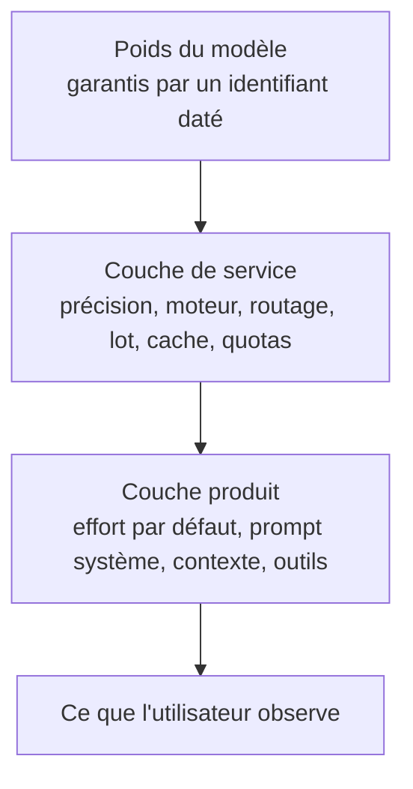

# Ce qui change derrière une API

## Aperçu

- Quand un modèle servi par API « paraît moins bon » quelques semaines après sa sortie, les preuves publiques ne montrent pas d'échange de **poids**. Elles montrent des **molettes de service** tournées autour des poids : effort par défaut, précision de calcul, routage, prompt système, cache, taille de lot, quotas. Le nom du modèle sur la facture reste identique.
- Deux idées à garder : **un identifiant de modèle épinglé n'épingle pas le service**, et il faut distinguer une variation de **mesure** (la règle du classement a changé) d'une variation de **service** (ce qui tourne a changé).

## Concepts clés

### Les trois couches

Un identifiant daté garantit la couche du haut. Les trois régressions d'Anthropic de mars-avril 2026 se sont produites sans qu'aucun identifiant ne change.

### Les molettes, avec leur observabilité de l'extérieur
| Molette | Effet observable | Visible de l'extérieur ? |
|---|---|---|
| Effort de raisonnement par défaut | réponses plus courtes, moins d'étapes | en partie : tokens de réflexion renvoyés, pas le défaut d'un produit tiers ([[Effort de raisonnement et courbe coût-qualité]]) |
| Précision de service (bf16, fp8, int8, int4) | sorties qui dérivent, surtout sur les tâches longues | rarement : une API de première partie ne la publie pas ([[Quantization]]) |
| Routage entre fournisseurs et pools | deux exécutions identiques, deux scores | oui si le routeur renvoie le fournisseur servi |
| Prompt système et outils injectés | style, longueur, format | non sur un produit fermé |
| Contexte effectif, troncature, cache | oublis, répétitions | en partie : tokens d'entrée, succès de cache |
| Quotas, files d'attente, limites de débit | erreurs 429, coupures | oui : en-têtes et pages tarifaires publics |
| Taille de lot | même prompt, autre réponse | non |
| Échantillonnage par défaut (température, top-p, top-k) | sorties plus ou moins variées | oui sur une API, non sur un produit fermé |
| Garde-fous resserrés | refus, préambules | oui : le refus est binaire |

Le décodage spéculatif n'est **pas** une molette de dégradation : sans perte en arithmétique exacte, la distribution est celle du modèle cible ([[Speculative decoding]]).

### Quatre choses qu'on appelle « nerf »
- **Dégradation réelle et datée** : un document signé, un périmètre, un correctif. Anthropic, 2026 : effort par défaut `high` → `medium` du 4 mars au 7 avril (34 jours ; Claude Code et SDK, pas l'API), purge du raisonnement à chaque tour du 26 mars au 10 avril, une ligne de prompt de concision du 16 au 20 avril (−3 % sur une évaluation). Le tout sur 47 jours : le périmètre accompagne le nombre.
- **Changement commercial non annoncé** : quotas divisés par trois (xAI, mai 2026) ; le modèle est identique, c'est ce qu'on en obtient qui change.
- **Variance de service** : personne ne l'a décidé, parfois le fournisseur lui-même ne la voit pas. Anthropic, 2025 : un routage erroné a touché jusqu'à 16 % des requêtes Sonnet 4 à l'heure la pire, et ~30 % des utilisateurs de Claude Code au moins une fois ; un bug de compilateur faisait disparaître le jeton le plus probable.
- **Effet perceptif** : l'échantillonnage (on publie le raté), le recalibrage des attentes, la pourriture du contexte d'une longue session, et un effet placebo mesuré en interaction homme-IA. Une cause parmi quatre, pas l'explication résiduelle.

### Variation de mesure contre variation de service
| Indice | Mesure | Service |
|---|---|---|
| Qui bouge ? | tous les modèles du classement | un modèle ou un fournisseur |
| Date de bascule | nette, celle de la nouvelle version d'indice | progressive, ou corrélée aux heures de pointe |
| Rejouer | l'ancienne version restitue l'ancien score | le même prompt ne restitue rien |
| Trace | changelog public de l'indice | nulle, sauf postmortem |
| Test décisif | un jeu de prompts **figé** joué localement donne le même résultat | le même jeu donne un résultat différent |

## Les maths, simplement

- **Le lot fait varier la sortie.** Les noyaux d'inférence ne sont pas invariants à la taille du lot : l'ordre des sommes en virgule flottante change, et la taille du lot dépend des autres utilisateurs. Mesure du laboratoire Thinking Machines : 1 000 appels identiques sur Qwen3-235B à température 0 donnent **80 complétions différentes**, la plus fréquente 78 fois, première divergence au token 103 ; 1 000 sorties identiques avec des noyaux invariants au lot. « Nous ne réduisons jamais la qualité selon la charge » est vrai de l'intention, pas de l'effet.
- **Le backend seul déplace les scores.** Même identifiant de modèle ouvert, hébergeurs différents : jusqu'à **16,6 points** d'écart sur un banc ; 31 travaux sur 32 (97 %) auditaient sans épingler le fournisseur. Ordre de grandeur de la quantification (Qwen3-32B, H100) : FP8 contre BF16 = 69,64 % contre 70,24 % sur MMLU-Pro (−0,6 point), score identique sur HumanEval, pour 1,5× le débit.
- **Capacité contre comportement** (Narayanan et Kapoor, critique de Chen, Zaharia et Zou, arXiv 2307.09009) : un modèle peut garder une capacité tout en changeant de comportement sur un prompt. Le « 84 % → 51 % » sur les nombres premiers testait 500 nombres **tous premiers** : le résultat s'inverse sur des composés. Le papier établit un changement de comportement sous un nom stable, pas une perte de capacité.

## En pratique

- **Épingler ce qui s'épingle** : instantané daté plutôt qu'alias flottant ou `-latest`, et un identifiant de fournisseur quand le modèle en a plusieurs ; désactiver le repli automatique.
- **Consigner à chaque appel** : identifiant envoyé et renvoyé, fournisseur servi, horodatage UTC, paramètres d'échantillonnage, effort demandé, prompt système, comptes de tokens (entrée, sortie, réflexion), succès de cache, en-têtes de limite de débit. Sans ces champs, une comparaison à trois mois ne sépare pas une dérive de modèle d'un changement de ses propres appels. Mise en œuvre : [[LLM observability]], [[Langfuse]].
- **Un jeu figé avant le doute** et plusieurs tirages : [[Canari de dérive d'un LLM en API]].
- **Ce qu'on ne peut pas savoir**, même en faisant tout bien : la précision réellement servie, le pool de serveurs, le prompt d'un produit fermé, la composition du lot, et si la réponse vient bien du modèle facturé. Le calcul vérifiable n'existe pas en production ; la parole du fournisseur reste le seul instrument.
- **Les poids ouverts déplacent le soupçon** des poids vers la pile de service (matériel, moteur, version du moteur, quantification, lot), ils ne le ferment pas. Un fichier de poids sur disque ne change pas dans la nuit ; un moteur mis à jour, si.

### Repères datés

Faits établis par des documents publiés, relevés entre le 2026-09-13 et le 2026-09-16 ; la liste des défauts documentés par fournisseur évolue. Anthropic documente désormais l'effort par défaut de chaque modèle dans son tableau public, et date le retrait de ses instantanés (« pas avant le 2027-07-24 » pour Opus 5). Le démenti d'un autre fournisseur (« aucun changement depuis le lancement ») ne dit pas ce qu'il couvre : poids, prompt, précision, routage, quotas, budget de réflexion.

## Approches voisines & alternatives

- [[Lire un score publié]] — variation de mesure : la version de l'indice.
- [[Canari de dérive d'un LLM en API]] — la parade pratique.
- [[LLM observability]] — consigner ce qui a servi chaque réponse.
- [[Data drift]] — la même discipline pour la dérive d'un modèle ML classique.
- [[Hallucinations des LLM]] — autre cause d'une sortie surprenante, indépendante du service.
- [[Inference optimization]] — côté fournisseur, ce qui fait bouger précision et lot.
- [[Contexte long]] — la pourriture de contexte d'une longue session.
- [[Tarif catalogue contre coût par tâche]] — quotas et coûts, l'autre molette visible.

## Pour aller plus loin

- Vidéo « Are AI Models Being NERFED? », AI WITH Rithesh, 9 min 15, https://www.youtube.com/watch?v=ixw4xBYGvKY — postmortem d'avril à 1 min 36, le démenti à 6 min 27, la thèse « the weights didn't move, the knobs did » à 8 min 25.
- Anthropic, « An update on recent Claude Code quality reports », 2026-04-23 : https://www.anthropic.com/engineering/april-23-postmortem
- Anthropic, « A postmortem of three recent issues », 2025-09-17 : https://www.anthropic.com/engineering/a-postmortem-of-three-recent-issues
- Thinking Machines Lab, « Defeating Nondeterminism in LLM Inference » : https://thinkingmachines.ai/blog/defeating-nondeterminism-in-llm-inference/
- Khoriaty, « Not pinning your OpenRouter provider might invalidate your… », LessWrong, 2026-07-23 : https://www.lesswrong.com/posts/KsyoSAyBRXtwzSugg
- Chen, Zaharia, Zou, « How is ChatGPT's behavior changing over time? » : https://arxiv.org/abs/2307.09009
- Narayanan et Kapoor, critique du papier, 2023-07-19 (AI Snake Oil).
