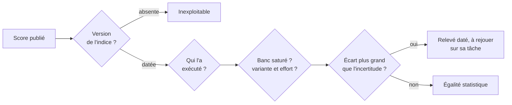

# Lire un score publié

## Aperçu

- Un score publié (« 46 sur l'indice », « premier open weights », « 99,6 % ») est un **relevé**, pas une propriété du modèle : il dépend de la version de l'indice, de qui l'a exécuté, du réglage du modèle, de la saturation du banc et de l'incertitude. Sans ces cinq éléments, le nombre ne vaut rien.
- Cette page est la grille de lecture ; [[LLM benchmarks]] décrit les bancs eux-mêmes et leurs deux maux (contamination, saturation).

## Concepts clés

### Les cinq questions à poser à un score
1. **Quelle version de l'indice ?** Un indice composite est reversionné : le même modèle change de score sans qu'un poids bouge. Entre le 2026-09-05 (v4.2) et le 2026-09-07 (v4.3), Artificial Analysis a ajouté deux épreuves, abandonné GPQA-Diamond, corrigé des grilles, remplacé des bancs et monté le poids des jeux privés de 40 à 45 % : GPT-6 Astra, à égalité avec Sol, est passé quatre points devant sans aucun changement chez OpenAI. Un score sans sa version est inexploitable ; des scores de versions différentes ne se comparent pas.
2. **Qui l'a exécuté ?** Une mesure indépendante prime sur une table d'éditeur. Les bancs d'agents d'un lancement sont presque toujours exécutés par l'éditeur ; aucun tiers ne les a rejoués au jour de la sortie. Une étiquette « rapporté par l'éditeur » à l'écran vaut mieux que rien, mais disparaît quand on reprend une capture.
3. **Quel checkpoint, quel effort, quelle variante ?** « Gemini 3.8 Live » désigne deux modèles qui obtiennent 30,1 % et 68,6 % au même banc : l'un est la variante standard, l'autre la variante à raisonnement, mesurée au seul niveau `high`. Comparer un concurrent à effort `medium` à un modèle à effort `high` n'est pas une comparaison. Voir [[Effort de raisonnement et courbe coût-qualité]].
4. **Le banc est-il saturé ?** Un score de 100,0 (ExploitBench, banc de génération d'exploits, où le meilleur modèle est parfait) ou de 99,6 % d'AUROC image sur MVTec AD ne dit plus « deux fois meilleur » mais « résolu ou non ». MVTec AD est saturé ; MVTec AD 2 reste sous 60 % d'AU-PRO pour les meilleurs.
5. **Quelle incertitude ?** Un écart plus petit que l'intervalle de confiance n'est pas un classement. Le meilleur score peut venir d'un seul essai contre trois pour le concurrent.

### Ce qu'un indice composite cache
- Un indice composite est une **moyenne pondérée**. Terminal-Bench 4.0 n'y pèse qu'un dixième : MiMo-V2.6-Pro peut y marquer 34,9 contre 59,6 au meilleur et rester à 46 sur l'indice. Lire le score de la **composante qui ressemble à son usage**, pas l'indice.
- **« Meilleur de la table » est une propriété de la table.** Xiaomi publie une table à six colonnes qui donne Claude Opus 5 à 74,0 sur DeepSWE v1.1, et une table à dix colonnes qui donne DeepSeek V4.1 Flash à 74,2.
- **Le score de vitrine** range des défaites sous un titre « là où il gagne » : deux lignes perdues face à Claude Opus 5, une victoire sur CyberGym où aucun modèle fermé n'a été évalué, une « égalité en tête » qui est une troisième place. Lire chaque ligne et nommer son adversaire.

## Les maths, simplement

- **Propager l'incertitude jusqu'à l'indice.** L'indice vocal d'Artificial Analysis moyenne quatre composantes à poids égaux et convertit l'Elo de l'arène en score : $\text{Arena} = \dfrac{100}{1 + 10^{(800 - \text{Elo})/400}}$. Vérification : Elo 990 donne 75,0, et $(97{,}7 + 68{,}6 + 75{,}0 + 89{,}1)/4 = 82{,}6$, le score publié.
- Un Elo de $990 \pm 27$ donne un score de $\pm 2{,}9$, soit $\pm 0{,}73$ point d'indice (poids 25 %). Un taux de réussite de 89,1 % d'intervalle de Wilson $[84{,}7\,;\,92{,}4]$ ajoute $\pm 0{,}97$ point. En quadrature : $\sqrt{0{,}73^2 + 0{,}97^2} \approx 1{,}2$ point sur l'indice, environ $\pm 1{,}7$ sur l'**écart** entre deux modèles.
- **L'écart publié entre le premier et le deuxième est de 1,1 point** : plus petit que l'incertitude. Trois modèles tiennent dans 1,3 point ; ce n'est pas un classement. Le calcul est de la rédaction de la source, pas un chiffre publié par l'indice. Notions de base : [[Intervalles de confiance]], [[Bootstrap]].

## En pratique

- **Écrire à côté de chaque score** : version de l'indice, date de relevé, variante et effort, qui a exécuté. Un score recopié sans ces quatre champs se périme sans qu'on le voie.
- **Chercher la plage de rangs** quand l'arène la publie : « rang 1 à 4 » dit que le deuxième peut être premier.
- **Vérifier le nombre d'essais** : un score sur un essai ne se compare pas à une moyenne de trois.
- **Une arène de préférence mesure autre chose qu'un indice de tâches.** La variante de Gemini 3.1 Flash Live à raisonnement minimal est dernière de l'indice vocal (63,9) et première de l'arène de préférence humaine (Elo 1096) ; la variante qui gagne l'indice finit dixième. Une dimension retirée de l'indice (la dynamique de conversation) jouait contre elle : une v2.1 qui la réintroduirait pourrait inverser le classement.
- **Un score n'est pas une propriété du modèle : c'est celle du triplet modèle × méthodologie × date.** Pour décider, rejouer sur sa propre tâche (jeu privé, plusieurs tirages) : [[LLM-as-judge]], [[LLM eval metrics]], [[Inspect AI]], [[promptfoo]].
- **Une image de démonstration n'est pas un score.** Les essais isolés sur les réseaux montrent ce qu'un modèle peut produire, jamais ce qu'il produit en moyenne.

### Repères datés

Relevés les 2026-09-16, 2026-09-22 et 2026-09-23. À relire avant de citer.

| Cas | Ce qu'on lit | Ce qu'il faut ajouter |
|---|---|---|
| MiMo-V2.6-Pro | 46,32 selon Xiaomi | mesuré sous v4.3 ; 46 sous v4.3.2 le 2026-09-22 ; 17e du classement général, sept points sous la tête |
| Gemini 3.8 Live Extended Thinking | premier de l'indice vocal à 82,6 | avance de 1,1 point, inférieure à l'incertitude estimée (±1,7) ; concurrent mesuré sur un essai |
| Qwen-Image-2.1 | 60,28 sur Qwen-Image-Bench | banc de l'éditeur, sans version ni barres d'erreur ; absent des classements indépendants au 2026-09-22 |
| GPT-6 Sol et Luna | « même niveau » que GPT-5.6 | Sol +1 point sur 47, Luna +0 sur 37 ; identiques sous v4.3 et v4.3.2 le 2026-09-23 |

## Approches voisines & alternatives

- [[LLM benchmarks]] — les bancs, la contamination, la saturation ; cette page est la grille de lecture d'un score.
- [[Code and math benchmarks]] — les familles spécialisées, saturées les premières.
- [[Ce qui change derrière une API]] — la variation de mesure (version d'indice) contre la variation de service (le modèle servi).
- [[Tarif catalogue contre coût par tâche]] — l'autre grandeur d'un choix de modèle.
- [[LLM-as-judge]] — le moteur des arènes à jugement automatique, avec ses biais.
- [[Licences de modèles open weights]] — la licence se lit avant les classements.
- MiMo-V2.6 · DeepSeek-V4.1-Flash · Qwen-Image-2.1 — trois fiches dont les scores d'éditeur sont lus avec cette grille.
- Laya — 0,766 contre 0,362 : le score de vitrine d'un checkpoint ajusté ; Comparatif - Modèles de décision — score public contre score complet, deux relevés datés.

## Pour aller plus loin

- Vidéo « Xiaomi MiMo-V2.6, Pro et Flash », AI WITH Rithesh, 10 min 03, https://www.youtube.com/watch?v=WWYH-Lw-i2g — score d'ouverture à 0 min 18, défaites à 9 min 02, « là où il gagne » à 8 min 28.
- Vidéo « Gemini 3.8 Live », AI WITH Rithesh, 18 min 57, https://www.youtube.com/watch?v=A7K-b_a2CZ4 — composition de l'indice à 16 min 27, tableau à 16 min 12, arène à 17 min 21.
- Artificial Analysis, méthodologie de l'indice vocal et historique de versions : https://artificialanalysis.ai/methodology/speech-to-speech-benchmarking
- Artificial Analysis, articles sur l'indice v4.3 : https://artificialanalysis.ai/articles/artificial-analysis-intelligence-index-v4-3
