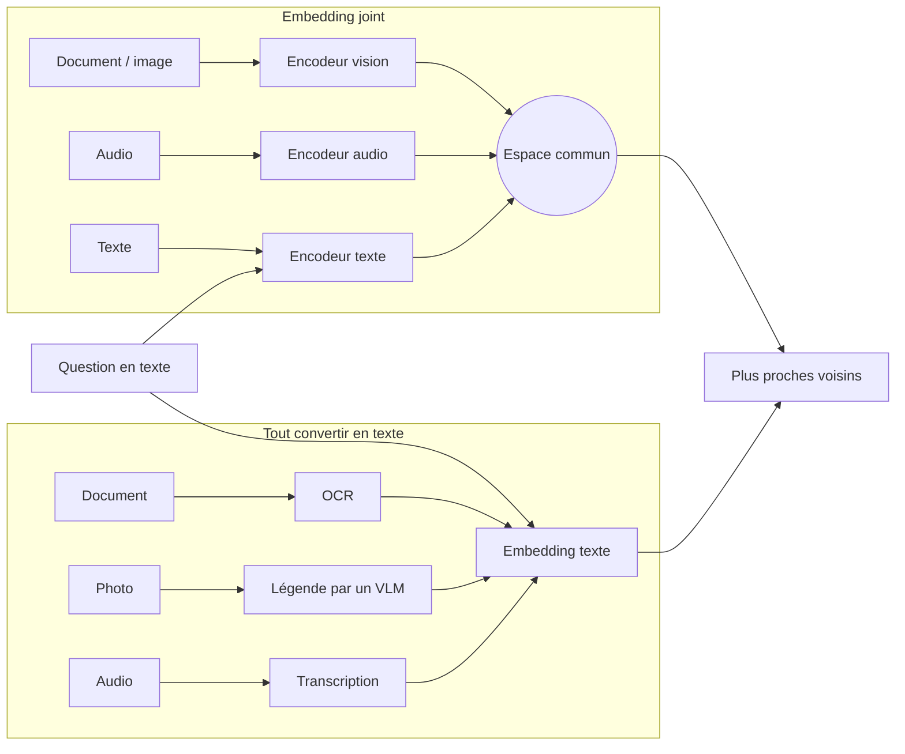

# Embedding multimodal et modality gap

## Aperçu

- Un **embedding multimodal** projette des contenus de natures différentes (texte, image, audio, vidéo) dans **un même espace vectoriel**. Une question en texte retrouve alors directement une image ou un extrait audio, par une simple comparaison de vecteurs.
- C'est l'une des deux façons de rendre cherchable un contenu qui n'est pas du texte. L'autre consiste à **tout convertir en texte** (OCR, légende par un modèle vision-langage, reconnaissance vocale), puis à n'utiliser qu'un modèle d'embedding texte.
- Trois choses à garder en tête : l'espace commun vient d'un entraînement conjoint, il garde un **écart entre modalités** (*modality gap*), et un embedding **ne restitue pas** le texte exact d'une image.

## Concepts clés

### Deux façons de rendre un contenu cherchable

- **Convertir en texte** : robuste, un seul modèle d'embedding, mais **un traitement à maintenir par modalité** et un endroit où l'information se perd (une légende ne garde que ce que le légendeur a retenu à l'indexation).
- **Embedding joint** : un seul espace, un vecteur par entrée. Plus direct ; il faut un modèle entraîné pour cela et il ne dit rien du texte exact.

### Ce qui rend l'espace commun possible

1. **Un entraînement contrastif sur des paires.** CLIP (OpenAI, arXiv 2103.00020) rapproche le vecteur d'une image et celui de sa légende, et éloigne les autres paires du lot, sur 400 millions de paires prises sur le web. Sans entraînement conjoint, un vecteur de texte et un vecteur d'image n'ont aucune relation. Voir [[Apprentissage contrastif]].
2. **Des espaces alignés**, puis une mesure : le cosinus entre le vecteur de la question et ceux des images.
3. **Des préfixes de tâche** pour certains modèles : la requête porte une consigne, l'image est encodée sans préfixe (cas d'EmbeddingGemma 2 : EmbeddingGemma 2).

### Le modality gap

- Liang, Zhang, Kwon, Yeung et Zou (NeurIPS 2022, arXiv 2203.02053) observent que dans des modèles de type CLIP, **images et textes occupent deux régions séparées** de l'espace partagé, « à bout de bras », au lieu de se recouvrir. Ils l'attribuent à deux causes : l'initialisation (les représentations d'un réseau profond tiennent dans une région étroite, donc les deux modalités partent loin l'une de l'autre) et l'optimisation contrastive (l'objectif maintient l'écart, que la **température** de la perte règle).
- **Conséquence pratique** (lecture de l'écart, pas un résultat mesuré par le papier) : les scores texte-image n'ont pas la même plage que les scores texte-texte. On ne les compare pas sans calibration, et on ne fixe pas un seuil unique de pertinence pour deux modalités. Ranger les résultats **par modalité**, puis fusionner par rang ([[Hybrid retrieval]], fusion RRF), est une parade plus sûre qu'un classement par score brut.
- Les requêtes longues et techniques passent mal dans les encodeurs de texte courts de type CLIP (le texte de CLIP est tronqué à 77 tokens) : un modèle récent à contexte plus long (jusqu'à 8 192 tokens pour EmbeddingGemma 2, 32K pour Qwen3-VL-Embedding) réduit ce problème sans l'effacer.

### Ce qu'un embedding ne fait pas

- **Il ne restitue pas le texte exact d'une image.** Un vecteur retrouve une page qui « parle de » la question ; pour **citer** le chiffre ou la phrase, il faut un OCR ou un modèle de lecture en aval ([[OCR classique vs modèles vision-langage pour documents]]).
- **Il ne dit pas où** dans l'image se trouve la réponse. Les cartes de similarité d'un modèle multi-vecteur (ColPali) montrent les zones de la page qui s'allument, ce qu'un vecteur unique ne fait pas.

### Embedding joint ou multi-vecteur de page

- Un embedding joint met **un vecteur par entrée**, toutes modalités confondues. Un modèle comme ColPali indexe **une seule nature de document**, la page en image, avec **environ 1 030 vecteurs par page** et une interaction tardive (MaxSim). La frontière n'est pas étanche : certains modèles offrent les deux modes.
- Le multi-vecteur coûte en stockage : 257,5 kio par page pour ColPali (valeur du papier) contre 4 kio pour un vecteur dense de 1 024 dimensions en float32. Voir [[RAG visuel - retrouver des documents sans OCR]] et [[Late-interaction retrieval]].

### Convertir en texte ou indexer l'image : les mesures divergent

- **Pour l'image** : ColPali dépasse de 14 points de nDCG@5 les pipelines OCR ou légendage sur ViDoRe, un benchmark construit par les mêmes auteurs ; VisRAG (arXiv 2410.10594) annonce dans son résumé 20 à 40 % de gain de bout en bout sur du RAG texte après parsing.
- **Pour le texte** : Riedler et Langer, *Beyond Text* (arXiv 2410.21943, cadre industriel), concluent que des **résumés texte d'images** sont plus prometteurs que des embeddings multimodaux.
- Les cadres, les modèles d'époque et les juges diffèrent : aucune étude lue ne tranche. Pour une décision, rejouer sur ses documents. Aucune étude trouvée ne compare un embedding audio à « transcription puis texte ».
- Côté **génération**, deux choix indépendants de la recherche : donner l'**image** à un modèle vision-langage (aucune perte de transcription, mais des tokens d'image à chaque requête) ou donner sa **description** à un modèle texte (compact et citable, mais figé par ce que la description a retenu).

## Les maths, simplement

- **Comparaison.** Pour des vecteurs normalisés $\hat u$ et $\hat v$ : $\cos(u,v) = \hat u \cdot \hat v$. La requête texte et l'image sont comparées par ce seul produit scalaire.
- **Troncature Matryoshka.** Garder les $d'$ premières dimensions d'un vecteur de dimension $d$ **puis le renormaliser** : une troncature d'un vecteur unitaire n'est plus unitaire, et sauter la renormalisation dégrade silencieusement le classement. Requête et corpus doivent partager la même dimension.
- **Stockage d'un index** : octets par entrée $= N \times D \times b$ ($N$ vecteurs, $D$ dimensions, $b$ octets par valeur : 2 en float16, 4 en float32). Un vecteur dense de 1 024 dimensions en float32 : 4 kio ; une page ColPali : $1\,030 \times 128 \times 2 = 263\,680$ octets, soit 257,5 kio.

## En pratique

- **Commencer par la conversion en texte** si le besoin est de citer des chiffres ou des phrases, que les documents sont surtout du texte, ou que les modalités sont peu nombreuses.
- **Un embedding joint** quand la requête cherche une image, une vidéo ou un son qu'aucun texte ne décrit bien, ou quand maintenir plusieurs flux de conversion coûte plus cher que l'indexation conjointe.
- **Mesurer** sur ses propres paires (question, passage ou image attendu) : rappel@$k$ par modalité, pas un score global. Les classements publics (MMEB, MIEB) mesurent des protocoles précis.
- **Précision numérique** : certains modèles ne supportent pas le float16 (EmbeddingGemma 2 l'interdit, valeurs hors de la plage) ; lire la carte.
- **Licence des poids** : elle varie d'un modèle à l'autre, de l'Apache-2.0 à une licence non commerciale (voir « Repères datés »).

### Repères datés

Relevés les 2026-10-19 et 2026-10-20 sur les cartes de modèles et dépôts ; à relire avant de citer. Scores publiés par les éditeurs eux-mêmes : aucune comparaison de classement sous un protocole commun n'est établie, et les tailles des modèles diffèrent.

| Modèle | Modalités | Licence relevée | Remarque |
|---|---|---|---|
| EmbeddingGemma 2 (Google, 2026-10-06) | texte, code, image, vidéo, audio | Apache-2.0 | 740 M, 768 dimensions ; MMEB v2 global 59,01 à 768 dimensions, 45,65 à 128 (carte) |
| Qwen3-VL-Embedding (Alibaba, 2026-01-07) | texte, image, captures, vidéo ; pas d'audio | Apache-2.0 | 2 B et 8 B ; MMEB-V2 global 73,2 et 77,8 (README) |
| SigLIP 2 (Google, 2025-02) | texte, image | Apache-2.0 | encodeur double, recherche image-texte et classification zéro exemple |
| Jina CLIP v2 (2024) | texte, image | CC-BY-NC-4.0 | poids non commerciaux |
| CLIP (OpenAI, 2021) | texte, image | non relevée ici | le modèle d'origine de l'approche |

## Approches voisines & alternatives

- [[embeddings]] — la notion de base : ce qu'est un embedding, texte seul.
- [[Choisir un modèle d'embedding]] — critères de choix et limites de MTEB, côté texte.
- [[Comparatif - Embeddings]] — les outils et les modèles, dont les trois modèles multimodaux de cette page.
- [[Late-interaction retrieval]] · [[RAG visuel - retrouver des documents sans OCR]] · [[ColPali]] — l'autre famille : plusieurs vecteurs par page.
- [[Apprentissage contrastif]] — la méthode d'entraînement qui crée l'espace commun.
- [[Modèles de fondation vision]] — les encodeurs de vision sur lesquels ces modèles s'appuient.
- [[Vision Language Models]] — les modèles qui lisent image et texte, côté génération.
- [[OCR classique vs modèles vision-langage pour documents]] — la voie « convertir en texte ».
- [[Calibration]] — pourquoi un score n'est comparable qu'après calibration.

## Pour aller plus loin

- Radford et al., *Learning Transferable Visual Models From Natural Language Supervision* (CLIP), arXiv 2103.00020 — https://arxiv.org/abs/2103.00020
- Liang et al., *Mind the Gap: Understanding the Modality Gap in Multi-modal Contrastive Representation Learning*, NeurIPS 2022, arXiv 2203.02053 — https://arxiv.org/abs/2203.02053
- Faysse et al., *ColPali*, ICLR 2025, arXiv 2407.01449 — https://arxiv.org/abs/2407.01449
- Yu et al., *VisRAG*, arXiv 2410.10594 ; Riedler et Langer, *Beyond Text*, arXiv 2410.21943.
- Fiches de modèle : https://huggingface.co/google/embeddinggemma-2 ; https://huggingface.co/Qwen/Qwen3-VL-Embedding-8B ; https://huggingface.co/google/siglip2-so400m-patch14-384
- Short « C'est quoi le RAG multimodal ? Et l'intérêt derrière ? », Benoit Ferrere, 2 min 29, https://www.youtube.com/watch?v=FbHEm1wgjEE — deux façons de rendre un contenu cherchable à 1 min 02, espace commun à 1 min 53.
- Short « C'est quoi les multi-vecteurs dans un RAG ? », Benoit Ferrere, 2 min 11, https://www.youtube.com/watch?v=OR8voPgLtJY — MaxSim à 0 min 59, prix du multi-vecteur à 1 min 50.
