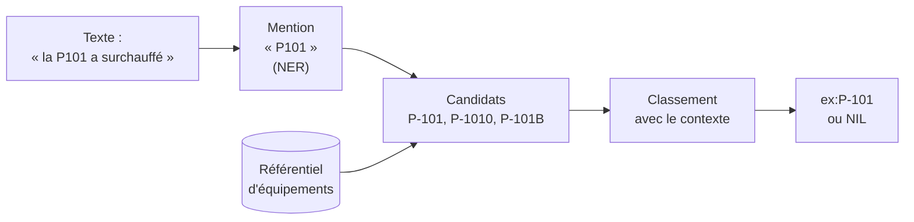

# Liage d'entités

## Aperçu

- Le **liage d'entités** (entity linking) relie une **mention** dans un texte (« la P101 », « pompe 101 », « P-101 ») à l'**entrée unique** d'une base de connaissances qu'elle désigne (`ex:P-101` dans le registre d'actifs, ou un élément Wikidata). Une fois liées, des mentions différentes d'un même texte, ou de textes différents, tombent sur **la même chose**.
- Il se place **après** la reconnaissance des mentions ([[NER et étiquetage de séquence]] : repérer et typer) et **avant** le graphe : c'est lui qui fait qu'un [[Graphe de connaissances]] ne se remplit pas de doublons.
- Il ne se confond pas avec la **résolution d'entités** de [[Construction de graphes de connaissances]] : celle-ci fusionne, **à l'intérieur** du graphe en cours de fabrication, les mentions qui désignent le même réel (« IBM » et « International Business Machines »), sans référence extérieure. Le liage, lui, vise un **référentiel connu** : une base existante dont les entrées ont des identifiants.

## Concepts clés

### Trois problèmes voisins

| Problème | Entrée | Sortie | Exemple |
|---|---|---|---|
| **Liage d'entités** (entity linking) | une mention dans un texte | l'identifiant d'une entrée du référentiel, ou « aucune » (NIL) | « la P101 a surchauffé » → `ex:P-101` |
| **Appariement d'enregistrements** (entity matching, record linkage) | deux enregistrements de deux tables | « même entité » ou non | une ligne de la GMAO et une ligne de l'ERP |
| **Résolution d'entités** dans un graphe en construction | les nœuds déjà extraits | des nœuds fusionnés | cf. [[Construction de graphes de connaissances]] |

Les techniques se recoupent (similarité de chaînes, de plongements, classement), pas les entrées ni le référentiel.

### Les étapes d'un système de liage

Sevgili et al. (2022) décrivent l'architecture générale des systèmes neuronaux en trois composants :

1. **Génération de candidats** : pour une mention, retrouver rapidement quelques dizaines d'entrées plausibles (dictionnaire d'alias, recherche lexicale, recherche de voisins par vecteurs).
2. **Encodage du contexte de la mention** : lire la phrase autour, pas seulement le mot.
3. **Classement des entités** : choisir la meilleure, ou décider qu'**aucune** ne convient (NIL).

### Systèmes de référence

- **BLINK** (Wu et al., EMNLP 2020) : deux étages. Un **bi-encodeur** (BERT) place mentions et entités dans un même espace de vecteurs pour retrouver les candidats vite ; un **cross-encodeur** les reclasse. Il lie en « zero-shot » avec seulement la description textuelle courte de chaque entité. Le code est publié par Facebook Research.
- **GENRE** (De Cao et al., ICLR 2021) : un modèle encodeur-décodeur **génère le nom** de l'entité, mot à mot. Le nombre de paramètres dépend du vocabulaire, non du nombre d'entités ; ajouter une entité, c'est fournir son nom.
- **REL** (Radboud Entity Linker) : paquet Python et API web, exécutable en local (pip ou Docker) ; il utilise Wikipédia **anglaise** comme base de connaissances. Pour un référentiel d'entreprise, il faut un système qu'on peut adapter à sa propre base.
- **Appariement avec des LLM** : Wang et al. (COLING 2025) comparent trois façons d'interroger un LLM pour l'appariement d'enregistrements — juger les paires une à une, comparer, ou **sélectionner** dans un ensemble — et trouvent la sélection meilleure sur 8 jeux de données et 10 modèles. Pour du texte libre vers un référentiel fermé, voir « En pratique ».

## Les maths, simplement

- **Candidats par vecteurs** : avec un bi-encodeur, la mention $m$ et l'entité $e$ ont des vecteurs $\mathbf{u}_m$ et $\mathbf{v}_e$ ; on classe par similarité cosinus $\cos(\mathbf{u}_m, \mathbf{v}_e) = \frac{\mathbf{u}_m \cdot \mathbf{v}_e}{\lVert \mathbf{u}_m\rVert \lVert \mathbf{v}_e\rVert}$. La recherche des $k$ plus proches voisins est rapide, car les $\mathbf{v}_e$ sont précalculés ([[embeddings]]).
- **Score combiné** (forme générale, pas celle d'un système précis) : on peut écrire $P(e \mid m, c) \propto P(e)\, P(m \mid e)\, P(c \mid e)$, où $P(e)$ est l'a priori de l'entité (les équipements fréquemment cités), $P(m \mid e)$ la probabilité que cette entité s'écrive ainsi et $c$ le contexte.
- **NIL** : on fixe un **seuil** $\tau$ ; si le meilleur score est inférieur, on rend « aucune entité » plutôt que le moins mauvais candidat. Choisir $\tau$ arbitre entre liens manqués et liens faux.
- **Mesure** : précision, rappel et F1 sur les liens, calculés **par mention** ; un lien vers la mauvaise entité compte comme une erreur, comme un oubli.

## En pratique

- **Commencer par la règle, ajouter l'apprentissage ensuite.** Pour des codes d'équipement ou de pièces (`P-101`, `P101`, `pompe 101`), une normalisation et une table d'alias couvrent l'essentiel ; les modèles neuronaux servent pour les mentions en langage libre.
- **Le référentiel fait la qualité.** Sans fiche propre pour chaque équipement (nom, alias, localisation), aucun système ne devinera. Le registre d'actifs est un préalable.
- **Prévoir NIL** : une mention absente du référentiel ne doit pas se lier à l'entrée la plus proche ; elle part en **revue humaine**, et sert éventuellement à créer l'entrée.
- **Garder une trace** de chaque lien (score, méthode, date) : un lien appris est une hypothèse. Déclarer l'identité dans le graphe avec `owl:sameAs` fusionne tout ; préférer un lien plus doux (`skos:exactMatch`) quand le doute subsiste ([[Données liées et vocabulaires partagés]]).
- **LLM** : utile pour désambiguïser avec contexte, mais coûteux sur un corpus entier, et il peut inventer un identifiant. Le contraindre à **choisir parmi les candidats** fournis plutôt qu'à écrire l'identifiant ([[Structured outputs]]).
- **Pièges** : homonymes (deux équipements de même nom dans deux ateliers) ; mentions imbriquées ; référentiel qui change (l'identifiant d'hier n'est plus valide) ; évaluer sur des textes qui ressemblent trop à l'entraînement.

## Approches voisines & alternatives

- [[NER et étiquetage de séquence]] — l'étape qui précède : repérer les mentions ; [[GLiNER]] et [[spaCy]] — des outils d'extraction d'entités, à brancher en amont.
- [[Construction de graphes de connaissances]] — la résolution d'entités interne au graphe.
- [[Graphe de connaissances]] — l'entrée du sujet ; [[RDF et triplets]] — les IRI sont les identifiants du référentiel.
- [[Plongements de graphe et prédiction de liens]] — une tâche voisine : deviner des **relations** manquantes au lieu d'identités.
- [[embeddings]] et [[sentence-transformers]] — la brique de similarité des bi-encodeurs.
- **Alternative** : l'appariement flou de chaînes sur un champ clé (distance d'édition) quand le texte est court et la clé existe.

## Pour aller plus loin

- Sevgili, Shelmanov, Arkhipov, Panchenko, Biemann (2022, Semantic Web 13(3)) — *Neural Entity Linking: A Survey of Models Based on Deep Learning* — https://arxiv.org/abs/2006.00575
- Wu, Petroni, Josifoski, Riedel, Zettlemoyer (2020, EMNLP 2020) — *Scalable Zero-shot Entity Linking with Dense Entity Retrieval* (BLINK) — https://arxiv.org/abs/1911.03814
- De Cao, Izacard, Riedel, Petroni (2021, ICLR 2021) — *Autoregressive Entity Retrieval* (GENRE) — https://arxiv.org/abs/2010.00904
- REL — Radboud Entity Linker — https://github.com/informagi/REL
- Wang et al. (2025, COLING 2025) — *Match, Compare, or Select? An Investigation of Large Language Models for Entity Matching* — https://arxiv.org/abs/2405.16884

> Non vérifié : la licence de REL (le fichier existe, sa nature n'a pas été lue) ; l'état de maintenance de BLINK et de GENRE ; aucune enquête de 2025 sur le liage d'entités à l'ère des LLM n'a été trouvée.
