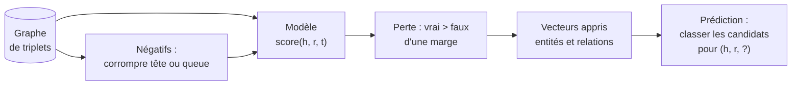

# Plongements de graphe et prédiction de liens

## Aperçu

- Un **plongement de graphe de connaissances** (knowledge graph embedding, KGE) associe à chaque **entité** et à chaque **relation** un vecteur de quelques dizaines à quelques centaines de nombres, appris de façon que les **faits vrais** du graphe aient un **meilleur score** que les faits faux.
- Il sert à la **prédiction de liens** (complétion du graphe) : étant donné `(pompe P-101, a-pour-défaut, ?)`, classer les entités candidates par plausibilité. Un graphe est toujours incomplet (monde ouvert, cf. [[OWL et raisonnement]]) ; le plongement **propose** des faits manquants.
- Les modèles de la famille TransE ne regardent que les **triplets** `(tête, relation, queue)`, pas les textes ni les propriétés numériques. Les [[Graph Neural Networks]] sont une famille voisine, qui agrège le voisinage et sait utiliser les attributs ; ici on décrit la famille « un vecteur par entité et par relation ».

## Concepts clés

### TransE : la relation comme translation

- Bordes et al. (NIPS 2013) proposent **TransE** : une relation est une **translation** dans l'espace des vecteurs. Pour un fait `(h, r, t)`, on veut $\mathbf{h} + \mathbf{r} \approx \mathbf{t}$. Peu de paramètres, entraînement simple ; les auteurs rapportent un passage à l'échelle sur environ 1 million d'entités, 25 000 relations et plus de 17 millions d'exemples d'entraînement.
- La **famille** reprend l'idée avec d'autres opérations : **RotatE** (Sun et al., ICLR 2019) fait de la relation une **rotation** dans l'espace complexe et modélise symétrie, antisymétrie, inversion et composition ; **DistMult** et **ComplEx** notent le fait par un produit de vecteurs ; d'autres modèles utilisent des réseaux de neurones. PyKEEN en implémente quarante (état du dépôt à la lecture).

### Ce qu'on en fait

- **Compléter** un graphe de maintenance : proposer qu'un composant ait un mode de défaillance qu'on n'a pas encore noté, à partir de la ressemblance de son voisinage avec celui d'autres composants.
- **Classer les candidats** pour une requête : « quelles pièces sont les plus plausibles pour cette référence ? » ; c'est un classement, pas une certitude.
- **Produire des vecteurs d'entités** réutilisables : similarité entre équipements, entrée d'un modèle aval ([[embeddings]]).

### Évaluation : le point faible

- Le protocole standard est un **classement** : pour chaque fait de test, on remplace la tête ou la queue par toutes les entités, on classe, et on regarde le rang de la bonne réponse (rang moyen réciproque, taux de bonnes réponses dans les $k$ premiers).
- **Résultats à lire avec méfiance.** Rossi et al. (TKDD 2021) comparent 16 méthodes avec une base de référence à règles, et notent que l'évaluation agrégée peut **surestimer** la performance : certaines entités sont sur-représentées dans les faits de test, et une méthode peut briller en modélisant l'entourage de ces entités tout en étant mauvaise sur le reste du graphe. Ali et al. (2020) refont 21 modèles dans PyKEEN : certains résultats publiés se reproduisent avec les hyperparamètres annoncés, d'autres seulement avec d'autres, d'autres pas du tout ; la performance dépend de l'**ensemble** architecture, entraînement, perte et traitement des relations inverses, pas de l'architecture seule.
- Conséquence : **mesurer sur son propre graphe**, avec ses propres faits retenus, et comparer à une base simple (règles, voisins communs) avant de conclure.

## Les maths, simplement

- **Score TransE** : $f(h,r,t) = -\lVert \mathbf{h} + \mathbf{r} - \mathbf{t} \rVert$, la norme $L_1$ ou $L_2$. Plus la distance est petite, plus le fait est plausible.
- **Perte à marge** : pour un fait vrai $(h,r,t)$ et un faux $(h',r,t')$ obtenu en corrompant la tête ou la queue, on minimise $\max\bigl(0,\ \gamma + d(\mathbf{h}+\mathbf{r},\mathbf{t}) - d(\mathbf{h'}+\mathbf{r},\mathbf{t'})\bigr)$, avec $\gamma$ la marge : le vrai doit être plus proche que le faux d'au moins $\gamma$.
- **Une limite visible à la main** : si $r$ est **symétrique** (`voisinDe`), on voudrait $\mathbf{h}+\mathbf{r}\approx\mathbf{t}$ **et** $\mathbf{t}+\mathbf{r}\approx\mathbf{h}$, d'où $2\mathbf{r}\approx \mathbf{0}$ : la relation tend vers le vecteur nul et les entités liées se confondent. C'est la motivation des modèles à rotation (RotatE), qui représentent la symétrie par une rotation d'un demi-tour.
- **Négatifs** : un graphe ne contient que des faits vrais ; les faux sont **fabriqués** en corrompant un triplet. Un faux ainsi fabriqué est peut-être vrai (le graphe est incomplet) : le bruit est inhérent.

## En pratique

- **Quand l'essayer** : un grand graphe riche en relations, une tâche de complétion ou de recommandation, des relations du type « est lié à ». **Quand l'éviter** : peu de relations, des attributs numériques ou textuels importants (un GNN ou un modèle de langage s'y prête mieux), ou un besoin de justification : le plongement ne donne pas de raison.
- **Outillage** : PyKEEN, bibliothèque Python de plongements de graphe de connaissances (MIT, 40 modèles, article JMLR 2021) permet d'entraîner et de comparer ; fiche à venir dans le dossier [[Ontologies et RDF]]. [[PyTorch Geometric]] couvre le côté GNN.
- **Valider les propositions** : une prédiction est une **hypothèse**. Dans un graphe d'usine, un humain la confirme avant d'écrire le fait (boucle [[Pattern - RAG structuré graphe + human-in-the-loop|human-in-the-loop]]), et le fait confirmé passe par les formes [[SHACL]].
- **Pièges fréquents** : fuite entre entraînement et test (le fait inverse est dans l'entraînement) ; comparer des modèles avec des hyperparamètres inégalement réglés ; entités rares, dont le vecteur est peu fiable ; oublier qu'un graphe a **évolué** : un nouveau composant n'a pas de vecteur (problème d'« entité inconnue »).

## Approches voisines & alternatives

- [[Graph Neural Networks]] — agrègent le voisinage et les attributs ; [[PyTorch Geometric]] — la bibliothèque.
- [[Graphe de connaissances]] — l'entrée du sujet ; [[RDF et triplets]] — la forme des faits à plonger.
- [[Liage d'entités]] — une tâche voisine : décider que deux noeuds sont la même chose ; les plongements peuvent y aider.
- [[embeddings]] et [[Apprentissage contrastif]] — même idée : rapprocher les vrais, éloigner les faux, avec des négatifs fabriqués.
- [[OWL et raisonnement]] — **déduire** des faits avec certitude à partir d'axiomes ; le plongement **induit** des faits plausibles à partir de régularités. Les deux se complètent.
- **Alternative** : des règles de fouille (« si A est lié à B par r1 et B à C par r2, alors A est lié à C par r3 ») : moins générales, mais lisibles et justifiables.
- **Outil** : [[PyKEEN]] entraîne et compare des plongements de graphe de connaissances en Python.

## Pour aller plus loin

- Bordes, Usunier, Garcia-Durán, Weston, Yakhnenko (2013, NIPS 26) — *Translating Embeddings for Modeling Multi-relational Data* — https://papers.nips.cc/paper/2013/hash/1cecc7a77928ca8133fa24680a88d2f9-Abstract.html
- Sun, Deng, Nie, Tang (2019, ICLR 2019) — *RotatE: Knowledge Graph Embedding by Relational Rotation in Complex Space* — https://arxiv.org/abs/1902.10197
- Rossi, Firmani, Matinata, Merialdo, Barbosa (2021, ACM TKDD) — *Knowledge Graph Embedding for Link Prediction: A Comparative Analysis* — https://arxiv.org/abs/2002.00819
- Ali et al. (2020) — *Bringing Light Into the Dark: A Large-scale Evaluation of Knowledge Graph Embedding Models Under a Unified Framework* — https://arxiv.org/abs/2006.13365
- PyKEEN — https://github.com/pykeen/pykeen ; documentation — https://pykeen.readthedocs.io/en/stable/
- Hogan et al. (2021, ACM Computing Surveys) — *Knowledge Graphs* (méthodes inductives) — https://arxiv.org/abs/2003.02320

> Non vérifié : les métriques exactes (rang réciproque moyen, Hits@k, protocole « filtré ») dont la page de documentation de PyKEEN lue ne donne pas le détail ; les résultats chiffrés de chaque modèle.
