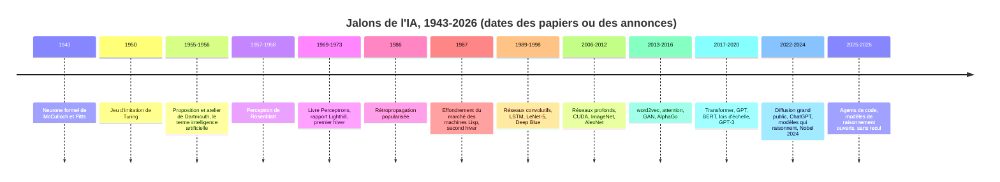

# Histoire de l'IA (1943-2026)

## Aperçu

- Une **chronologie sourcée** de l'intelligence artificielle, du neurone formel de 1943 aux modèles de 2026, avec les **dates et attributions corrigées** : un « premier » y est presque toujours disputé, et le nom de la chose arrive souvent après la chose.
- Deux enseignements durables : la **forme commune des deux hivers** (promesse chiffrée, facteur limitant nommé par un tiers, financeur qui coupe) et une **grille de cinq questions** pour lire une annonce du moment.
- **2025-2026 est sans recul.** Les événements de cette période sont annoncés, pas établis comme jalons : ils vieillissent en quelques semaines.

## Concepts clés

### La frise

*Frise refaite d'après le tableau du document de formation de floSa « Histoire de l'IA de 1943 à 2026 » (vidéo d'AI WITH Rithesh, 10 min 06, 2026-09-28, produite avec un modèle d'IA et une voix de synthèse : elle ne fonde aucune date ; chaque jalon a été confronté par le document à un papier ou à un acte officiel).*

### Ce que les sources corrigent

| Jalon | Version courante | Ce que disent les sources |
|---|---|---|
| Dartmouth | « des progrès réels en un été » | proposition du 31 août 1955, signée McCarthy, Minsky, Rochester, Shannon : « une étude de 2 mois par 10 hommes » ; « une avancée significative » est possible *si* un groupe choisi y travaille. Hypothèse, pas promesse (texte relu le 2026-10-20) |
| Perceptron | construit en 1958 | rapport de janvier 1957 ; article de 1958 ; démonstration sur IBM 704 en juillet 1958 ; le matériel *Mark I* date de 1959-1960 |
| XOR et le livre *Perceptrons* | « un perceptron ne sait pas apprendre le XOR » | limite de **représentation** (aussi la parité et la connexité) ; « le livre a tué les réseaux » est un récit contesté par la sociologie des sciences |
| Rapport Lighthill (1973) | « les ordinateurs sont trop lents » | l'argument est l'**explosion combinatoire** : plus de calcul ne règle pas le problème ; commandé par un conseil de recherche britannique |
| ImageNet (2009) | « l'équipe de Fei-Fei Li, 14 millions d'images » | premier auteur Jia Deng ; **3,2 millions** d'images en 2009 ; 14 millions est l'état actuel |
| Transformer (2017) | « huit chercheurs de Google » | huit auteurs, six chez Google, un à Toronto, un sans affiliation imprimée (arXiv 1706.03762, auteurs relus) |
| GPT-1 | 117 millions de paramètres | chiffre non imprimé dans le papier ; corrigé en 124 millions par OpenAI |
| ChatGPT | 100 millions d'utilisateurs en deux mois | estimation d'analystes (UBS, Similarweb), utilisateurs **actifs mensuels** en janvier 2023, pas un chiffre d'OpenAI |
| GPT-4 au barreau | dans les 10 % meilleurs | rapport technique : 90e percentile, biaisé par les candidats qui repassent ; réévalué entre les 48e et 69e percentiles (Martínez, 2024) |
| Olympiade 2025 | « médaille d'or » | deux annonces à 35/42 ; une seule corrigée par l'organisation de l'olympiade |
| Rétropropagation, CNN, GAN, diffusion | « inventés par … » | prétendants multiples (voir plus bas) |

### « Premier » veut presque toujours dire « disputé »

- **Rétropropagation** : Kelley (1960), Bryson (1961), Dreyfus (1962), Linnainmaa (1970, sans lien avec les réseaux), Werbos (1974), Parker (1985), LeCun (1985), Rumelhart, Hinton et Williams (*Nature*, 1986, qui montrent que les couches cachées apprennent des représentations utiles). Le document de formation ne tranche pas.
- **Réseau convolutif** : Fukushima (Neocognitron, 1980), Waibel et al. (réseaux à poids partagés dans le temps, 1989), LeCun et al. (version 2D entraînée par rétropropagation sur des codes postaux, 1989).
- **GAN** : Goodfellow et al. (2014, huit auteurs), contre Schmidhuber (minimisation de prédictibilité, 1992).
- **Diffusion** : Sohl-Dickstein et al. (2015), rendue compétitive par Ho et al. (2020) ; les produits de 2022 en sont des applications.
- **Premier chatbot** : ELIZA (1966) est le premier programme de dialogue largement connu ; la définition de « chatbot » est en cause.

### ImageNet, GPU et AlexNet : un seul événement

Chacun est nécessaire, aucun n'est suffisant. Le CNN entraîné par rétropropagation existait depuis 1989 : sans données, un jouet. ImageNet apporte 1,2 million d'images d'entraînement et un banc d'essai public ; les cartes graphiques apportent le calcul que le partage de poids parallélise (AlexNet : 5 à 6 jours sur deux GTX 580 de 3 Go). AlexNet : 15,3 % d'erreur top-5 contre 26,2 %, un écart de 10,9 points, contre environ 2,4 points entre les vainqueurs de 2010 et 2011. Le 15,3 % est celui d'un **ensemble** de sept réseaux.

### Les deux hivers

| | Premier hiver (années 1970) | Second hiver (fin des années 1980) |
|---|---|---|
| Promesse chiffrée | Simon (1960) : « dans les vingt ans » ; Minsky (rapporté, 1970) : « trois à huit ans » | budgets des systèmes experts ; programme japonais de cinquième génération |
| Facteur limitant, nommé par un tiers | explosion combinatoire (Lighthill) | fragilité hors de la base de règles |
| Qui coupe | Science Research Council ; amendement Mansfield ; DARPA | marché des machines Lisp (1987) ; DARPA à partir de septembre 1987 |
| Sortie | n'a pas la forme de la promesse : les réseaux reviennent avec des données et du calcul que personne n'avait promis | idem |

Les bornes des deux hivers sont conventionnelles. L'expression « hiver de l'IA » vient d'une table ronde de l'AAAI de 1984 (compte rendu : *AI Magazine*, 1985).

### Le mot arrive après la chose

- **Deep learning** : Dechter (1986) l'emploie pour de l'apprentissage de contraintes, sans réseau de neurones ; les articles de Hinton de 2006 disent « deep belief nets » ; premier titre au sens actuel trouvé : 2008 ; définition canonique : LeCun, Bengio, Hinton, *Nature* (2015).
- **LLM** : « Large Language Models in Machine Translation » (Brants et al., EMNLP-CoNLL 2007, métadonnées relues) désigne des tables de comptage de n-grammes ; le sens actuel (Transformer à des dizaines de milliards de paramètres) arrive vers 2020 ; le grand public le découvre fin 2022.
- **IA générative** : l'essai de Sequoia du 19 septembre 2022 la définit, ne l'invente pas ; aucune « première fois » n'est établie.

## Les maths, simplement

- **Rétropropagation** : l'erreur $\delta^l=\big((W^{l+1})^\top\delta^{l+1}\big)\odot\sigma'(z^l)$ remonte couche par couche ; le coût d'un passage arrière est du même ordre que celui d'un passage avant.
- **Pourquoi partager les poids** : une couche dense de $28\times28$ vers $28\times28$ demande $784^2=614\,656$ poids ; un filtre $5\times5$ n'en demande que 25.
- **Attention** : $\mathrm{softmax}(QK^\top/\sqrt{d_k})V$ ; la matrice $QK^\top$ a $n\times n$ entrées, d'où un coût quadratique : $n=128\,000$ donne environ $1{,}6\times10^{10}$ scores par tête et par couche.
- **Échelle** : $175\,000/117\approx1\,500$ entre GPT-1 et GPT-3 ; $175\times10^9\times2$ octets $=350$ Go, soit 4,4 cartes de 80 Go pour les seuls poids.
- **Go** : $2{,}08\times10^{170}$ positions légales contre $10^{80}$ atomes dans l'univers observable : aucune énumération possible.

## En pratique

Devant une annonce de 2026, cinq questions, tirées de la forme commune des deux hivers (ce sont des questions de lecture, pas un pronostic) :

1. **Qui chiffre la promesse**, et à quelle échéance ?
2. **Qu'est-ce qui est mesuré, et par qui** : un score de l'éditeur, un score indépendant et versionné, ou rien ? Voir [[Lire un score publié]].
3. **Quel facteur limitant est nommé**, par l'éditeur ou par un tiers ?
4. **Qui finance et peut couper** ?
5. **Le résultat a-t-il été reproduit** hors du laboratoire ?

### Repères datés

Tout ce qui suit est de 2025-2026, sans recul historique, d'après des pages d'éditeurs et la presse, relevé par le document de formation le 2026-10-01 et **non recoupé ici** : DeepSeek-R1 (20 janvier 2025, licence MIT, six modèles distillés ; Nvidia perd environ 589 milliards de dollars de capitalisation le 27 janvier) ; Claude Code en aperçu (24 février 2025) et Codex CLI (16 avril 2025) ; deux annonces de médaille d'or à l'olympiade de mathématiques (juillet 2025) ; Claude Mythos Preview à accès restreint (7 avril 2026) puis Fable 5 (9 juin 2026) ; GPT-6 Astra (3 septembre 2026). Deux affirmations de la vidéo sur Astra (« profondeur récurrente », « plus de 100 000 GPU ») ne figurent pas dans la source de l'éditeur. Le pari de l'auteur de la vidéo, « le prochain jalon est à des mois », est une prédiction.

## Approches voisines & alternatives

- [[Généalogie des modèles de langage (2011-GPT-3)]] — le détail de la période qui mène aux modèles de langage actuels.
- [[Pré-entraînement, affinage et apprentissage en contexte]] — le schéma qui s'installe de 2018 à 2020.
- [[Scaling laws]] — Kaplan (2020) et l'échelle comme moteur.
- [[Self-attention]] et [[Transformer architectures]] — l'architecture de 2017.
- [[Perceptron et MLP]] — le perceptron et la rétropropagation.
- [[CNN]] — le réseau convolutif, de 1980 à AlexNet.
- [[GANs]] et [[Diffusion models]] — les deux familles de génération d'images.
- [[AlphaZero and self-play]] — de AlphaGo à l'auto-jeu.
- [[RL for LLMs]] et [[Reasoning models]] — les modèles qui raisonnent depuis 2024.
- [[Lire un score publié]] — la lecture critique d'un chiffre d'éditeur.

## Pour aller plus loin

- McCulloch et Pitts, *Bull. Math. Biophys.* 5 (1943) ; Turing, *Mind* 59 (1950) ; Rosenblatt, *Psychological Review* 65 (1958) ; Rumelhart, Hinton, Williams, *Nature* 323 (1986) ; Krizhevsky, Sutskever, Hinton, NIPS 25 (2012) ; Vaswani et al., arXiv 1706.03762 (2017) — références d'après le document de formation, qui les a croisées avec DOI et arXiv.
- Proposition de Dartmouth : https://www-formal.stanford.edu/jmc/history/dartmouth/dartmouth.html — relue le 2026-10-20.
- Brants et al. (2007) : https://aclanthology.org/D07-1090/ — métadonnées relues le 2026-10-20.
- Rapport Lighthill : https://www.aiai.ed.ac.uk/events/lighthill1973/lighthill.pdf ; Roland et Shiman, *Strategic Computing* (MIT Press, 2002) ; Crevier (1993) — non rouverts ici.
- Source de cette page : document de formation de floSa « Histoire de l'IA de 1943 à 2026 : dates, auteurs et sources de chaque jalon » (https://www.youtube.com/watch?v=lwj4hfrZxBo). Le document liste ce qu'il n'a pas pu vérifier : livre d'Aizenberg (2000), texte du *New York Times* du 8 juillet 1958, billet de Mozilla, pages openai.com de 2018 à 2024.
