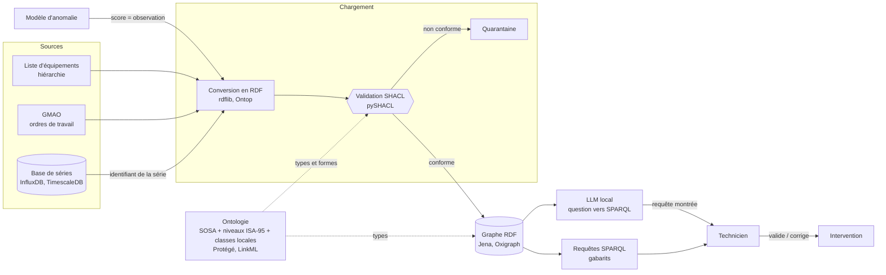

# Pattern — Graphe de connaissances industriel sur site

## Contexte

Les faits utiles à la maintenance vivent dans des systèmes qui s'ignorent : l'historien ou la base de séries (les mesures), la GMAO (les ordres de travail, les pannes passées), un tableur d'équipements, des fiches PDF. Un modèle de [[Pattern - Pipeline de maintenance prédictive on-prem|détection d'anomalies]] rend un score ; personne ne sait ensuite dire en une requête « quelles pompes de la ligne 2 ont eu une alarme de vibration, et quel ordre de travail a suivi ? ».

Ce pattern ajoute à la chaîne de mesures un **graphe de connaissances** : des choses (machines, capteurs, alertes, interventions) reliées par des relations dont le sens est écrit dans une [[Ontologie]]. Il ne remplace pas la base de séries : il la **décrit** et la relie au reste. Tout reste dans l'usine, sur des briques libres ou gratuites.

À appliquer quand trois conditions tiennent : au moins deux sources qu'il faut relier, des questions qui portent sur des **relations** (qui est où, qui mesure quoi, qui a réparé quoi), et quelqu'un qui tient le schéma dans la durée. Sinon, des tables dans [[Postgres]] suffisent (décision 8).

Le sujet est expliqué à partir de [[Graphe de connaissances]], l'entrée du dossier [[Ontologies et RDF]].

## Stack

| Étage | Brique | Quand la prendre |
|---|---|---|
| Écrire le schéma | [[Protégé]] | construire et tester l'ontologie à la main, avec un raisonneur intégré ; le fichier Turtle ou OWL reste la source, versionnée |
| Écrire le schéma | [[LinkML]] | un schéma YAML unique d'où sortent SHACL, OWL, Pydantic ou SQL : utile quand le même modèle sert le graphe **et** le code |
| Convertir | [[rdflib]] | un script Python qui lit la GMAO et écrit du RDF ; bibliothèque, pas serveur |
| Convertir | [[Ontop]] | les données sont **déjà** en tables SQL et doivent y rester : un graphe virtuel, interrogé en SPARQL |
| Raisonner en Python | [[Owlready2]] | charger l'ontologie comme des objets Python et raisonner avec HermiT ou Pellet (Java requis) ; licence LGPL-3.0 |
| Valider | [[pySHACL]] | valider un lot avant chargement, en ligne de commande ou en API |
| Stocker | [[Apache Jena]] | un seul projet pour serveur SPARQL (Fuseki), SHACL et raisonneurs partiels |
| Stocker | [[Oxigraph]] | le plus simple à installer, mono-nœud ; ni SHACL ni raisonnement annoncés (la validation se fait alors en amont) |
| Stocker | [[RDF4J]] | validation SHACL à chaque transaction, serveur dans un conteneur de servlets |
| Séries | [[InfluxDB]], [[TimescaleDB]] | les points restent là, le graphe garde un identifiant vers la série |
| Interroger en langage naturel | [[Ollama]] et un modèle local | les données ne quittent pas l'usine ; voir la décision 6 |

Le choix du moteur est dans [[Comparatif - Moteurs RDF]], celui des outils Python dans [[Comparatif - Outils RDF et OWL en Python]].

## Décisions clés

### 1. Le graphe décrit, la base de séries stocke

- Une usine de 5 000 capteurs à 1 Hz produit environ 4,3 × 10⁸ observations par jour ([[Ontologies industrielles]], rubrique « Les maths »). Aucun graphe RDF ne doit les contenir.
- Le graphe porte la **structure** (quelle machine, quel capteur, quelle propriété, quelle alerte, quelle intervention) et un identifiant qui renvoie vers la série dans [[InfluxDB]] ou [[TimescaleDB]].
- Conséquence : le graphe reste petit (des milliers à des millions de triplets), et la question du moteur devient simple.

### 2. Réutiliser avant d'écrire, et rester minimal

- Partir de **SOSA** pour l'observation, des **niveaux ISA-95** pour le lieu (entreprise, site, atelier, centre de travail, unité), et ne créer de classes locales que pour ce qui manque : le type de pompe, le mode de défaillance ([[Ontologies industrielles]], [[Données liées et vocabulaires partagés]]).
- Dix à vingt classes qui répondent à des questions réelles. Écrire d'abord **dix questions métier** ; si aucune ne porte sur une relation, ne pas faire de graphe.
- Aucune ontologie OWL normative d'ISA-95 n'a été trouvée : le chemin réaliste est le modèle d'information OPC UA (OPC 10030) lu par [[asyncua]], ou un petit schéma maison qui reprend les niveaux.
- La coque d'administration d'actif (AAS) sert à **échanger** la fiche d'un équipement avec un fournisseur ; la correspondance vers le graphe est à construire, pas livrée.

### 3. Une prédiction est une observation

- Le modèle de [[Time series anomaly detection]] est un `Sensor` au sens de SOSA (un logiciel qui applique une procédure) ; la propriété observée est « score d'anomalie », la chose observée est la machine.
- Le même graphe porte alors la mesure et ce qu'on en a conclu, et une requête relie l'alerte à l'ordre de travail qui a suivi. Seuls les **événements** d'alerte entrent dans le graphe, pas chaque score : les scores restent dans la base de séries ([[Pattern - Pipeline de maintenance prédictive on-prem]], décision 4).
- Les notions de cadrage sont [[Maintenance prédictive et RUL]] et [[Jumeau numérique et modèles hybrides]].

### 4. Valider à l'entrée, déduire peu

- [[SHACL]] vérifie en **monde fermé** : toute observation a une propriété, une unité, un instant ; tout équipement a un identifiant. [[pySHACL]] valide le lot avant le chargement ; ce qui échoue part en quarantaine, pas dans le graphe.
- [[OWL et raisonnement]] raisonne en **monde ouvert** : s'en tenir aux déductions qui comptent (une pompe centrifuge est une pompe, donc un équipement ; « est dans » est transitif), dans un profil (EL, QL ou RL) pour garder un temps prévisible. Les confondre est l'erreur la plus fréquente.
- Pour deux ou trois déductions, une requête SPARQL `CONSTRUCT` ou du SQL est plus simple à tenir qu'une ontologie complète.
- Le moteur choisi peut valider **à la transaction** ([[Apache Jena]], [[RDF4J]]) ; sinon la validation reste dans le chargement.

### 5. Interroger par gabarits d'abord

- [[SPARQL]] avec des **requêtes paramétrées** pour les questions récurrentes : « machines d'un atelier » (chemin de propriétés `ex:dans+`), « alertes d'un équipement depuis une date », « interventions suivant une alerte ». Seules les valeurs varient.
- Un moteur RDF s'interroge par HTTP : un script ou un tableau de bord n'ont besoin d'aucun pilote spécifique.
- Piège classique : un motif sans variable partagée donne un produit cartésien ; sous le monde ouvert, l'absence d'un triplet ne prouve pas que le fait est faux.

### 6. Le langage naturel vient après, en lecture seule

- Un LLM écrit la requête SPARQL, le moteur l'exécute, la requête est **montrée** avec la réponse ([[Interroger un graphe en langage naturel]]). Il reçoit le schéma (l'ontologie), quelques paires question / requête du même graphe, et la liste des identifiants : sans elle, il invente un identifiant plausible ([[Liage d'entités]]).
- Les mesures publiées sont sévères : environ 45 % d'exactitude d'exécution pour les meilleurs systèmes sur Spider4SPARQL, et des scores pouvant être gonflés par la mémorisation des benchmarks. **Tester sur ses propres questions** avant toute promesse.
- Garde-fous : compte sans droit d'écriture, durée et nombre de lignes plafonnés, clauses autorisées par liste. Modèle servi en local ([[Ollama]], cf. [[Pattern - Agent sur LLM auto-hébergé]]) quand les données sont sensibles.
- Quand la question est « synthétiser » plutôt que « lister », l'autre voie est [[GraphRAG]] ; elle se combine avec le graphe dans [[Pattern - RAG structuré graphe + human-in-the-loop]].

### 7. Un humain décide avant toute action

- Le graphe aide à **comprendre** ; il ne déclenche pas une intervention. Un diagnostic produit par une requête ou par un LLM est présenté avec sa requête et ses sources, et le technicien valide ou corrige ([[Human-in-the-loop]]).
- Une alerte nomme une machine, un indicateur et un horizon ([[Score et seuil d'alerte]]).

### 8. Choisir le moteur sans promettre ce qu'il ne fait pas

- Données déjà en tables et qui doivent y rester : [[Ontop]], graphe virtuel, rien à charger.
- Raisonnement et SHACL dans le moteur, dans un seul projet : [[Apache Jena]] ou [[RDF4J]], mono-nœud.
- Simplicité d'installation : [[Oxigraph]], en acceptant de valider en amont. Très grand graphe sur une machine : [[QLever]] (probablement inutile ici, voir la décision 1).
- Graphe de propriétés plutôt que RDF : possible et plus direct à parcourir, mais sans les normes de validation, de raisonnement et d'échange ([[Bases graphe — modèles et langages de requête]], [[Neo4j]]) ; [[neosemantics]] relie les deux mondes dans Neo4j.
- Ne pas faire de graphe du tout : peu de relations, une seule source, aucune question de parcours. [[Postgres]] avec la hiérarchie d'équipements en tables suffit alors.

### 9. L'apprentissage sur le graphe vient en dernier

- [[PyKEEN]] entraîne des plongements de graphe pour proposer des liens manquants ([[Plongements de graphe et prédiction de liens]]). C'est un plus, pas un socle : les résultats agrégés peuvent surestimer la performance, comme le note la notion (Rossi et al., 2021). À reprendre une fois le graphe propre et validé.

## Pièges

- **Les séries brutes dans le graphe** : le volume le rend inutilisable. Le graphe garde l'identifiant, la base de séries garde les points.
- **Une ontologie trop ambitieuse** : deux cents classes jamais finies. Vingt classes qui servent valent mieux.
- **Prendre un protocole pour un modèle sémantique** : MQTT et OPC UA transportent la valeur, ils ne disent pas ce qu'elle signifie.
- **Croire qu'une ontologie remplace la qualité de la donnée** : sans validation SHACL à l'entrée, doublons et relations incohérentes s'accumulent.
- **Licences lues trop vite** : [[Virtuoso Open Source]] est en GPL v2 seule, avec cluster et réplication réservés à l'édition commerciale ; [[Fluree]] est en BUSL-1.1, pas une licence libre ; la licence d'IOF Core n'a pas été vérifiée à la source. À relire avant de promettre quoi que ce soit à un client.
- **Raisonneurs OWL incomplets** : la documentation de [[Apache Jena]] le dit de ses raisonneurs ; ne pas bâtir une règle métier sur une déduction non testée.
- **Standards qui bougent** : les versions de la spécification AAS se succèdent, et RDF 1.2 n'était encore qu'en *Candidate Recommendation* au 2026-04-07 ([[Bases graphe — modèles et langages de requête]]). Dater chaque choix.
- **Requête valide qui répond à une autre question** : le LLM rend un tableau net, l'erreur ne se voit pas. Montrer la requête et un échantillon de lignes.
- **Un graphe sans propriétaire** : le schéma dérive dès que personne n'en répond, comme la politique de maintenance qui n'a pas de destinataire ([[Politique de maintenance et coût]]).

## Voir aussi

- Concepts : [[Graphe de connaissances]], [[Ontologie]], [[RDF et triplets]], [[SPARQL]], [[OWL et raisonnement]], [[SHACL]], [[Données liées et vocabulaires partagés]], [[Ontologies industrielles]], [[Plongements de graphe et prédiction de liens]], [[Liage d'entités]], [[Interroger un graphe en langage naturel]]
- Outils : [[Apache Jena]], [[Oxigraph]], [[RDF4J]], [[QLever]], [[Ontop]], [[rdflib]], [[pySHACL]], [[Protégé]], [[LinkML]], [[Owlready2]], [[PyKEEN]], [[Virtuoso Open Source]], [[Fluree]], [[neosemantics]]
- Comparatifs : [[Comparatif - Moteurs RDF]], [[Comparatif - Outils RDF et OWL en Python]], [[Comparatif - Bases graphes]]
- Patterns : [[Pattern - Pipeline de maintenance prédictive on-prem]], [[Pattern - RAG structuré graphe + human-in-the-loop]], [[Pattern - Agent sur LLM auto-hébergé]], [[Pattern - Détection d'anomalies en deux étages]]
- Hub : [[Ontologies et RDF]]
