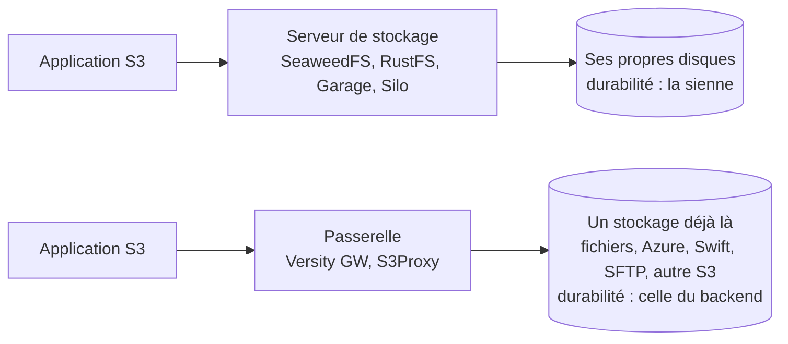

# Comparatif - Stockage objet

> On tranche sur : l'état du projet et sa licence d'abord — c'est ce qui a bougé en 2025 et 2026 —, puis l'étendue réelle de l'API S3 (versioning, Object Lock, écritures conditionnelles), le mécanisme de durabilité (erasure coding ou réplication), l'échelle qu'il faut pour commencer, et le public visé (petit cluster, analytique, datacenter).

![[Comparatif - Stockage objet.base]]

## En tête : SeaweedFS, RustFS, Garage

Les trois serveurs que floSa suit de près depuis l'arrêt de [[MinIO]], dans l'ordre où le brain les recommande aujourd'hui.

- [[SeaweedFS]] — Apache 2.0, le plus de recul, la couverture S3 la plus large des trois (versioning, Object Lock, écritures conditionnelles, chiffrement côté serveur), une interface d'administration web, un pari d'architecture sur les milliards de petits fichiers. Un auteur signe 75 % des commits des six derniers mois.
- [[RustFS]] — Apache 2.0, le plus proche des habitudes MinIO (console intégrée, Object Lock, réplication), version stable depuis le 2026-09-16 seulement et 43 avis de sécurité publiés depuis décembre 2025, dont huit sur la version stable.
- [[Garage]] — AGPL-3.0, pour un petit cluster réparti sur du matériel modeste : réplication par zone, sans erasure coding, sans versioning, sans Object Lock, et sans console intégrée à ce jour.

## Les trois familles, et l'état au 2026-10-30

Une **passerelle** n'a pas de stockage propre : elle traduit l'API S3 vers un stockage qui existe déjà. Elle ne se compare pas aux serveurs.

Mesures du **2026-10-30**, à la source (API GitHub, fichier `LICENSE` du dépôt, README, documentation). *Auteurs* : auteurs distincts d'au moins un commit sur les six mois du 2026-04-30 au 2026-10-30, robots exclus, identités regroupées par compte GitHub ; entre parenthèses, la part du premier auteur. Étoiles : celles du dépôt GitHub, miroir compris. Les parts très élevées sont dites en clair : un seul auteur signe presque tout.

### Serveurs de stockage

| Brique | Étoiles | Licence | Console web | Version (date) | Auteurs sur 6 mois (part du premier) |
|---|---|---|---|---|---|
| [[SeaweedFS]] | 35,8 k | Apache-2.0 | oui, Admin UI (`weed admin`) ; OIDC réservé à l'offre Enterprise | 4.51 (2026-10-25) | 143 (75 %) |
| [[RustFS]] | 35,6 k | Apache-2.0 | oui, intégrée, port 9001 | 1.0.4 (2026-10-25) | 90 (49 % ; les deux premiers 73 %) |
| [[Garage]] | 4,8 k (miroir ; dépôt principal chez Deuxfleurs) | AGPL-3.0 | aucune intégrée ; interface officielle `garage-webadmin` en test (0.2.0, 2026-10-25) ; tierce : `garage-webui` | 2.5.0 (2026-10-24) | 27 (37 %) |
| [[Silo]] | 4,4 k | AGPL-3.0 | oui, console MinIO v2.5.1 | RELEASE.2026-10-26 | 15 (94 %) |
| [[Ceph]] | 17,2 k | LGPL-2.1 ou 3.0 (double ; quelques fichiers sous d'autres licences) | oui, Dashboard de ceph-mgr | 20.2.4 Tentacle (2026-08-18) | 250 (8 %) |
| [[Apache Ozone]] | 1,3 k | Apache-2.0 | supervision seulement : Recon (interface web de suivi du cluster) | 2.2.2 (2026-10-30) | 93 (12 %) |
| [[OpenStack Swift]] | 2,8 k (miroir ; code chez opendev) | Apache-2.0 | aucune propre ; le tableau de bord Horizon d'OpenStack gère conteneurs et objets | 2.38.3 (2026-10-21) | 17 (25 % ; robot Zuul exclu) |
| [[MinIO]] (repère) | 61,3 k | AGPL-3.0 | retirée de l'édition libre en 2025 | dépôt archivé ; dernière release 2025-10-16 | — |

### Passerelles

| Brique | Étoiles | Licence | Console web | Version (date) | Auteurs sur 6 mois (part du premier) |
|---|---|---|---|---|---|
| [[Versity GW]] | 3,1 k | Apache-2.0 | oui, WebGUI optionnelle | v1.10.0 (2026-10-22) | 45 (54 %) |
| [[S3Proxy]] | 2,4 k | Apache-2.0 | aucune | 4.1.1 (2026-09-10) | 7 (99 %) |

### Services managés

| Brique | Licence | Console web | Remarque |
|---|---|---|---|
| [[AWS S3]] | propriétaire, service payant | console AWS | la référence de l'API |
| [[Cloudflare R2]] | propriétaire, service payant | tableau de bord Cloudflare | sans frais d'egress |

Notes de lecture. **Ceph** : GitHub ne reconnaît pas de licence unique, le README du dépôt écrit « la plupart du code est sous double licence LGPL 2.1 ou 3.0 » ; la page des versions de la documentation annonce aussi Umbrella 21.2.0 au 2026-10-28, mais le dépôt n'en porte pas encore l'étiquette. **Garage** : mesuré sur le dépôt principal (branche `main-v2`), deux adresses de la même personne regroupées à la main ; le miroir GitHub en donne 30 (31 %). **Ozone** : la page de documentation de Recon porte encore la mention « TODO », la fonction existe d'après la page d'accueil de la section. **Swift** : plus de 40 % des commits des six mois viennent du robot d'intégration Zuul, hors du compte.

## Ce qui départage

**Les références managées** ne sont pas départagées sur l'on-prem : elles fixent ce que l'API doit savoir faire et ce qu'elle coûte.

- [[AWS S3]] — la **référence de l'API** que tous les autres réimplémentent : versioning, Object Lock, cycle de vie, notifications, lecture après écriture forte depuis 2020. Service managé propriétaire, dont l'**egress** est le poste qui surprend. Les nouveautés récentes (S3 Files, S3 Tables, Express One Zone) sont propres à AWS.
- [[Cloudflare R2]] — la référence managée **sans frais d'egress**. Sa page de compatibilité déclare elle-même l'absence de versioning et d'Object Lock S3, remplacé par des « bucket locks » propriétaires.

**Les serveurs auto-hébergés** se départagent ainsi.

- [[SeaweedFS]] — **Apache 2.0**, une couverture S3 large (versioning, Object Lock, écritures conditionnelles, SSE) et un pari d'architecture sur les **petits fichiers** et les milliards d'objets. Erasure coding seulement sur les volumes passés en lecture seule ; ni notifications de bucket, ni réplication S3 native. Plusieurs composants à exploiter (master, volume, filer, S3) et un metadata store à choisir. Porté à 75 % par un seul auteur sur six mois.
- [[RustFS]] — le **successeur visé de MinIO**, en **Apache 2.0** : versioning, Object Lock, réplication et console dans l'édition libre. Mais la version stable date du 2026-09-16 et **43 avis de sécurité** ont été publiés depuis décembre 2025, dont huit le 2026-10-18 sur la version stable (contournement de l'Object Lock en COMPLIANCE, contournement des politiques par WebDAV, FTP et SFTP) : **pas encore éprouvé**, à réserver à un pilote tant que des retours indépendants manquent.
- [[Garage]] — le choix du **petit cluster géo-distribué** sur matériel modeste (1 Go de RAM suffisent) : réplication en facteur 3 par zone, lecture après écriture par quorum, sans consensus. **AGPL-3.0**, et un S3 volontairement restreint — **ni versioning ni Object Lock**, donc pas de WORM — sans erasure coding, et sans console intégrée : l'interface officielle est en test, la seule utilisable aujourd'hui est celle d'un tiers.
- [[Silo]] — le **fork communautaire de MinIO** (AGPL-3.0, console web, binaires et images) qui garde une installation MinIO existante à jour. Un seul auteur signe 94 % des commits : un **pont de migration**, pas un choix pour une nouvelle installation. L'AGPL permet à quiconque de le reprendre.
- [[MinIO]] — le serveur S3 auto-hébergé qui a servi de référence, aujourd'hui **abandonné** : dépôt archivé en avril 2026, plus de release depuis octobre 2025, images retirées de Docker Hub en septembre 2026, **AGPLv3**, et une suite commerciale propriétaire (AIStor, dont l'édition gratuite est mononœud). À ne plus choisir ; il reste à connaître parce qu'une base installée existe, et parce que son arrêt est la raison de ce comparatif.
- [[Ceph]] — le **socle unifié** objet, bloc et fichier, en **LGPL**, avec une couverture S3 documentée large (versioning, cycle de vie, politiques, notifications, Object Lock). Le prix est l'exploitation : trois moniteurs, 4 Gio de RAM par OSD, un réseau rapide, une équipe dédiée. Justifié quand le cluster sert aussi du bloc ou du fichier. Le plus large vivier de contributeurs du tableau (250 auteurs, 8 % pour le premier).
- [[Apache Ozone]] — l'**analytique sur site à très grande échelle** : espace de noms à milliards d'objets, cohérence forte par Raft, accès par S3 et par le système de fichiers Hadoop. Le dimensionnement officiel (3 OM, 3 SCM, au moins 10 Datanodes pour RS-6-3) et un S3 sans versioning, Object Lock ni requêtes conditionnelles le réservent à ce public.
- [[OpenStack Swift]] — la brique **historique** : pertinent dans un cloud privé OpenStack existant ou pour son API native. Cohérence à terme, middleware S3 sans cycle de vie ni étiquettes, pas de console propre, et un principal exploitant public (OVHcloud) qui a arrêté de le faire évoluer au profit du S3 natif.

**Les passerelles** ne se comparent pas aux serveurs : elles se posent devant un stockage existant.

- [[Versity GW]] — la passerelle pour des **données déjà dans un système de fichiers** (NAS, système de fichiers partagé, ScoutFS) : les mêmes fichiers restent lisibles en POSIX et en S3. Sans état, WebGUI optionnelle, S3 sur RDMA ; un éditeur derrière le projet et 45 auteurs sur six mois.
- [[S3Proxy]] — la passerelle pour **traduire S3 vers Azure, Google Cloud, Swift ou SFTP**, ou pour un S3 de test sur un dossier local. Aucune console, et un seul auteur pour 99 % des commits.

**Cités sans fiche.** Zenko CloudServer (Apache-2.0, implémentation Node.js de l'API S3 qui stocke chez Azure, Google ou en local), JuiceFS (Apache-2.0, système de fichiers POSIX posé sur Redis et un stockage objet : il se pose sur les briques ci-dessus, il ne les remplace pas) et OpenMaxIO (fork de l'interface de MinIO seule, AGPL-3.0, dernier push le 2025-06-24 : pas une suite). Décision de ne pas créer de page.

## La lecture de floSa

- **SeaweedFS pour la production aujourd'hui** : le plus de recul, la couverture S3 la plus large, une licence sans copyleft.
- **RustFS pour remplacer MinIO sans changer ses habitudes**, mais **à réévaluer dans six mois** (avril 2027) : stable depuis le 2026-09-16, avis de sécurité encore nombreux.
- **Garage pour un petit cluster réparti** : sans versioning, sans Object Lock, sans console officielle intégrée.
- **Silo** seulement si une installation MinIO existe et doit rester à jour. **Une passerelle** seulement si le stockage existe déjà.

## Voir aussi

- [[Comparatifs]] — le hub qui réunit tous les comparatifs du brain, groupés par domaine.
- [[Stockage]] — le hub du dossier.
- [[Stockage objet et API S3]] — la notion : ce que l'API S3 fixe et ce qu'elle laisse à chaque implémentation.
