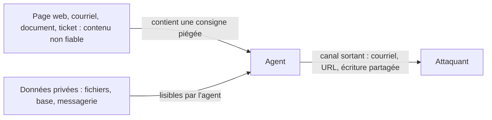

# Excessive agency et lethal trifecta

## Aperçu

- Deux grilles de lecture pour la même question : **que peut faire un agent s'il se trompe ou s'il est détourné ?** L'*excessive agency* (OWASP, LLM06) mesure le **pouvoir** donné à l'agent. La *lethal trifecta* (Simon Willison) repère le **trajet d'exfiltration** que trois capacités ouvrent quand elles se trouvent dans le même agent.
- Aucune des deux ne dépend d'un modèle fautif. Un agent parfaitement aligné qui lit une page piégée suit la consigne piégée : le modèle ne distingue pas fiablement une instruction d'une donnée.
- La parade tient en une phrase : **retirer du pouvoir ou retirer une patte**, plutôt que filtrer en espérant tout attraper. Voir [[Garde-fous hors modèle]] pour ce qui s'applique côté runtime.

## Concepts clés

### Excessive agency : trop de fonctions, de permissions, d'autonomie

OWASP (édition 2025, LLM06) distingue trois causes, chacune avec son exemple :

| Cause | Définition | Exemple d'OWASP |
|---|---|---|
| **Trop de fonctions** | l'agent dispose d'outils dont la tâche n'a pas besoin | une extension qui doit seulement *lire* des documents embarque aussi *modifier* et *supprimer* |
| **Trop de permissions** | l'outil agit sur les systèmes en aval avec plus de droits que nécessaire | une extension de lecture qui se connecte à la base avec une identité qui a aussi `UPDATE`, `INSERT` et `DELETE` |
| **Trop d'autonomie** | une action à fort impact part sans vérification ni approbation | une extension qui supprime des documents sans aucune confirmation de l'utilisateur |

Les mesures listées par OWASP vont dans le même sens :

- **Minimiser** les extensions, puis leurs fonctions, puis leurs permissions.
- **Éviter les outils ouverts** : « exécuter une commande shell » ou « récupérer une URL » laissent un champ d'action immense, là où un outil « écrire dans ce fichier » n'en laisse aucun.
- **Exécuter dans le contexte de l'utilisateur** : le droit d'agir est celui de la personne, pas celui d'un compte de service trop large.
- **Exiger l'approbation** des actions à fort impact ([[Human-in-the-loop]]).
- **Appliquer l'autorisation en aval**, pas dans le LLM : la médiation complète.

La journalisation et la limitation de débit ne préviennent rien : elles bornent seulement les dégâts.

### La lethal trifecta : trois capacités, un trajet d'exfiltration

Simon Willison (16 juin 2025) appelle ainsi la combinaison de trois capacités dans un même agent :

1. l'accès à des **données privées** (la raison d'être de la plupart des outils) ;
2. l'exposition à du **contenu non fiable** : tout mécanisme par lequel un texte (ou une image) contrôlé par un attaquant peut atteindre le modèle ;
3. la capacité de **communiquer vers l'extérieur** d'une façon qui permette de voler les données (envoyer un courriel, appeler une URL, écrire dans un document partagé, ouvrir un ticket).

*Les trois flèches réunies sur un même agent forment le trajet. Retirer l'une d'elles suffit à le couper.*

- **Aucune règle n'est violée** : l'agent lit ce qu'il a le droit de lire, écrit là où il a le droit d'écrire. C'est ce qui distingue la trifecta de l'agence excessive : elle peut exister avec des permissions étroites.
- **Ce que Willison conclut** : on ne sait pas empêcher cela de façon fiable côté modèle ; il se méfie des produits « garde-fous » qui annoncent bloquer 95 % des attaques, car en sécurité web 95 % est une note d'échec ; la parade est d'**éviter la combinaison** (« les éditeurs de modèles ne vont pas nous sauver »).
- Il recense des cas contre des produits en production (Microsoft 365 Copilot, le serveur MCP officiel de GitHub, GitLab Duo, entre autres), presque tous corrigés par le verrouillage du canal sortant.

### Ce que chaque notion voit que l'autre ne voit pas

| | Excessive agency | Lethal trifecta |
|---|---|---|
| Ce qu'elle mesure | l'écart entre le pouvoir donné et le pouvoir nécessaire | un trajet de fuite de bout en bout |
| Ce qu'elle suppose | rien : un bug ou une erreur suffit | un contenu non fiable qui atteint le modèle |
| Se corrige par | retirer fonctions, permissions, autonomie | retirer une des trois capacités |
| Reste vraie avec des permissions étroites ? | non, par définition | **oui** : trois droits modestes peuvent suffire |

## Les maths, simplement

- Une trifecta est une **conjonction** : le risque d'exfiltration est nul dès qu'une des trois capacités est absente. Là où un filtre probabiliste réduit un risque sans l'annuler, retirer une patte le supprime pour ce trajet.
- Un inventaire simple : pour chaque agent, trois cases à cocher (données privées ? contenu non fiable ? canal sortant ?). Trois cases cochées = trajet ouvert, quelle que soit la qualité du modèle.
- Exemple chiffré : un assistant qui lit la messagerie d'un employé (privé), résume les courriels reçus (non fiable) et peut répondre à un destinataire quelconque (sortant) coche les trois. Le même assistant limité à un brouillon que l'humain relit avant envoi n'a plus de canal sortant autonome.

## En pratique

- **Auditer avant de déployer** : lister les outils de l'agent, puis cocher les trois capacités. Penser aux canaux sortants discrets : appels d'URL (les paramètres portent les données), rendu d'images distantes, écriture dans un espace partagé, serveurs MCP tiers.
- **Couper la patte la moins chère** : souvent le canal sortant (liste blanche de domaines au niveau du bac à sable, voir [[Isolation par politique déclarative]]), parfois l'entrée non fiable (ne pas lire les courriels externes), plus rarement les données privées.
- **Séparer en deux agents** : un agent qui lit le contenu non fiable sans accès aux données ni à l'extérieur, un autre qui agit sans lire de contenu non fiable. Dans la même direction, l'article de Beurer-Kellner et al. (arXiv 2506.08837, juin 2025) catalogue des patrons de conception à résistance prouvée avec leurs compromis, et CaMeL (arXiv 2503.18813) sépare mécaniquement le flux de contrôle du flux de données.
- **Préférer les outils étroits** : un outil « ajouter une ligne à ce tableau » plutôt que « exécuter du SQL » ou « écrire n'importe où ».
- **Ne pas confondre avec l'injection** : [[Prompt injection]] est la cause (une consigne piégée entre dans le contexte) ; la trifecta est la combinaison qui la rend dangereuse ; l'agence excessive est l'ampleur des dégâts possibles.

## Approches voisines & alternatives

- [[Prompt injection]] — l'attaque qui exploite ces deux défauts ; la page cite déjà LLM06 comme l'extension du risque aux outils.
- [[AI security]] — le panorama OWASP : LLM01 (injection) et LLM06 (agence excessive) y côtoient les autres risques.
- [[Garde-fous hors modèle]] — les couches (isolation, autorisation, approbation, hooks) qui bornent le pouvoir ; aucune ne corrige un trajet autorisé.
- [[Isolation par politique déclarative]] — la liste blanche réseau et les credentials substitués, deux moyens de couper le canal sortant.
- [[Human-in-the-loop]] — l'approbation des actions à fort impact, remède à l'autonomie excessive.
- [[Guardrails]] — des filtres, probabilistes : utiles, mais pas une parade à la trifecta.
- [[Sandboxing de code généré]] — contenir les dégâts d'une exécution, pas empêcher la fuite par un canal autorisé.
- [[Reliability patterns]] — l'idempotence et les plafonds, côté fiabilité des effets de bord.
- [[mcp-protocol]] — chaque serveur MCP branché ajoute des outils, donc des fonctions, des permissions et parfois un canal sortant.

## Pour aller plus loin

- OWASP, *LLM06:2025 Excessive Agency* : https://genai.owasp.org/llmrisk/llm062025-excessive-agency/ — lue le 2026-10-20 ; les trois causes et les mesures citées ci-dessus viennent de cette page.
- Simon Willison, « The lethal trifecta for AI agents: private data, untrusted content, and external communication », 16 juin 2025 : https://simonwillison.net/2025/Jun/16/the-lethal-trifecta/ — lue le 2026-10-20.
- Beurer-Kellner et al., *Design Patterns for Securing LLM Agents against Prompt Injections*, arXiv 2506.08837 : https://arxiv.org/abs/2506.08837 — catalogue de patrons avec leurs compromis entre utilité et sécurité.
- Debenedetti et al., *Defeating Prompt Injections by Design* (CaMeL), arXiv 2503.18813 : https://arxiv.org/abs/2503.18813 — 77 % des tâches d'AgentDojo avec sécurité prouvée, contre 84 % sans protection.
- Source de cette page : documents de formation de floSa d'après les courts de Benoit Ferrere sur la sécurité des agents (2026-10-01 et 2026-10-04), recoupés avec les sources ci-dessus ; la carte « Prompt injection » du court « L'erreur que tu fais sur la sécurité de tes Agents IA » (https://www.youtube.com/watch?v=K3Sm2J4fdfI) à 0 min 46.
