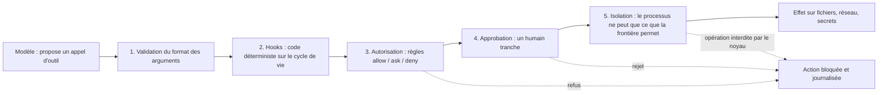

# Garde-fous hors modèle

## Aperçu

- Une règle **appliquée par le runtime** (le noyau, un proxy, le code qui exécute l'outil) tient même si le modèle se trompe ou se fait manipuler. Une règle **écrite dans le prompt** n'a que la fiabilité d'un modèle probabiliste : elle tient souvent, pas toujours.
- Le modèle **propose** une action, une couche qu'il ne contrôle pas **dispose**. La question utile n'est pas « mon agent connaît-il les règles ? » mais « s'il ne les respecte pas, le système l'empêche-t-il quand même d'agir ? ».
- Quatre mécanismes portent ce nom et ne se valent pas : **isolation**, **autorisation**, **approbation**, **hooks**. Les confondre en un seul bloc « garde-fous » est l'erreur la plus courante : chacun couvre une chose, et en laisse une autre à découvert.

## Concepts clés

### Le principe : la médiation complète

- Le principe vient de la sécurité des systèmes, pas de l'IA. Chaque accès à une ressource passe par un composant **indépendant de celui qui le demande**. OWASP l'écrit pour les agents (LLM06, édition 2025) : appliquer l'autorisation dans les systèmes en aval, plutôt que de laisser le LLM décider si une action est permise (*complete mediation*).
- Même constat chez l'éditeur d'OpenShell : un agent « ne peut pas être censé gouverner pleinement son propre comportement ». La formulation d'origine est plus nuancée que ses résumés (« dans ces circonstances », « pleinement »).
- Ce que le modèle garde : raisonner, choisir ses outils, formuler l'action. Ce qu'il perd : le dernier mot sur son exécution.

*L'ordre de traversée est une lecture, pas un standard : les outils du commerce n'empilent pas ces couches de la même façon.*

### Les quatre mécanismes, ce que chacun couvre et ne couvre pas

| Mécanisme | Répond à | Appliqué par | Couvre | Ne couvre pas |
|---|---|---|---|---|
| **Isolation** | Que **peut** faire ce processus ? | le noyau (Landlock, seccomp, espaces de noms), une microVM, un proxy réseau | tout ce qui passe par le processus confiné, quelle que soit la façon de l'appeler | ce que le processus a le **droit** de faire : une fuite par un canal autorisé ; les outils qui tournent hors de la frontière |
| **Autorisation** | Cet appel d'outil est-il **permis** ? | des règles (`allow`, `ask`, `deny`) évaluées avant l'exécution | des appels reconnus par leur forme : un outil, une commande, un domaine | une action équivalente écrite autrement ; une règle de refus n'est pas une isolation |
| **Approbation** | Un humain **valide-t-il** cette action ? | une interface, un message, un ticket | les actions rares, à fort enjeu, irréversibles | la fatigue : trop de demandes et l'humain approuve sans lire ([[Human-in-the-loop]]) |
| **Hooks** | Quel **code** s'exécute avant et après chaque étape ? | des scripts déterministes branchés sur le cycle de vie | une validation précise (un chemin, un montant), la journalisation, le blocage | un script qui tourne avec les droits du processus : il n'isole rien |

- **Valider un format n'est pas autoriser.** Un appel d'outil bien formé (arguments conformes au schéma) peut rester interdit. PydanticAI le dit nettement : sa validation passe **avant** la demande d'approbation, et l'approbation n'est pas une frontière d'autorisation si un client peut soumettre son propre historique : la fonction d'outil garde ses propres contrôles.
- **Une règle de refus n'est pas un bac à sable.** La documentation de Claude Code le montre sur un cas simple : une règle qui refuse `curl` ne reconnaît pas le même programme appelé par son chemin complet ou dans un `sh -c`. Pour que la restriction tienne, elle double la règle par une liste blanche de domaines **au niveau du bac à sable**. Hermes Agent écrit la même mise en garde : ses règles de refus sont une politique sur des commandes, pas une isolation.
- **Une isolation ne couvre souvent qu'une partie des outils.** Le bac à sable de Claude Code ne couvre que les commandes du shell ; ses outils de fichiers, ses serveurs MCP et ses hooks tournent hors de lui, et il n'existe pas sous Windows natif. Celui de DeepSeek Harness ne gouverne que les effets sur les fichiers, ni le réseau ni la visibilité des processus. Lire la documentation de la frontière avant de s'y fier : voir [[Isolation par politique déclarative]].
- **Les hooks ne contournent pas les refus.** Dans Claude Code, un hook qui répond « autorise » ne lève pas une règle `deny` : les règles de refus sont évaluées quoi que le hook renvoie. Les hooks sont une couche de plus, pas un moyen d'en ouvrir une autre.

### Ce qui reste à découvert

- **Une autorisation trop large.** La couche applique la politique qu'on lui donne, pas celle qu'on aurait dû lui donner. C'est la deuxième cause d'[[Excessive agency et lethal trifecta|agence excessive]].
- **La fuite par un outil autorisé.** Un agent qui lit des données privées, lit du contenu non fiable et écrit vers un domaine autorisé réunit la « lethal trifecta » sans violer aucune règle. Aucune des quatre couches n'y change rien : seul le retrait d'une des trois capacités le fait.
- **L'erreur de jugement.** Un agent qui respecte toutes les contraintes techniques peut encore prendre une mauvaise décision. La surveillance voit les violations de règles, pas l'assurance mal placée.
- **La couche est du logiciel.** Elle déplace la confiance vers le contrôleur, elle ne la supprime pas : OpenShell a connu sa propre évasion de bac à sable (voir [[OpenShell]]).

## Les maths, simplement

- Un filtre qui bloque une proportion $p$ des attaques, face à un attaquant qui **réessaie** $n$ fois de façon indépendante, en laisse passer au moins une avec la probabilité $1 - p^{n}$.
- Pour $p = 0{,}95$ : $n = 20$ donne $1 - 0{,}95^{20} \approx 64\ \%$, et $n = 100$ donne $\approx 99{,}4\ \%$. L'hypothèse d'indépendance est généreuse : un attaquant qui adapte sa méthode au filtre fait mieux.
- Un contrôle **déterministe** (un chemin interdit par le noyau, un domaine absent de la liste) ne fonctionne pas par probabilité : il refuse, ou il est mal configuré. C'est la différence de nature, pas de degré.
- Simon Willison en tire la formule : en sécurité web, « 95 % » est une note d'échec. L'article « The Attacker Moves Second » (Nasr, Carlini et al., arXiv 2510.09023, octobre 2025) le mesure : douze défenses récentes contournées avec plus de 90 % de réussite pour la plupart, alors que la majorité annonçait un taux proche de zéro sur des attaques statiques.

## En pratique

- **Partir de ce qui doit être impossible**, pas de ce qui est improbable : un secret qui ne doit jamais sortir ne va pas dans un prompt « ne le révèle pas », il reste hors du processus (credentials substitués, voir [[Isolation par politique déclarative]]).
- **Empiler plutôt que choisir.** L'isolation borne les dégâts, l'autorisation filtre les appels reconnus, l'approbation tient les actions rares, les hooks vérifient ce que les règles ne savent pas exprimer. Aucune ne remplace les autres.
- **Une politique étroite d'abord.** Le gain d'une couche externe est réel face aux erreurs et aux injections ordinaires *si* la politique est étroite et en mode bloquant. Un mode « audit » qui journalise sans bloquer ne protège pas : vérifier le mode par défaut de chaque outil.
- **Sécurité par construction.** Le papier CaMeL (Debenedetti et al., Google, arXiv 2503.18813, mars 2025) sépare le flux de contrôle (issu de la requête de confiance) du flux de données (récupéré, non fiable) et applique des politiques à l'appel des outils. Résultat : 77 % des tâches d'AgentDojo résolues avec une sécurité prouvée, contre 84 % pour un système non protégé. La sécurité par construction coûte de l'utilité.
- **Aucune mesure indépendante** ne classe aujourd'hui les plateformes d'isolation d'agents entre elles. Se méfier d'un comparatif qui prétend le faire ; voir [[Comparatif - Isolation d'exécution d'un agent]].

## Approches voisines & alternatives

- [[Guardrails]] — la couche qui filtre ce qui entre et sort du modèle ; un garde-fou de sortie est lui-même un composant à faire tourner hors du modèle, sinon il hérite de ses défauts.
- [[Sandboxing de code généré]] — le degré d'isolation (conteneur, gVisor, microVM) ; la notion-ci place l'isolation parmi quatre mécanismes.
- [[Isolation par politique déclarative]] — l'isolation décrite par un fichier de politique que le noyau applique.
- [[Excessive agency et lethal trifecta]] — ce qu'aucune couche ne corrige : donner trop de pouvoir, ou réunir les trois capacités.
- [[Human-in-the-loop]] — l'approbation humaine, avec son coût de fatigue.
- [[Prompt injection]] — la menace qui motive tout cela : un contenu non fiable devient une instruction.
- [[AI security]] — le cadre OWASP et le panorama des risques.
- [[Reliability patterns]] — les garde-fous d'effets de bord (idempotence, plafonds) du côté de la fiabilité.
- [[Harnais d'agent]] — là où ces couches se branchent : le harnais exécute, le modèle propose.
- [[OpenShell]] · [[sandbox-runtime]] · [[NeMo Guardrails]] — trois mises en œuvre fichées, à des endroits différents de la chaîne.
- Alternative : **ne rien faire hors du modèle** et compter sur le prompt système. Acceptable pour un assistant sans outils ; insuffisant dès que l'agent peut écrire, envoyer ou supprimer.

## Pour aller plus loin

- OWASP, *Top 10 for LLM Applications 2025*, LLM06 *Excessive Agency* : https://genai.owasp.org/llmrisk/llm062025-excessive-agency/ — mesures : minimiser fonctions et permissions, éviter les outils ouverts, exiger l'approbation des actions à fort impact, appliquer l'autorisation en aval.
- Simon Willison, « The lethal trifecta for AI agents », 16 juin 2025 : https://simonwillison.net/2025/Jun/16/the-lethal-trifecta/
- Debenedetti et al., *Defeating Prompt Injections by Design*, arXiv 2503.18813 : https://arxiv.org/abs/2503.18813
- Beurer-Kellner et al., *Design Patterns for Securing LLM Agents against Prompt Injections*, arXiv 2506.08837 (10 juin 2025) : https://arxiv.org/abs/2506.08837
- Nasr et al., *The Attacker Moves Second*, arXiv 2510.09023 (10 octobre 2025) : https://arxiv.org/abs/2510.09023
- Documentation de Claude Code, *Configure permissions* et *Sandboxing* : https://code.claude.com/docs/en/permissions et https://code.claude.com/docs/en/sandboxing — relevée le 2026-10-20.
- Source de cette page : documents de formation de floSa d'après les courts de Benoit Ferrere (« L'erreur que tu fais sur la sécurité de tes Agents IA », 2 min 10, 2026-10-04, https://www.youtube.com/watch?v=K3Sm2J4fdfI ; « C'est quoi OpenShell de NVIDIA ? Les 3 mécanismes à comprendre », 2 min 37, 2026-10-01, https://www.youtube.com/watch?v=TUJgAfE6Wbg ; « C'est quoi un Harness ? Les 6 mécanismes à comprendre », 2 min 11, 2026-10-18, https://www.youtube.com/watch?v=MXcJGOf2S9M), recoupés avec les documentations citées. Schéma refait en Mermaid d'après les cartes de la vidéo à 1 min 19 (« OpenShell, règles externes ») et 1 min 38 (« Guardrails »).
