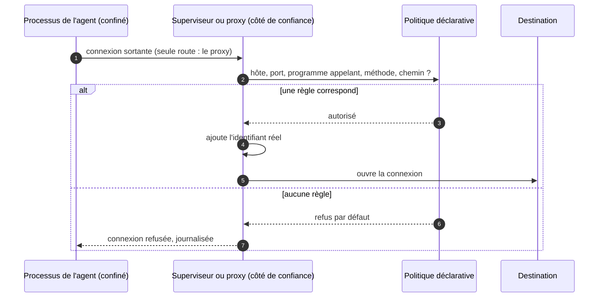

# Isolation par politique déclarative

## Aperçu

- Une isolation **déclarative** décrit dans un fichier ce que le processus de l'agent a le droit de toucher (chemins, appels système, destinations réseau, secrets), puis laisse le **noyau** et un **proxy** appliquer ce fichier. Tout le reste est refusé : *deny by default*.
- Elle répond à une autre question que le conteneur, gVisor ou la microVM. Ceux-là disent **quelle est la solidité du mur** (noyau partagé, noyau émulé, noyau dédié : voir [[Sandboxing de code généré]]). La politique dit **ce qui passe à travers le mur**.
- Quatre ingrédients reviennent chez les outils qui la pratiquent ([[OpenShell]], [[sandbox-runtime]]) : Landlock pour les fichiers, seccomp pour les appels système, un proxy réseau à politique, des identifiants que l'agent ne voit jamais.

## Concepts clés

### Landlock : le processus se restreint lui-même

- Landlock est un module de sécurité du noyau Linux qui permet à **n'importe quel processus, même sans privilège**, de restreindre ses propres accès (fichiers, et depuis l'ABI 4 certaines opérations TCP) pour lui et ses enfants. Il s'empile avec les contrôles du système.
- Un chemin non déclaré devient inaccessible. Les droits portent sur la lecture, l'écriture, la création, la suppression, la **troncature** (ABI 3, noyau 6.2) : écrire sans pouvoir tronquer laisse un trou, d'où l'exigence d'OpenShell de l'ABI 3 au minimum.
- **Il faut vérifier que Landlock est réellement actif** : le numéro de noyau ne prouve rien (une distribution peut l'avoir désactivé ou rétroporté). La documentation du noyau recommande une approche « au mieux » (utiliser le sous-ensemble disponible) ; une politique de sécurité préfère souvent l'inverse : **refuser de démarrer** si la protection ne peut pas s'appliquer.

### seccomp : filtrer les appels système

- Un filtre seccomp (un programme BPF) décide, appel système par appel système, ce que le processus peut demander au noyau. Il réduit la **surface** du noyau exposée au processus.
- Exemple d'OpenShell : blocage de `mount`, `ptrace`, `bpf`, `io_uring_setup`, `userfaultfd`, `perf_event_open`, `setns`, la création d'espaces de noms utilisateur, et seulement quelques familles de sockets autorisées ; le processus tourne sous une identité sans privilèges, sans capacités Linux.
- Landlock et seccomp sont **figés à la création** de l'environnement : changer les fichiers ou les processus autorisés impose de le recréer. Le réseau, lui, peut changer à chaud.

### Le proxy réseau à politique

- Le processus n'a **aucune route directe** : l'espace de noms réseau (ou le retrait de l'espace de noms) ne laisse que le proxy. Un programme qui ignore les variables d'environnement `HTTP_PROXY` n'arrive nulle part.
- La règle porte sur **l'hôte, le port et le programme** qui appelle, et, quand l'inspection de niveau applicatif est activée, sur la **méthode et le chemin** : un `GET` sur l'API d'un dépôt est permis, un `POST` refusé.
- **Piège du mode par défaut** : l'inspection de requêtes d'OpenShell est en mode `audit` par défaut, qui journalise sans bloquer ; l'agent peut encore écrire ou supprimer sur une API que la règle aurait refusée. Il faut passer en `enforce`. Un endpoint sans règle de requête laisse passer toute méthode et tout chemin.

### Les identifiants substitués

- L'agent ne manipule qu'une **valeur de substitution**. Le vrai secret est ajouté par le proxy, **hors du processus**, à la seule requête qui part vers la destination prévue.
- Conséquence : une injection de prompt qui fait lire à l'agent ses variables d'environnement ne lui livre qu'un jeton factice. C'est l'application directe de la règle « un secret qui ne doit pas sortir ne va pas dans le prompt, ni dans le processus ».
- Contrepartie : pour injecter, le proxy doit **lire** la requête, donc terminer le TLS avec une autorité propre au bac à sable. Un endpoint marqué `tls: skip` n'a ni substitution ni inspection.

### Différence avec conteneur, gVisor et microVM

| Sujet | Conteneur, gVisor, microVM | Politique déclarative |
|---|---|---|
| Question | quelle est la solidité de la frontière ? | que laisse-t-on traverser la frontière ? |
| Se règle par | le choix de la technologie d'isolation | un fichier de règles versionné |
| Se combine | oui : OpenShell s'exécute dans un conteneur Docker ou Podman, un pod Kubernetes ou une microVM | avec n'importe laquelle des trois |
| Laisse à découvert | un canal sortant ouvert, un secret monté | une règle trop large, un noyau sans Landlock, un mode `audit` |

## Les maths, simplement

- Une politique est un **ensemble autorisé** $A$ de triplets (programme, destination, méthode). Une action est permise si et seulement si elle appartient à $A$ ; le reste est refusé. Avec le *deny by default*, la surface d'attaque est **exactement** $A$, pas son complémentaire.
- Conséquence : chaque règle ajoutée **agrandit** la surface, d'où le conseil de départ d'OpenShell : commencer par une politique minimale, lire les refus dans le journal, n'ajouter que ce que la tâche exige.
- Exemple : une liste de 4 hôtes autorisés laisse 4 destinations, dont chacune, selon la documentation d'OpenShell, « est un chemin d'exfiltration possible » ; un caractère générique (`*.exemple.com`) en ouvre un nombre inconnu.

## En pratique

- **Écrire la politique comme du code** : un fichier YAML dans le dépôt, relu comme un changement de sécurité. OpenShell propose un conseiller où l'agent **propose** une règle réseau et un vérificateur formel compare ce que le bac à sable pourrait joindre avec et sans elle ; par défaut, un humain approuve. Proposer n'est pas s'autoriser.
- **Régler le mode avant de se croire protégé** : mode bloquant (`enforce`), exigence dure sur les chemins (`hard_requirement` plutôt que `best_effort`), conseiller activé seulement si l'on veut ce circuit.
- **Garder à l'esprit les angles morts** : une isolation de processus ne voit pas un outil qui tourne hors du processus confiné ; le bac à sable de `sandbox-runtime` ne couvre que les processus qu'il enveloppe.
- **Prérequis noyau** : Landlock demande Linux 6.2 ou plus pour l'ABI 3 ; sur macOS les modules noyau tournent dans la machine virtuelle de Docker Desktop, pas sur le noyau de l'hôte.
- **Aucune mesure indépendante** de la résistance d'un de ces outils à un attaquant qui s'adapte n'a été trouvée par le document de formation d'origine (recherche arrêtée au 2026-10-19), ni par la relecture de cette page : la politique vaut ce que vaut sa configuration.

## Approches voisines & alternatives

- [[Garde-fous hors modèle]] — la notion-mère : l'isolation en est l'un des quatre mécanismes.
- [[Sandboxing de code généré]] — la solidité du mur : conteneur, gVisor, microVM.
- [[Excessive agency et lethal trifecta]] — la liste blanche réseau coupe la patte « canal sortant ».
- [[Prompt injection]] — la menace que les identifiants substitués désamorcent en partie.
- [[Gestion des secrets]] — où vivent les vrais secrets avant que le proxy ne les injecte.
- [[Guardrails]] — filtrer ce qui entre et sort du modèle, un autre étage.
- [[Comparatif - Isolation d'exécution d'un agent]] — OpenShell, sandbox-runtime, E2B, Daytona et DeepSeek Harness, sans classement.
- Alternative : **un conteneur seul**, plus simple, sans politique réseau fine ni secrets masqués : un mécanisme de packaging, pas une frontière de sécurité pour du code hostile.

## Pour aller plus loin

- Documentation du noyau Linux, *Landlock: unprivileged access control* : https://docs.kernel.org/userspace-api/landlock.html — lue le 2026-10-20 ; versions d'ABI, troncature, réseau TCP.
- Documentation du noyau Linux, *Seccomp BPF* : https://docs.kernel.org/userspace-api/seccomp_filter.html — lue le 2026-10-20.
- Dépôt et documentation d'OpenShell, page *Security Best Practices* : https://github.com/NVIDIA/OpenShell (dossier `docs/security/`) — lue le 2026-10-20 sur la branche `main` ; couches, défauts et risques à relâcher.
- Dépôt de `sandbox-runtime` : https://github.com/anthropics/sandbox-runtime — modèle à double isolation (fichiers et réseau), lu le 2026-10-20.
- Source de cette page : document de formation de floSa d'après le court « C'est quoi OpenShell de NVIDIA ? Les 3 mécanismes à comprendre » de Benoit Ferrere (2 min 37, 2026-10-01, https://www.youtube.com/watch?v=TUJgAfE6Wbg). Schémas refaits en Mermaid d'après les cartes « Qui contrôle quoi ? » (0 min 26), « Le système refuse » (0 min 47), « Même API, droits différents » (1 min 20) et « La clé reste hors de l'agent » (1 min 37). Aucune image copiée.
